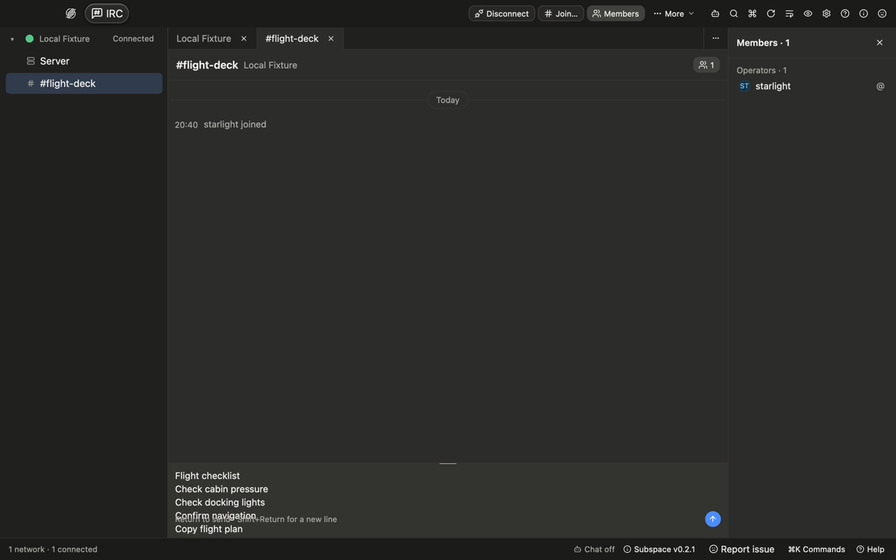
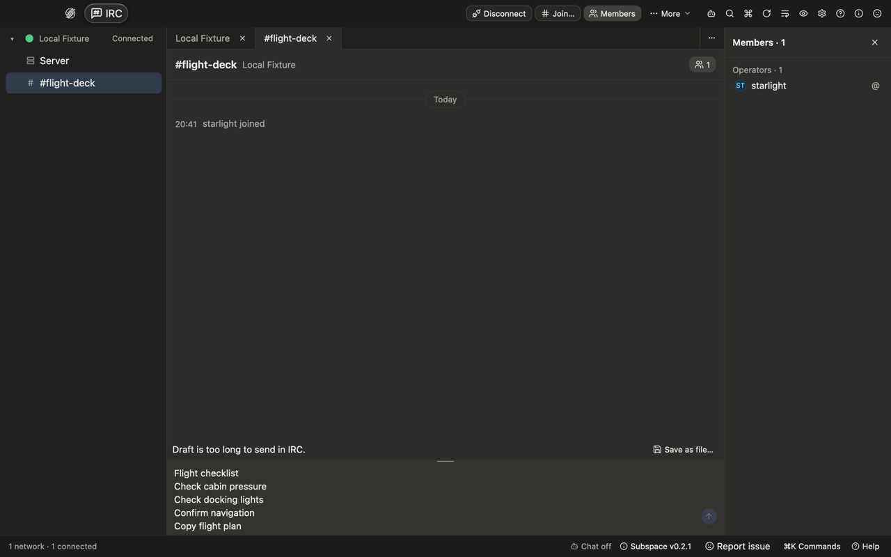

# Oversized IRC drafts

A 600-line Markdown paste queued hundreds of messages. The composer now
keeps drafts over 10 lines or 4,096 UTF-8 bytes editable and offers **Save as
file…**. Cancelling the file picker leaves the draft in place. Confirming it
saves the editor's UTF-8 text and also leaves the draft in place.

The IRC session applies the same limit before sending any network messages.
Within the limit, the negotiated IRCv3 batching and line splitting keep their
existing behaviour. The limit also applies to slash commands and agent tools.

The protocol tests exercise channel messages, private messages and slash
commands with and without multiline support. The board interaction test
pastes a 600-line Markdown document, tries to send it, cancels and then
confirms a save, and verifies that the short draft can still send.

Private upload and an agent's authenticated retrieval remain follow-up work.

## macOS evidence

The captures use Cupertino Dark with a fictional channel on a loopback Ergo
server. The before build is `ee8c856` from `origin/main`.

### Board checklist: IRC

Identity, layout and configuration

- [x] The registered IRC board, artwork, process lifetime and custom conversation layout use the existing integration.
- [x] The draft shows a visible length error and an accessible Save as file action. Return respects the draft limit and Shift+Return remains available for editing. The platform owns the file picker and cancellation. File errors appear in the composer.
- [x] Toolbar and palette commands, board keys and quit warnings are inapplicable to the local draft action.
- [x] The action uses the existing IRC settings and requires no service configuration or experiment flag.

Data and links

- [x] The user chooses a file location. Draft export needs no stored choices, framework store, refresh or indexing. File writes run off the UI thread.
- [x] The change uses the current composer without adding chat context, notifications, cross-board contracts or shared globals.
- [x] Save as file opens the system file picker. The error omits draft contents, and the existing IRC diagnostics still apply.

Agent tools, help and evidence

- [x] `irc_write` remains app-only and retains per-call approval. Its schema and the IRC developer guide document the revised validation.
- [x] The IRC help guide documents the draft limit and file action. Both guides remain in the documentation index.
- [x] The protocol and headless interaction tests passed on macOS with `make check`. `mise run quality` passed. The screenshots above show the fixture flow before and after.
