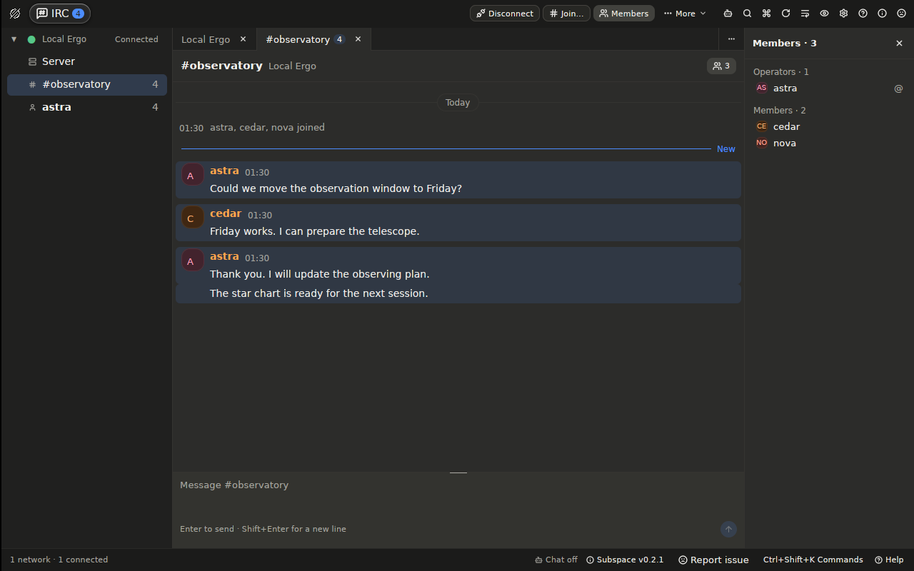
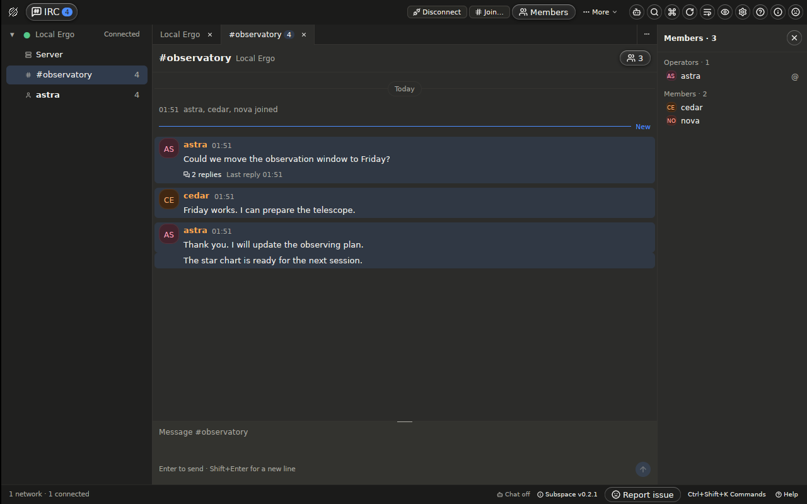
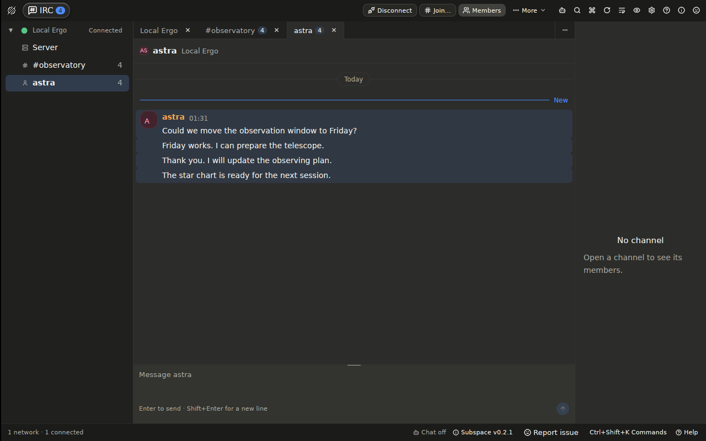
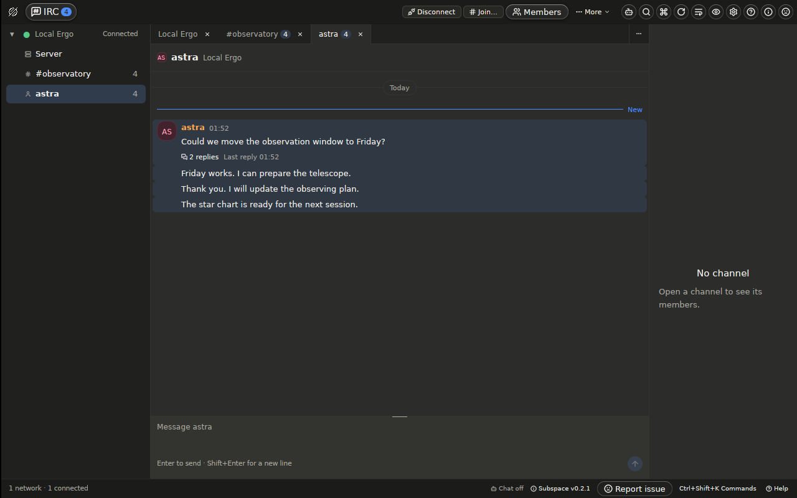
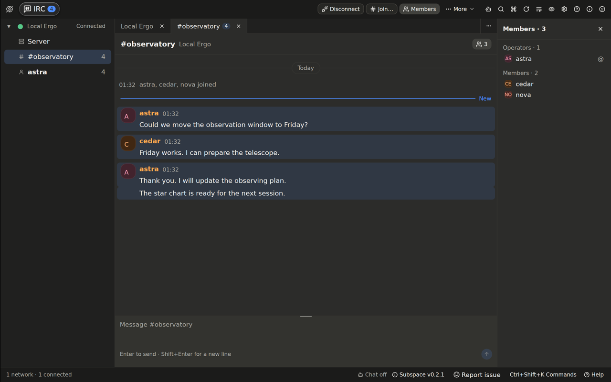
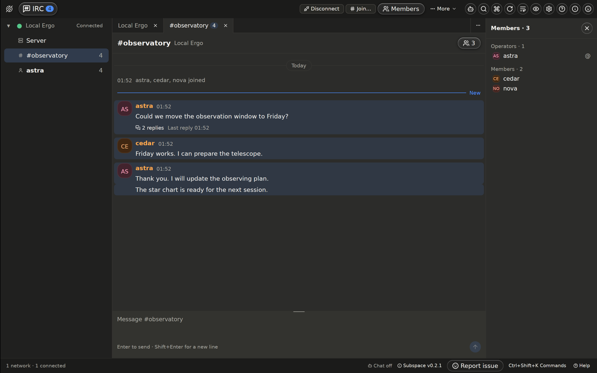
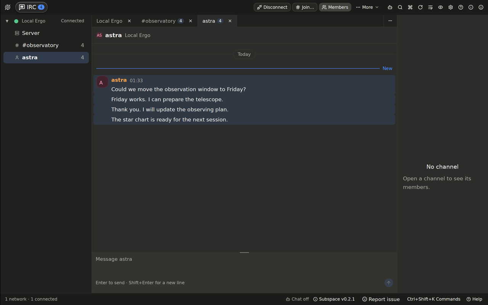
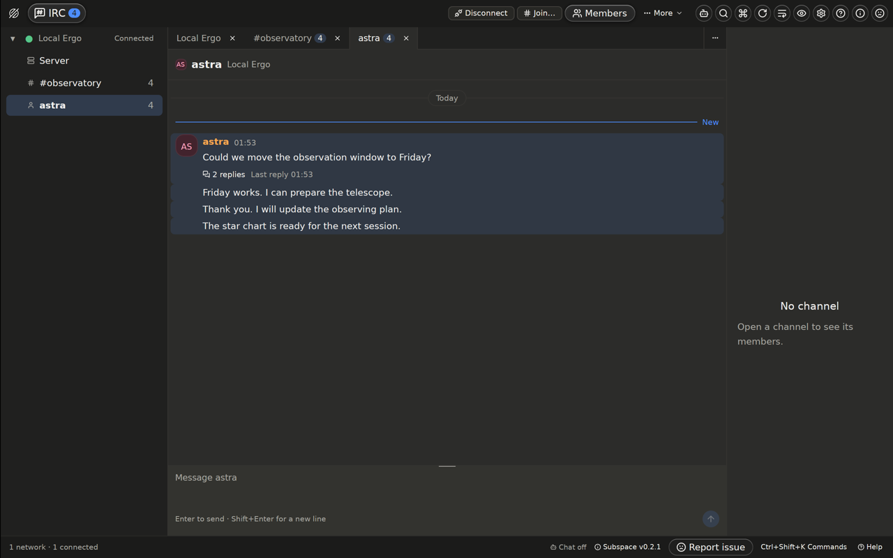

# IRC loaded reply counts (PR 2 of 3)

## Intent

Show how many loaded messages reply to a root, in channels and private
conversations, following the approved IRC threading design. This work builds
on the reply protocol foundation in subspace#43.

Hiding replies moved to PR 3 alongside the replies pane: hiding them earlier
would leave a build with no way to read them. This PR keeps every reply inline.

## Specification

- A root with at least one loaded reply shows a messages glyph, `1 reply`
  or `N replies`, and muted `Last reply HH:MM` below its text. It uses the
  same body alignment, caption size and theme tokens as the transcript.
- The metadata is a read-only accessible label. It has no click handler,
  keyboard shortcut, focus target or composer effect. It wraps in a narrow
  conversation. The existing transcript reference/focus model is unchanged.
- `ThreadRoots` builds the same parent index as PR 1 once per buffer. All
  replies share it; `Line::thread_root` uses that same implementation for
  single-message resolution. Cross-buffer links never resolve, missing
  ancestors retain their IDs, and cycles or empty references return no root.
- Resolved ancestors, including invalid chains, are cached within that
  snapshot. A 10,000-message nested chain visits each ancestor once, in either
  resolution order. ID-less replies also reuse those cached ancestors.
  Unindexed lines with IDs and duplicate-ID lines use PR 1's uncached
  traversal so they cannot poison the indexed relationships.
- Each conversation rebuilds and retains summaries when it synchronises with
  the hub. Every virtual row reads a shared summary map; none builds a parent
  map. Replies to replies count on the root. Latest time is the maximum reply
  time, independent of arrival order. A changed summary invalidates the root's
  cached virtual-row height, including when that row is offscreen, through
  Kit's `remeasure_items`. Surviving row identities and scroll anchors stay put.
- Missing roots get no count until they load. Removing loaded replies reduces
  the count; removing the root removes its metadata. Rebuilding from the
  stored raw relationships gives the same counts after restart.
- Counts describe only loaded history. Server lookup is a follow-up. Unread,
  notifications, agent tools, keys and the main composer retain their existing
  behaviour. There is no pane or reply action in this slice.

## Delivery and evidence

Tests were written first. The client test failed to compile because the
reusable `ThreadRoots` API did not exist; the two real-board render tests
failed because the root had no count element. They then passed with the
implementation. Additional pure tests cover cycles, empty references,
cross-buffer input, trimming, restored history, notice/action replies and
out-of-order times. The single-pass iterator test builds one parent index
and resolves many replies without rereading the loaded buffer. Render tests
check updating counts, late parents, channels and private conversations,
root-only metadata, inline reply rows, inert clicks and row containment.
The UI expectations use local time and pass with `TZ=America/New_York`.
A further regression test covers summary-driven virtual-row invalidation,
and a real-board test measures a root, scrolls it offscreen, loads its first
reply, checks that the reader's current row stays at the same position and
reveals the root again. That test first failed when height invalidation
replaced surviving rows; remeasurement preserves the anchor. The ID-less
regression test failed on the old
path (29.86 seconds for 5,000 anonymous replies to 5,000 ancestors); all
17 focused client reply tests now pass together in about 0.11 seconds.

`make check` and `mise run quality` pass on the integration rebase at
`7a9288c11792`. The live suites against local Ergo passed **114 client tests,
2 client integration tests and 277 board tests**, including the board's
agent-tool integration. Follow-ups bring the suites to 115 client unit tests
and 279 board tests; the required pre-push gates verify the final changes.
Final delivery rebases cleanly onto `8750fba` (the shared theme update), with
the after captures refreshed from that build before publication.
The refreshed quality baseline retains a 100% score and zero findings,
violations and function-length warnings; only the function total changes.

CodeRabbit's local pre-PR review reported zero findings. The independent
Codex review reported three P2 findings: repeated ancestor walks, UTC-only
test expectations and an oversized test. All were fixed with the cache,
local-time expectations and extracted layout assertions. No P0 or P1 was
reported. The final read-only review reported two further P2s: offscreen
height invalidation (already being fixed during the review) and ID-less
ancestor caching. Both are fixed and covered by targeted regression tests;
there are no unresolved review findings. That review also reported no P0/P1.

Evidence comes from the capture-enabled debug app on Linux, with an isolated
HOME and XDG paths, Cupertino Dark (theme unset), local Ergo 2.19.1 on
`127.0.0.1:16931`, and fictional `astra`, `cedar`, `nova`, `#observatory`.
Each run uses fresh local storage. Ergo assigns the real message IDs and
relays a direct reply and a reply to that reply. No deployed IRC service or
client certificate is used. Every fixture server and private display is
stopped after capture.

Before images use the PR 1 integration build at `253720b7bb7f`, the specified
baseline for this slice; a separate checkout or branch switch is not used.
Both before and after show all replies inline. The display sizes are
1280 × 800 at 1× and 2560 × 1600 at 2×; exported PNGs are 1280 × 800,
within the repository's 1600 px limit. Linux's capture build cannot render
windows directly to PNG, so ffmpeg reads only the private Xvfb display.

## Tasks

- [x] Read the IRC threading work's settled decisions, approvals and prototype reference.
- [x] Test first and implement shared loaded-history counts.
- [x] Keep all replies inline and counts noninteractive.
- [x] Complete full checks, local Ergo suites and evidence inspection.
- [x] Complete independent pre-PR reviews and prepare signed publication.
- [x] Prepare a ready PR against `feat/subspace-desktop`; leave merge to the captain.

### Board checklist: irc

Identity and registration
- [x] ID, title, description and icon: not applicable because identity is unchanged.
- [x] Product descriptor, registration and artwork: not applicable because no board is added.
- [x] Retain when disabled: not applicable because process ownership is unchanged.

Layout and UI
- [x] List hooks/custom layout: existing conversation dock and message scroller.
- [x] Toolbar, status, badge and busy: not applicable because counts are transcript metadata.
- [x] Palette commands: not applicable because no action is added.
- [x] Keys and help foot: not applicable because no key or focus behaviour changes.
- [x] Menus, dialogs, modal and dismiss: not applicable because none are added.
- [x] Empty/loading/error states: no metadata for zero replies or an unloaded root; existing history controls remain.
- [x] Quit warnings: not applicable because no new process or work is started.

Settings and configuration
- [x] Settings/notification opt-ins: not applicable because none change.
- [x] Service connections/config: not applicable because existing IRC connections are used.
- [x] Feature flags: not applicable because this is part of the enabled IRC board.

Data caching and refresh
- [x] Stored choices: not applicable because no preference is added.
- [x] Framework store: existing reply relationships remain the source of restored counts.
- [x] Store-first loading: counts rebuild from restored lines, covered by tests.
- [x] Automatic refresh/UI blocking: in-memory summaries rebuild on hub sync; no I/O in render.

Search
- [x] Item search/recent items: not applicable because search behaviour is unchanged.
- [x] Full-text index: not applicable because stored text and search scope are unchanged.
- [x] Cross-board references: not applicable because reference identities are unchanged.

Agent tools, MCP and CLI
- [x] Read/write tools: not applicable because agent thread support is deferred.
- [x] App-only tools: not applicable because no tool is added.
- [x] Tools/actions docs: not applicable because their behaviour is unchanged.

Chat context
- [x] Agent context: not applicable because no agent-context contract changes.

Notifications and attention
- [x] Notices and notification opening: not applicable because notification policy is unchanged.
- [x] Process notices/badge: not applicable because counts add no attention path.

Help and docs
- [x] Help guide: documents loaded-only counts and inline replies.
- [x] Guide/developer links: existing index links reach both; developer page links this record.

Communicating with other boards
- [x] Contracts: not applicable because no contract changes.
- [x] Framework state/globals: no new global and no cross-board dependency.

Links, logging and diagnostics
- [x] URLs/citations: not applicable because counts contain neither.
- [x] Logging/diagnostic path: not applicable because there is no new I/O or credential handling.

Testing and evidence
- [x] Pure logic and headless rendering: cover counts and the real transcript.
- [x] Capture-build screenshots: before/after channels and private conversations, 1× and 2×; all inspected for fixture-only content.
