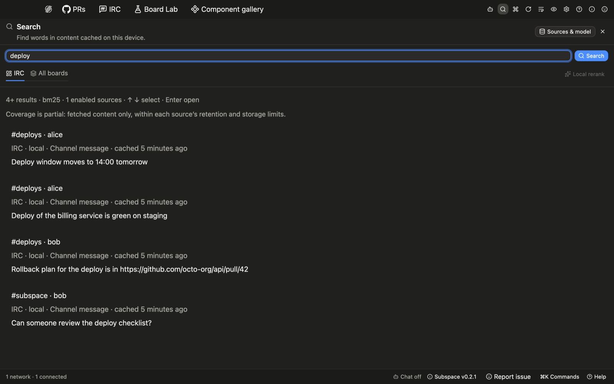
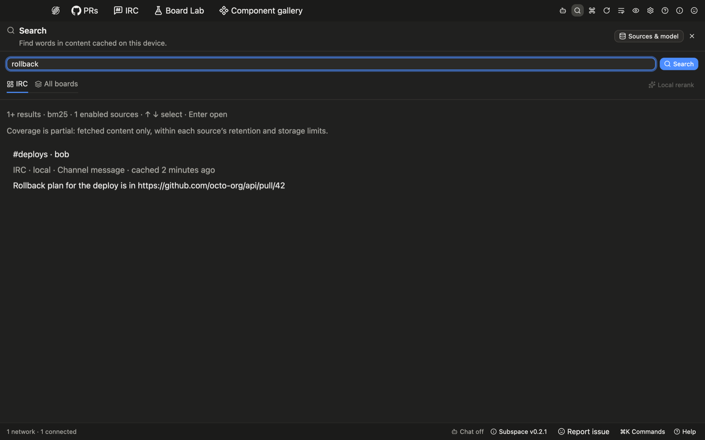
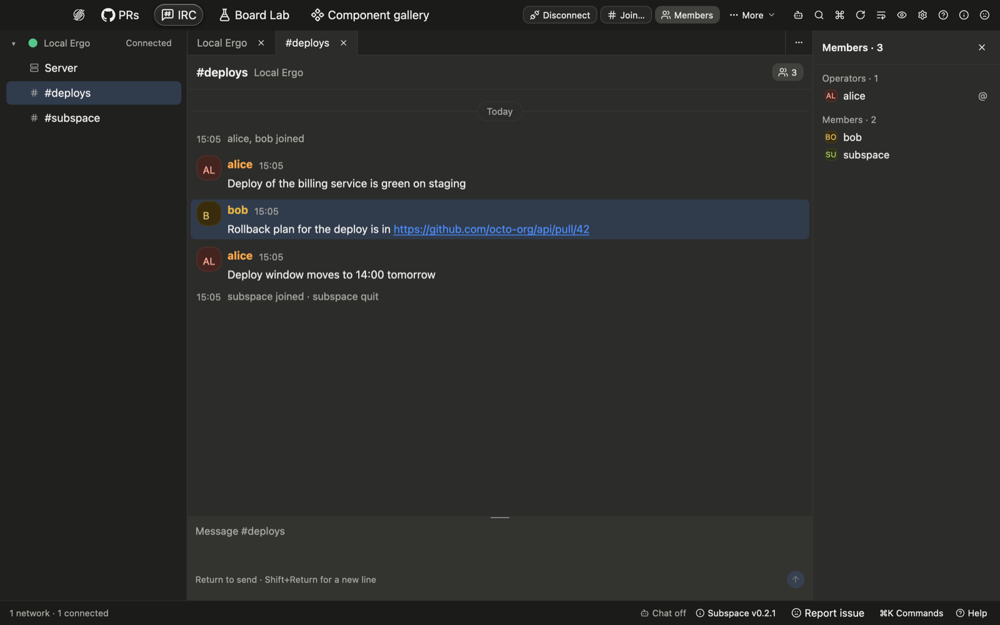

# IRC history and full-text search: delivery

Back to the [change records](../README.md). Spec: [spec.md](spec.md).

## Checks

- `make check`: architecture, board-guide and documentation-index checks,
  format, cargo-shear, clippy with warnings denied, tests and script fixtures.
- `make interfaces`.
- `mise run quality`: no findings in the code this change touches. Findings
  that remain on the branch come from the concurrent board-contracts work
  (`framework/services/contracts`, `dashboard/src/contracts`,
  `host/app/src/registry.rs`).
- Ergo-gated tests against `scripts/irc-test-server.sh`
  (`IRC_TEST_SERVER=127.0.0.1:16667`): `cargo test -p subspace-client-irc
  --test ergo` (including `anchors::an_anchored_join_asks_only_for_what_came_after`)
  and `cargo test -p subspace-irc-board ergo`.

New tests:

| Area | Tests |
| --- | --- |
| Search service | `tests/cases/records.rs`: pages and cursor, groups, removal by facet, active scope and policy required, metadata batch, board default until chosen, body excerpts; `migration.rs`: an earlier choice survives version 3 |
| Host | `search_runtime`: a board stored by default starts on until the person chooses |
| Client | `session/tests/anchors.rs`: anchored join asks `LATEST … msgid=… 500` and answers as `Backfill`, timestamp anchors, newest anchor wins, `Command::Anchors` kept for the next join, `AROUND` in order, `AROUND` without the cap |
| IRC store | `store/tests.rs`: record mapping (ids, titles, kinds, plain text, filters, clamped time), stable hashes, only messages stored, round trip in order with `Forget`, source off writes nothing, clear then new writes, file mode `0600`; `store/links.rs`: GitHub references |
| IRC state | `state/tests/backfill.rs`: merge in time order once each, restored lines count nothing, removed and unknown buffers skipped, anchors, replayed copies |
| IRC board | `tests/stored.rs`: restore before Configure then Anchors with no badge or notification, batched writes and removal deletes, a held result opens at its line, a missing result asks `AROUND` then opens; `tests/items.rs`: `/` search and `Opened`; `commands.rs`, `context.rs`, `agent_tools/read/search.rs` (held and stored matches merged once each), `transcript/scroll.rs` (`row_of`), editor History note |

## Screenshots

Cupertino Dark, from the capture build
(`cargo build -p subspace --features subspace-shell/capture`) with an isolated
`HOME`, against the local Ergo server with fictional people (alice, bob) and
fictional messages.

Not captured:

- **Before** (an `origin/main` build): it needs a second checkout or target
  directory, which this change was asked not to create (disk space). On
  `origin/main` IRC is not a Search source, so the Search view has no Channels tab
  or results.
- **Sources & model** with **Cache IRC** on, and the **History** note on
  Settings > IRC below the fold: the capture build's pointer and Tab/Enter
  steps did not reach these controls in this session (clicks, scrolls and
  keyboard activation had no effect; typed text did). The note is covered by
  `editor::tests::the_page_says_where_message_history_is_kept_and_cleared`.
- **Restore after a restart**: each capture run starts from a new fixture
  `HOME`, so the store does not survive between runs; the restore is covered
  by `tests::stored::stored_messages_restore_quietly_before_the_runtime_and_resume_after_the_newest`.
