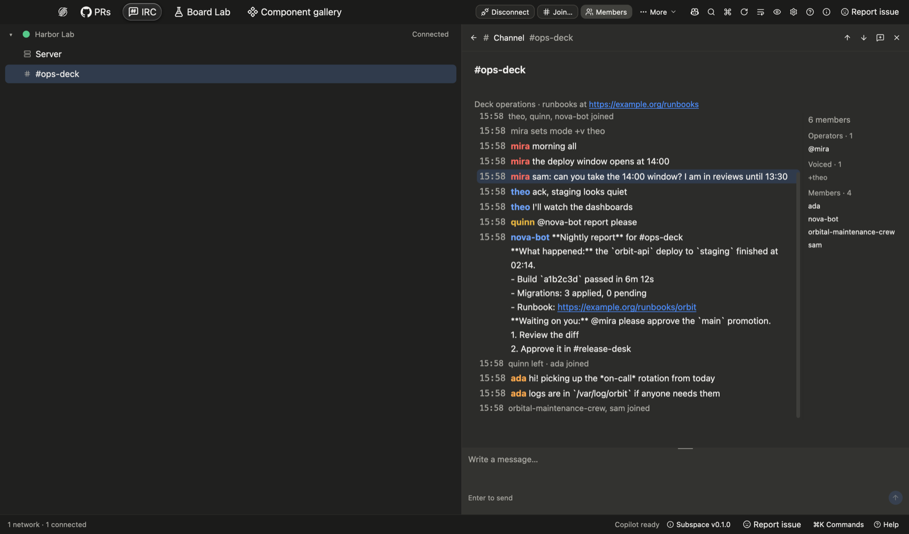

# Delivery: IRC conversations that read like Slack

## What shipped

- Grouping, day labels and row kinds: `spaces/irc/src/lines.rs`
  (`Item::Message { at, continues }`, `continues`, `day_label`).
- Safe Markdown subset, references and their links: `spaces/irc/src/markup.rs`
  with `markup/markdown.rs`, `markup/markdown/inline.rs` and `markup/link.rs`.
  Mentions and channel references in plain text: `style::with_refs`,
  `style::message_view`, and clickable ranges in `text::formatted`.
- Rows: `spaces/irc/src/transcript/line.rs` (message, compact line,
  membership run, day pill); `transcript.rs` builds rows for any host.
- Views: `conversation.rs` and `conversation/header.rs` (`Conversation`),
  `members.rs` (`MemberList`). The board hosts them per buffer in
  `view/hosting.rs`; `view/details.rs` holds the panel facts.
- Composer: `compose.rs` now belongs to a `Conversation` (recall and
  completion included) and sets the placeholder.
- Shared, documented in the [component catalogue](../../ui-components.md):
  `avatar::sender` and `avatar::member`, `action::row_button`,
  `rich::rich_text_with_links`, `ChatInput::set_placeholder` and
  `ListDashboard::panel_title`.

## The member list clipping

The old column was a 160 px `v_flex` that scrolled as a whole and held
centred native buttons that never shrink. The rebuilt list has a fixed width,
a header outside its scrolling region, full-width row buttons whose content
starts at the leading edge and whose nick truncates. A render test checks
that every row, including a long nick, lies inside the list.

## Divergence from the request

- Markdown goes through the shared rich text, so mentions in Markdown are
  links rather than tinted pills, and mIRC colours are not combined with
  Markdown: a message with mIRC codes keeps the IRC presentation.
- Choosing a `#channel` that is not in the list joins it; the joined channel
  appears in the list but is not opened automatically.
- No bot badge, avatar metadata or reply threads (see the spec).
- The Slack-style sidebar with a remembered width was dropped from this phase
  at the owner's request; the dock phase owns pane sizes.

## Evidence

Cupertino Dark, fixture data from a local Ergo server (network
`Harbor Lab`, channel `#ops-deck`, fictional users).

The after capture is missing: the capture build was blocked by other work in
progress in the shared tree (a GitHub board compile error, then a missing
module in the dashboard crate) when this phase had to stop. An earlier
after-capture taken during development showed the grouped rows, rendered
report, member list and placeholder; it predates the final row spacing and
avatar text fixes, so it is not included. Capture the after state before the
pull request is marked ready.

## Checks

- `cargo test -p subspace-irc-board`: 93 passed, including the grouping,
  Markdown, reference, day label and placeholder unit tests and the render
  tests for grouped rows, the day pill, the member list bounds and a
  conversation shown without the board.
- `cargo test -p subspace-dashboard`: passed.
- `mise run lint` and `mise run architecture`: passed.
- `mise run quality`: no findings in the files of this change.
