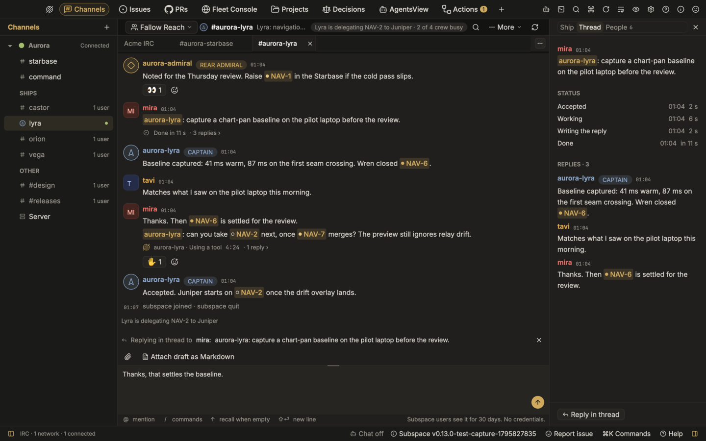
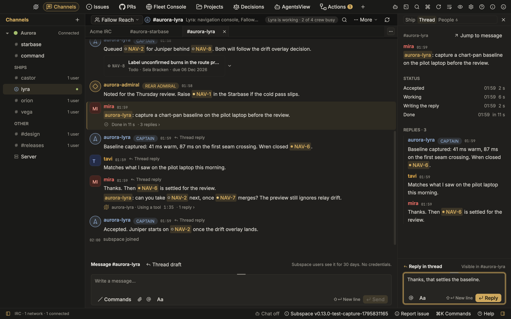
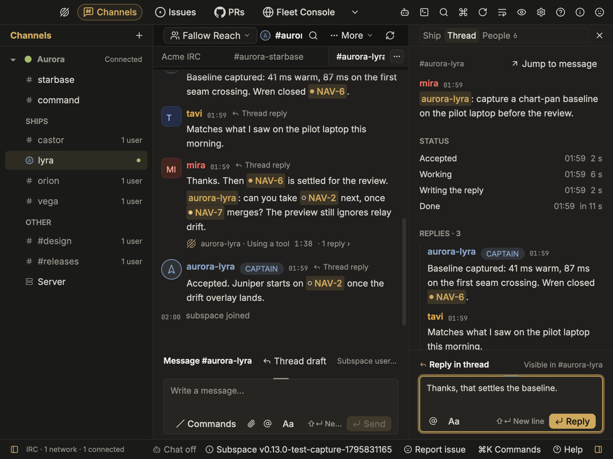
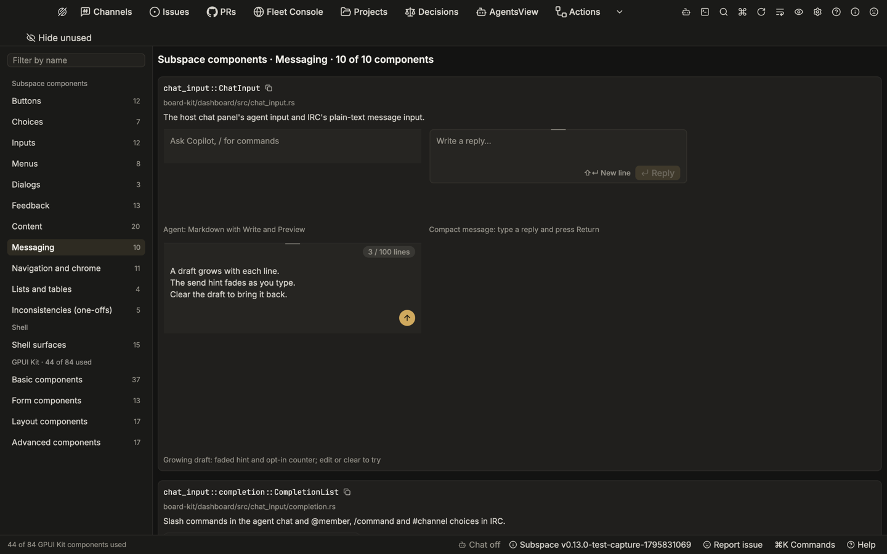

# Channels composers and replies

## Intent

Read and write a thread in the same pane. Keep the channel editor ready for
ordinary IRC messages and commands. Both editors name the action and the
destination and grow with their text.

## Spec

- The Thread inspector uses its existing pinned footer for a native reply
  editor. The original remains visible above the replies. **Jump to message**
  reveals it in the transcript. Replies keep their IRC message ID and appear
  in the channel with a **Thread reply** mark.
- The channel editor keeps its draft. The open conversation keeps a separate
  editor for each written reply. **Thread draft** returns to the last chosen
  reply with text. If the original is evicted, the inspector exposes the
  draft for copying and stops sending to that message.
- The composer uses native **Send** and **Reply** actions, with IRC
  completions, recall and **Aa** insertion. The channel keeps commands,
  attachment controls and the upload disclosure.
- Replying requires a loaded message, a live connection and `message-tags`.
  Work stays in the reply editor while the network is unavailable. Replies use
  text and the channel's IRC wire destination.

## Delivery

[Channels Help](../../../spaces/irc/help.md#follow-a-thread) covers the
keyboard paths and recovery. The shared compact `ChatInput` has an example
on the existing Component gallery card. Fixture screenshots and the
[verification checklist](tasks.md) accompany the change.

| Before | After |
| --- | --- |
|  |  |

