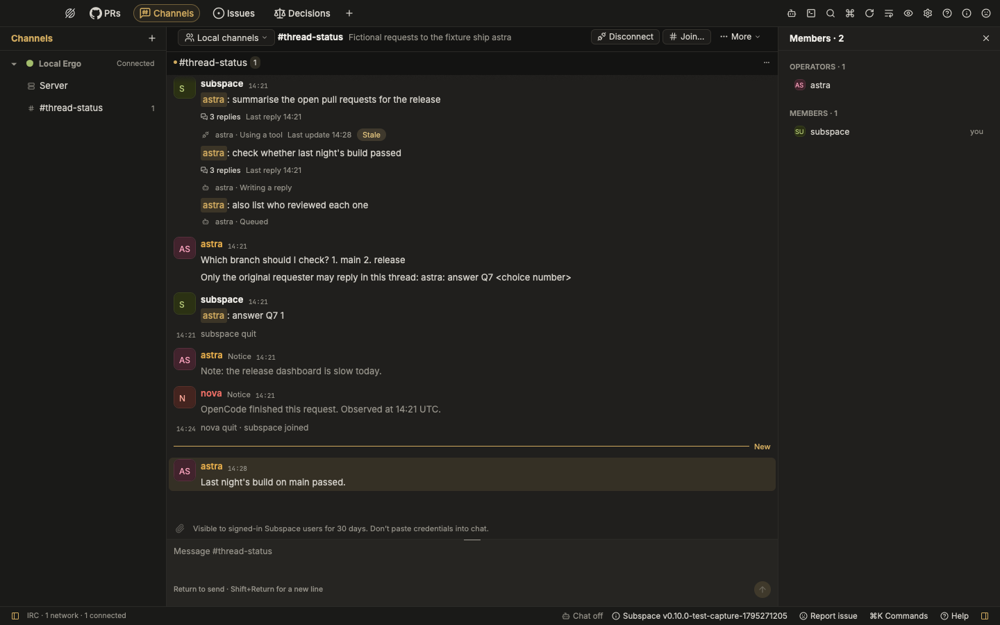
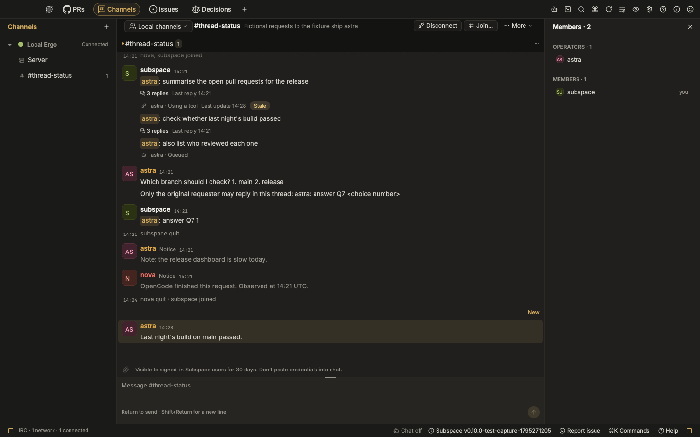
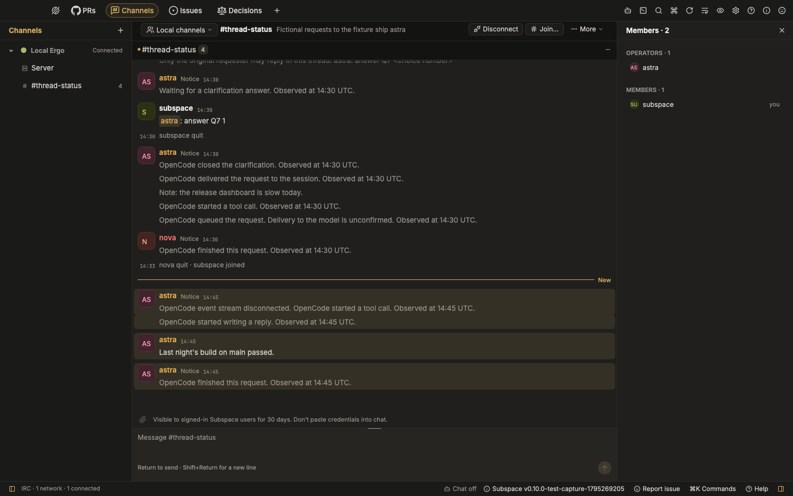

# Delivery: IRC thread status

## What changed

- `subspace-client-irc`: `Line::client_tags` keeps the allow-listed
  client-only tags of a `PRIVMSG` or `NOTICE` (`KEPT_CLIENT_TAGS`, today
  only `PROGRESS_TAG`, `+stargate/progress`, with values of at most 64
  bytes), live and in history; a multiline message takes them from its
  opening `BATCH` only (`session/lines.rs`, `session/batch/multiline.rs`,
  `model.rs`). The field is stored with the line, and older stored lines
  load without it.
- `spaces/irc/src/thread_status.rs`: the agreed marker (`PROGRESS_TAG`), its
  values and their labels.
- `thread_status/trust.rs`: the trust rule. `arrival` reads one live line
  before it is counted, with the account the member lists report for a
  live request's agent; `asked` and `notices` read a buffer's requests and
  its progress, oldest first by server time, when it folds again.
- `thread_status/requests.rs`: `Requests`, held per buffer in
  `Buffer::requests`: each request's binding (the account reported as it
  arrives live, else the account on its agent's first answer, never the
  requester's own), the endings, the folded notices of each held request,
  and which bindings and endings changed, for the store (`Kept`).
- `store.rs`, `store/mapping.rs`, `hub/persist.rs`, `hub.rs`: each request
  whose binding or ending changed is written as one `Channels request`
  record under its buffer; the restore loads them into `Requests`
  (`IrcState::restore_requests`) before the buffer's lines fold.
- `thread_status/model.rs`: one status per request message ID from the
  folded notices, the newest by server time, with endings that stay final,
  staleness, and the Search mapping (`shown_entry`).
- `state.rs`, `state/folding.rs`, `state/apply.rs`, `state/counts.rs`:
  `Buffer::folded` is kept current in proportion to each event: a live line
  by itself, history, backfill and restore by folding their buffer again;
  member list changes fold nothing. Dropping a request at the line cap
  stops folding its notices and counts them against the read marker at
  once (`counts::unfolded`). Folded
  lines never count as unread or notify, and lines counted from history
  before the server vouched are taken back out.
  `Network::held_at_connect` decides staleness.
- `lines.rs` makes no row for folded lines and never runs a membership row
  across one; `transcript/replies.rs` leaves them out of reply counts.
- `transcript/status.rs` draws one line per request with GPUI Kit's
  `Marker` and the shared `Pill`; `conversation.rs` rebuilds the lines on
  every sync, remeasures a request row whose line changed and reveals a
  folded Search hit at its request.
- `scripts/irc-thread-status-fixture.py`: the disposable fixture below.
- Docs: `docs/irc.md` (Request status lines, Design, Test with a local
  server) and the guide's Transcript section.

## Tests

- Pure (`thread_status/tests.rs`, with the tests in `thread_status/tests/`:
  `markers.rs`, `trust.rs` and `lifecycle.rs`):
  - marker eligibility: untagged, unknown value, unknown suffix, suffix on
    an ending, no reply ID, our own line, a tagged `PRIVMSG` or action and
    the server buffer are not markers;
  - every value's label, and `,disconnected` on stages before the end;
  - trust: only the addressed ship's server account folds; a lookalike from
    another account, the ship's nick with another account, no account, an
    unknown request and a reply to a notice stay notices and count as
    unread; a request without an addressee or without a reported account
    folds nothing; `@nick` addresses too;
  - two requests to the same ship, two of them in one thread, where an
    update to one leaves the others alone and one ends while the others
    work;
  - a question waiting for our answer, the question staying a message, the
    answer, then `clarified`;
  - a main-room final reply and a tagged `PRIVMSG` clearing nothing until
    `failed`;
  - late progress after `completed`, and older progress loaded from history
    afterwards, never reopening the request;
  - a lost connection, a reconnect and `,disconnected` showing the last stage
    as stale;
  - in a private conversation, trusted progress neither counting nor
    notifying while a lookalike does both;
  - history counted before the member list vouched, taken back out of the
    unread count when it arrives;
  - reopening a completed thread after a store round trip without a line,
    and unfinished work reading as stale;
  - the Search mapping;
  - the agent's nick shown as one bounded line of plain text (added when the
    change was re-applied onto `main`).
- `lines/tests.rs`: folded lines make no row, keep a sender's group together
  and split a membership run.
- Pinning and retention (`thread_status/tests/pinning.rs` and
  `retention.rs`, added for the review findings): a nick taken over by
  another account neither folds, changes nor ends a pinned request, also
  after the buffer folds again, while the pinned account still can; a
  request that addresses its own sender folds nothing; an ending survives
  the eviction of its notice and a reload without it; an older replayed
  stage does not replace a newer one; a notice whose request is dropped by
  the line cap shows, and Search reveals it. `markers.rs` also refuses
  `completed,` and `tool,`.
- Binding and storage (round 2; `thread_status/tests/binding.rs`,
  `pinning.rs`, `retention.rs`, `store/tests.rs`): a request first seen
  from history binds to the account on the earliest answer of the nick it
  asks, by server time; a notice from another nick, or a later one from
  another account, neither binds nor folds; a request whose agent's first
  answer carries no account stays unfolded; member events neither bind
  nor change a binding; a request to another nick of the requester's own
  account folds nothing; a stored binding and ending survive a restart
  through JSON, so a nick taken over by another account cannot fold, spoof
  or end the request, and a request whose completed notice did not
  restore stays ended; request records round trip through the store
  beside their buffer's lines and go when it is removed; an older store,
  or a record without `pin` or `ended`, loads with none; a notice unfolded
  by its request's eviction counts as unread and highlighted at once; and
  `agent_name` drops IRC formatting, bidi, zero-width and format
  characters.
- Client (`session/tests/client_tags.rs`): the allow-listed client-only tag
  kept live, from the opening batch only and in history; server tags, the
  reply reference, tags outside the allow-list and over-long values left
  out.
- Headless render (`tests/thread_status.rs`): the real board with three
  requests, the third in the first's thread; one line each; folded rows
  absent and the reply count covering only the follow-up and the lookalike;
  an update to the second leaving the first; the question visible; typing
  still in state; the stale line and pill while reconnecting; a main-room
  final clearing nothing; `completed` clearing only the second; and progress
  from a ship whose account the server does not report staying a notice.

Not run by the author of this change on its first branch: `make check`,
`mise run quality`, the tests above and the capture. They were first run
after the re-application onto `main`; see the checks at the end of
[Re-applied onto `main`](#re-applied-onto-main-after-pull-request-29).

## Fixture evidence

Fixture evidence is separate from live fleet evidence, which this change
does not cover: it uses no deployed Stargate, IRC server, fleet or real
account. The fixture plays a fictional ship, `astra`, and a fictional
lookalike, `nova`, on a fresh local Ergo server from
`scripts/irc-test-server.sh`. Both register throwaway accounts there, so the
server tags their messages with `account`, and `astra` sends the agreed
`+stargate/progress` notices.

1. Start a fresh server (its history and accounts are thrown away when it
   stops, so restart it between runs):

   ```sh
   scripts/irc-test-server.sh &
   ```

2. Start the fixture and wait for `thread-status fixture: ready`. It writes
   the Channels configuration, has `subspace` send three requests (the third
   in the first one's thread) and answer the second one's question, then
   leave, and has `astra` and `nova` answer:

   ```sh
   python3 scripts/irc-thread-status-fixture.py --config "${TMPDIR:-/tmp}/irc-thread-status.json" &
   ```

3. Capture from `subspace-desktop`. The fixture times its steps from when
   the capture build joins: after 15 seconds the first request's stream is
   lost, after 30 the second request's reply starts and its final answer
   goes to the main room without a reply tag, and after 45 the second
   request completes.

   ```sh
   CAPTURE_THEME="Twilight Two" \
   CAPTURE_IRC_CONFIG="${TMPDIR:-/tmp}/irc-thread-status.json" \
   CAPTURE_STATE='{"app.window":"[0,0,1440,900]","app.dashboard":"irc","irc.dock-layout":"{\"center\":{\"kind\":\"tabs\",\"buffers\":[{\"network\":\"local\",\"target\":{\"Channel\":\"#thread-status\"}}],\"active\":0}}"}' \
   make capture OUT=docs/changes/irc-thread-status/evidence \
     STEPS='wait:10000;shot:thread-status-working;wait:15000;shot:thread-status-stale;wait:15000;shot:thread-status-final-reply;wait:15000;shot:thread-status-completed'
   ```

   `CAPTURE_STATE` sets a 1440 x 900 window (`app.window`) and opens
   Channels (`app.dashboard`) with `#thread-status` as the one tab of the
   pane, through the layout key Channels stores on `main`,
   `irc.dock-layout` (`spaces/irc/src/dock/layout.rs`). The layout leaves
   out `buffers` and `members`, so the navigator and the inspector both
   show, as they do by default. When another checkout already uses port
   16667, start the server and the fixture with the same `IRC_TEST_LISTEN`,
   such as `IRC_TEST_LISTEN=127.0.0.1:16922`.

The shots should show, in Twilight Two, on the workspace shell: the
navigator with the network and `#thread-status` selected, the pane's tab
strip naming `#thread-status`, the conversation, and the members inspector.
In the conversation:

- `thread-status-working`: the first request with `astra · Using a tool`, its
  ordinary untagged notice and `nova`'s lookalike notice, both visible; the
  third request, in the first one's thread, with `astra · Queued`; the second
  with its question, answer instructions and our answer, and
  `astra · Answer received`. No trusted progress notice shows as a message.
- `thread-status-stale`: the first request's line with an Unplug glyph,
  `Last update HH:MM` and the **Stale** pill; the others unchanged.
- `thread-status-final-reply`: the final answer at the end of the channel and
  the second request still `astra · Writing a reply`.
- `thread-status-completed`: the second request without a line; the first
  still stale and the third still queued.

For the before image, run the same fixture and the same `make capture`
command from an `origin/main` build (the workspace shell, after pull request
#29), where every progress notice shows as a reply. The fixture needs no
particular build. Keep each image at most 1600 px wide; a 1440 px window
captures at that width.

A disconnect of Channels itself is covered by the render and pure tests,
not by a shot: the capture cannot take the network down without clicking
coordinates that have not been measured.

## Re-applied onto `main` after pull request #29

The change was first written on a branch from `27ee242`, before pull
request #29 moved Channels onto the workspace shell (navigator, tab strip,
toolbar and members inspector) and rewrote much of `spaces/irc`. It was
never committed there. It was carried onto `main` (`40b9ebd`) by hand, file
by file, on a fresh branch, `feat/irc-thread-status`; the history above
describes the change as first written.

- **Applied as they were.** Every file the change touched that `main` had
  not changed since `27ee242` took the original hunks by a three-way merge
  against that base, without conflicts: the IRC client (`model.rs`,
  `model/replies.rs`, `network/offline.rs`, `session/batch/multiline.rs`,
  `session/lines.rs`, `session/tests/replies.rs`) and, in Channels,
  `conversation.rs`, `lines.rs`, `lines/tests.rs`, `state.rs`,
  `state/apply.rs`, `state/apply/status.rs`, `state/counts.rs` and
  `transcript/replies.rs`. The new files (`thread_status.rs`,
  `thread_status/`, `state/folding.rs`, `transcript/status.rs`,
  `tests/thread_status.rs`, the fixture and this record) were copied.
- **Re-applied onto changed code.** `lib.rs`, `tests.rs`, `transcript.rs`,
  `transcript/line.rs` and `transcript/line/message.rs` changed on `main`
  (the mono gutter time, the reading-width cap, `cx` passed to the row
  helpers) but not where this change touches them, so the module lines,
  `RowContext::statuses`, the folded set passed to `lines::items` and the
  status line after the reply count merged without conflicts. `docs/irc.md`
  and `spaces/irc/help.md` conflicted with the shell's text and were merged
  by hand, keeping both. In `docs/irc.md` the Request status lines section
  now follows the **Join…** paragraph, so that paragraph stays under its
  own section rather than under this one.
- **Placement.** The status line stays where the change first put it: in
  the transcript, under its request, after the reply count. The shell did
  not change the message row's structure, and the design guide puts a
  conversation's content in the pane, not the inspector (which shows the
  selection's detail, here the members) or the toolbar (search, filters
  and actions). The line sits in the message column, whose text is capped
  at `workspace::READING_WIDTH_PX`; the line itself is short.
- **Render tests.** `tests/thread_status.rs` mounts the board with `mount`,
  injects events with `inject` and opens the channel with `view::reveal`,
  as the other render tests on `main` do; the element ids it reads
  (`irc-line:<seq>:row`, `irc-replies:<msgid>`, `irc-status:<msgid>` and
  `irc-status:<msgid>:stale`) still exist. It reads accessible labels, not
  drawn text, so it needs no `test_text`.
- **Bounded agent name.** The only text from the network the line shows is
  the agent's nick; the stage labels are fixed and the notice's own text is
  never shown. Re-applying added `thread_status::model::agent_name`, which
  drops control characters and whitespace and cuts the nick to 32
  characters with an ellipsis, rather than relying on the server's nick
  rules, with a unit test.
- **Nick status kept apart.** `draft/metadata-2` nick status
  (`Event::NickStatus`) is shown by Channels through the separate
  `channels-agent-status` change, now on `main`; this change does not
  touch it. The two are deliberately different (nick-wide, against per
  request by message ID); see the Findings in [the spec](spec.md).
- **Code quality.** `mise run quality` found what the change added to
  `main`'s baseline, all fixed rather than suppressed or rebaselined: the
  pure tests were split into `thread_status/tests/` and the client test
  moved out of `session/tests/replies.rs` into `session/tests/client_tags.rs`
  (module size and a repeated fragment); the long render test became a
  short test over one helper per stage; the message row draws its reply
  count and status line through one helper, `thread_facts`, to stay under
  60 lines; the row context shares the two counts with `Rc::clone`; and
  `ListedChannel` moved from `clients/irc/src/model.rs` into
  `model/listing.rs`, re-exported as before, to keep that module under the
  size limit with `Line::client_tags` added.
- **Capture commands** now use Twilight Two, a 1440 x 900 window and the
  layout key Channels uses on `main`; see [Fixture evidence](#fixture-evidence).
- **Not carried across:** nothing was left out.
- **Based again on `19242ec`.** After the agent status feature
  (`channels-agent-status`, pull requests #30 and #33) merged into `main`,
  the branch was reset to `origin/main` at `19242ec` and the change
  re-applied with `git cherry-pick --no-commit`. Two files conflicted and
  were merged by hand: `spaces/irc/src/state.rs`, where `Network` keeps both
  new fields (the agent status feature's `statuses` and this change's
  `held_at_connect`), and `docs/irc.md`, which keeps both fixture
  paragraphs. The review fixes below were made on top.

Checks after the re-application, run on 21 November 2026 on macOS
(arm64), Rust 1.99.0 through mise. This was the change's first build.

- [x] `cargo test -p subspace-client-irc -p subspace-irc-board`: compiled
      first time, and every test passes (Channels 461 passed, 4 ignored as
      on `main`; the IRC client 241 passed).
- [x] `make check` in `subspace-desktop/`: the first run failed in clippy
      on one `Some(x).filter(|_| …)` (`clippy::some_filter`) in
      `thread_status/model.rs` `shown_position`, now
      `bool::then_some`; the second run passes, exit 0: architecture, board
      docs, documentation index, format, licences, clippy with warnings
      denied, the tests in both configurations (2,380 passed, none failed)
      and the script fixtures. `subspace-framework/` did not change.
- [x] `mise run quality`: passes, 100.0% against the baseline. Its one
      finding, a stale suppression in `products/subspace/build.rs`, is also
      reported on a clean copy of `main` and is not in code this change
      touches.
- [x] `rustfmt --edition 2024 --check` on every changed Rust file.
- [x] `scripts/check-docs-index.py` and `scripts/check-board-docs.py`.
- [x] The fixture against a live local Ergo 2.19.1 server. Its first run
      failed: Ergo answers NickServ's `REGISTER` with notices, not 900, so
      the fixture never saw the login. It now also sends `WHOIS` for its own
      nick and accepts 330 (logged in as) or 900. With that, both accounts
      register and the server tags their lines with `account`.
- [x] Before and after captures under `evidence/`; see [Evidence](#evidence).
- [ ] Not checked: a real Stargate gateway on a fleet (only the fixture);
      a disconnect of Channels itself in a capture (tests only); screen
      readers (accessible labels are checked in headless tests only).
- [x] Both model reviews (GPT-6.2 Sol and Claude Opus 5.5, high effort) of
      the head before the review fixes: Sol not clear (one high finding),
      Opus clear. Every finding is in [Review findings](#review-findings).

## Review findings

Two independent reviews of the head before these fixes: GPT-6.2 Sol (high
effort, verdict not clear) and Claude Opus 5.5 (high effort, verdict clear).
Every finding, and what was done:

| Reviewer | Severity | Finding | Done |
| --- | --- | --- | --- |
| Sol; Opus | High; medium | Trust followed whoever held the addressed nick now, so another account taking it could fold, spoof or end the ship's requests. | **Fixed.** Each request is pinned to the account its ship holds when Channels first sees the request with one: as a live request is appended, or, when first held from history, backfill or the store, when first evaluated with an account reported. Only that account's notices fold, whoever holds the nick later; without a pin nothing folds. Pins live in `Buffer::requests` (`thread_status/requests.rs`), so folding again uses them and member events cannot change them. They are not stored: after a restart a restored request is pinned to whoever holds the nick when the member list first reports an account, a window recorded in the spec. |
| Opus | Low | A member could address themselves and have their own tagged notices folded. | **Fixed.** A request that addresses its own sender is not a request (`trust.rs` `request`). |
| Opus; Sol | Medium; medium | Every member event refolded every buffer on the network, and every live line indexed the buffer's requests, twice. | **Fixed.** A live line is taken in by itself (`trust.rs` `arrival`, `folding.rs` `arrived`), without reading the buffer again. A member event with no account does nothing; otherwise it pins only the requests waiting for that nick (or, for a whole list, any waiting nick) in the buffers its list speaks for, and folds a buffer again only when held progress answers a newly pinned request. History, backfill and restore fold their own buffer again, as before. The client's existing per-line dedupe (`merge::known`) on `main` is unchanged. |
| Sol | Medium | An ending held only while its notice was, so eviction or a partial reload could revive a finished request. | **Fixed.** Endings are kept in `Requests` apart from the lines, and `model.rs` `statuses` honours them. They are not stored either; after a restart the ending comes back from the restored notice, which the store restores whenever it restores the request's earlier progress. |
| Sol | Medium | An older bouncer replay could replace a newer stage. | **Fixed.** `model.rs` `record` keeps the newest observation by server time; of two at the same time, the later in the buffer. |
| Sol | Medium | A folded notice stayed hidden, and unrevealable from Search, after its request was evicted; unread was decided before trimming. | **Fixed, by unfolding.** Dropping a request at the line cap stops folding its notices (`folding.rs` `make_room` and `dropped`, `Requests::release`), so they show and Search reveals them; they fold again if the request loads again. `append` now makes room before it decides whether a live notice folds, so a notice whose request that very line drops counts as unread like any notice. |
| Sol | Low | A trailing comma was accepted, as in `completed,`. | **Fixed.** `thread_status.rs` `parse` accepts only `<stage>` and `<stage>,disconnected`. |
| Opus | Low | The client kept every client-only tag from any sender, in memory and in the store. | **Fixed, by an allow-list.** The client keeps only `KEPT_CLIENT_TAGS` (`+stargate/progress`), with values of at most 64 bytes (`session/lines.rs`); `+draft/reply` stays in `Line::reply_to`. |
| Sol | Low | The fixture opened its `--config` path following symbolic links, before the server answered. | **Fixed.** It opens with `O_NOFOLLOW` and mode `0600`, as the agent status fixture does, and writes the config only once the server has answered, before printing `ready`. The `WHOIS`/330 login confirmation is kept. |
| Sol | Low | Nicks compare in ASCII, not by the network's `CASEMAPPING`. | **Left open.** The Space has no case mapping, and the agent status change made the same decision. Recorded under Limits in the spec. |
| Opus | Low | Progress loaded from history counts as current however old. | **Left open.** History replayed on join is how Channels learns the current progress after a restart, and the documented fixture captures rely on it. Staleness comes from `,disconnected` and our own disconnect. Recorded under Limits in the spec. |

Checks after the review fixes, on 21 November 2026:

- [x] `cargo test -p subspace-client-irc -p subspace-irc-board`: compiled
      first time; all pass (Channels 483 passed, 4 ignored as on `main`,
      now including the agent status tests from #30; the IRC client 241
      passed).
- [x] `make check` in `subspace-desktop/`: exit 0 (architecture, docs,
      format, licences, clippy with warnings denied, the tests in both
      configurations with 2,402 passed and none failed, script fixtures).
- [x] `mise run quality` (`rustqual . --findings`): no new finding; the one
      finding is the stale suppression in `products/subspace/build.rs`
      reported on `main` too.
- [x] `rustfmt --edition 2024` on every changed Rust file;
      `python3 -I -m py_compile` on the fixture.
- [x] `scripts/check-docs-index.py` and `scripts/check-board-docs.py`.
- [x] The fixture against a fresh local Ergo 2.19.1 server, captured from
      this build with the same steps: the same results as the evidence
      below. The requests arrive from history when the capture build joins,
      are pinned once the member list reports `astra`'s account, and fold
      as before; the first request goes stale, the second's line clears on
      `completed`, the third stays queued, and the untagged notice and
      `nova`'s lookalike stay notices. That run's window opened at the
      app's default 1280 x 800 rather than 1440 x 900, so its images were
      not added; the UI is unchanged, and the images below still show it.
- [x] Both model reviews of that head (`06cf1a6`): Claude Opus 5.5 clear
      (two low findings), GPT-6.2 Sol not clear (one high finding); see
      [Review findings, round 2](#review-findings-round-2).

## Review findings, round 2

Both models reviewed `06cf1a6`, the head with the round-1 fixes: Claude
Opus 5.5 (high effort, verdict clear) and GPT-6.2 Sol (high effort, verdict
not clear). The owner decided the remaining trust gap: bind each request
from two sources only, and store bindings and endings. Every finding, and
what was done:

| Reviewer | Severity | Finding | Done |
| --- | --- | --- | --- |
| Sol; Opus | High; low | A request without a pin was pinned to whoever held the nick when an account was first reported: after a restart (pins were not stored) and when the agent's account was not reported at arrival. The guide overstated the guarantee. | **Fixed.** A request binds once, from the account the member lists report as it arrives live (`trust.rs` `arrival`, `Requests::hold`), else from the server `account` tag on the earliest progress notice by server time from the nick it asks (`Requests::note` and `answer`; `trust.rs` `notices` sorts by server time). Member lists are not read after arrival: `pin_waiting`, `reported`, `repin` and the member-event scope are gone. Without a binding nothing folds. Bindings and endings are stored (next row). The guide, `docs/irc.md` and the spec now claim exactly this. |
| Sol | Medium | Endings lived in memory only, so after a restart a partial or Search reload could revive a finished request. | **Fixed.** Each changed binding or ending is written as one `Channels request` record (id `request:<network>:<msgid>`, payload `Kept { request, pin, ended }`) under its buffer's record parent (`store/mapping.rs` `request_document`, `store.rs` `Op::Requests` and `keep_requests`, `hub/persist.rs` `keep_requests`). The restore reads each buffer's newest twice-`HISTORY_MAX` of them (`store.rs` `read_all` and `read_records`) and loads them before the lines fold (`IrcState::restore_requests`, `Requests::load`), so a stored binding wins and a stored ending holds. The records have no searchable text and are deleted with their buffer. An older store without them loads with none (`serde(default)`); with no users or installs yet there is no migration. |
| Sol | Medium | Unfolding a dropped request's notices left their unread and highlight state stale. | **Fixed.** `folding.rs` `dropped` counts them at once with `counts::unfolded`, against the current read marker as `recount` does, so a later recount changes nothing. |
| Sol | Low | Two nicks on one account could bypass the self-address check. | **Fixed.** An account equal to the request line's own `account` tag never binds, from either source (`requests.rs` `own`, used by `hold` and `binding`). The nick check stays. |
| Sol | Low | Nicks compare in ASCII, not by the network's `CASEMAPPING`. | **Left open,** as in round 1: the Space has no case mapping, and the agent status change made the same decision. Recorded under Limits in the spec. |
| Sol | Low | The fixture kept an existing config file's mode. | **Fixed.** It writes a fresh owner-only file beside the target with `tempfile.mkstemp`, then `os.replace`s it onto the target, still refusing a symbolic link there and still only after the server has answered. |
| Sol | Low | A single-nick member event scanned every waiting nick. | **Gone.** Member events no longer bind, so nothing waits and nothing is scanned. |
| Opus | Low | `agent_name` let bidi overrides and zero-width or format characters through. | **Fixed.** `model.rs` `agent_name` cleans the nick with the client's `status_text` (IRC formatting, controls and bidi overrides), then drops whitespace and the remaining zero-width, joining and format characters (`invisible`). |
| Opus | Note | `tasks.md` and `delivery.md` disagreed on whether the round-1 fixes were built. | **Fixed.** Both now say the round-1 build, tests and `make check` passed. |

Checks after the round-2 fixes, on 21 November 2026:

- [x] `cargo test -p subspace-client-irc -p subspace-irc-board`: compiled
      first time; all pass (Channels 489 passed, 4 ignored as on `main`;
      the IRC client 241 passed).
- [x] `make check` in `subspace-desktop/`: exit 0 (2,408 tests passed, none
      failed; clippy clean). Its first run stopped on the timing-sensitive
      `subspace-api-client` test under machine load, which this change does
      not touch; the rerun on a quiet machine passed.
- [x] `mise run quality` (`rustqual . --findings`): no new finding; the one
      finding is the stale suppression in `products/subspace/build.rs`
      reported on `main` too.
- [x] `rustfmt --edition 2024` on every changed Rust file;
      `python3 -I -m py_compile` on the fixture.
- [x] `scripts/check-docs-index.py` and `scripts/check-board-docs.py`.
- [x] The fixture against a fresh local Ergo 2.19.1 server, captured from
      this build: its requests arrive from history and bind by `astra`'s
      first answer, then fold as in the evidence below; `nova`'s lookalike
      and the untagged notice stay notices, the first request goes stale,
      the second clears on `completed` and the third stays queued. The
      window again opened at 1280 x 800, so those images were not added.
- [ ] The round-3 model reviews of the new head: not yet run; required
      before merging.

## Evidence

Captured on 21 November 2026 with `make capture` and the commands in
[Fixture evidence](#fixture-evidence), in Twilight Two at 1440 x 900, from
a fresh local Ergo 2.19.1 server for each run. Fixture data only: the
fictional ship `astra`, the lookalike `nova` and the capture build's
`subspace`, on loopback; each image was examined for hostnames, tokens and
real names before it was added.

After, this branch:

- 
  Working: `astra · Using a tool` under the first request, `astra · Answer
  received` under the second, `astra · Queued` under the third. The
  ordinary untagged notice ("Note: the release dashboard is slow today.")
  and `nova`'s lookalike "finished" notice from another account stay
  ordinary notices; no trusted progress notice shows as a message.
- 
  The first request's line with the Unplug glyph, `Last update` and the
  **Stale** pill; the second at `astra · Writing a reply` while its untagged
  final answer arrives in the main room, which ends nothing; the third
  still queued.
- 
  The second request, `completed`, has no line; the first is still stale
  and the third still queued.

The documented `STEPS` take four shots. The fixture's clock started about
ten seconds before the capture's own steps did, so the second shot already
showed the final reply and the third (`thread-status-final-reply`) matched
the fourth exactly; it was dropped as a duplicate.

Before, an `origin/main` build (`40b9ebd`) with the same fixture:

- 
  Every `+stargate/progress` notice shows as a notice message, and the
  request lines carry no status.
- 
  After the stream loss, reply and completion, the progress notices arrive
  as new messages and the channel counts 4 unread.

Compared with the design guide's shell anatomy and review checklist: the
zones are unchanged and nothing is added to the navigator, tab strip,
toolbar, inspector or status bar. The line sits in the conversation under
its request, at the message text's edge like the reply count, in the
caption size with muted text; the Stale pill is the shared `Pill` and the
glyphs are GPUI Kit `Marker` icons, theme tokens only.
