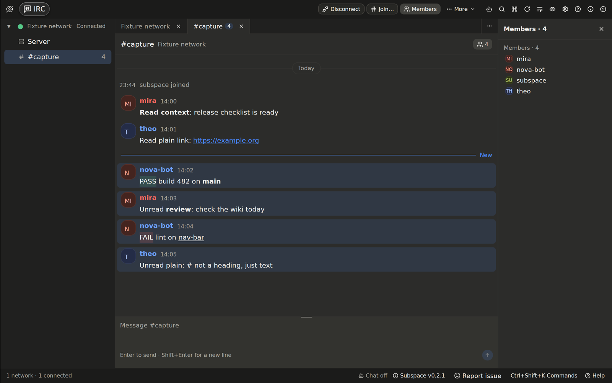
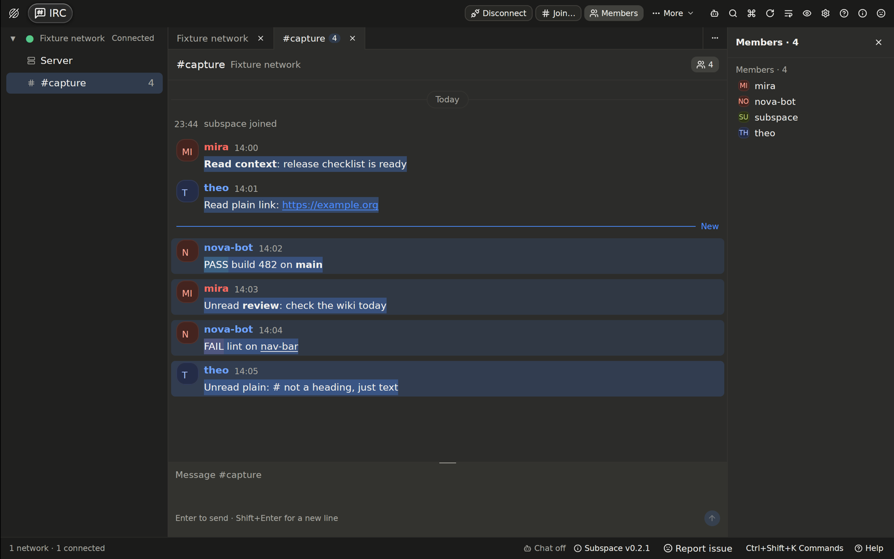
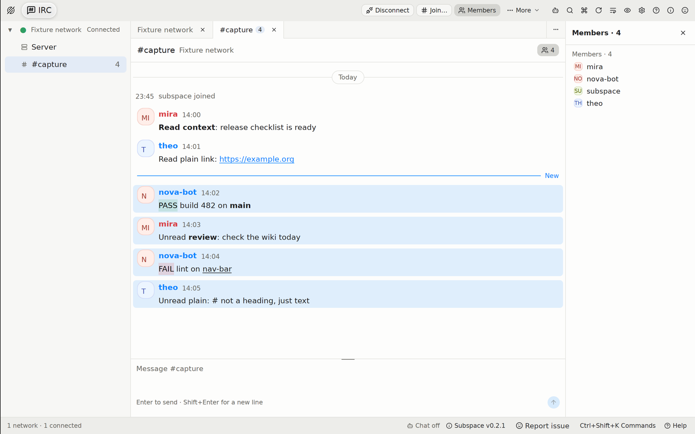
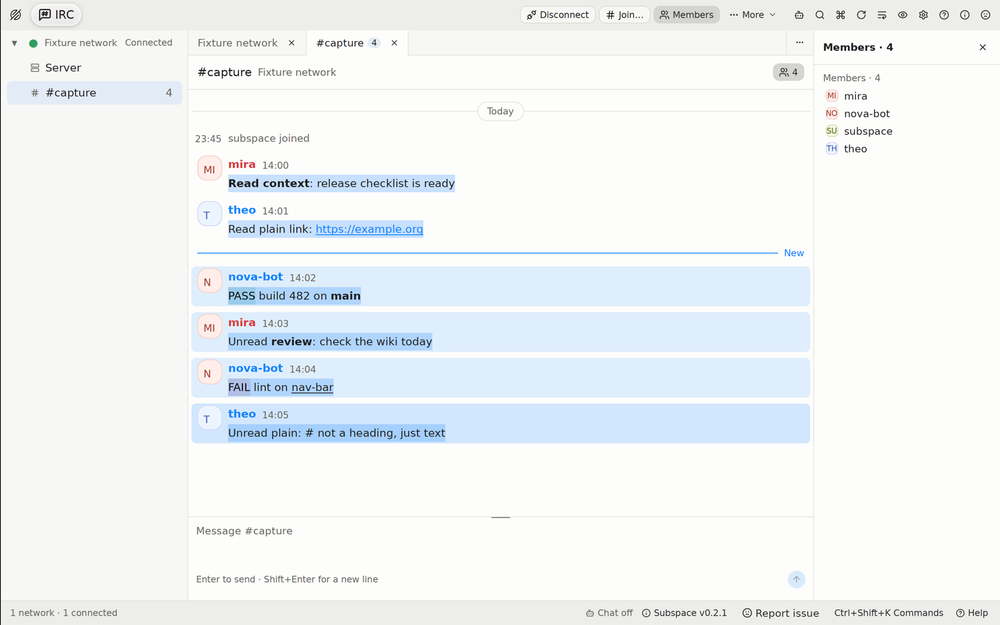
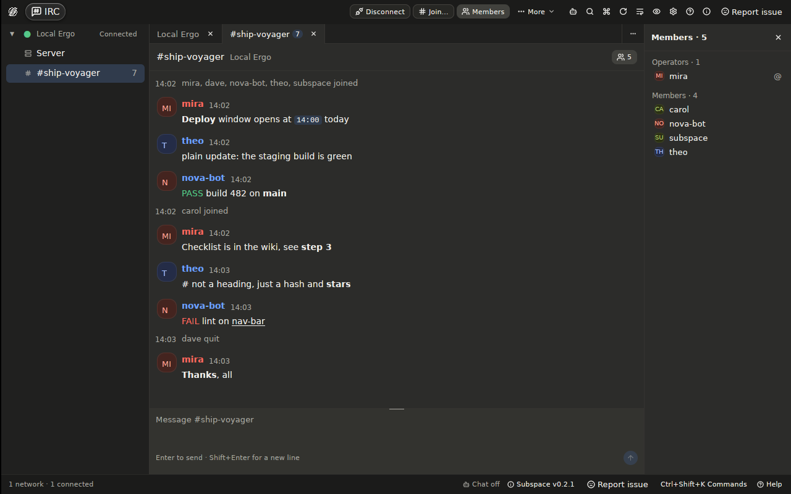
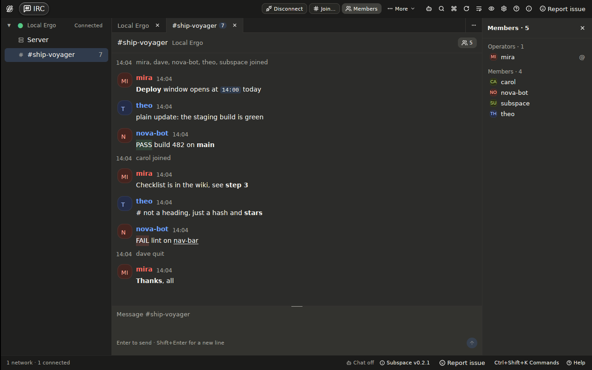
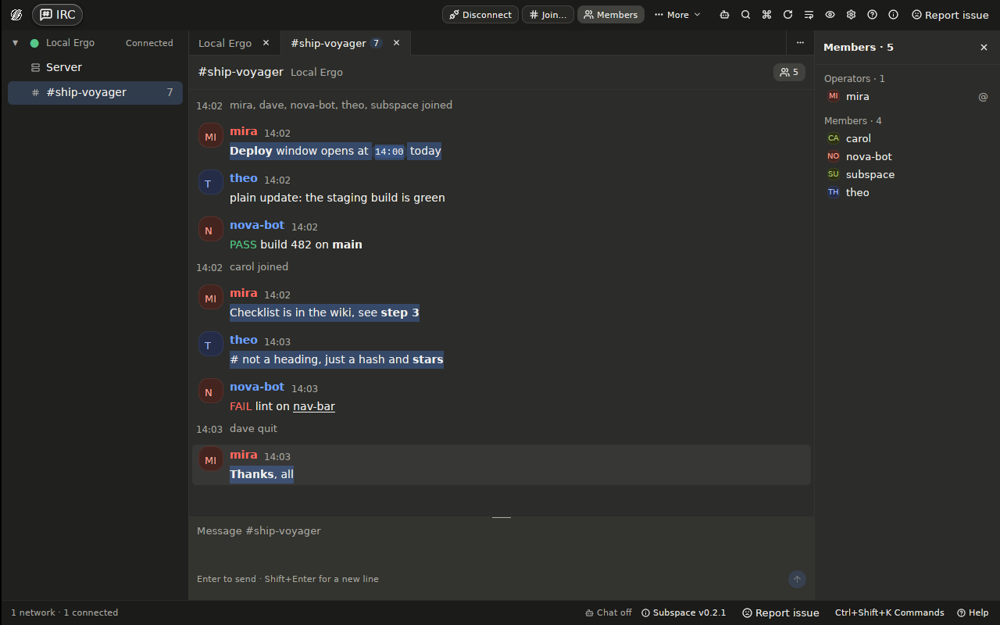
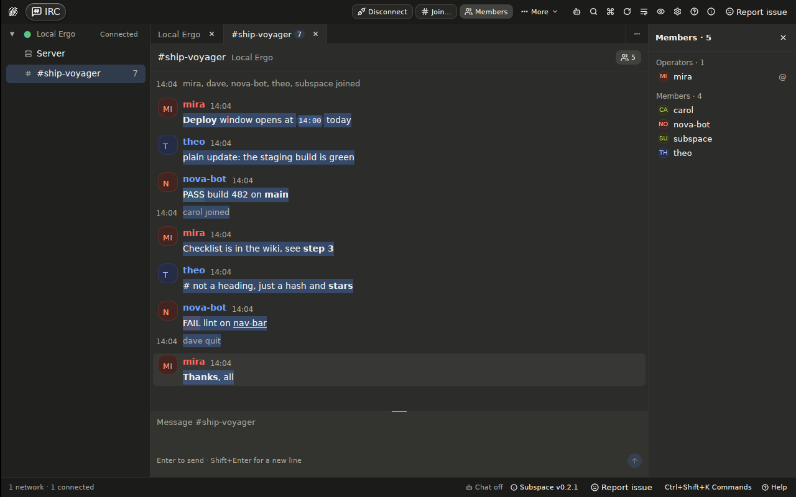
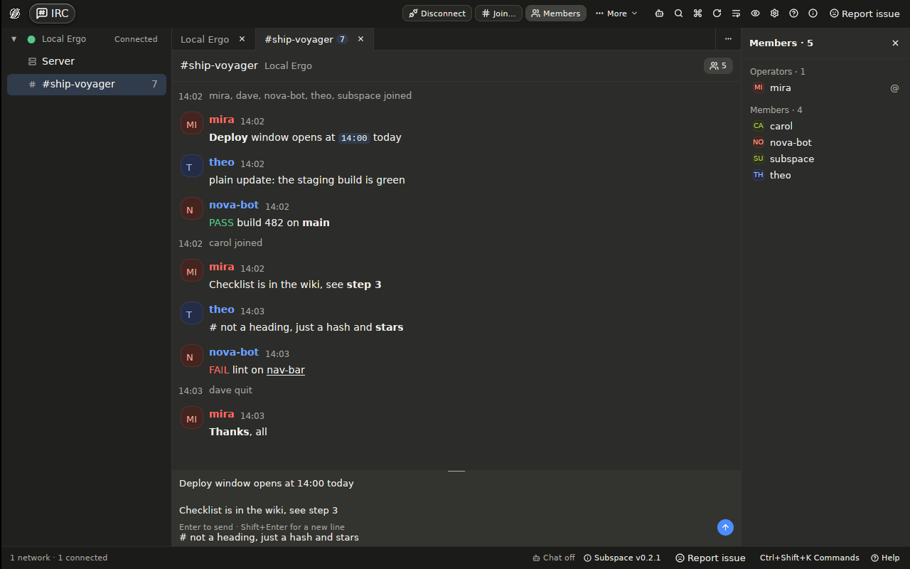
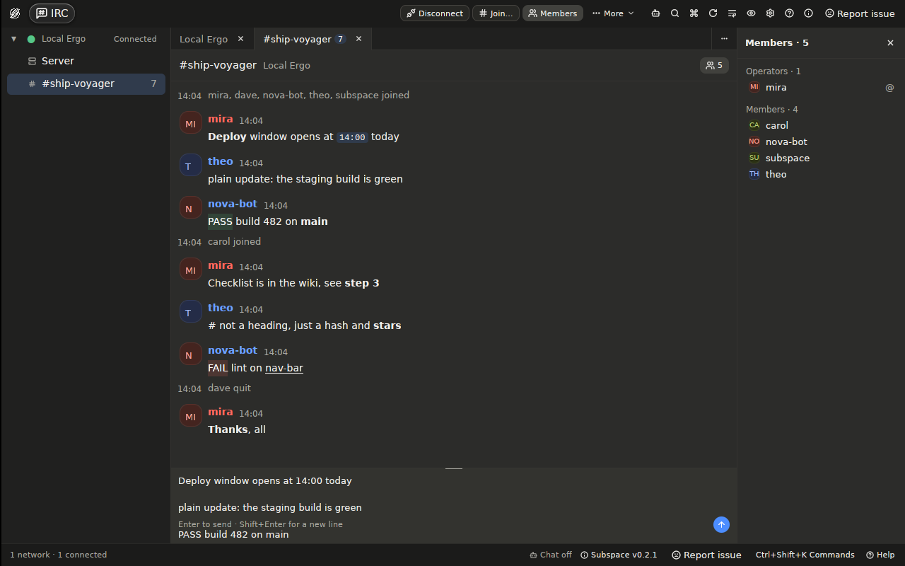

# Delivery: drag selection across the IRC transcript

## Integration with unread highlighting (#37)

The branch merges `feat/subspace-desktop` at `1a73c2c997b2`. The unread
divider, retained unread state and row fills remain unchanged. Every message,
compact line and membership summary still uses a selectable text view. The
divider is a label, so dragging across it copies both sides without adding
`New` to the clipboard. Opening the conversation clears its badge while the
unread fill stays visible, as #37 specifies.

The merged base also supplies issue-reference navigation and cards. Literal
links and references retain their native presentation inside Kit inline
objects: issue hover cards, unavailable references and keyboard focus remain
available while their text participates in the parent selection. A reference
is an atomic span in that selection. Formatted Markdown references keep the
base's existing link presentation.

The integration test drags from read history through the divider, an unread
plain row with a member reference and an unread mIRC-coloured row. It checks
the selected text and dispatches the real `Copy` action through the focused
text view, asserting the clipboard and retained selection. A separate test
checks that unread rest/hover fills differ from the text-selection fill.

The updated evidence uses an isolated debug capture build, a finite local IRC
fixture on `127.0.0.1:16924`, fictional senders and a private 2560 × 1600 Xvfb
display with `GPUI_X11_SCALE_FACTOR=2`. Native input goes only to that private
display. The PNG exports are reduced to 1600 × 1000. Both Cupertino themes
show the read context, unread divider, unread fill and mIRC tints, then a drag
across the divider. Linux cannot render a window directly to an image, so
the frames come from Xvfb; the app is the capture-enabled development build.

Integration verification: `mise exec -- make check`, `mise run quality`
(100 %, no new findings in touched code) and `mise run audit` pass. The audit
is required because the base merge changes lockfiles. There are 262 IRC board
tests before the review follow-up. One check run was interrupted by SIGTERM during unrelated Issues board
tests; a fresh foreground run passed the whole gate.

All three native macOS checks remain open: **⌘C and Edit > Copy**, **Retina
tints in Cupertino Light**, and **italic**. Linux covers the Copy action and
both themes at 2×, but cannot verify macOS integration. The fixture font has
no italic face.

## Final local review of the merged PR

The final local Claude review ran once, on pushed head `ec7d98a83e92`
against `origin/feat/subspace-desktop` (`1a73c2c997b2`). It found no P0/P1,
one P2 and two P3s:

- **P2, valid and fixed:** canonical URL destinations did not match typed
  bare-host, mixed-case-host or Unicode URLs when restoring a literal link's
  underline and keyboard-focus styling. A regression test first failed on
  `https://example.org`; destination comparison now follows the shared URL
  policy, and the test covers plain and mIRC rows. Occurrence matching also
  uses the literal writer's escaped destination, with a test for keyboard
  focus on the second identical link containing parentheses and `&`.
- **P3, valid and fixed:** Help and the change record now distinguish sender
  headers (not copied) from names within compact server/topic text (copied).
- **P3, valid and fixed:** the UI component catalogue now describes selectable
  text views, mIRC tints, native inline references and unread fills.

The follow-up passes the full `mise exec -- make check` gate, including
**264 IRC board tests**, and `mise run quality` remains at 100 % with no new
findings in touched code. Both 2× theme captures were refreshed with a
bare-host URL, showing its underline alongside the unread and selection
tints. The dependency audit from the merge remains applicable; the follow-up
changes no dependencies or lockfiles.

The review was not rerun. The original three captain-triaged P2s remain out
of scope for this pass. The review's low-confidence monospace candidate was
below its reporting threshold and was not changed.

## Evidence

The images come from isolated debug capture builds on Linux, in Cupertino
Dark, the default theme, with `appearance.theme` unset. Each run used a
temporary `HOME` with only the IRC board on, DejaVu Sans as the only UI
font, and a 1280 × 800 Xvfb screen. It connected to a fresh local Ergo
server from `scripts/irc-test-server.sh` on `127.0.0.1:16922`. There, a
fictional crew (`mira`, `theo`, `nova-bot`, `carol`, `dave`) posted
Markdown, plain and mIRC-coloured lines in `#ship-voyager`, `carol` joined
and `dave` quit. The capture build opened the channel. It then dragged from
the start of the first message to the end of the last with its new `drag:`
step, pressed Ctrl+C, clicked the composer and pressed Ctrl+V. GPUI does not
render a window to an image on Linux, so frames were grabbed from the
virtual display with `ffmpeg -f x11grab`, without the pointer. The before
build is `d7f1007` with only this change's capture tool.

The composer shows the first lines of the paste: it grows only after the
paste, which the capture did not wait for.

## Results

- `mise exec -- make check`: passed.
- `mise run quality`: 100.0 %, no new findings against the baseline.
- Tests: `subspace-irc-board` 209, including 11 selection tests (4 Kit-level),
  9 literal Markdown tests and the tint test; `subspace-shell` capture tests
  7; the `rich::text_view_style` test in `subspace-dashboard`.

## Reviews

1. **CodeRabbit CLI** (one finding, minor). Fixed: adjacent monospace pieces
   that differed only in an untinted tone wrote touching code spans, such as
   `` `a``b``c` ``, which Markdown reads as one delimiter. Pieces written the
   same way are now merged first, and a parser round-trip test covers it.
2. **Read-only reviewer sub-agent** (no P0 or P1).
   - Fixed: a lone `\r` acted as a Markdown line ending, so spaces after it
     were dropped or became an indented code block. Every line ending is now
     one hard break, as on the Markdown path. Added tests for line endings,
     blank lines, multibyte piece edges, long code fences at a line start and
     trailing backslashes.
   - Recorded: compact lines' sender names lose their tone, and mIRC colours
     become tints. Both are deliberate and stated in the findings and Help.
   - Declined: IOSP mixing in `piece`, `look`, `escaped`, `selectable` and
     `literal`. rustqual's IOSP analysis scores the workspace 100 % with them,
     and they follow `inline.rs`.
   - Not this repository: Kit's range highlighter misreads long-fenced code
     spans; it does not affect selection or copy.
3. **Codex pass: skipped.** The owner has paused Codex use for crew work while
   its weekly quota is low.
4. **Final Opus review** (no P0 or P1).
   - Fixed: a drag test now covers a notice, an action, a topic line and a
     two-line message.
   - Fixed: a test for `rich::text_view_style`, and `// qual:api` on
     `rich::tinted`.
   - Fixed: the findings, `docs/irc.md` and the `rich::tinted` comment now say
     a text view ignores its container's colour only because the app leaves
     Kit's `inherit_text_color` off.
   - Fixed: the findings and spec now say that Markdown notices are muted.
   - Fixed: the `Rendered.markdown` comment now names the generated tags.
   - Fixed: the spec now says monospace is inline code.
   - Fixed: a citation now gives a line range.
   - Not tested: a row's drawn colour. Headless tests cannot read glyph
     colours, so the captures show it instead.

## Not verified on Linux

- ⌘C and the macOS Edit menu's Copy. The headless tests read Kit's
  selection directly, and the Linux capture used Ctrl+C.
- The tints' look on macOS and in Cupertino Light: measured only as 16 % of
  each theme tone.
- Italic: the Linux fixture font has no italic face, so `_wiki_` shows
  upright in the captures.
