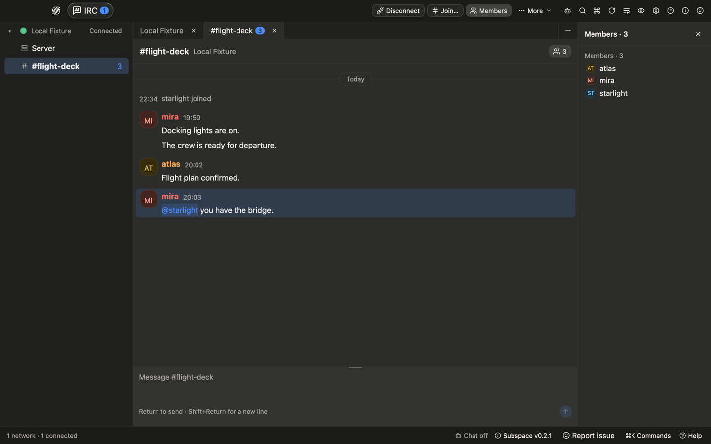
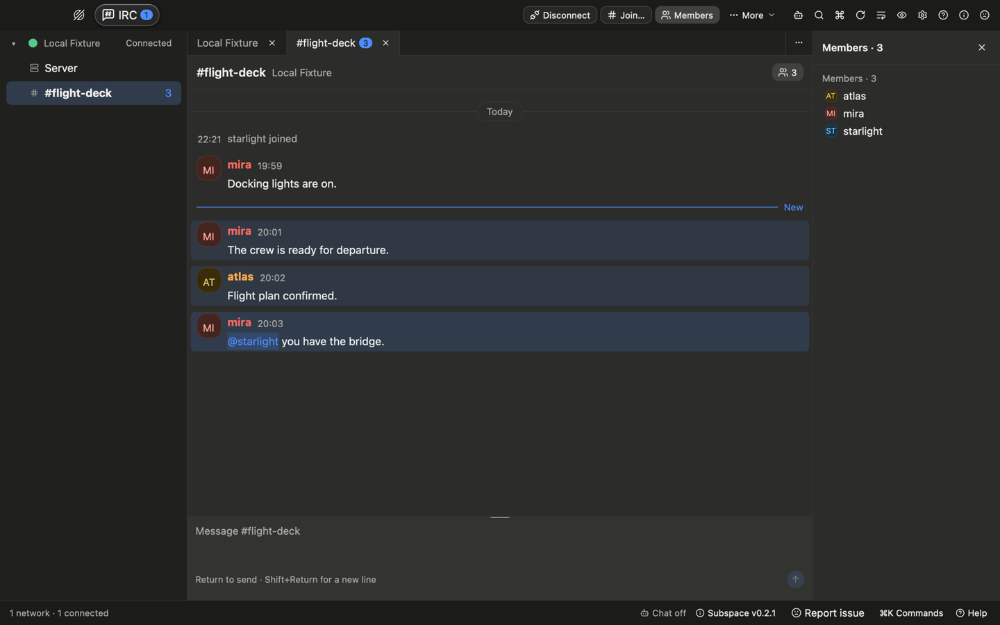
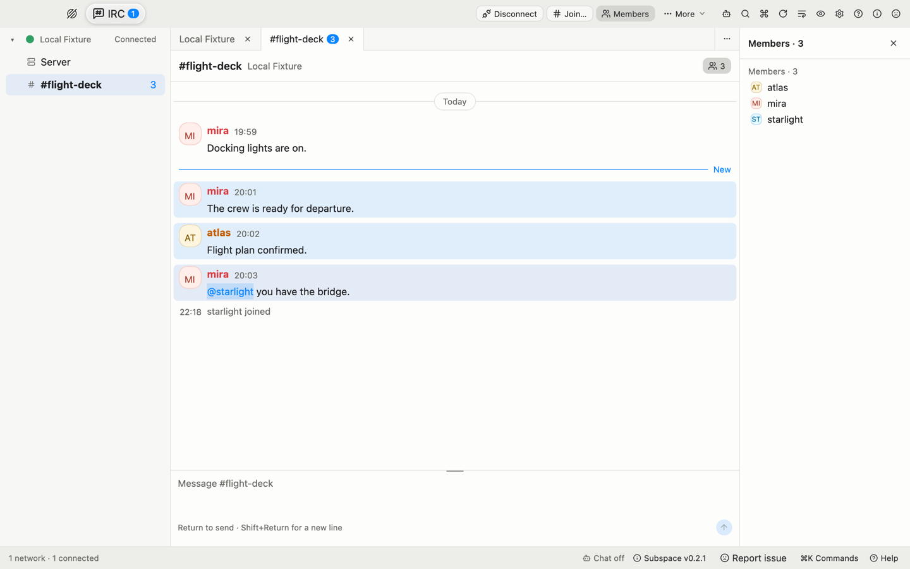

# IRC unread messages

Show a **New** divider before the first unread message and tint unread
messages in the transcript. A divider begins a fresh sender group so the
first message has its sender's name and timestamp.

The IRC board uses the same retained messages as its unread badges. It
keeps what was unread on entry to the focused conversation so opening it
can still clear the badge and publish the existing IRCv3 read marker.
The divider clears when the reader leaves the conversation. Local unread
tracking also works on servers that lack the read-marker capability.

The macOS loopback fixture supplied an IRCv3 read marker between a read
message and three unread messages. The headless tests exercise the
boundary, the sender grouping and the conversation opening lifecycle.
The fleet's Ergo server advertised `draft/read-marker` in `CAP LS 302`
and acknowledged a request for it over TLS.

