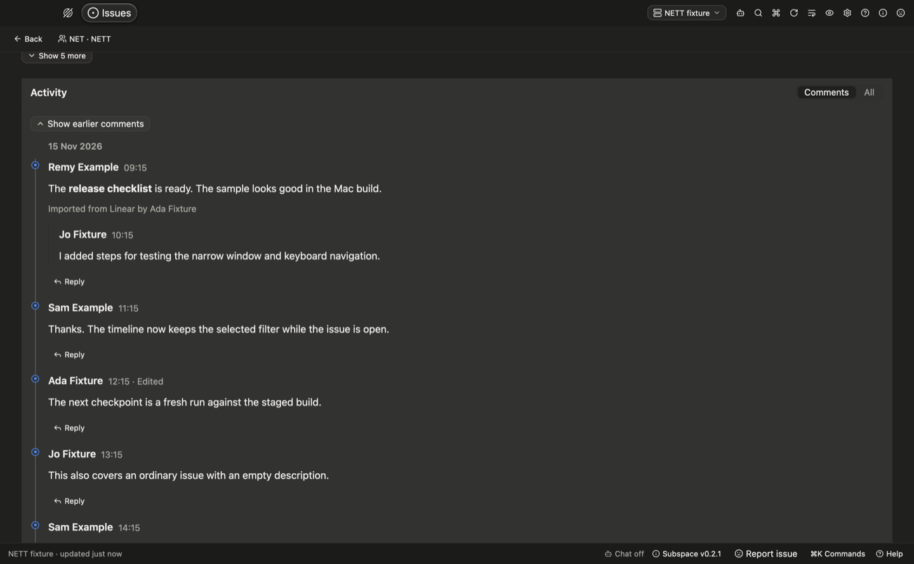
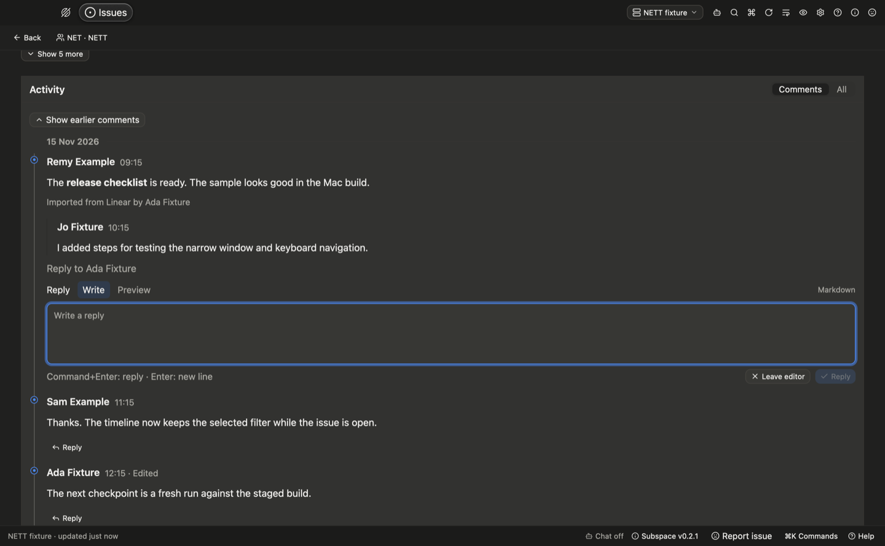
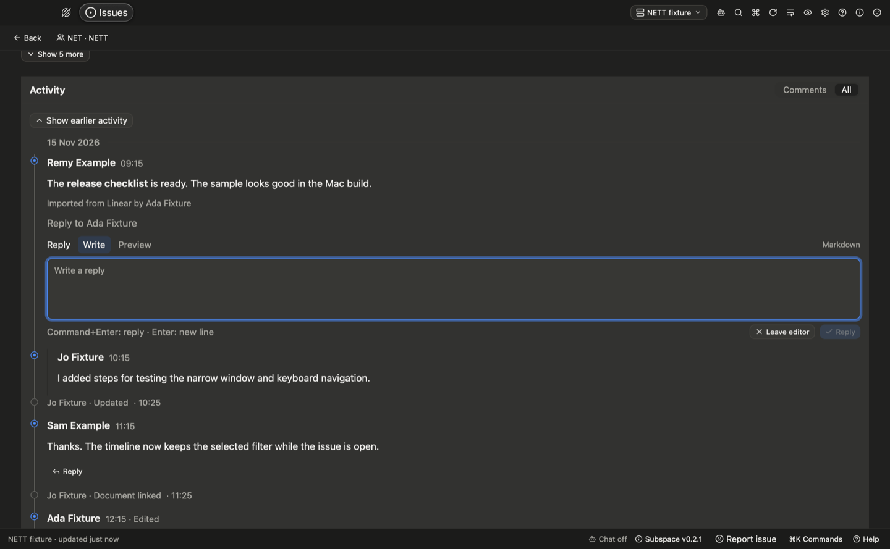

# Issue comment layout

The issue timeline uses the rail and circular markers from the Subspace
workflow design as a visual reference. A filled marker and extra spacing
separate each comment thread. The All view keeps events compact, with hollow
markers and their own times.

A date heading covers the entries beneath it. Each byline shows the local
time, with a full date for replies that fall on a different day from their
parent. Replies and their editor stay in the parent thread in Comments.

The macOS preview uses the loopback fixture with synthetic comments. The
board test checks the layout bounds and grouping of a reply and its parent
in the Comments and All views.

Earlier comments layout

