# Issue decisions verification

Back to the [change record](intent.md).

## Local checks

The locked Rust suites cover the client projections, scoped page requests,
refresh depth, stale responses, retries and the board's real controls in a
headless window. The board covers both openers, focus containment and return,
Escape order, channel-origin Back and the 700 px layout. The keyboard-only
test uses `m`, Right, Enter and Tab to open the panel, then Escape to close
the panel and leave the issue. These tests use loopback fixtures.

The desktop was also run against the local stack's Subspace API with
fictional decisions linked to an issue, reading the list and one decision
through `GET /api/v1/decisions?issue=` and `GET /api/v1/decisions/{id}`.

## Capture

Captured with `make capture` from the isolated fixture build, in Cupertino
Dark, using the [Decisions fixture](../../capture.md#decisions-fixture).
`CAPTURE_DECISION_SCENARIO` set to `forbidden`, `unavailable` or `missing`
gives the 403, 503 and missing-detail states. The narrow captures set the
saved window to 700 × 800. The before image is from the branch's base,
before this change.

| State | Image |
| --- | --- |
| Before: SUB-1's Activity has only Comments and All | 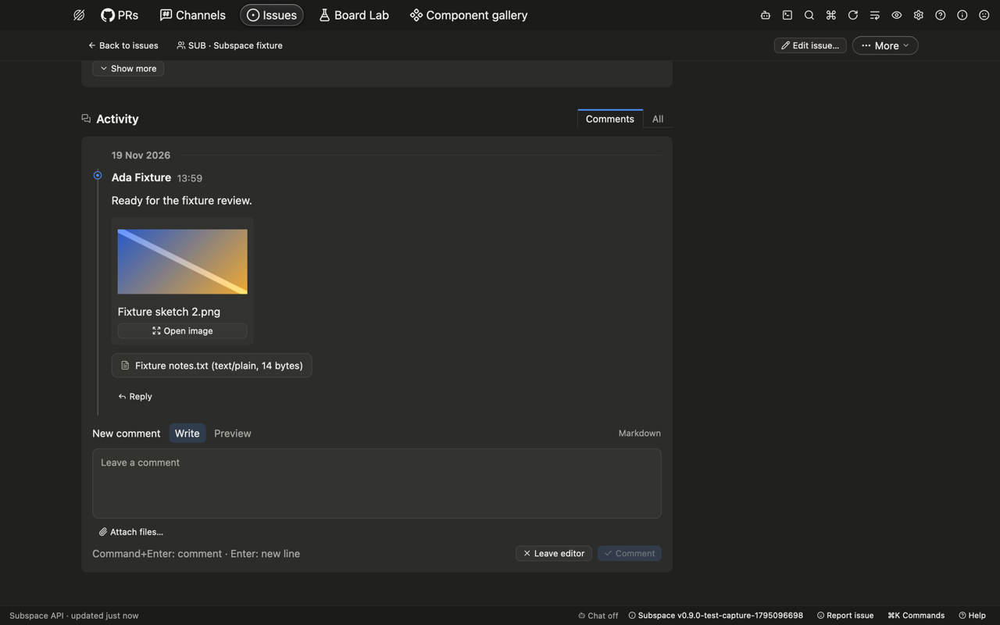 |
| The Decisions tab on SUB-1: three linked decisions, newest decided first, with their status, project, date, and maker or successor | 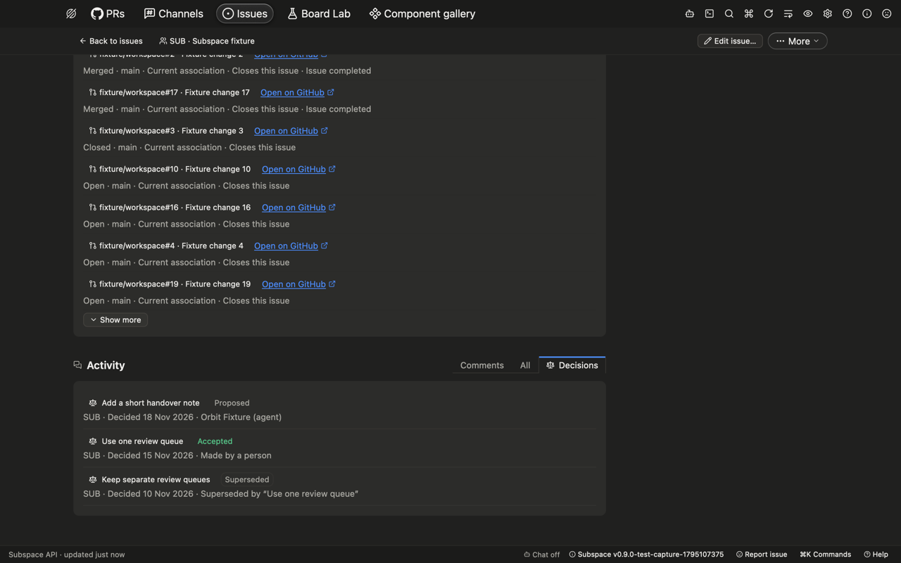 |
| **Use one review queue** in the side panel, scrolled down: the decision text, maker, evidence link showing its host, the decision it supersedes and linked issues SUB-1 and SUB-4 | 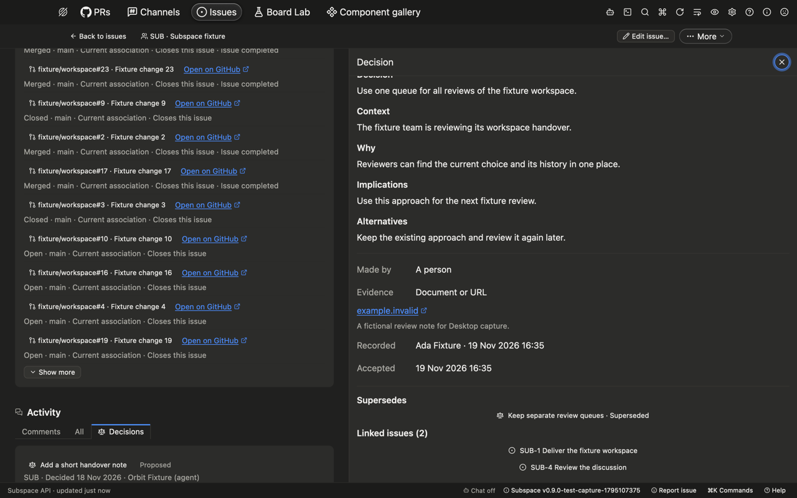 |
| After following **Supersedes**: the earlier decision, with Back to return | 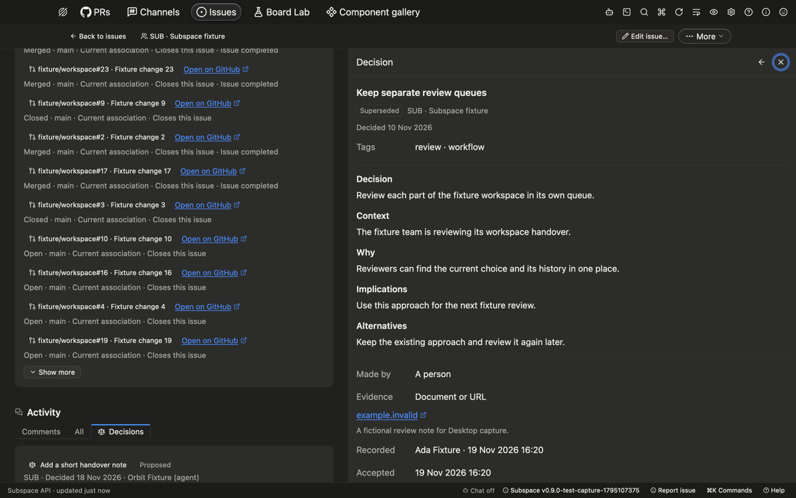 |
| Escape closes the panel, keeps the Decisions tab and returns focus to the opener | 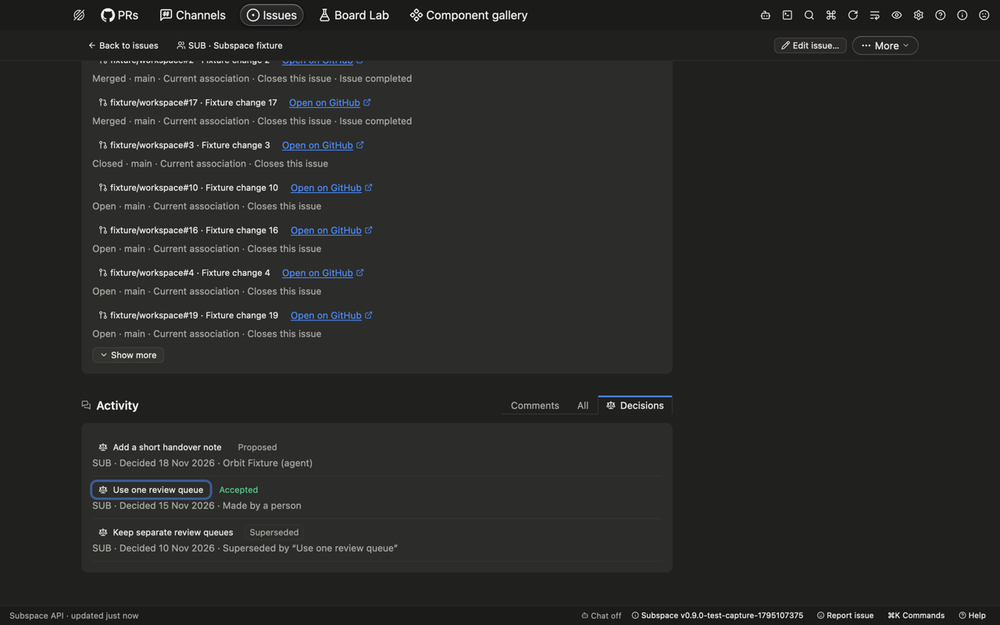 |
| SUB-2 has no linked decisions | 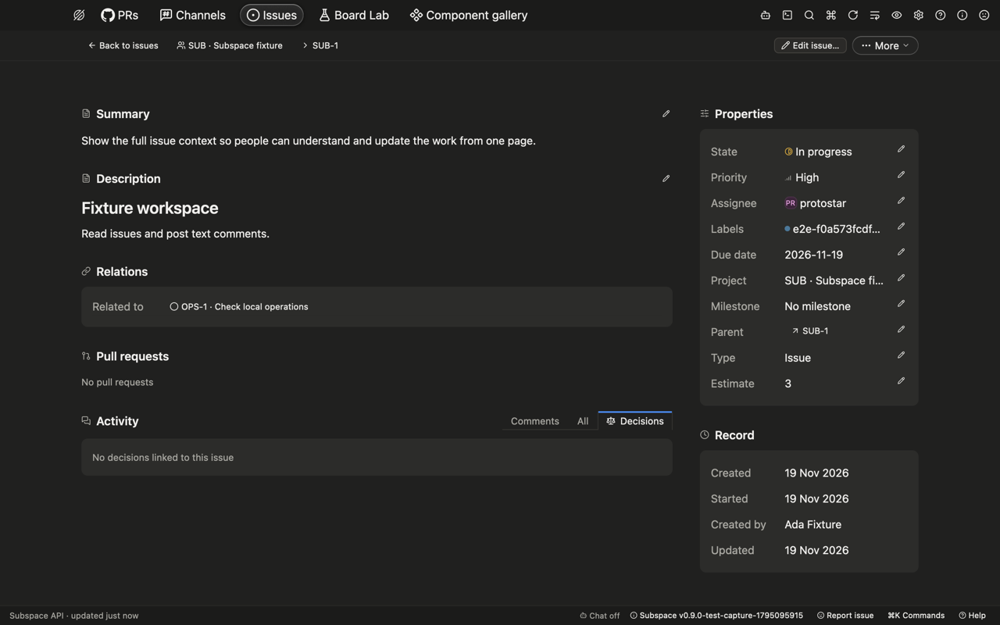 |
| 403: no access to this issue's decisions, with no Retry | 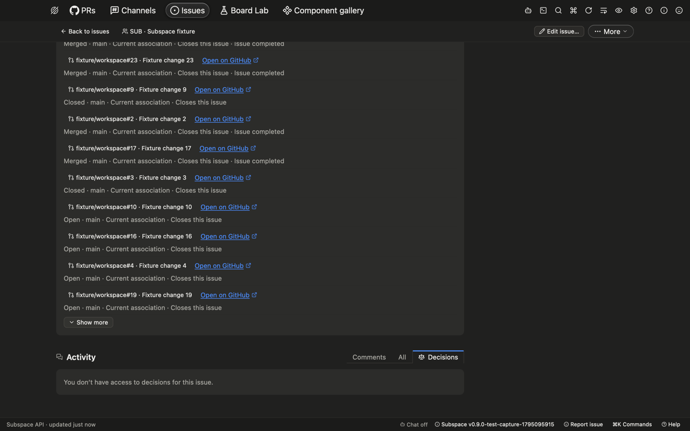 |
| 503: the list couldn't load, with Retry | 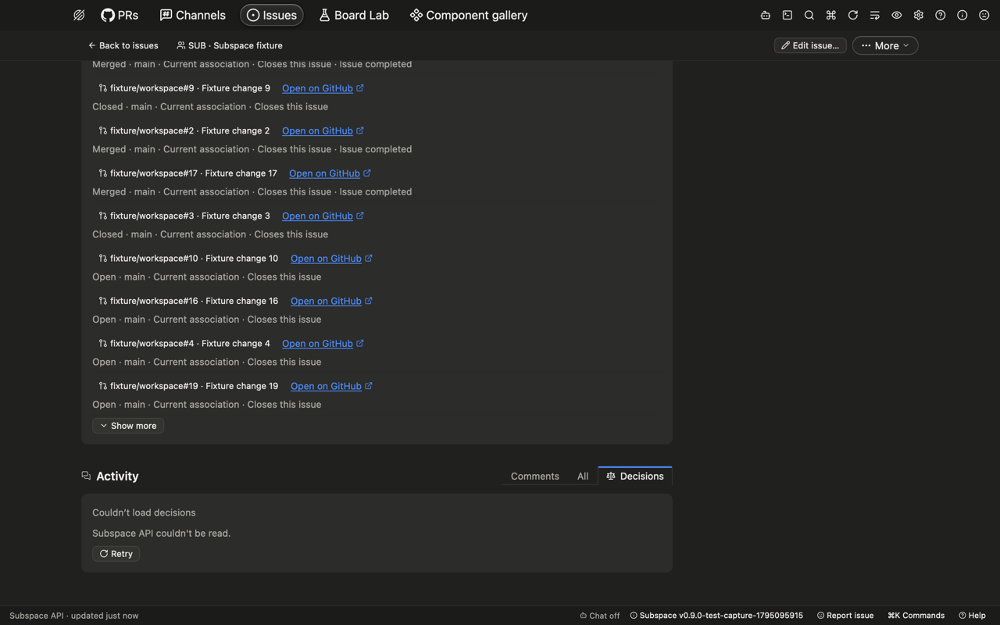 |
| A listed decision whose detail returns 404 | 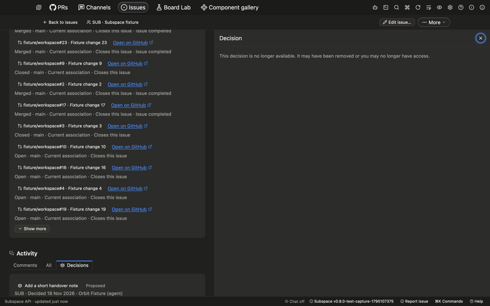 |
| A 700 px window: the tabs wrap below the Activity heading | 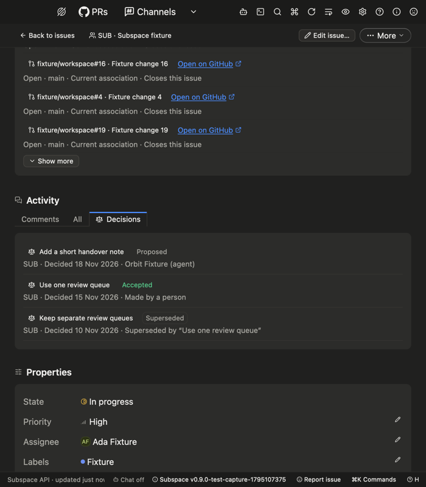 |
| A 700 px window: the panel keeps 75% of the width, so the issue column narrows | 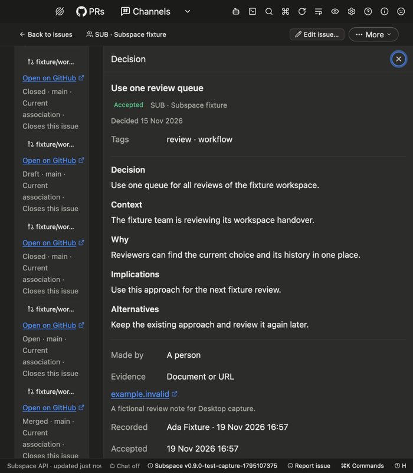 |

The panel's width is clamped to at least 320 px and at most 75% of the
window, so at 700 px it is 525 px wide. This is intended.

Tab revealing clipped controls, the scroll keys and the inert issue page
behind the panel are covered by headless tests
(`tests/decisions/keyboard.rs`), not captures. The keyboard walkthrough was
not captured natively. The capture harness
focuses the Space again before every `key:` step, so Enter doesn't activate
a focused tab. The headless test
`keyboard_only_from_activity_to_decision_and_back` covers the same keyboard
path.
