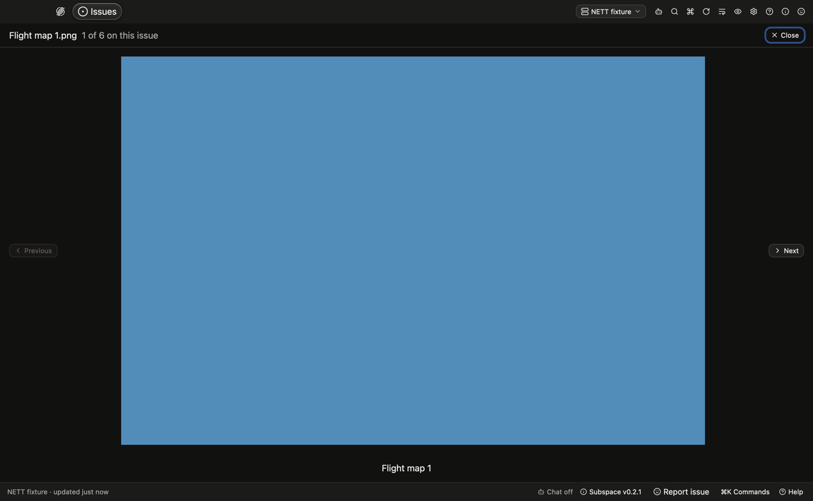

# Issue image loading and cache pressure

## Intent and behavior

An issue with many images could occupy shared background workers while the
dedicated NETT file reader was busy. When the visible previews exceeded the
128 MiB cache, decoding one preview evicted another and triggered a fresh read
on each redraw.

The Issues board now runs up to three preview requests and reserves one slot
for the open viewer. The slot gives the viewer priority for admission. A new
viewer image waits for a free slot during fast navigation, and the dedicated
reader handles requests already admitted in order. The reader handles HTTP
and batches grants. Queue admission and result delivery are asynchronous, including when
the queue is full. Cancellation closes the reply, and the file reader checks
the issue revision and access scope before using it. Only image decoding uses
the shared background executor.

The cache continues to keep 128 MiB of decoded previews across the current and
previous issue. It gives the image open in the viewer priority. Evictions keep
a zero-byte placeholder, so a redraw leaves the tile settled. **Open image**
can request those bytes again through the normal private grant path.
Reopening an issue offers one fresh preview pass for that issue.

## Verification

- [x] A bounded in-memory queue waits for space, then for a reply, and closes
  an accepted request's reply when the caller cancels.
- [x] The real headless Issues board settles with two previews and room for
  one. Repeated redraws make no image reads, and opening the evicted image
  reads it once and renders it in the viewer.
- [x] The board tests cover three tile slots, the reserved viewer slot, a
  waiting tile resuming and a preview pass when revisiting an issue.
- [x] The loopback `images-pressure` scenario serves six synthetic 24 MiB
  decoded images. It goes through the real desktop image list, file grant,
  bounded decode and viewer paths.
- [x] Existing image tests cover late results, retries, sign-out, grants,
  focus, navigation and decoded bytes.

### Board checklist: Issues

- [x] The current board registration, deep links, tool and runtime
  integration use the existing Issues board and hub.
- [x] The existing image tile shows an accessible placeholder and retains
  its **Open image** action. The existing viewer keeps focus and navigation.
- [x] The image queue and cache are in memory. Closing or changing access
  scope clears private previews and discards late reads.
- [x] The board uses the existing Issues profile, help, local fixture and
  private file fetch. No new setting, stored choice, contract or user command
  applies to the cache change.
- [x] The issue-media tests exercise the queue, cache and viewer. Mac fixture
  evidence is below.

## Mac fixture evidence

The captures use Cupertino Dark and loopback NETT and WorkOS fixtures. The
previous image implementation is `bb86982` on the feature branch. The image
viewer and panel had yet to land on `main`.

Previous build cycling a preview through Loading image with six images in the panel.

A settled placeholder while the other images stay available.

