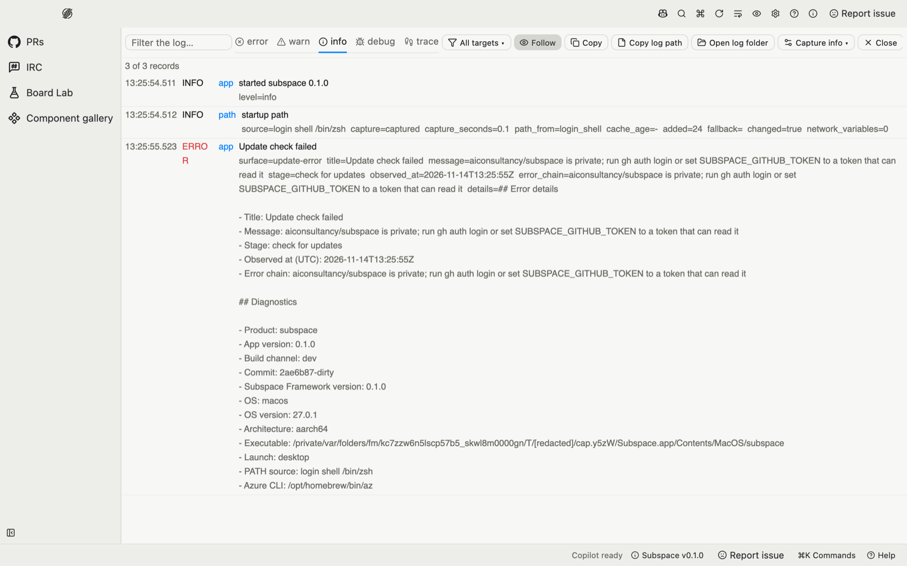
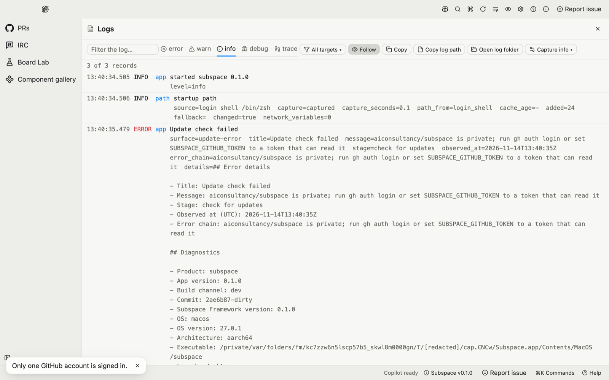
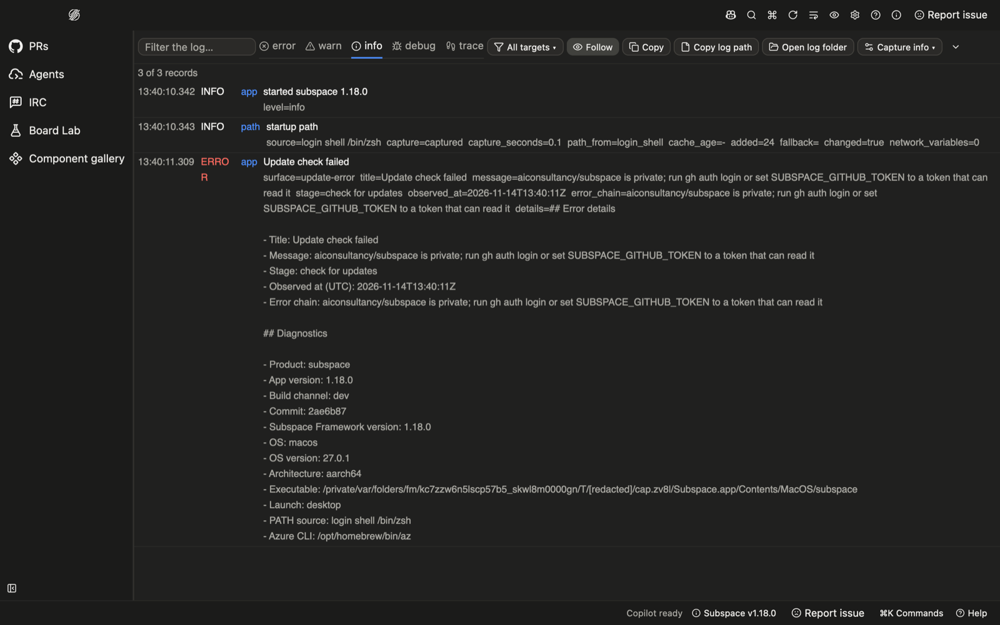
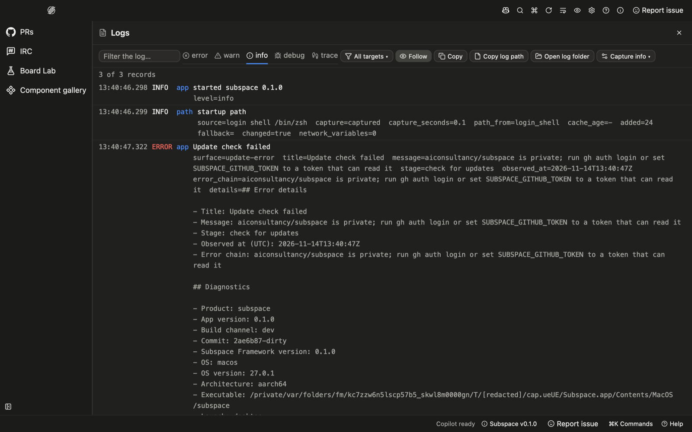
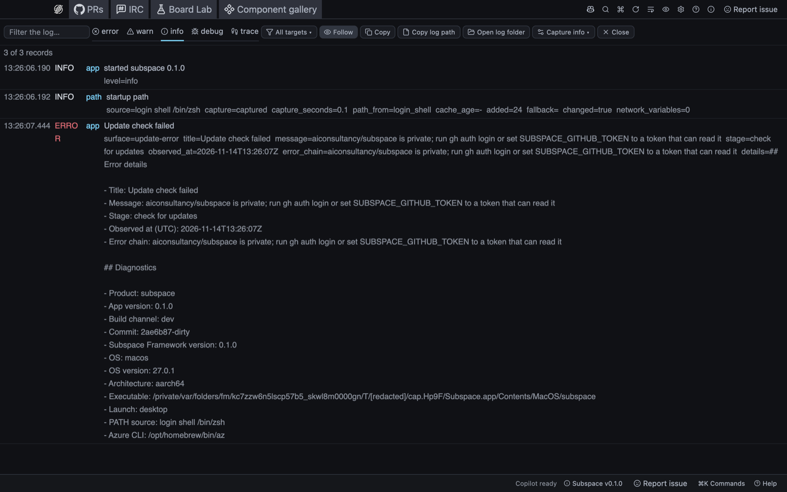
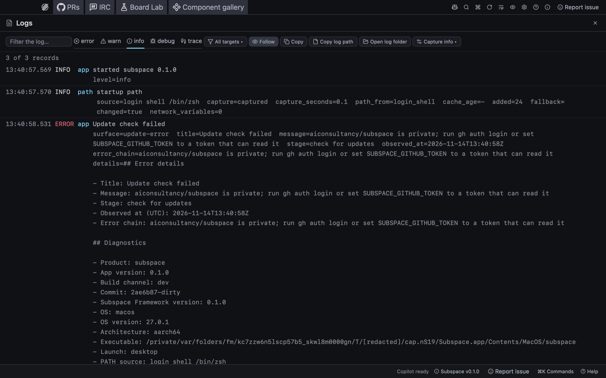
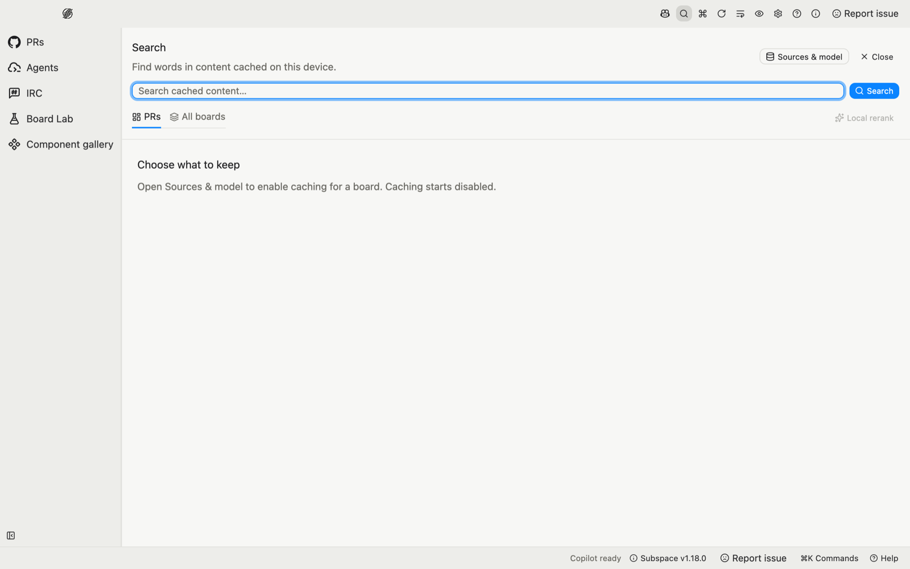
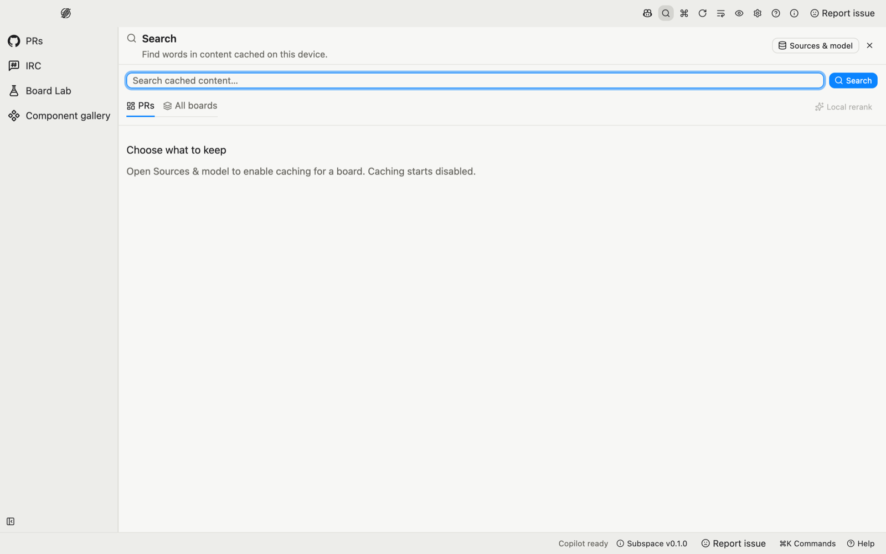
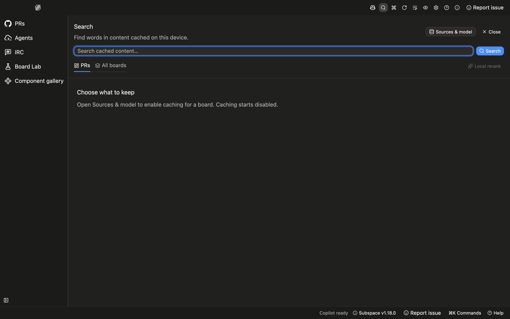
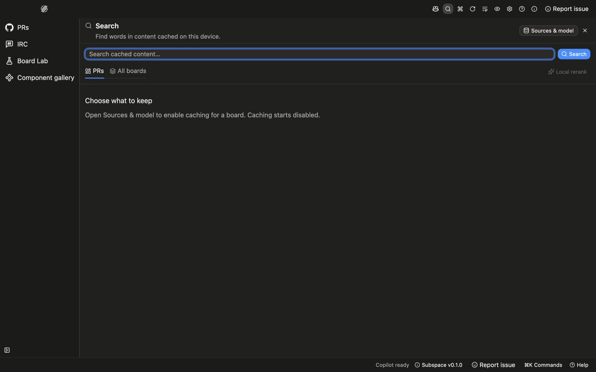

# Change: Close the log view

## Intent

The owner's feedback: when the logs are shown, from About or from the
Subspace menu, there is no obvious way to close the view. It opens in place of
a board but has no tab, which is right because it is not a board, but it needs
a way to close it.

The log view's only Close was the last unit of its overflow toolbar, so it was
easy to miss and moved behind the chevron in a narrower window. Escape worked
only while the view had focus, and nothing on screen said so. The level column
also wrapped `ERROR` as `ERRO` / `R`, because the list asked for a
`monospace` family that does not exist and fell back to the proportional UI
font in a fixed 44 px lane.

The full-text Search view is the other Framework view shown in place of the
board. Its Close was visible but was a labelled header action beside
**Sources & model**, with a different header geometry. Both views should look
and close the same way.

## Spec

- A shared `subspace_dashboard::surface_header::SurfaceHeader` is the title bar
  of a view the shell shows in place of the board. It has a leading muted glyph,
  a semibold title in the heading family at `heading_font`, an optional muted
  description under the title, the view's trailing actions and a Close control.
  It uses `toolbar_height` as its minimum height, the `pad_x` inset and a `line`
  bottom hairline.
- Close is the shared quiet `icon_button` with the X glyph. Its accessible name
  names the view (**Close logs**, **Close search**) and its tooltip names the
  shortcut (`Close logs (Esc)`). It is always the last control in the header and
  is never an overflow unit, so it stays visible at any window width.
- The log view shows the header titled **Logs** (FileText glyph, the glyph of
  **Show log**) above its toolbar. The toolbar no longer has a Close unit or a
  Close overflow entry.
- Escape closes the log view from anywhere inside it, including the filter
  input. An open target, capture or overflow menu closes first.
- The Search view shows the same header titled **Search** (Search glyph) with
  its description and **Sources & model**. The query and scope rows sit below it.
  Escape keeps its existing behaviour (it cancels a pending source clear first).
- While Logs or Search is open, the tabs and rail show no board as current.
  Selecting a board closes the view. Both were already true; the rule now lives
  in one `SubspaceApp::shows_current` and a test covers it.
- While the log view is open, the palette offers **Close logs** (shortcut Esc)
  in place of **Show logs**, as it offers **Close theme designer**. The
  native app menu is unchanged.
- The log list uses the theme's monospace family. The level lane is measured
  with `measure::text_width` to fit the widest level label (`ERROR`) at the
  current monospace size, so no label wraps and every message starts on one
  spine. Header, toolbar, record count and lines share the `pad_x` inset; the
  Search body uses it too.

## Delivery

Captured with the headless capture build, isolated `HOME`, vertical navigation
unless stated. "Before" is the branch before this change.

Logs, Cupertino Light, before: Close is the last toolbar unit and `ERROR`
wraps.

Logs, Cupertino Light, after: the **Logs** header with the close button at its
right; no Close in the toolbar; `ERROR` on one line in the monospace lane.

Logs, Cupertino Dark, before: Close has already moved behind the overflow
chevron.

Logs, Cupertino Dark, after.

Logs, One Dark, horizontal tabs, before.

Logs, One Dark, horizontal tabs, after: no board tab is current while the view
is open.

Search, Cupertino Light, before: a labelled **Close** action and its own header
geometry.

Search, Cupertino Light, after: the same header and close button as Logs.

Search, Cupertino Dark, before.

Search, Cupertino Dark, after.

The capture build has no window-resize step, so the narrow-window case is
covered by render tests instead: at 360 px and at 320 px with extra-large icon
buttons the log toolbar collapses into its chevron while the header's Close
stays visible inside the header, and the overflow menu has no Close entry.

## Tasks

- [x] Add `surface_header::SurfaceHeader` with a render test for a narrow
      window and the Esc tooltip.
- [x] Show it in the log view; remove the toolbar's Close unit and popup entry.
- [x] Escape closes the log view from the filter input; test it.
- [x] Use the theme monospace family and a measured level lane; test that
      `ERROR` fits on one line.
- [x] Use the same header in the Search view; test pointer and Escape close.
- [x] Move board-current state into `SubspaceApp::shows_current`; test that the
      rail shows no current board while Logs is open, and that the header's
      Close and selecting a board both return to the board.
- [x] Offer **Close logs** in the palette while the log view is open.
- [x] Update `docs/logging.md` and `docs/ui-components.md`.
- [x] Capture before and after screenshots in light and dark themes.
