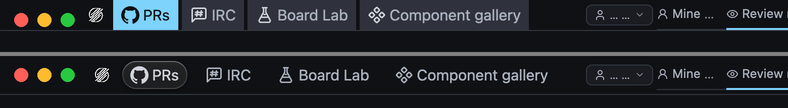
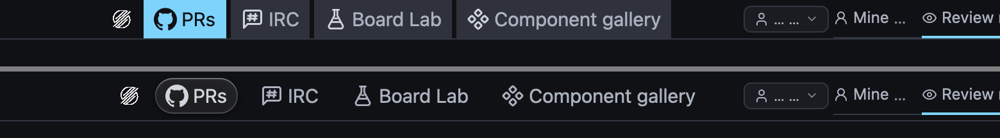
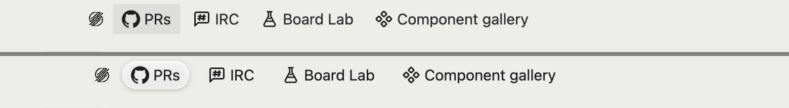
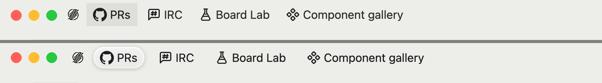
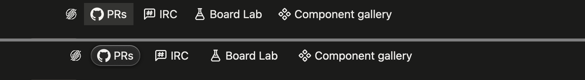
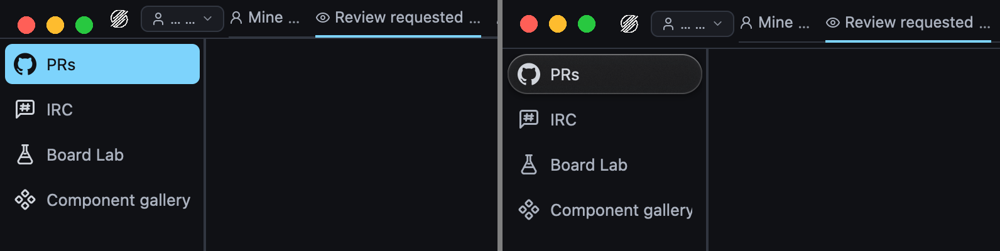
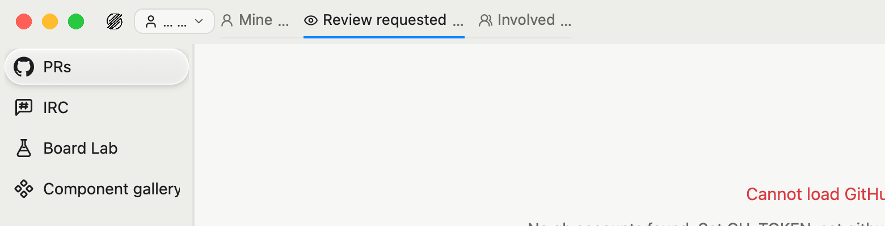

# Delivery: glass capsule board tabs and title-bar spacing

These images come from isolated debug capture builds. Each uses a temporary
`HOME`, no accounts, a 1280 × 800 window and the default boards. The
**before** images are from the branch before this change; the **after**
images are from the change. In each pair, before is on top (or on the left).

Offscreen captures render only the window's content, not the macOS traffic
lights. In the images marked *traffic lights overlaid*, the coloured circles
are drawn afterwards. They sit at the positions AppKit uses: 14 pt buttons,
9 pt apart, starting 14 pt from the edge. Their vertical position is the one
Subspace sets: 13 pt from the top before, and centred on the 38 px row after.
Headless layout tests check the same numbers: `title_bar_content_clears_the_traffic_lights_on_their_centre_line`
and the `titlebar` unit tests.

## Results

- `make check` passes. One run failed in the Board Lab proxy test
  `project_runtime_persistent_proxy_survives_more_than_32_requests_and_reaps_on_drop`,
  which uses loopback sockets and does not involve this change. That test
  passed on its own three times, and the next full run passed.
- `mise run quality` passes with no new findings.
- At 1280 px wide, the PR board's controls still fit beside the tabs, as
  they did before the change. The tabs keep GPUI Kit's small-button padding,
  and there are 10 px between capsules: the overflow gap plus the shadow
  room.
