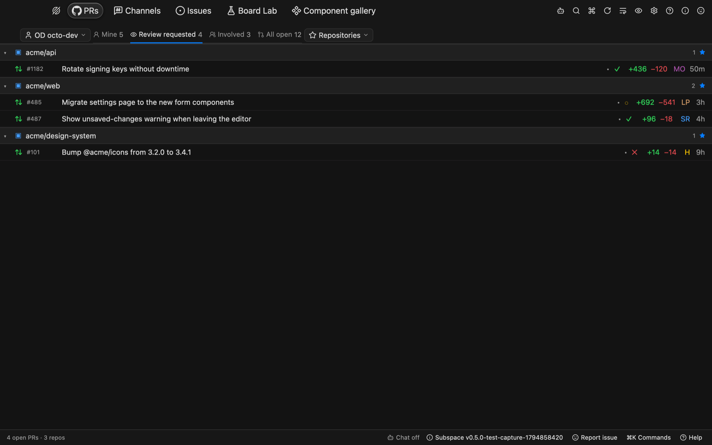
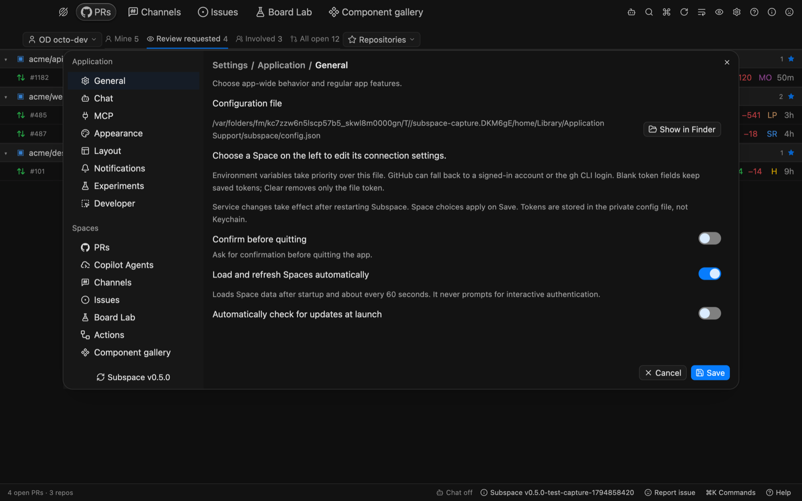

# macOS Classic Dark Remix theme

Back to the [change records](../README.md).

## Intent

The owner supplied a theme, "macOS Classic Dark Remix": huacnlee's
[macOS Classic](https://github.com/huacnlee/zed-theme-macos-classic) theme
for Zed, remixed with Subspace density and fonts, and asked for it to be
committed.

## Spec

- `framework/host/app/themes/macos-classic-dark-remix.json`, one dark
  variant, registered as `macos-classic-dark-remix` in the host's bundled
  themes and the Subspace product's theme list. Cupertino Dark stays the
  default.
- The upstream theme is MIT (Copyright (c) 2023 Jason Lee). The licence text
  ships in `licenses/themes/LICENSE-MACOS-CLASSIC`, listed in
  `licenses/themes/README.md`; the app bundle copies `licenses/`.
- Three values differ from the JSON as supplied, so the theme passes the
  checks every bundled Subspace theme must pass:
  - `switch.background` `#393939` → `#808080`: the off switch track had 1.6:1
    contrast on the page; it now has at least 3:1 on the page, popover and
    secondary surfaces, and the thumb has at least 3:1 on it (WCAG 1.4.11).
  - `caret` `#bfbfbf` → `#dedede`: Subspace reads `caret` as strong text, so
    the supplied value made headings dimmer than body text and left a
    latched toolbar glyph at 4.1:1 on its fill; it now matches the body text
    and meets 4.5:1 (WCAG 1.4.3).
  - Glass tones `glass`, `glass-rim` and `glass-shadow` from Cupertino Dark,
    which the supplied block did not set, so the current Space's capsule
    reads as a surface with a legible label.
- [Appearance](../../appearance.md#macos-classic-dark-remix) describes it.

## Delivery

All 62 theme tests pass, including off-switch contrast, glass and flat
button legibility. The switch-rule count grows from 41 to 42 variants; the
count of variants that need the runtime track fix stays at 39.

The PRs Space and Settings (fixture data):

## Tasks

- [x] Add the theme with its licence notice.
- [x] Adjust three values for the accessibility checks.
- [x] Register, document and capture it.
