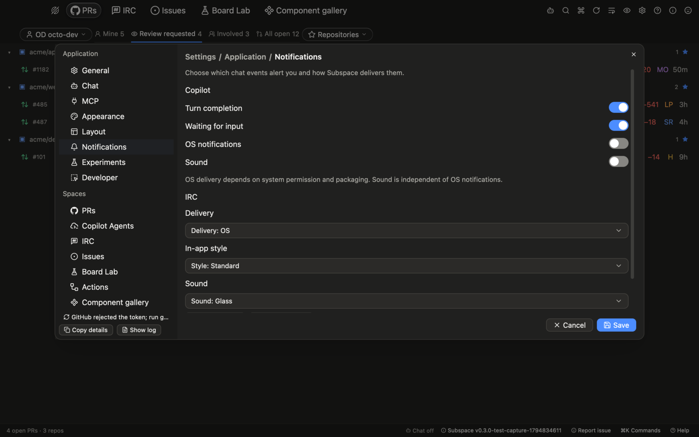
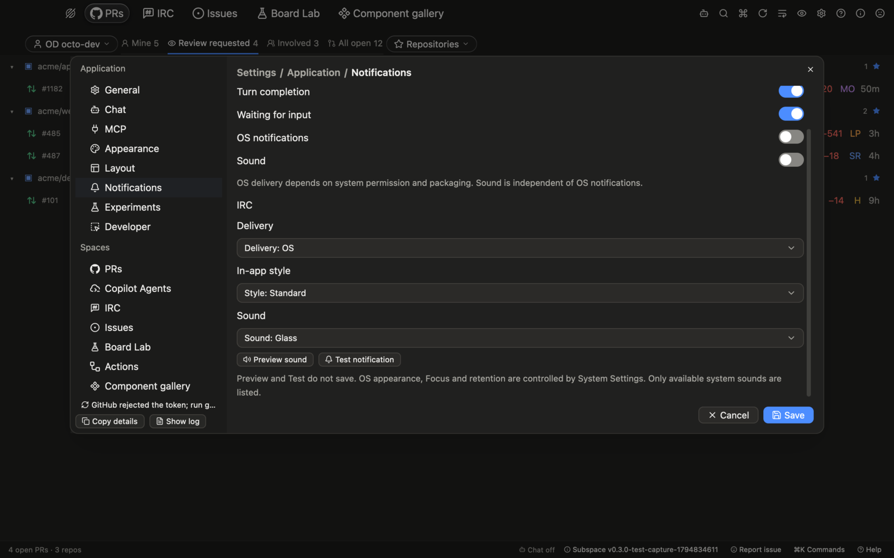
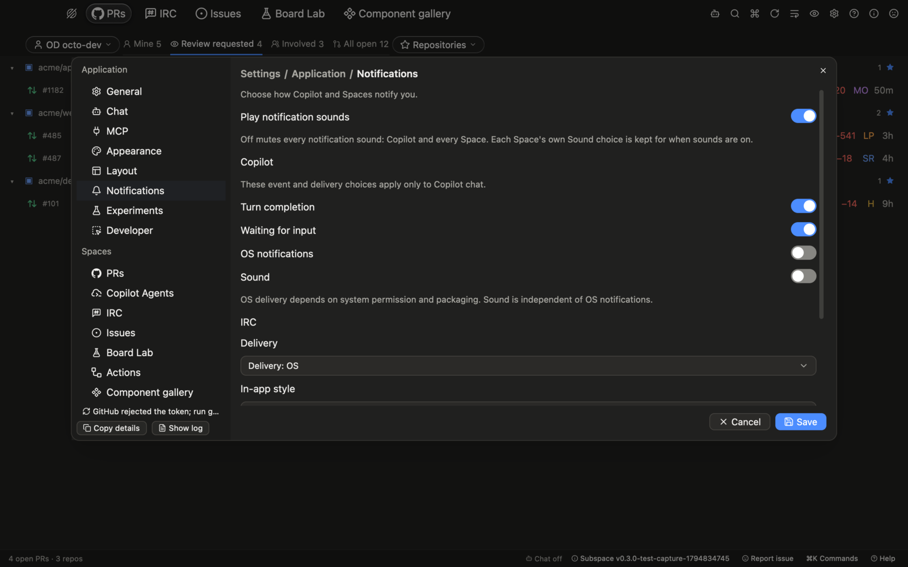
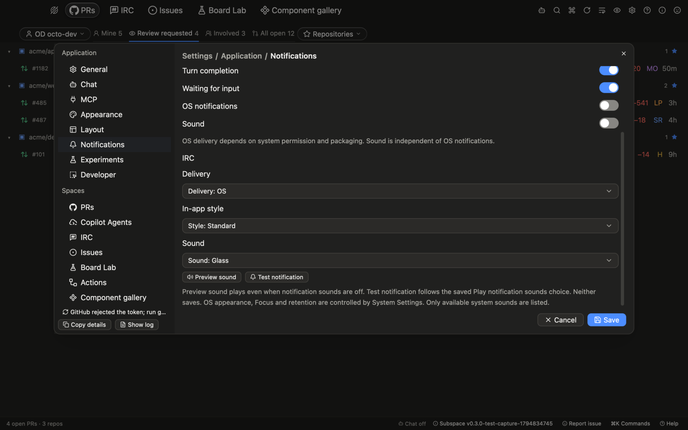

# Mute every notification sound

## Intent

SUBSPACE-JT-1116-SOUNDS: a person muted the Copilot Sound switch expecting
silence, but IRC still played Glass. Add one clear application-wide choice.

## Spec

- The first Notifications control is **Play notification sounds**, default
  on, saved as `notifications.sounds`. Save applies it; Cancel discards it.
- Off gates shared board playback, shell chat playback and OS banner sound.
  Individual choices remain stored. Explicit Preview sound bypasses the
  master; Test notification follows the saved master.
- Keep the Copilot heading and add a note that its controls apply only to
  Copilot chat. Use the existing shared toggle row, switch and note components.
- Linux uses a Linux-only notify-rust dependency to set SuppressSound(true),
  retaining default-action routing. GPUI's OS-post API has no silence flag;
  its Windows banners already specify silent audio and macOS adds no sound.

## Delivery

Regression coverage includes default-on, Save, Cancel, failed Save, dirty
tracking, shared playback, explicit previews, shell playback, Copilot/Space
native posts, windowless posts and Test notification routes. The Linux
adapter test checks the actual suppression hint.

Required gates: make check, mise run quality, make interfaces, mise run audit
and full pre-push hooks. Final results are recorded in the PR body.

jt captured the six images below on macOS with `make capture`, using the
capture runbook and fixture data in Cupertino Dark. The before build was
`a0a8f252f379e5e801ebfb4f51adb86bee34de14`; the after build was
`3e6067721630b01b7bdcb4ce66c32c1611a46368`. The captain downloaded and
inspected the originals. Bashir resized copies from 2560 × 1600 to
1600 × 1000 with ImageMagick 7.1.2-31 and inspected all six again. Original
captures were kept unchanged; no screenshots were taken on Linux.

The documentation/evidence follow-up reruns `make check`, `mise run quality`
and the full repository pre-push hooks. It changes no application code,
dependencies, product interface or quality baseline.

### Captures

No new shared UI component or board integration capability is introduced.
The Copilot Agents call-site supplies App to the shared playback gate; its
help text now explains the master. Its other board integration points remain
as before (no contracts, lifecycle, settings schema or tool changes).

### Board checklist: Copilot Agents and IRC

| Area | Implemented or not applicable |
| --- | --- |
| Identity, registration, artwork, retain | Not applicable: no identity, descriptor, registration or process ownership changes. |
| List hooks, components, toolbar/status/badge/busy, palette, keys, menus/dialogs, empty/loading/error, quit warnings | Not applicable: no board UI or interaction changes; host Settings reuses shared components. |
| Settings, connections/config editor, experiments | Host owns the new preference; no board schema, opt-in or feature changes. |
| Choices, store, cache-first loads, refresh | Sound choices remain stored; no data, loading or refresh changes. |
| Item/full-text search and cross-board references | Not applicable: no search change. |
| Tools, app-only tools, MCP/CLI docs | Not applicable: no tools change. |
| Chat context | Not applicable: no context change. |
| Notifications, defaults, activation, process ownership and attention | Existing delivery and routes retained; shared playback reads the master. No board-specific policy added. |
| Help guides, images and doc links | Existing guides updated and still linked; six inspected host Settings captures included above. |
| Contracts and framework globals | No new contracts or cross-board dependencies; master read through board-kit's notification API. |
| Links, logging and diagnostics | No board link/diagnostic changes; native failures report generic errors. |
| Pure/interaction/layout tests and evidence | Regression tests added; macOS capture evidence included above. |

## Tasks

- [x] Trace the separate Copilot and Space preferences and all playback paths.
- [x] Add a drafted master and clarify Copilot scope.
- [x] Gate shared playback and silent native banners; preserve Preview sound.
- [x] Add regression tests and update settings/help documentation.
- [x] Capture and inspect macOS before/after evidence; embed in the PR.
