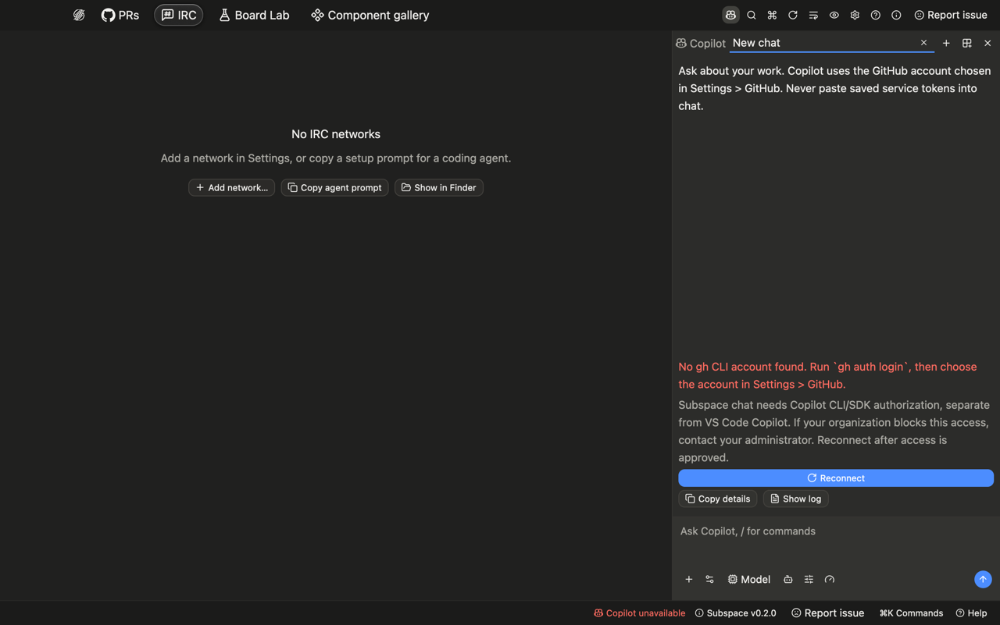
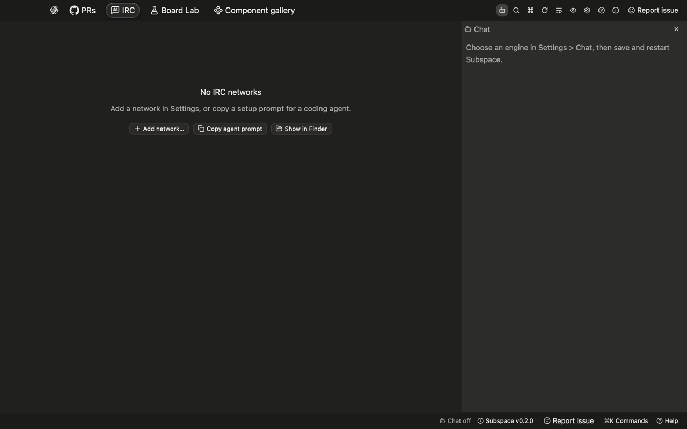
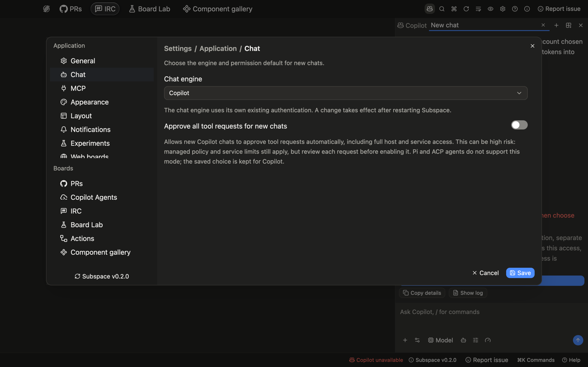
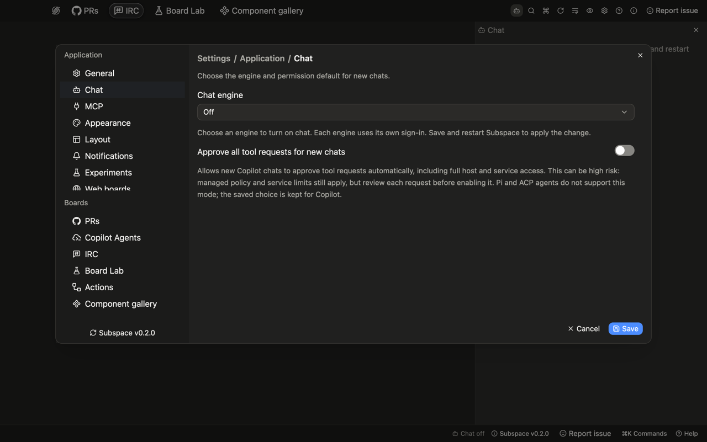
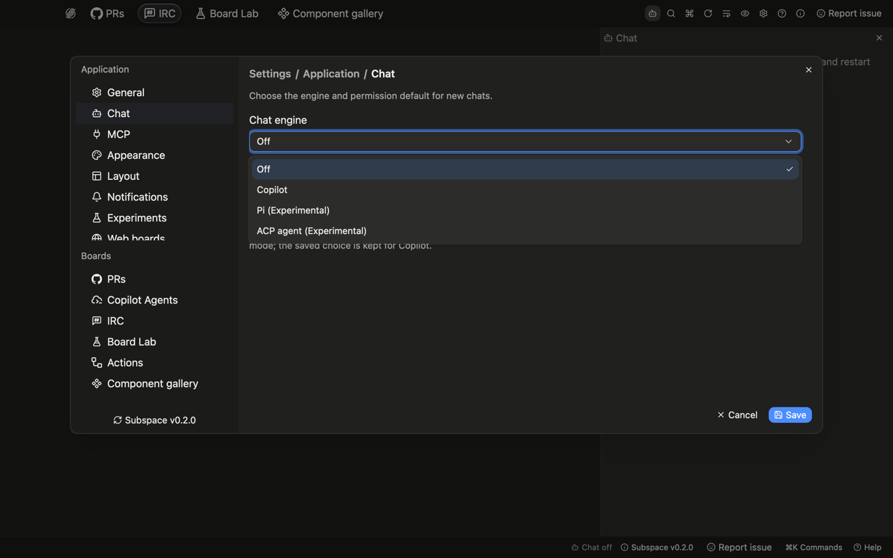

# Delivery

These captures use isolated macOS debug builds in Cupertino Dark, a fresh
temporary home and the IRC board with no networks configured. The before
build uses the desktop feature branch at `b6032a2`.

## Checks

- `make check` passes, including workspace tests, Clippy and script fixtures.
- `mise run quality` passes with no new findings.
- Regression tests cover the default engine, saved engine choices, experiment
  fallback and opening Chat without a runtime.
- Both capture builds produced the same macOS linker warning about the size of
  the unwind metadata.
