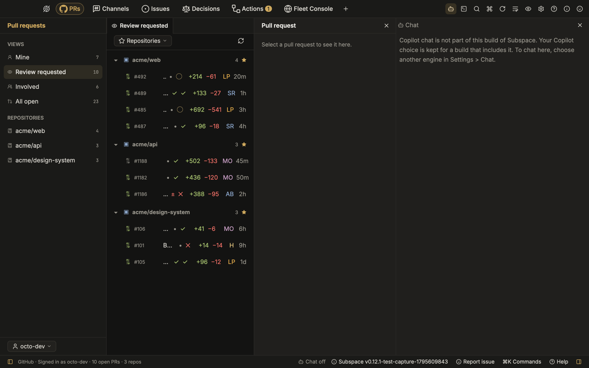
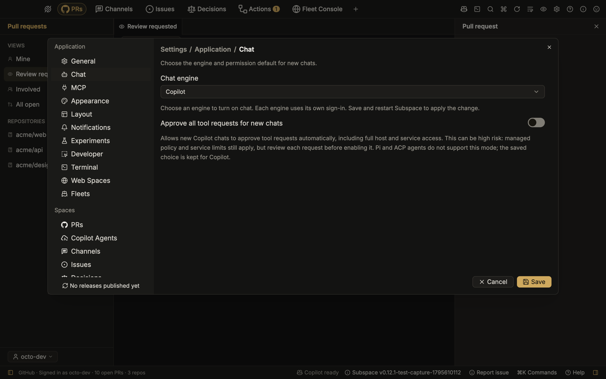
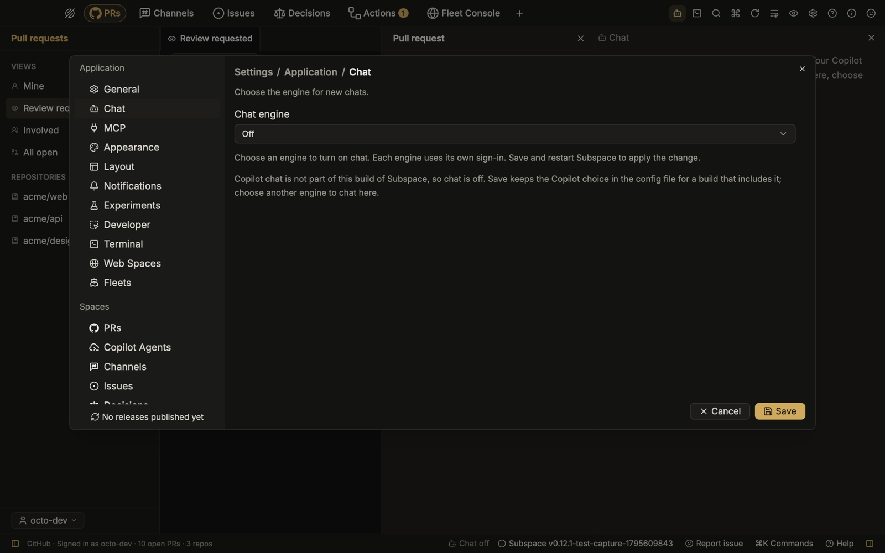
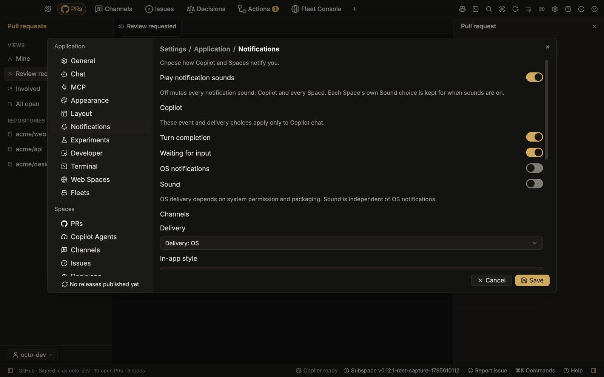
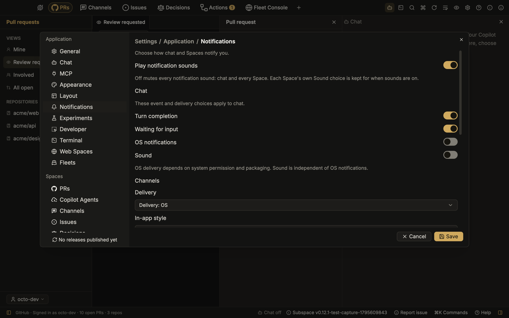

# Copilot chat as a build option

## Intent

The Copilot SDK's build script downloads the Copilot CLI and its runtime, and
the app embeds both. That is the largest single part of the app (see
[Size](#size)), and most people chat through Pi or an ACP agent, or not at
all. The owner wants the open-source build and downstream builds made from
it to leave Copilot out by default, so the SDK is neither compiled,
downloaded nor bundled, with Copilot still available to anyone who builds it
in. Nothing else changes.

## Spec

### The switch

- `subspace-agent` has a `copilot` feature, off by default, which turns on
  the optional `github-copilot-sdk` dependency (and the two crates only its
  engine uses). Every module that talks to the SDK is built only with it;
  Pi and ACP, and the modules they share, are always built.
- The Framework facade's `copilot` feature implies `agent` and turns on
  `subspace-agent/copilot`. Neither `agent` nor `host` implies it.
- The Subspace App's `copilot` feature turns on the Framework's. It is not in
  `default`. Packaging reads it from `SUBSPACE_BUILD_FEATURES`, as it reads
  `terminal`; `make run FEATURES="terminal copilot"` runs it.
- Only a product may enable the facade's `copilot`: the desktop architecture
  check refuses it on a Space, client or terminal crate, as it refuses
  `host` and `capture`.
- `subspace_agent::COPILOT_BUILT_IN` says which build it is;
  `subspace_chat::COPILOT_BUILT_IN` re-exports it for the shell.

### Without Copilot

| Surface | With Copilot | Without |
| --- | --- | --- |
| Settings > Chat engine | Off, Copilot, Pi, ACP agent | Off, Pi, ACP agent |
| Settings > Chat approve-all default and its warning | Shown | Hidden; `chat.approve-all-default` is kept |
| Settings > Notifications | **Copilot** heading and copy | **Chat** heading and copy |
| GitHub account note | Names Copilot chat | Does not |
| Chat pane for a saved Copilot choice | Starts Copilot | Chat off with `COPILOT_UNAVAILABLE`; no runtime, sign-in or Reconnect |
| Copilot Agents **Open in chat** on a cloud task with Pi or ACP | Suggests choosing Copilot | Says the build does not include Copilot |
| `AgentHandle::start` with Copilot selected | Starts it | Refuses with `COPILOT_UNAVAILABLE` |

### Saved settings

- The config file keeps `"chat": {"engine": "copilot"}`. The parser still
  reads it; the chat pane maps it to Off for the session
  (`engine::runnable`) and says why.
- Settings shows Off for it, with a note that the Copilot choice is kept.
  Save writes Copilot back while Off stays selected
  (`chat_engine::kept_engine`), so opening Settings and saving anything else
  does not lose it. Choosing Pi or ACP replaces it.
- State that only Copilot reads (`copilot-tabs-<login>.json`, the Copilot
  workspace, `chat.default-model.copilot`, `chat.approve-all-default`) is
  neither read nor changed. A build with Copilot finds it as it was.

### What it keeps

- Pi, ACP, the chat pane, the transcript, approvals, exports and the agent
  tools.
- The Copilot Agents Space, which reads GitHub's agent task API, and its
  local session list, which the chat pane publishes for any engine.
- The Copilot mark among the chat pane's engine marks, a small Octicons SVG.

### Checks

- The desktop's `make check` runs clippy and the tests on the workspace with
  `subspace/unreleased-spaces,subspace/copilot`, then on the app and its
  descriptor in the release configuration, without Copilot.
- The Framework's `make check` runs the workspace without Copilot, then the
  agent runtime, the chat panel and the shell (and clippy on the facade) with
  it.
- `THIRD_PARTY_LICENSES` is generated from the build's own dependency tree,
  so a default build lists neither the SDK nor the crates only it links
  (`data-encoding`, `fnv`, `h2`, `sha1`, `tungstenite`,
  `tokio-tungstenite`, `rustls-native-certs` on macOS, and the
  `native-tls`/`openssl` stack on Linux and Windows). No checked-in notice
  named them.

## Size

`scripts/build-macos-app.sh <dir> aarch64-apple-darwin` on Apple silicon,
from the same commit, by default and with `SUBSPACE_BUILD_FEATURES=copilot`.
The Copilot build is what every build was before this change.

| | With Copilot | Default | Saved |
| --- | --- | --- | --- |
| Binary, `Contents/MacOS/subspace` | 398.7 MB | 159.5 MB | 239.2 MB |
| `Subspace.app` on disk | 537.3 MB | 298.1 MB | 239.2 MB |
| The app zipped with `ditto -c -k` | 322.5 MB | 94.9 MB | 227.7 MB |

Most of it is the two archives the SDK embeds for `darwin-arm64`: the Copilot
CLI (139.4 MB) and its runtime (82.2 MB). Both are already compressed, so the
download shrinks almost as much as the app.

## Evidence

`make capture` in Twilight Two, with `CAPTURE_CONFIG='{"chat":{"engine":"copilot"}}'`,
so each build starts from a config file that selects Copilot. "Before" is
the same commit with `CAPTURE_FEATURES=copilot`, which builds what every
build was before this change; it does not open Chat, which would start
Copilot.

