# Delivery: favourite repositories and All open

## Tests

- `clients/github/src/scope.rs`: account-wide and repository queries,
  de-duplication, no search for no repositories, chunking within 256
  characters in order, refused names, merging.
- `clients/github/src/tests/repositories.rs`: All open sends exactly the
  scoped query and nothing without repositories; a personal section in
  chunks; the repository search uses `/search/repositories` or `/user/repos`.
- `framework/services/core/src/settings/repos.rs`: favourites save alone and
  keep every other value and token; owner-only files; invalid names and
  stale files write nothing.
- `framework/board-kit/dashboard/src/repositories/tests.rs`: toggling,
  option order and sections, owner-only write, `apply` notifies once, and a
  keyboard search → star → favourite flow that keeps the picker open.
- `framework/host/app/src/settings/repository_tests.rs`: Remove edits the
  draft only until Save; Save writes and updates the running config without a
  restart; Add repository… searches and stars into the draft; Escape closes
  the search.
- `framework/host/app/src/mcp/decision.rs`: a repository change swaps the
  served catalog.
- `spaces/github/src/favourites_tests.rs` (offline GitHub): search, star,
  saved file, running config, `ConfigChanged` and All open reloading with
  the new `repo:` qualifiers; Favourites only scoping and its preference; the
  empty state's Add repositories…; `f` on a repository header.
- `spaces/github/src/model.rs`, `favourites.rs`: section scopes, empty
  states, reload sets, labels.

## Evidence

Isolated debug capture builds, Cupertino Dark (default), fictional data from
the fixture GitHub server. **Before** is HEAD (release 0.1.0); **after** is
this change.

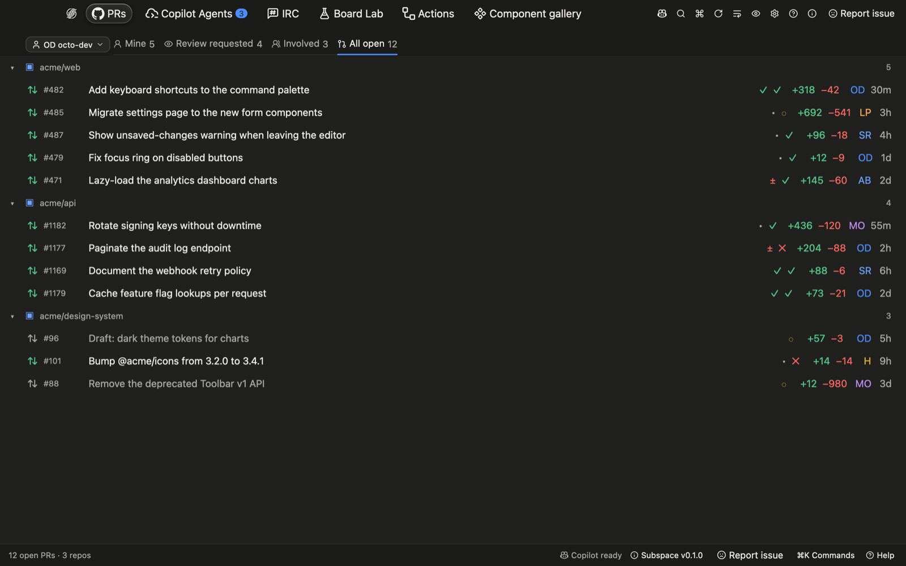

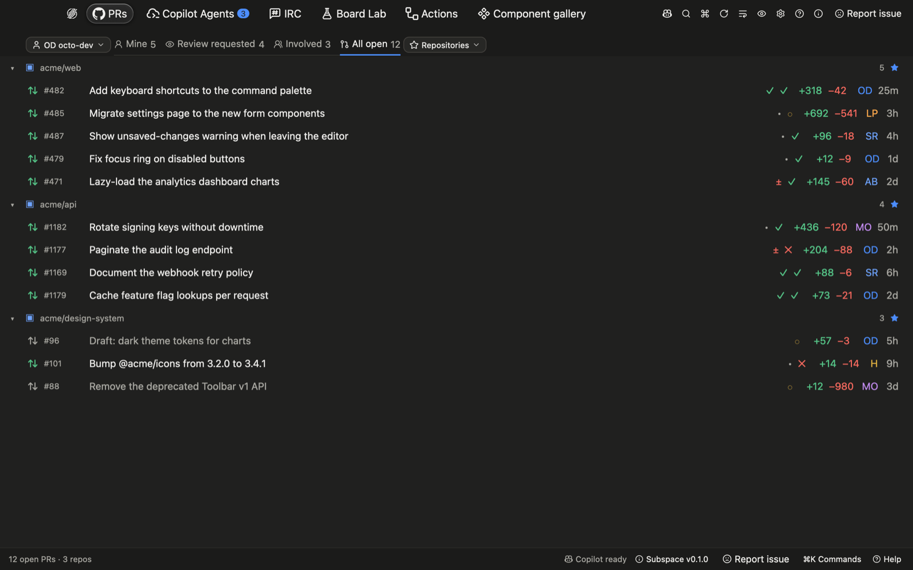

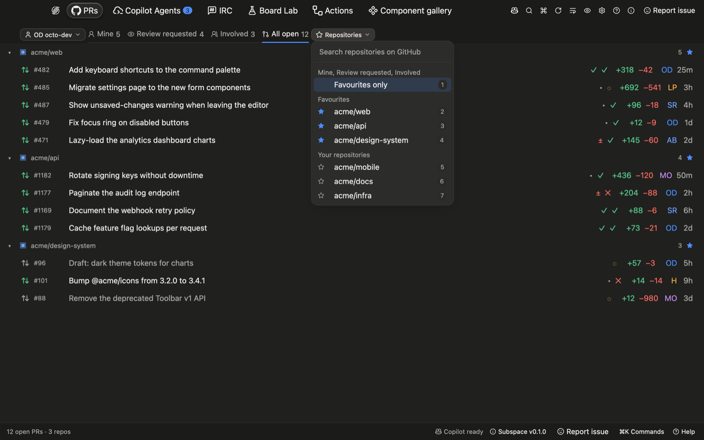

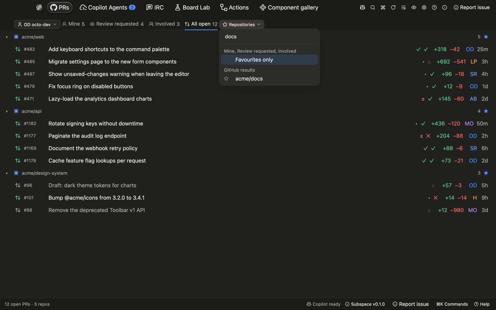

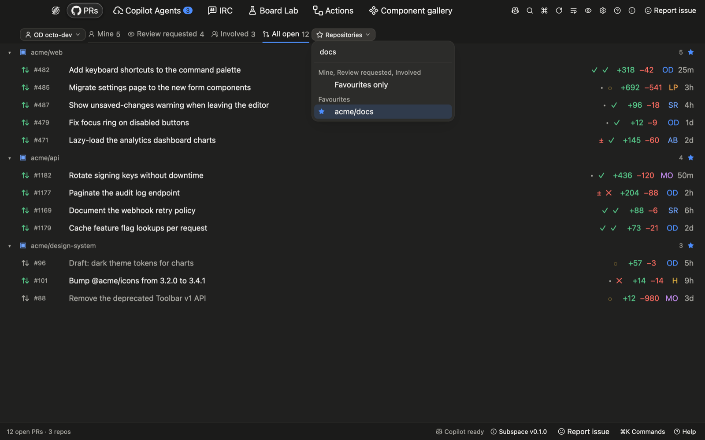

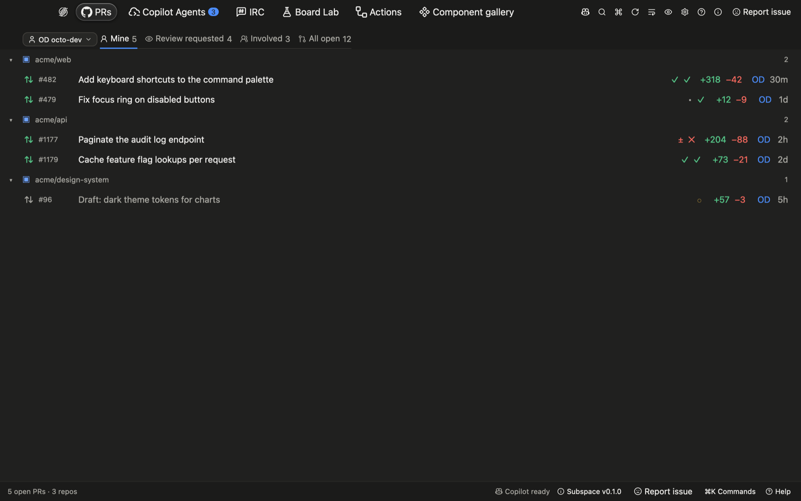

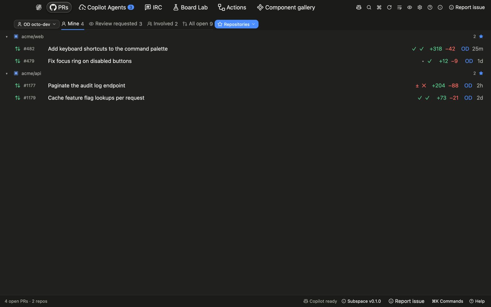

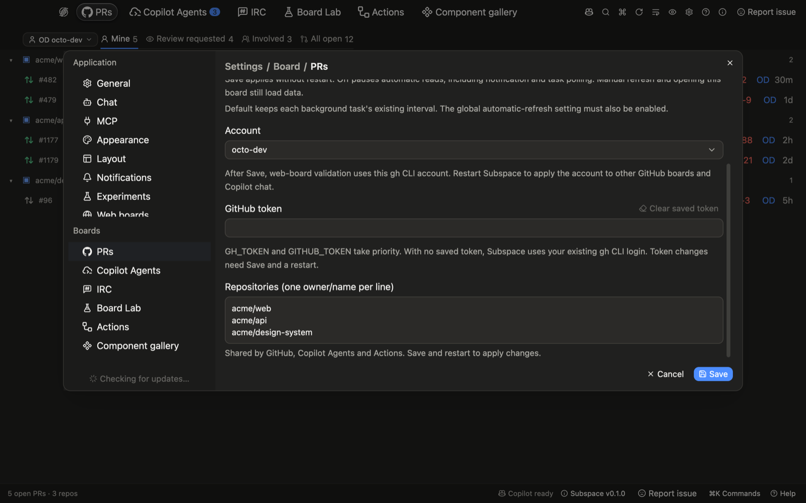

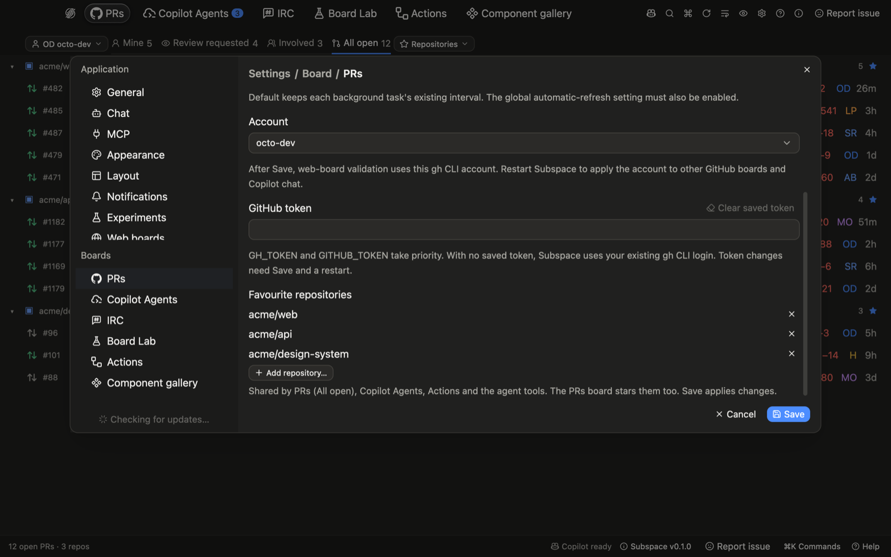

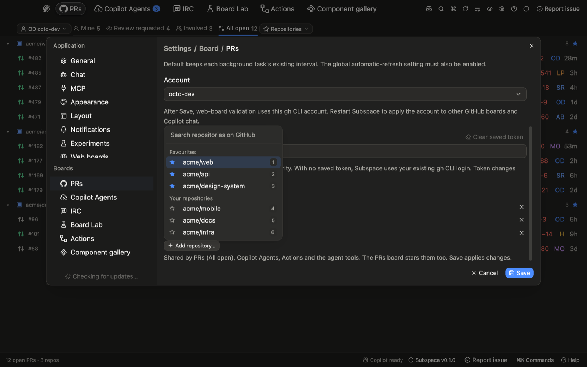

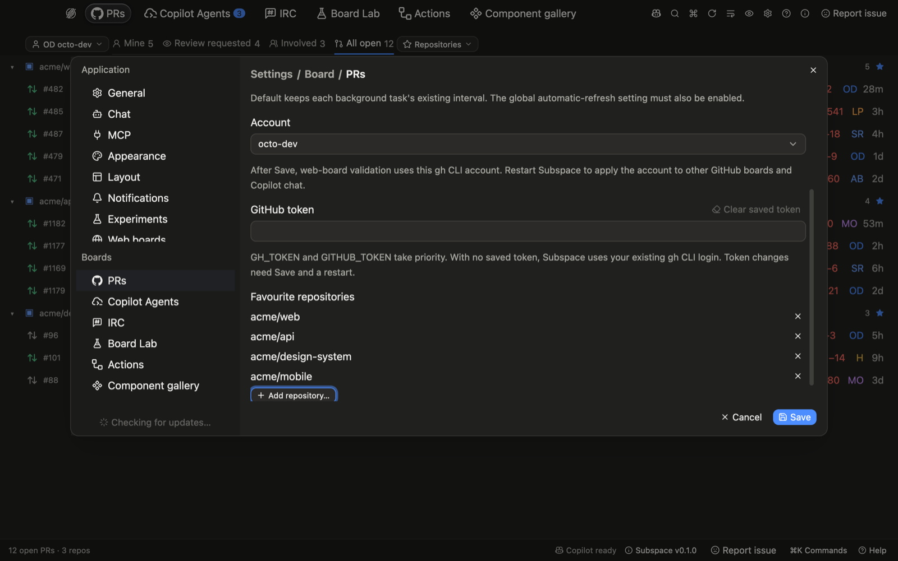
