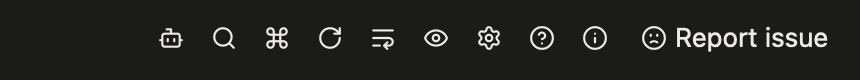
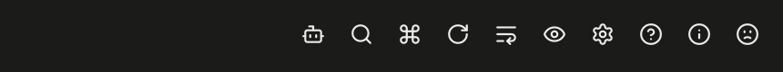
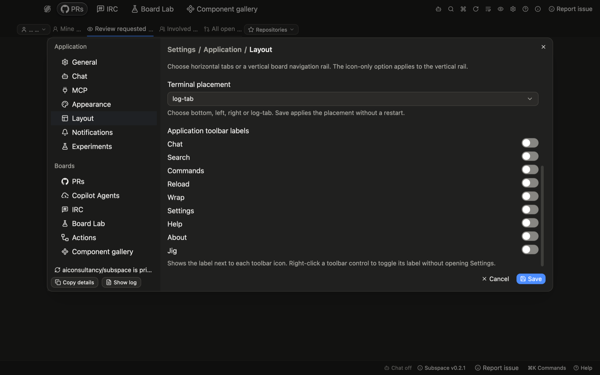
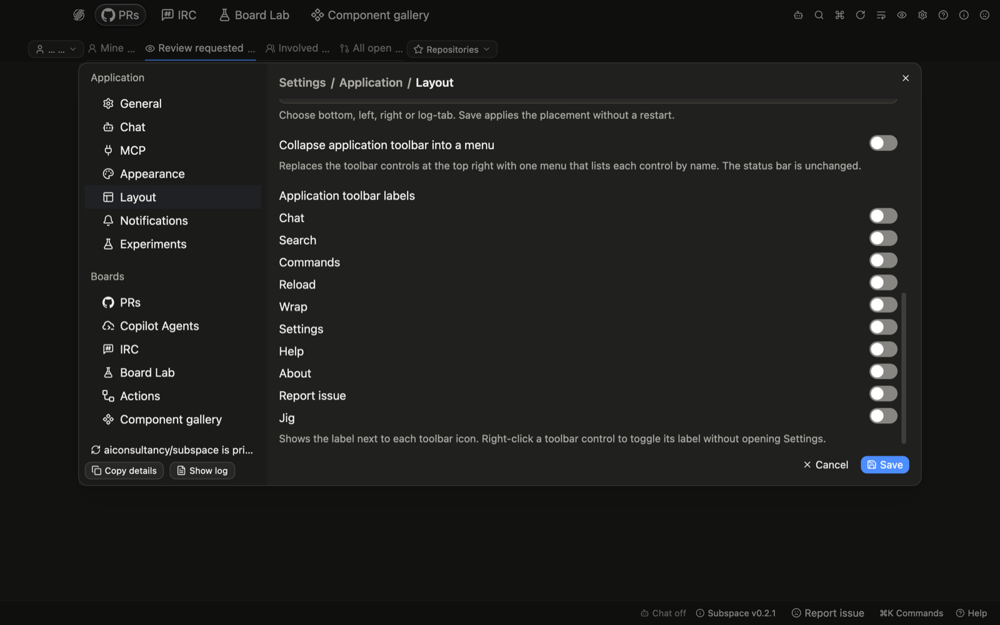

# Change: Report issue follows the toolbar label preference

## Intent

The owner's feedback: "The report issue button doesn't have a toggle for
showing and hiding the text. By default it should be hidden here but still
remain visible in the status bar."

The toolbar's **Report issue** control was a separate overflow unit that
always showed its label. Every other control at the top right is icon-only
by default, has a switch under **Settings > Layout > Application toolbar
labels**, and toggles its label from its context menu. Report issue had none
of these.

## Spec

- `ToolbarControl::ReportIssue` joins the per-control label preferences, with
  the key `app.toolbar-label.report-issue`. It is listed after About and before
  Jig in **Application toolbar labels**, matching its place after About in the
  toolbar.
- The toolbar control is one of the shell's global controls. It is icon-only
  by default (the frowning-face glyph), with the tooltip and accessible label
  **Report issue**. Right-clicking it offers **Show label**, like every other
  control. The preference is saved the same way as the other labels: Settings
  Save, or immediately from the context menu.
- The overflow chevron and its menu entry run the same command as before.
- The status bar's **Report issue** item keeps its label and is not affected
  by the preference.

## Delivery

Captured with the capture build, isolated `HOME`, fixture data, Cupertino Dark
(theme unset). "Before" is the branch before this change.

Toolbar, before: Report issue always shows its label.

Toolbar, after: Report issue is icon-only by default, like About.

Settings > Layout, before: no Report issue switch.

Settings > Layout, after: **Report issue** between About and Jig.

Tests: `toolbar_report_label_follows_its_preference_while_the_status_bar_keeps_it`
(the toolbar control starts narrower than the labelled status bar item,
right-click **Show label** widens it and saves the preference, and the status
bar item is unchanged); the existing report tests still open one retained form
from the toolbar, status bar and overflow menu.

## Tasks

- [x] Add `ToolbarControl::ReportIssue` and its preference key.
- [x] Render the toolbar control through the shared global-control path; remove
      the special overflow unit.
- [x] Keep the status bar button unchanged.
- [x] Test the default, the context-menu toggle and the status bar.
- [x] Update `docs/settings.md` and `docs/report-issue.md`.
- [x] Capture before and after screenshots.
