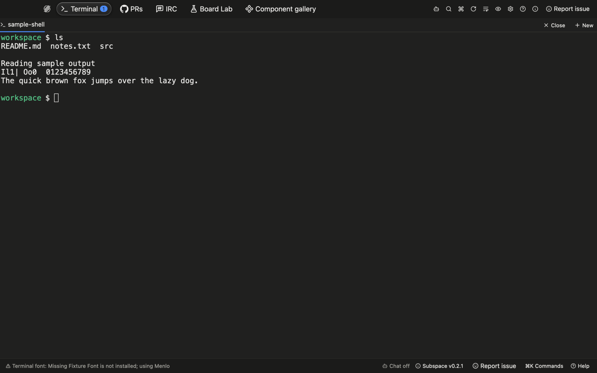
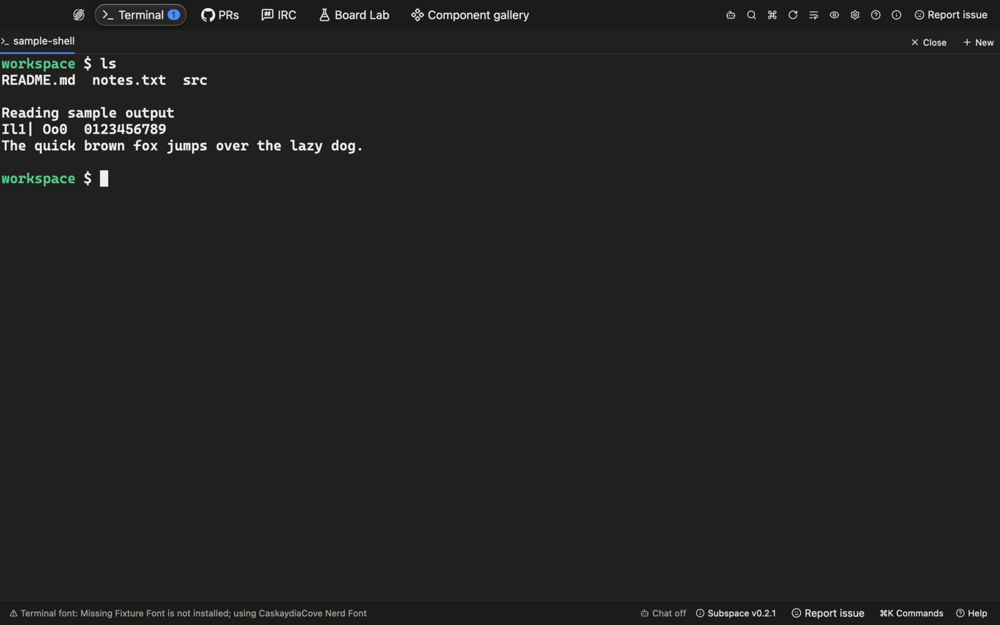
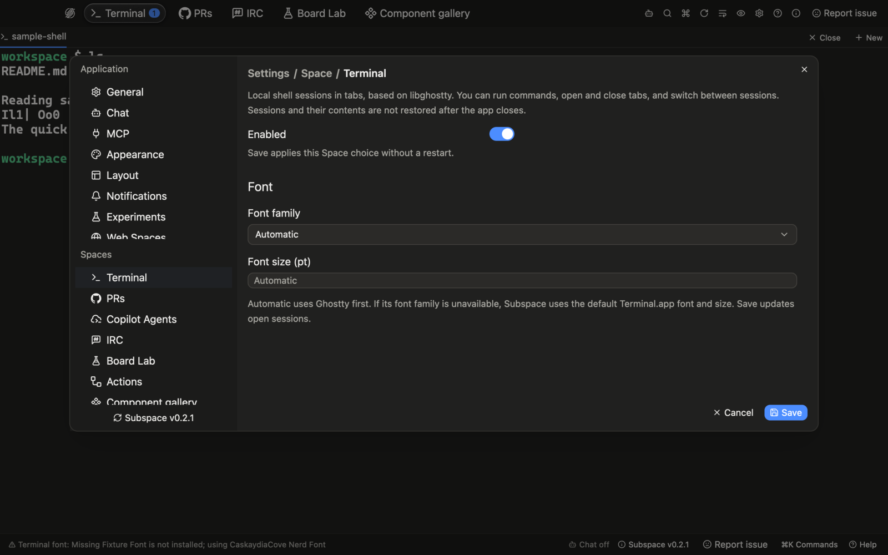
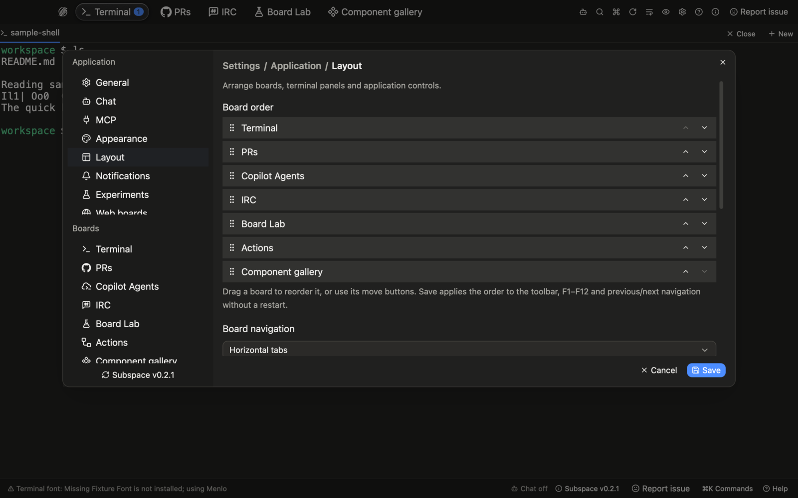
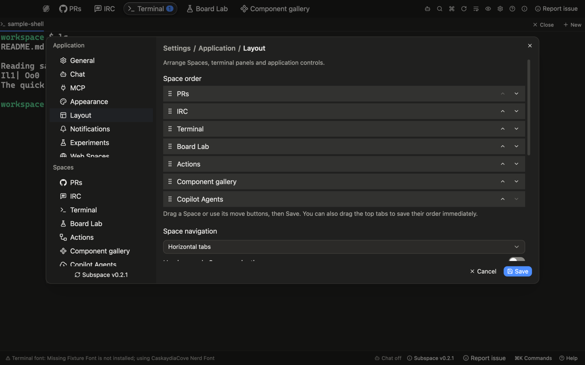
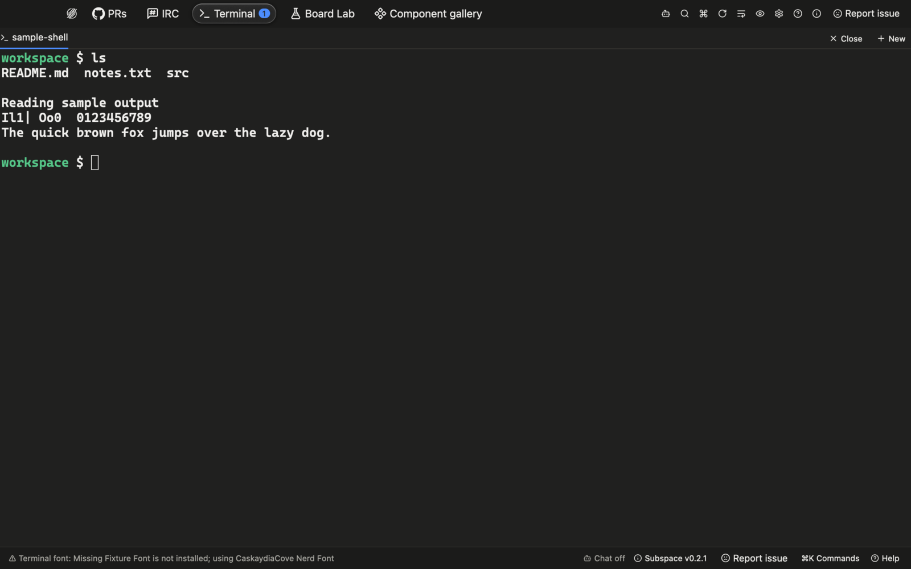

# Space tabs and the Terminal.app font profile

Subspace calls its top-level destinations Spaces. Users can drag the visible
tabs to save their order immediately, or move any Space from Settings > Layout
and choose Save. The active Space and its view stay open. Existing Space IDs
and the `boardOrder` setting remain compatible.

Terminal Automatic validates the macOS profile with the same character
advances as the picker and carries its base font weight and slant into
rendering. If an explicitly configured Ghostty family is unavailable, Automatic
inherits the Terminal.app face and size together. A size on its own can still
override the profile size.

The headless drag test moves a real tab and checks the saved order and active
Space. Terminal tests verify font precedence and the inherited weight used by
plain and bold text. Native captures use an isolated Terminal.app profile and
Ghostty config.

### Terminal board checklist

- Identity, registration, artwork and retained state use the existing Terminal
  registration.
- Layout, toolbar, palette, shortcuts, dialogs, recovery and quit warnings use
  the existing terminal tab and session flow.
- The existing settings editor saves font family and size in the Terminal
  config. Automatic reads the profile alongside the Ghostty config.
- Caching, refresh, item search, indexing and references do not apply to font
  resolution because it deals only with terminal appearance.
- MCP, CLI, chat context, notifications and inter-board events gain no commands
  or data because this change affects local rendering and navigation.
- Terminal Help and the developer guide describe profile precedence.
- The existing configuration warning reports an unavailable Ghostty family.
- The tests cover order persistence, retained Space selection, font precedence
  and renderer weight. The screenshots use fixture settings.

