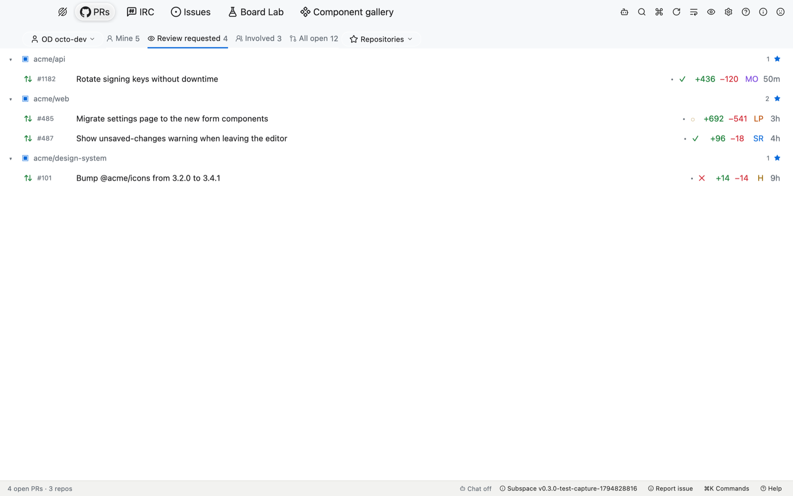
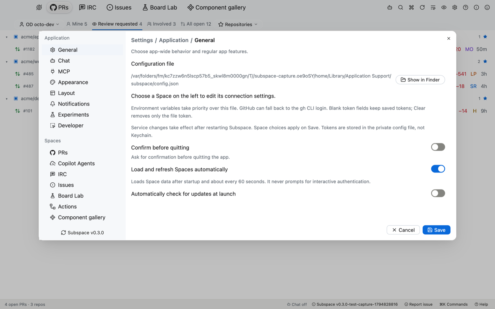
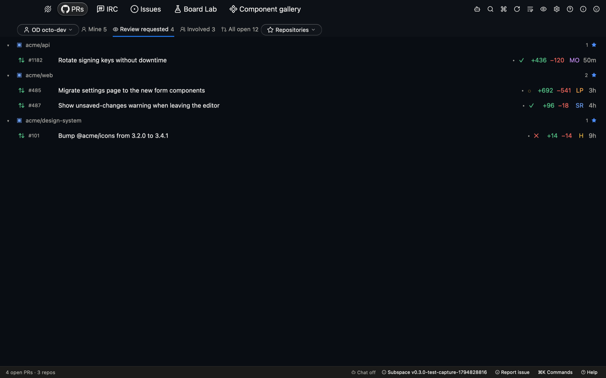
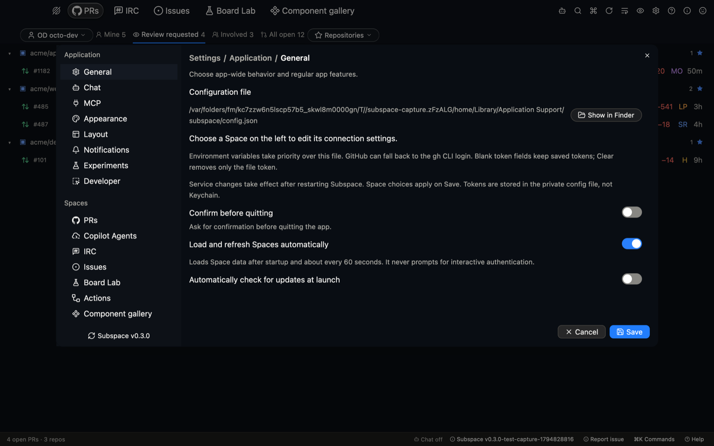

# Subspace Channel theme

Back to the [change records](../README.md).

## Intent

The owner supplied a dark theme, Subspace Channel Dark, and asked for it to be
added along with a light version of it.

## Spec

- `framework/host/app/themes/subspace-channel.json` is one theme document,
  "Subspace Channel", with two variants. Subspace Channel Dark is the owner's
  theme unchanged. Subspace Channel Light mirrors it key for key:
  - A white canvas, with cool silver title bar and sidebar (`#f6f8fa`) where the
    dark variant uses blue-black.
  - Warm light grey lists, tabs and status bar where the dark variant uses
    warm graphite.
  - System blue (`#0969da`) for primary actions, links, selection and focus.
  - Status colours and muted text that meet WCAG AA (4.5:1) on white.
  - Xcode's Default (Light) syntax colours, the counterpart of the dark
    variant's Default (Dark).
  - The same fonts, sizes and density.
- The host embeds it as `subspace-channel` after One Dark and Cupertino, and
  the Subspace product lists it with its themes. Cupertino Dark stays the
  default.
- [Appearance](../../appearance.md#subspace-channel) describes it.

## Delivery

- Every bundled-theme test passes for both variants, including off-switch
  contrast and legible glass. The switch-rule counts grow from 39 to 41
  variants, with 39 needing the runtime track fix.
- All 494 `subspace-shell` tests pass.

Light, the PRs board and Settings (fixture data):

Dark:

## Tasks

- [x] Add the owner's dark variant unchanged.
- [x] Derive and check the light variant.
- [x] Register, document and capture both.
