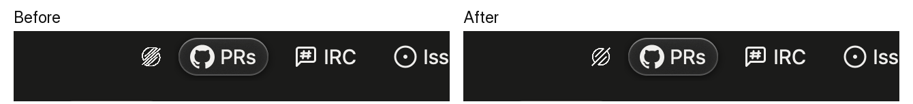
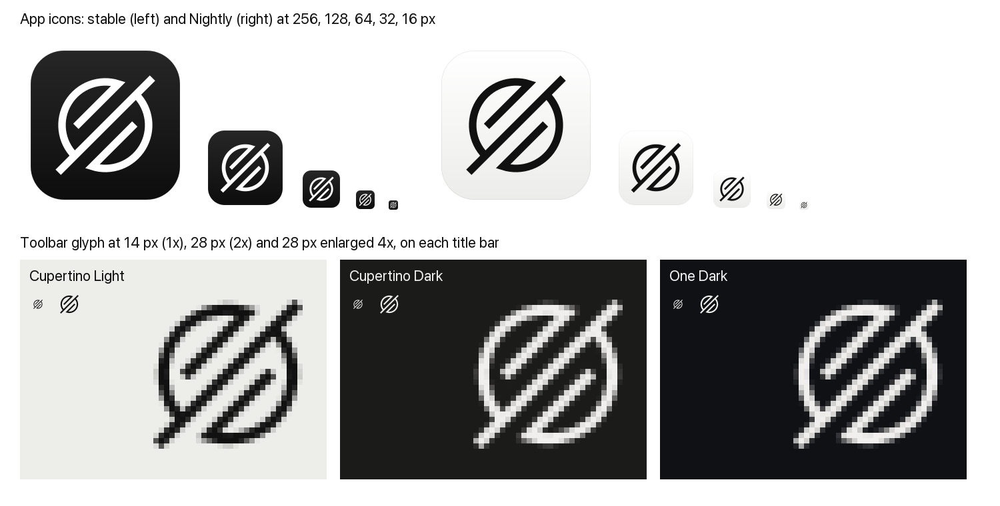
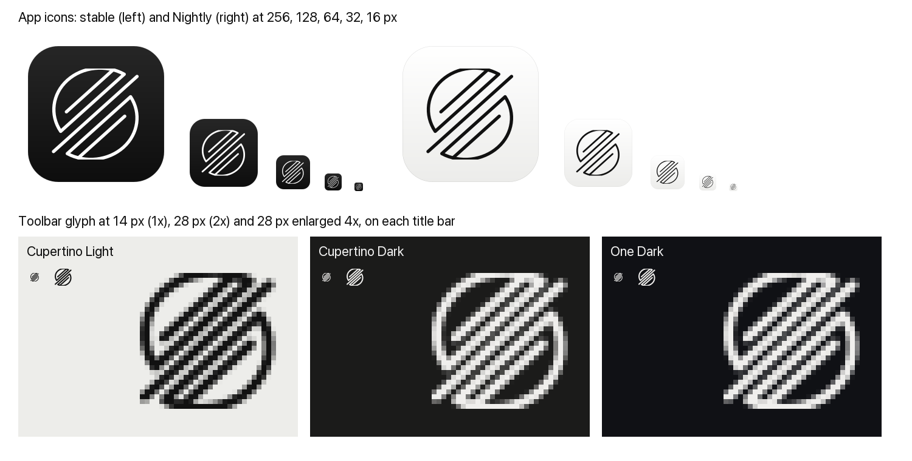

# Change: Subspace bold logo

## Intent

The owner refined the Subspace mark into a bolder version and asked for it to
replace the previous logo everywhere, and to show it in the READMEs. It
supersedes the [Subspace logo](../subspace-logo/README.md) record.

## Spec

- The mark is the owner's "Subspace balanced bold logo" in
  `assets/images/logo/`: an S drawn as a long diagonal and two half-circle
  hooks, rotated 45 degrees, in one weight (18 units, butt caps, miter joins)
  and one colour. `subspace-dark.*` is the black mark on white and
  `subspace-light.*` the white mark on black, as SVG and as PNG at 16 to
  1024 px, with a contact sheet. The old S sources (`subspace-logo-1.*`) are
  removed.
- The toolbar SVGs copy the source paths exactly, without the background, and
  crop the view box to the mark (`136 136 240 240`), so it fills the 14 px
  toolbar slot. `subspace.svg` and `product-light.svg` draw it in near-black
  (`#111111`) and `product-dark.svg` in off-white (`#F0EFED`), the tones of the
  previous mark. The source weight is already bold, about 1 px at 14 px, so the
  toolbar keeps it unchanged.
- `subspace-app.svg` (stable) puts the white mark on the black rounded tile and
  `subspace-nightly.svg` puts the near-black mark on the white tile. The tiles,
  gradients, rims and the 600 px mark box are unchanged. The provided pixel
  PNGs are full-bleed squares rather than tiles, so the `.icns` and `.ico` files
  are rendered from the tile SVGs with `make generate-icons` (and
  `scripts/generate-icons.sh products/subspace/assets/subspace-nightly.svg ""
  subspace-nightly` for Nightly).
- The repository and `subspace-desktop` READMEs open with the mark in a
  `<picture>` element: the off-white mark when GitHub uses a dark colour
  scheme, the near-black mark otherwise.

## Delivery

Captured from a debug capture build with fixture data, in Cupertino Dark.

`make check-icons`, `make check` and `mise run quality` pass.

## Tasks

- [x] Copy the icon pack into `assets/images/logo/` and remove the old sources.
- [x] Replace the toolbar marks and update their pinned fingerprints.
- [x] Replace the app-icon marks and regenerate the stable and Nightly `.icns`
  and `.ico` files.
- [x] Add the mark to both READMEs.
