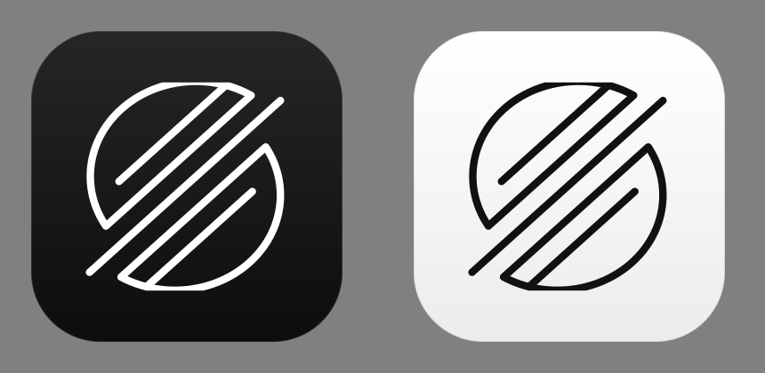
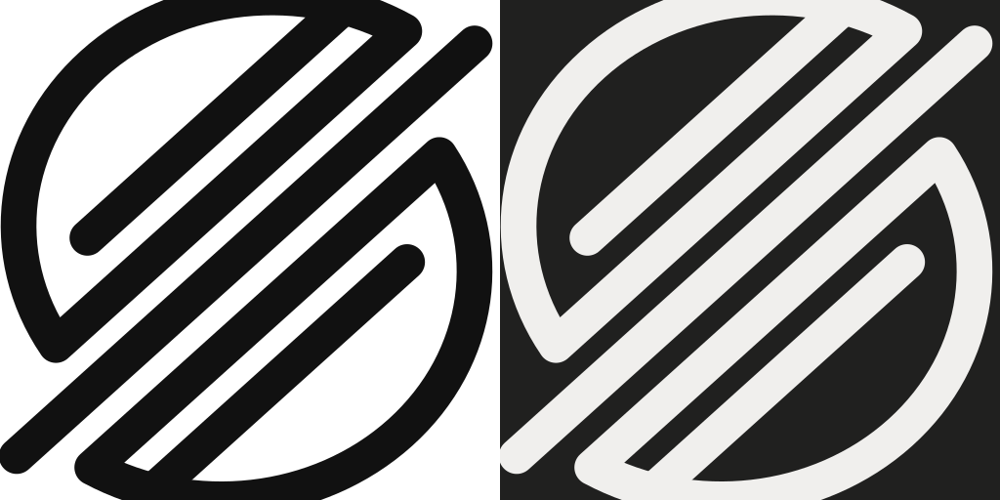

# Change: Subspace logo

Superseded by the [Subspace bold logo](../subspace-logo-bold/README.md), which
replaced this mark and removed its `subspace-logo-1.*` sources.

## Intent

Replace the inherited logo, a red and yellow pentagon with sunglasses taken from
another organisation's branding, with Subspace's own mark.

## Spec

- The mark is the owner's design in `assets/images/subspace-logo-1.*`
  (Affinity source, EPS and PNG exports): two half discs split by parallel
  diagonal lines into an S, drawn as single-weight lines with round caps and
  joins.
- The SVGs copy the EPS paths exactly (141.84 pt artboard, PostScript y axis
  flipped) and crop to the mark, so it fills the toolbar slot.
- `products/subspace/assets/subspace.svg` and `product-light.svg` draw it in
  near-black; `product-dark.svg` draws it in off-white. The toolbar shows it at
  14 px, with heavier lines (8 units instead of 3.5) so it stays legible at that
  size. The shell picks the variant that matches the theme mode.
- `subspace-app.svg` puts the white mark on a black rounded tile, like the
  owner's PNG; `subspace-nightly.svg` puts the black mark on a white tile. The
  `.icns` and `.ico` files are regenerated with `scripts/generate-icons.sh`.

## Delivery

## Tasks

- [x] Convert the EPS mark to SVG for the toolbar and app icons.
- [x] Register the light and dark toolbar variants and update the artwork test.
- [x] Regenerate the stable and Nightly `.icns` and `.ico` files.
