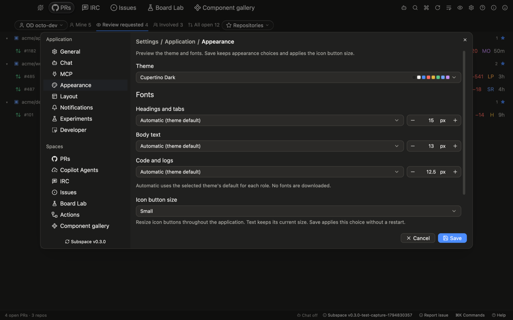
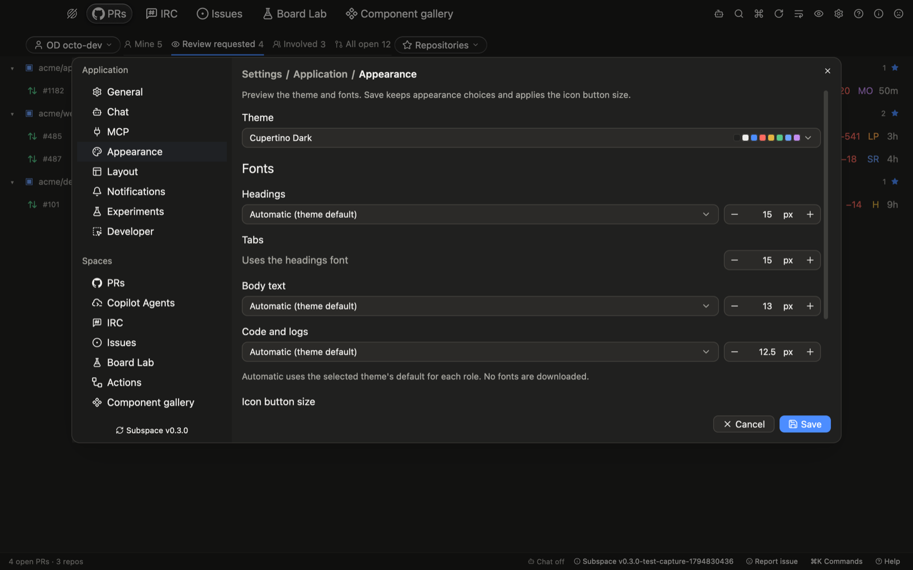
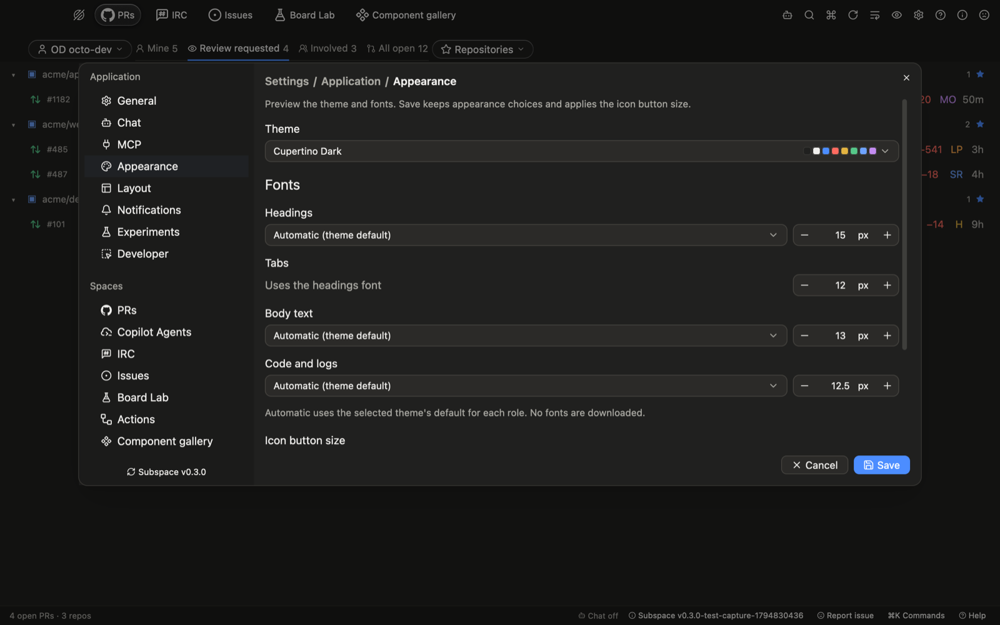
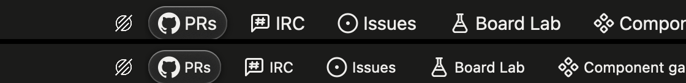

# A tab size separate from headings

Back to the [change records](../README.md).

## Intent

Headings and the board tabs shared one size setting. The owner asked to split
them, so tabs and headings can have different text sizes.

## Spec

- A new density token, `--tab-font` (10 to 24 px in 0.5 px steps, 15 px by
  default), sets the board tab labels in the toolbar through
  `Tokens::tab_size`, as `--heading-font` sets headings through
  `heading_size`. The tab strip's height follows the tab size as before.
- Tabs keep the headings font family; only the size is separate.
- Settings › Appearance shows Headings, then Tabs ("Uses the headings font"
  beside its size field), Body text and Code and logs. The theme designer's
  Typography section lists the Tabs size with the other font sizes, and its
  exported themes include it.
- The 15 px default matches the old behaviour for every bundled theme: the
  only theme that sets `--heading-font`, Cupertino, sets it to 15 px. A heading
  size someone saved before no longer resizes the tabs.
- The type-scale helpers moved to `tokens/sizes.rs`, to keep `tokens.rs`
  within the module size limit.

## Delivery

- Tests:
  - the tab and heading sizes scale independently, in both directions;
  - the Settings Tabs field changes only `--tab-font`;
  - the density control count.

  All `subspace-dashboard` and `subspace-shell` tests pass.

Before, one "Headings and tabs" size (Cupertino Dark, fixture data):

After, at the defaults:

After, with tabs at 12 px and headings unchanged:

## Tasks

- [x] Add `--tab-font` and `Tokens::tab_size`; use it for the board tabs.
- [x] Settings and designer controls.
- [x] Tests, docs and evidence.
