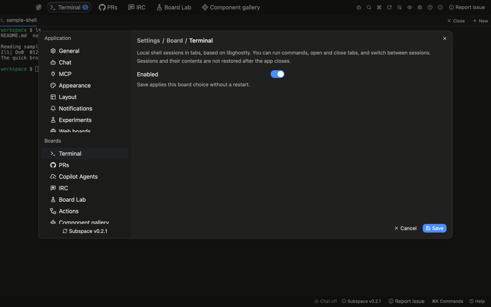
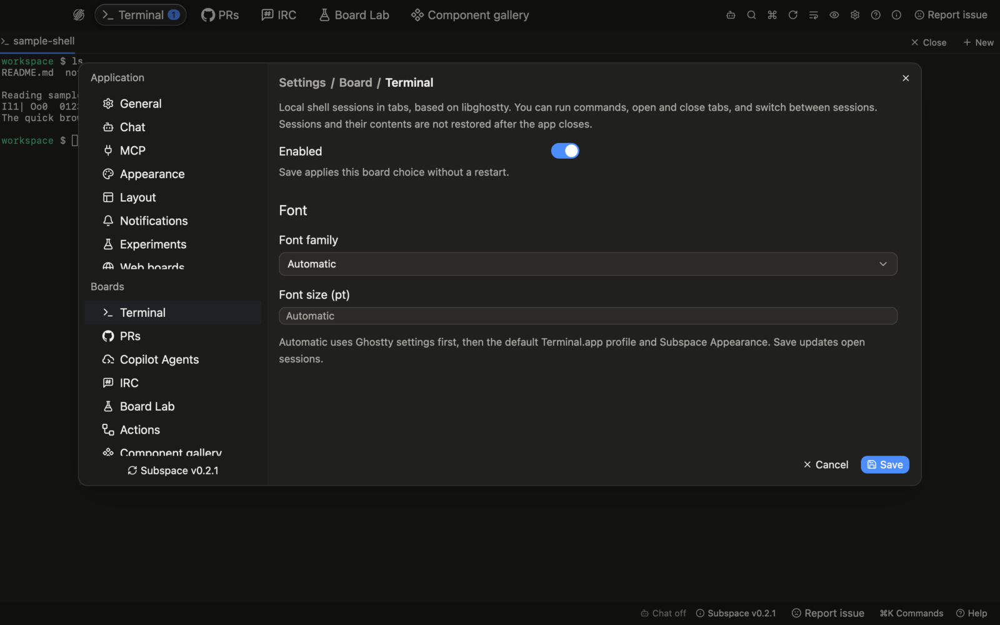
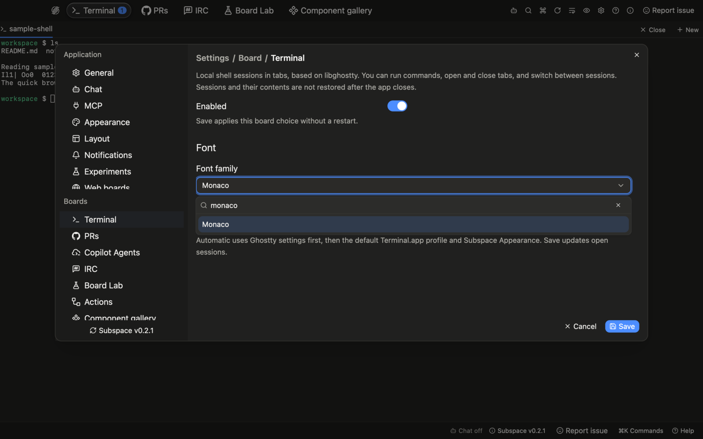
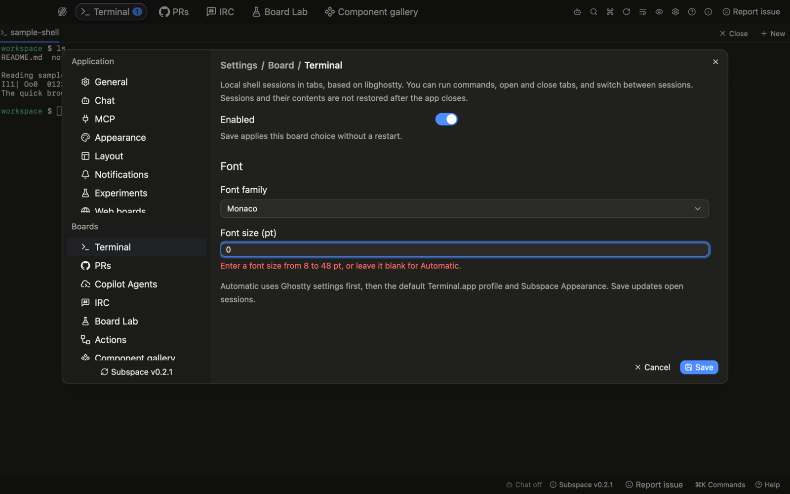
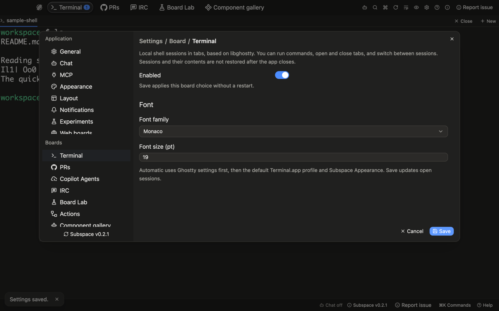
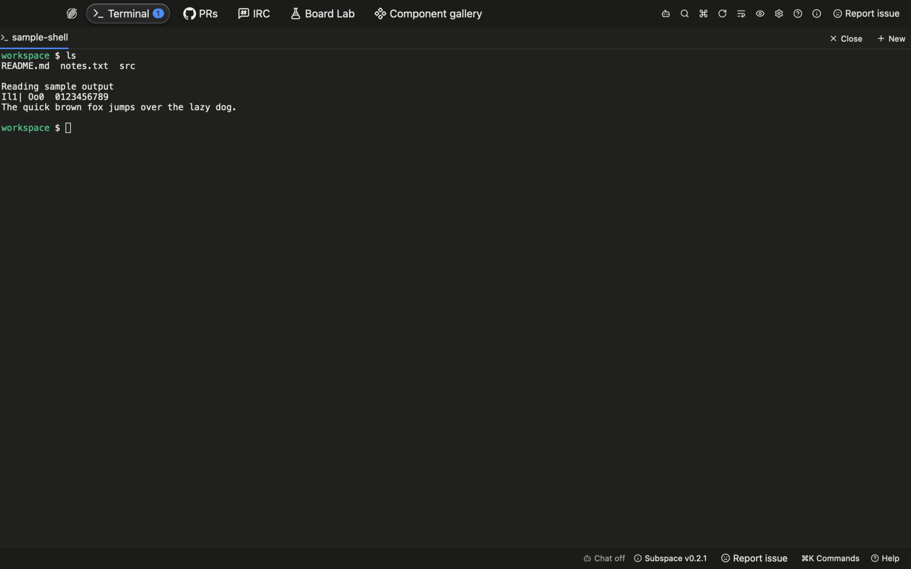
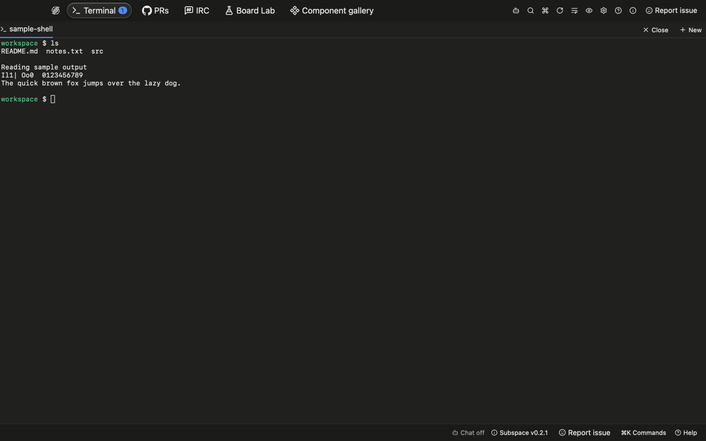
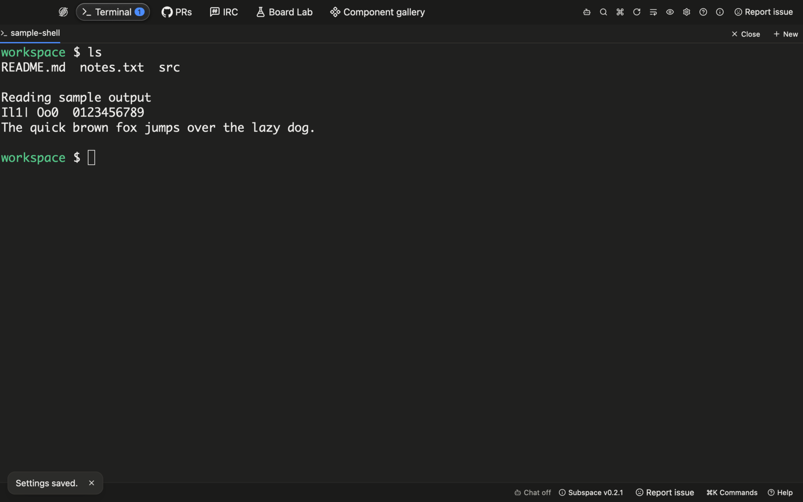

# Terminal font settings

**Intent:** Let users change the embedded Terminal font on machines where their
preferred font differs from the app default. On macOS, honor the default
Terminal.app profile when Ghostty has no override. Keep the editor available
on Windows and Linux.

**Behavior:** Settings > Terminal > Font offers a searchable fixed-width
family picker and a size in points. Family and size can inherit independently.
Save writes only the board's font settings and resizes retained sessions;
Cancel discards the draft. Automatic uses Ghostty, the macOS Terminal.app
profile if available, then the Appearance code font and size.

**Delivery:** Check the editor's rendered controls and keyboard path, font
precedence, the real app's live PTY resize and persistence, and the Terminal
and workspace gates. Capture only isolated fixture data.

The native macOS smoke test changed two open PTYs and confirmed both retained
their processes and output. It checked relaunch, Cancel, an unavailable family,
and independent inheritance from Ghostty and a synthetic Terminal.app profile.

