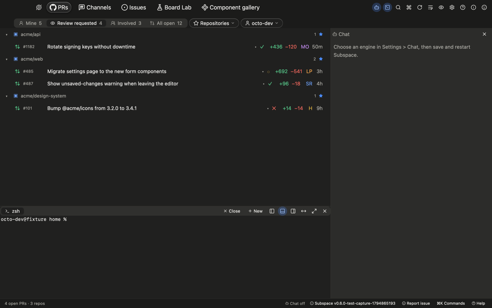
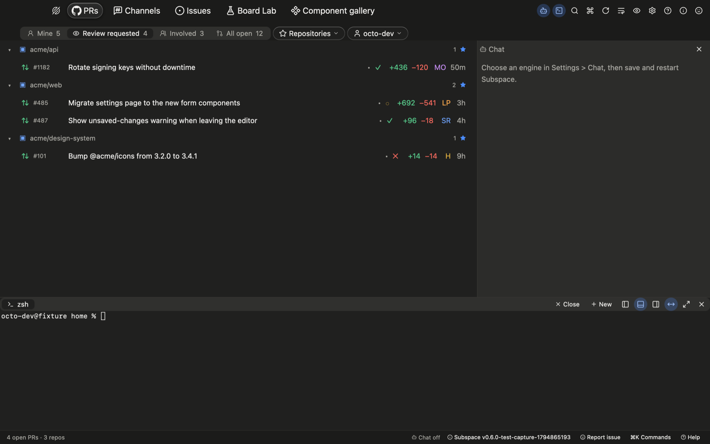
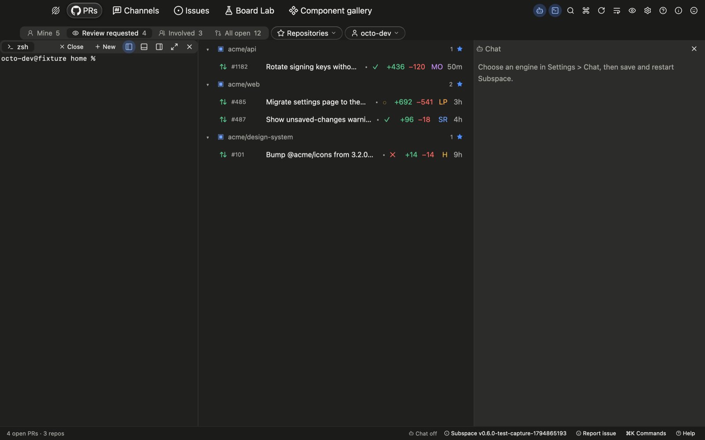
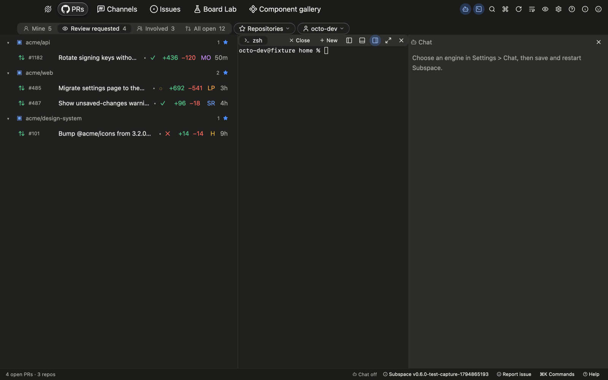
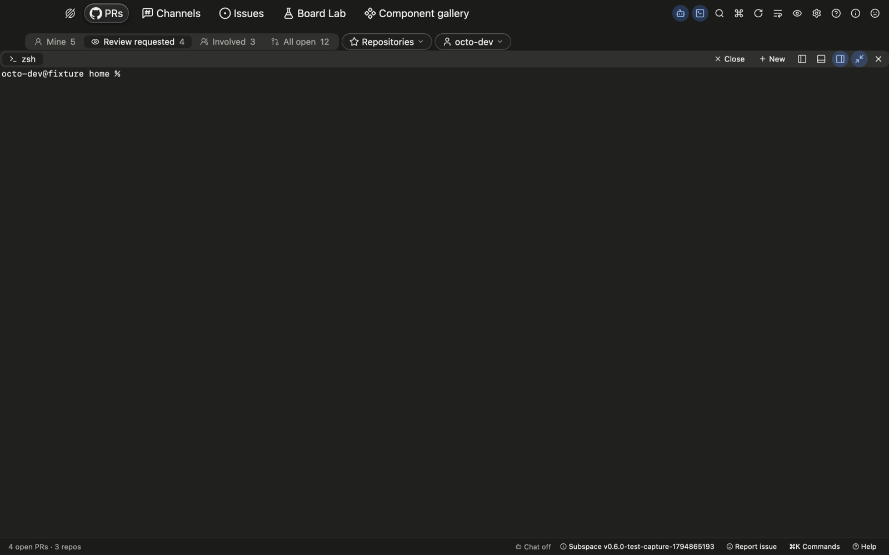
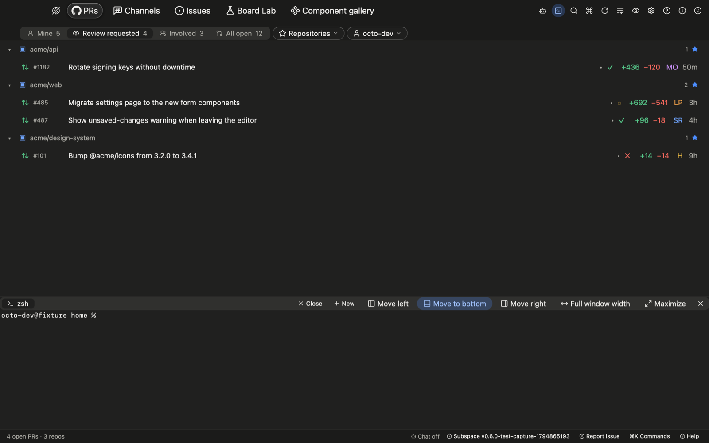

# Terminal panel: delivery

Back to the [spec](spec.md).

`make check`, `MISE_ENV=terminal make check-terminal` (runtime 274 tests,
panel 4, product build with the feature) and `mise run quality` (Findings
0 → 0) pass. New shell tests cover each placement and both bottom widths,
maximize, Ctrl+` show/hide and focus, persistence, panel requests, the menu
and palette actions, quit warnings and the Settings pages.

Captured with `make capture` (fixture data; the fixture shells use an
`octo-dev@fixture` prompt). There is no before image: the old Terminal Space
was never docked.

