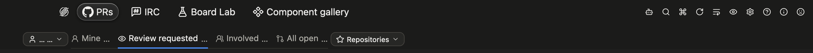
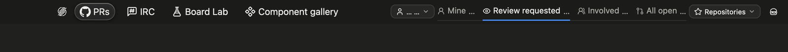
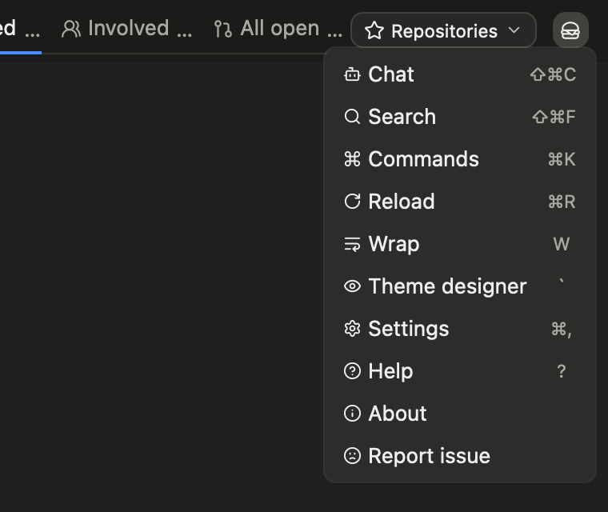
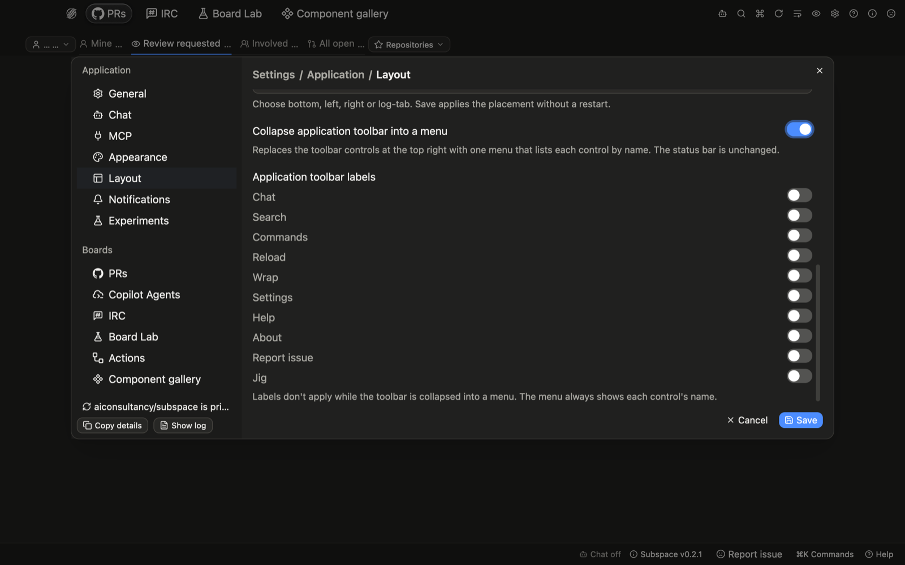

# Change: Collapse the application toolbar into a menu

## Intent

The owner's request: "Could we add an option to collapse all of these small
icons to the search commands, the reload, and everything into a small burger
menu that goes in the top right? I'd like to use an actual burger glyph, not
the typical two or three lines, like a beef burger glyph and that should show a
menu, a popover menu with each of the items with text. So there should be a
toggle in the settings to collapse all of these to the menu and when that
happens the controls are shown how the text should be disabled."

## Spec

- **Settings > Layout** has a switch, **Collapse application toolbar into a
  menu**, above **Application toolbar labels**. It is off by default, saved as
  the app preference `app.toolbar-menu`, and applies on Save like the label
  switches. Cancel discards it.
- When on, the global controls at the top right (Chat, Search, Commands,
  Reload, Wrap, Theme designer, Settings, Help, About, Report issue) are
  replaced by one ghost icon button with Lucide's `hamburger` glyph (the food,
  bundled with GPUI Kit's icon catalog). Its tooltip and accessible label are
  **Toolbar menu**. It uses the shared `anchored::dropdown_menu` trigger, as
  the overflow chevron does, and every row keeps its own keyboard shortcut.
- The menu is the shared native popup menu. Each row has the control's icon and
  name, in toolbar order, with its keyboard shortcut. Rows for controls that are
  on (Chat open, Search open, Wrap, Theme designer open, Help open) are checked.
  Reload is disabled while a reload runs and reads **Reloading…**. About shows
  **About · Update available** when an update is available. A row runs the same
  command as the inline control.
- The rows come from the same per-frame description as the overflow chevron's
  rows, so the two menus cannot drift. If the window is too narrow even for the
  menu button, the chevron lists the same rows.
- The Chat row uses the generic Chat icon and name, like the overflow menu; the
  engine logo and status stay visible in the status bar's chat item.
- While collapsed, the **Application toolbar labels** switches are disabled and
  their names muted, and the note under them reads "Labels don't apply while
  the toolbar is collapsed into a menu. The menu always shows each control's
  name." The burger button has no **Show label** context menu.
- The status bar is unchanged.

## Delivery

Captured with the capture build, isolated `HOME`, fixture data, Cupertino Dark
(theme unset).

Before (default): every control is inline at the top right.

After, collapsed: one burger button at the top right. The freed space lets the
board's own controls join the first row.

The open menu: each control with its icon, name and shortcut.

Settings > Layout with the switch on: the label switches are disabled and the
note explains why.

Tests:

- `the_toolbar_shows_its_controls_until_collapsed`: every control is inline by
  default; collapsing removes them and shows **Toolbar menu**; the status bar
  keeps Report issue.
- `the_toolbar_menu_lists_each_control_in_order_and_runs_its_command`: the menu
  rows match toolbar order, choosing Help opens Help, and the reopened menu
  checks Help.
- `collapsing_the_toolbar_disables_label_switches_and_saves_on_save`: the
  label switches are enabled, then disabled after the switch is turned on;
  nothing changes until Save; the choice survives reloading preferences and
  reopening Settings.
- `cancelled_toolbar_menu_draft_does_not_change_preferences` and
  `the_toolbar_menu_defaults_off_and_is_independent_of_labels`.

## Tasks

- [x] Add the `app.toolbar-menu` preference beside the label preferences.
- [x] Share one menu-row description between the overflow chevron and the menu.
- [x] Add the burger menu unit and select it when collapsed.
- [x] Add the Settings switch, draft, Save and Cancel handling; disable the
      label switches while collapsed.
- [x] Tests for the toolbar, the menu and Settings.
- [x] Update `docs/settings.md` and `docs/ui-components.md`.
- [x] Capture screenshots.
