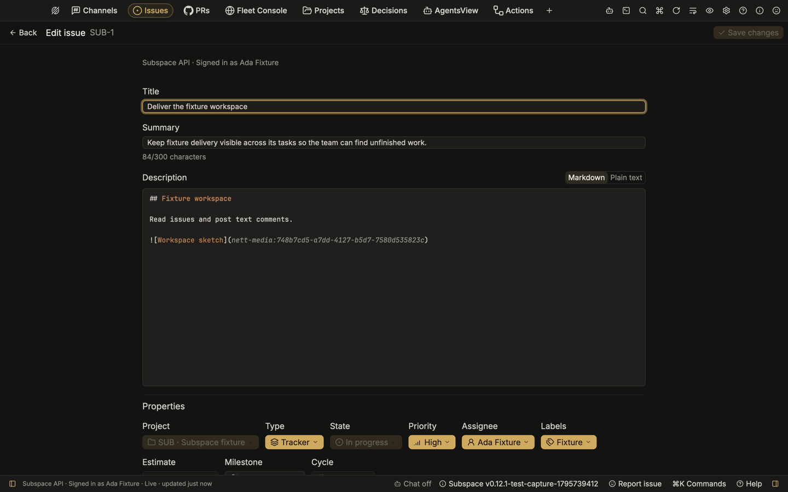
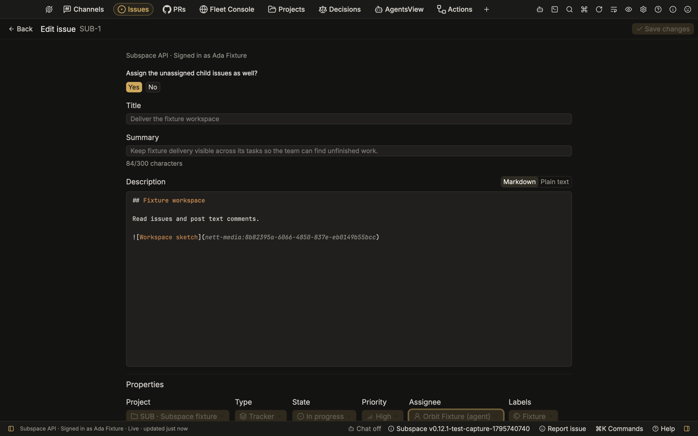
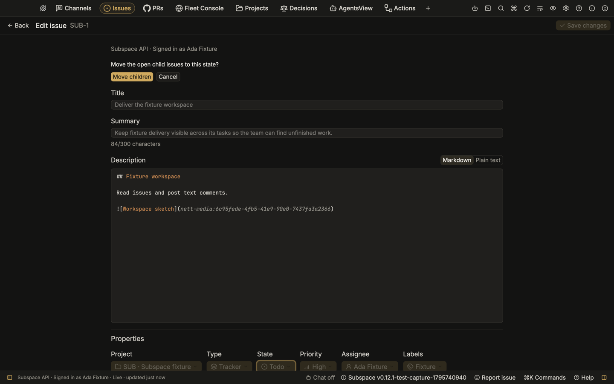

# Tracker assignment and child updates

A tracker can have a person or agent as its assignee. When it is assigned
from the Issues editor, **Yes** also assigns unassigned, non-archived direct
children. **No** saves the assignment on the tracker alone.

Changing a tracker's state to Backlog or Todo asks whether to move its open
direct issue children. **Cancel** keeps the edit in the draft. **Move
children** updates eligible children in one save and the API recalculates
the tracker state from the resulting child states.

The desktop tests exercise both assignment choices and state cancellation
and confirmation. The API integration test checks the affected children,
their activity and versions, the derived state, and stale write handling.

## Twilight Two screenshots

The tracker editor before this change.

Assigning the tracker to a fixture agent with a choice about child issues.

Moving open child issues with an explicit confirmation.

