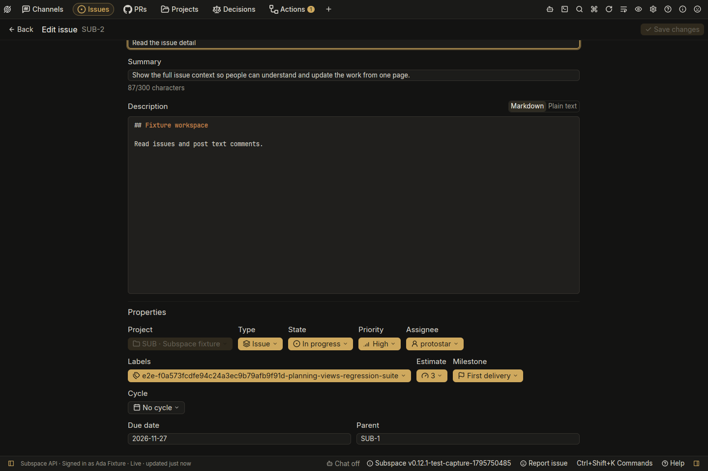
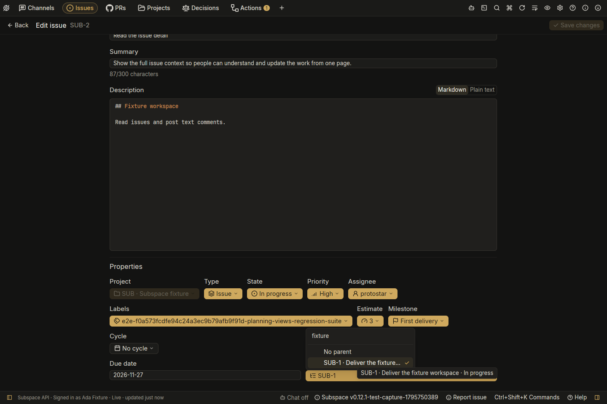
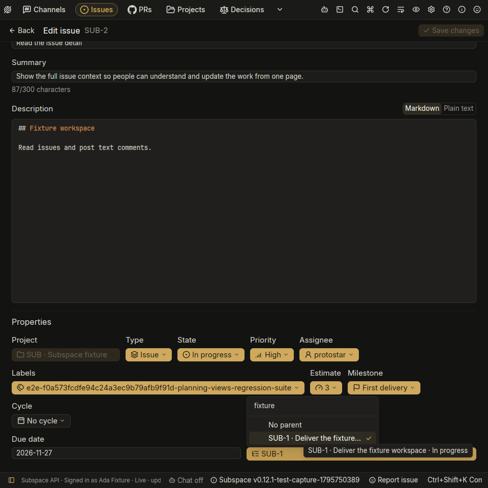
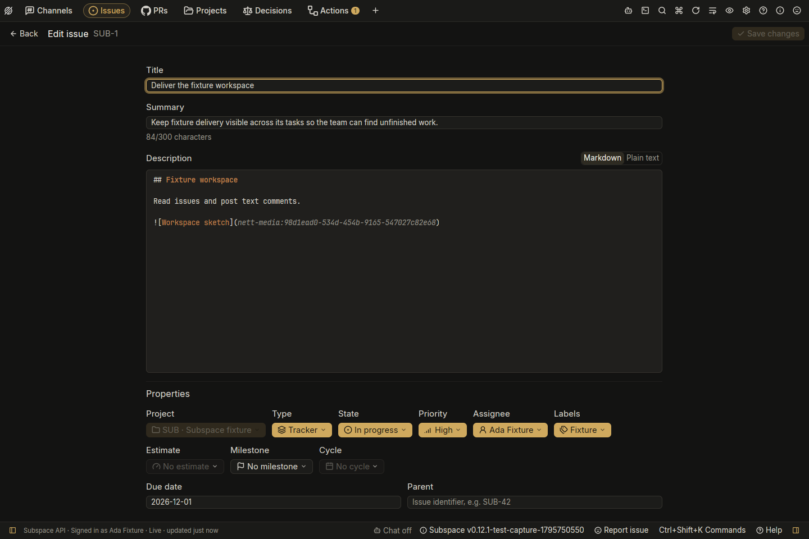
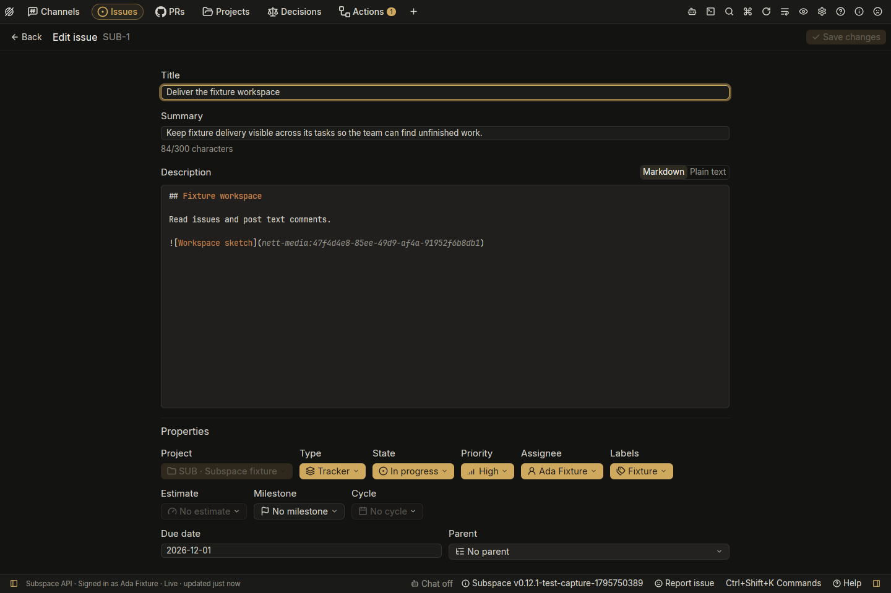
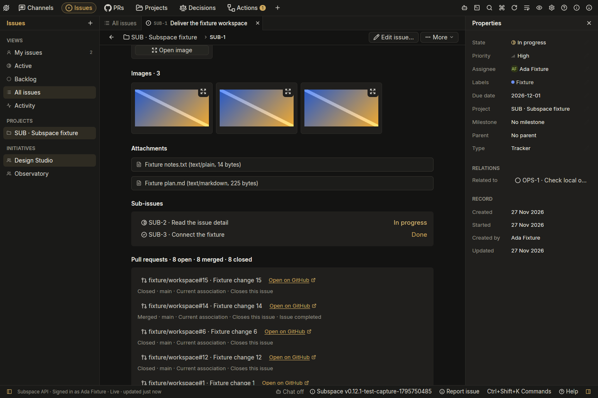
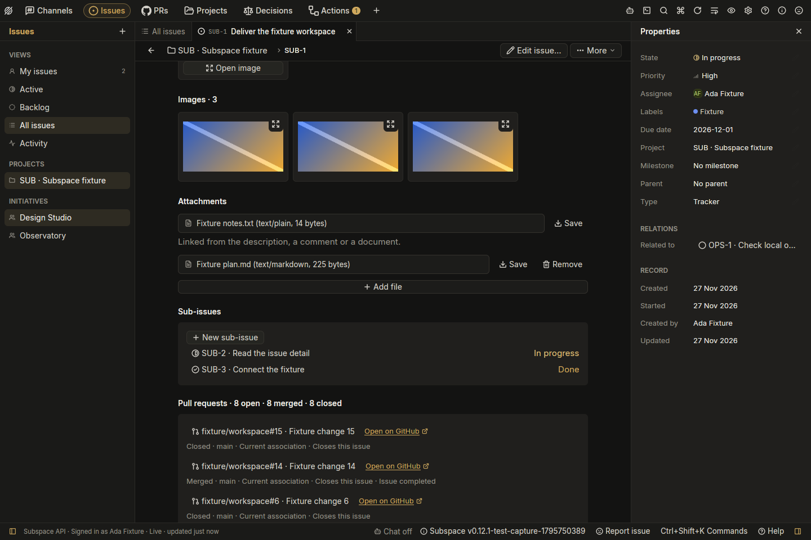
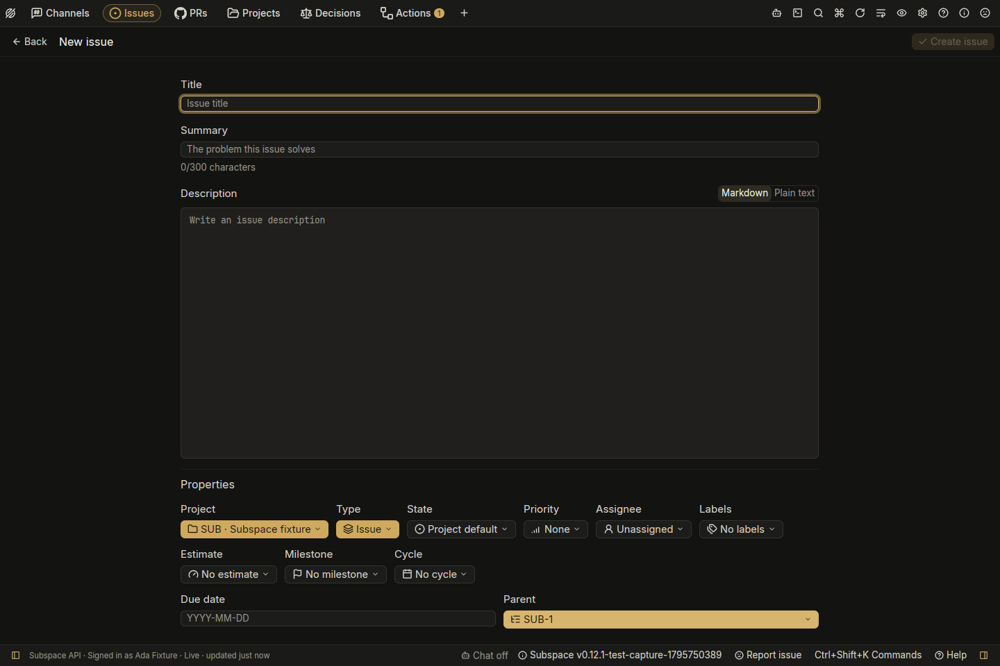

# Delivery: nest issues and attach files

The client tests run against fictional loopback requests and check that both
cursor pages use the same server filters without fetching ancestor details.
The HTTP and Python fixture tests cover ancestry eligibility. Issues Space
headless tests exercise the new control on an empty
tracker, the full editor's keyboard-accessible search and continuation, and
clearing a tracker parent from the inline editor. A combined tracker edit
checks that changing Parent, assignee and state still takes both child-update
confirmations and sends one versioned save. Cancelling keeps the draft; the
full editor scrolls back to reveal the confirmations and any child-block notice.
The client removes self from parent search results on older servers. Loopback
tests distinguish a parent refusal on create and update from other `409`
responses. Both editors keep the draft and show the refusal; the full editor
scrolls to the notice.

New children appear immediately under the tracker even when its first page
is full. Refresh confirms each missing child with one scoped read by ID,
deduplicated while in flight. Reparented or archived children disappear;
renamed children and changed states use the latest fields. The test checks
that the tracker doesn't page to reconcile those rows.

The shared menu does not expose accessibility labels for ordinary option
rows. The picker uses the existing menu unchanged; tests verify the options
sent to the menu, the rendered rows and the parent written on selection.

**Add file** uses the attachment route and 10 MB limit for standalone
files, including validated raster images. Inline and comment images keep
the image route. **Save** fetches the attachment bytes. The API's optional
`removal` field controls **Remove**: `available` enables it, linked rows
explain the restriction, and older servers omit the action. On a stale
`409`, the file stays in place and the list reloads. The notice reports the
reload; the refreshed row shows its removal eligibility. Deletion checks
descriptions, live comments and every issue document revision. The fixture
models the description and live-comment checks; it has no issue document
revisions.

The Attachments panel hides **Remove** and explains when this client's
unposted comment holds the file. The click handler and hub both guard removal.
Before an upload ID is confirmed, the client protects the same candidates its
upload recovery could claim. Tests cover the local hold, posting (server-linked)
and discarding (draft cleanup). Other clients' drafts are not protected.

After a successful removal, the client drops the row immediately
and starts a fresh scan. This supersedes any page already in flight so an
older response cannot put the deleted file back in the list.

The Issues Space tests cover both new tab stops, a standalone upload that
stays bound to its original issue, and the non-UTF-8 preview. The loopback
fixture tests cover both seeded file states, direct URL references, archived
issues, deletion conflicts and a tracker-only search. Full project gates run
through the pre-push hook.

## Screenshot evidence

The refused-parent and removal-conflict notices are error states not shown
in these captures. No screenshots were recaptured for those changes.

Both builds use isolated fictional data and the Twilight Two theme. The
before images use the integration base (`090ad8f1b9a2637a40d48d561b75d61092a002f3`),
which includes the tracker child-update editor. The after images use the
integrated code (`8c100527a507de448b5e1c1cd1ee219436d8a9f0`).

### Choose a parent

Before: Edit issue shows the free-text Parent field.

After: searching for `fixture` offers **No parent** and matches `SUB-1`.
The shared menu truncates the long row; its hover tooltip shows the full
key, title and state.

After at 960 px wide: the open picker and its result tooltip stay on screen.

### Edit a tracker

Before and after: the tracker editor retains its state and assignee controls.
The after view also offers the searchable **Parent** control for nesting.

### Manage attachments and sub-issues

Before: the tracker lists attachments and sub-issues without the new actions.

After: the tracker has **Add file** and **New sub-issue**. `Fixture plan.md`
offers **Save** and **Remove**; `Fixture notes.txt` offers **Save** and
explains why it cannot be removed.

After: **New sub-issue** opens New issue with project `SUB` and parent
`SUB-1` already selected.

