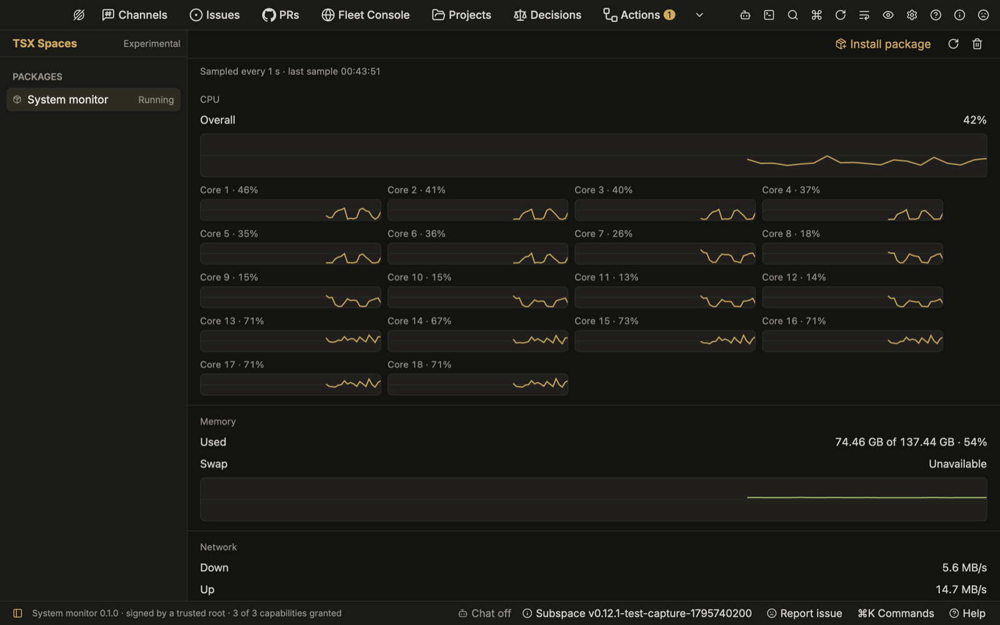
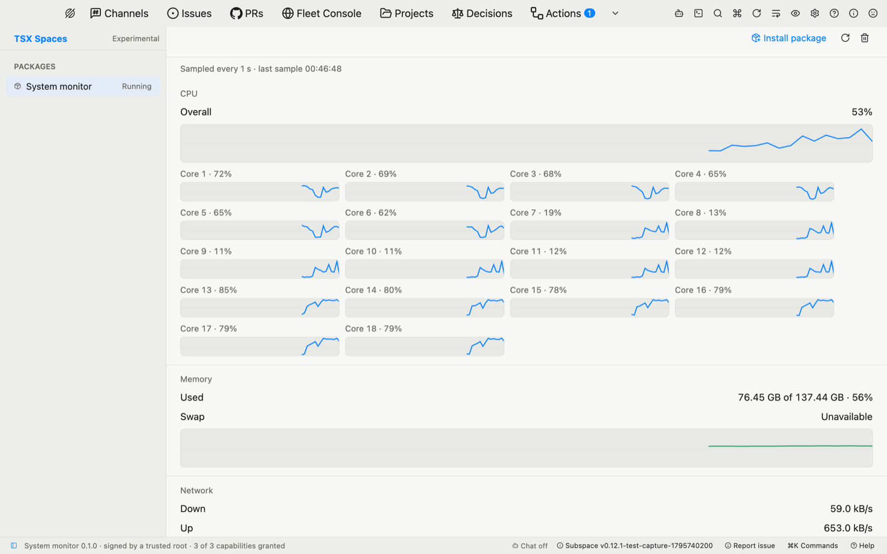
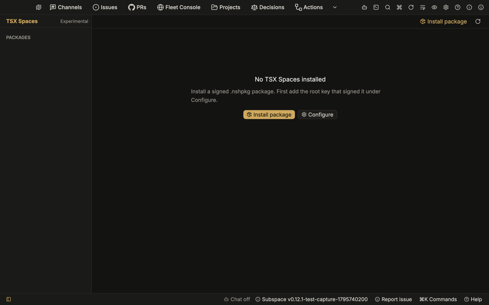
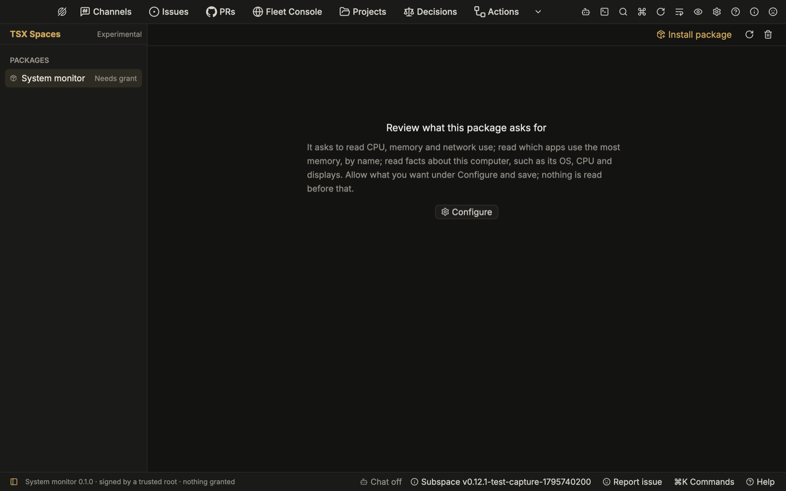
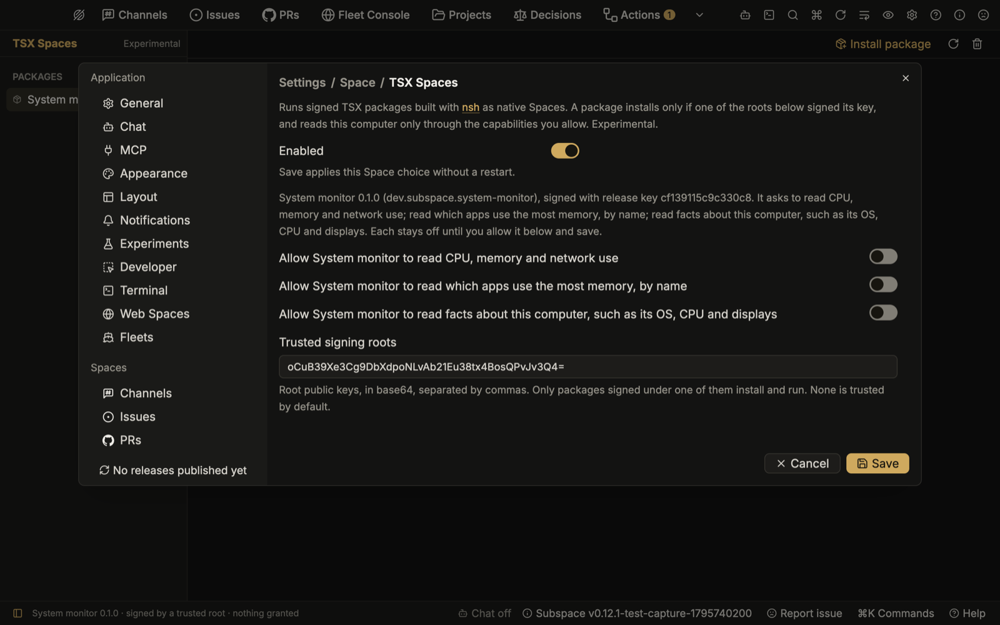
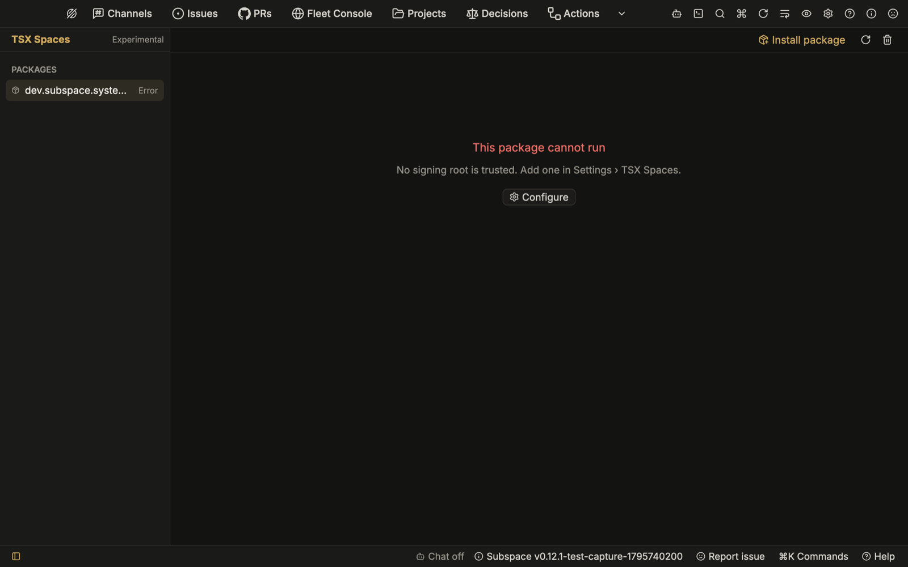

# Delivery: TSX Spaces

Back to [change records](../README.md). Satisfies the [spec](spec.md).

## Approach

1. **Spike first (task 01).** Turn on `gpui-kit/gpui-fast` at 0.9.1 behind
   the new `tsx-spaces` feature, add `nsh-platform-gpui` with unused
   default features off, and build. Write the two-QuickJS link test before
   anything else uses nsh. Only if 0.9.1 fails, upgrade GPUI Kit to the
   version nsh tests and measure existing Spaces. Record the route, the
   QuickJS result and the size and build-time numbers in this file.
2. **Capability and demo in parallel (tasks 02, 03).** Both depend only on
   the JSON contract in spec §5, so they can start at once and in another
   worktree.
3. **Host (tasks 04 to 06).** Space crate and product wiring, then package
   store, trust and grants, then the host channel to the capability.
4. **Docs and evidence (tasks 07, 08).**

```text
01 spike ──► 04 space ──► 05 packages+grants ──► 06 host channel ──► 08 evidence
02 capability ───────────────────────────────────┘                    ▲
03 demo package + signing script ─────────────────────────────────────┘
07 help + licences (after 03, 05)
```

## Work split

| Track | Tasks | Worktree |
| --- | --- | --- |
| A, host | 01, 04, 05, 06, 07, 08 | `feat/tsx-spaces` |
| B, independent | 02 capability crate, 03 demo package and signing script | A second worktree is possible; both touch only new folders, plus one line each in the workspace manifest and `.gitignore` |

Contract between tracks: spec §5 (names and JSON shapes) and §6. Track B's
crate exposes `SystemSampler` with `subscribe(tiers) -> Receiver<Reading>`
style API and `facts()`, with no GPUI and no nsh dependency, so it builds in
release configurations too.

## Decisions (coordinator on the owner's behalf)

- Intent defaults 1 to 16 as accepted in the [intent](intent.md).
- Task files are `task-NN-*.md` in this folder; `tasks.md` is the index,
  following this repository's record layout.
- The Space crate is `subspace-tsx-board`; the capability crate is
  `subspace-tsx-system`; the demo lives at `tsx-spaces/system-monitor/`.
- Grants are stored in the config file's `tsxSpaces` section, which
  Settings owns; the Space only reads them. The plan was a file of the
  Space's own; Settings' grant switches and Save boundary decided it.

## Verification

- `make check` and `mise run quality` in the desktop; Framework `make check`
  if it changes (it should not).
- `cargo tree` checks for R-BUILD-2 and 3; the QuickJS link test.
- `nsh test` for the demo; unit tests for the capability, privacy included.
- Isolated debug build (`make capture` with `CAPTURE_FEATURES=tsx-spaces`),
  screenshots in `evidence/`.

## Results

Implemented on 27 November 2026 by the implementing agent; decisions are the
coordinator's on the owner's behalf, for owner review.

### GPUI route and QuickJS

| Route | Result |
| --- | --- |
| `gpui-kit` 0.9.1 + `gpui-fast` | Builds only with `gpui-fast` pinned to 0.1.14; later versions conflict with `gpui-base` 0.9.1. |
| nsh on 0.9.1 | nsh 0.6 and 0.7 need GPUI Fast 0.1.16 or later; only nsh 0.5 fits, with no charts module. |
| `gpui-kit` 0.11.0 + `gpui-fast` 0.1.19 + nsh 0.7.1 | **Chosen.** nsh's tested pairing. |

A GPUI Kit version cannot be chosen per Cargo feature, so the whole app
moved to GPUI Kit 0.11 and GPUI Fast, as the owner asked, in a separate
change with its own visual pass and CPU measurements:
[GPUI Kit 0.11 and GPUI Fast](../gpui-fast/README.md). The same change
moves `subspace-charts` to nsh's QuickJS fork, so the app links one
QuickJS.

### Fixes found while embedding

- **TLS provider.** nsh turns on rustls's ring provider beside aws-lc-rs.
  rustls then picks no process default, and `ureq` and `reqwest`, built
  without a provider of their own, would panic building a client config.
  The app installs aws-lc-rs as the process default at start-up
  (`products/subspace/src/tls.rs`, with a test).
- **First save.** Saving Settings › TSX Spaces on a config file without a
  `tsxSpaces` section failed with "the board is no longer in the config
  file". The Framework now creates a Space's own top-level section on its
  first save; a removed nested board is still refused.
- **Grants apply when Settings closes**, without a Reload.

### Size and build time (macOS arm64, release, unstripped)

| Build | Binary | Incremental build |
| --- | --- | --- |
| Default features | 167.7 MB | 192 s |
| With `tsx-spaces` | 209.1 MB (+41.5 MB) | 127 s on top |

### Demo

Installed from `mise run tsx-package`'s signed package, its development root
trusted and all three capabilities granted, in an isolated capture build
(`make capture` with `CAPTURE_FEATURES=tsx-spaces` and the new
`CAPTURE_TSX_PACKAGE`, kept under its app ID, with `CAPTURE_TSX_KEY` so the
grants can name its install). The package built by the nsh 0.7.1 CLI runs on the
0.7.1 runtime. Live CPU, per-core, memory and network graphs update at 1 Hz;
the apps list and facts panel showed live data too, but those captures are
not committed because they list the capturing machine's own apps.

| State | Screenshot |
| --- | --- |
| Running, Twilight Two |  |
| Running, Cupertino Light (theme hand-off) |  |
| No packages |  |
| Declared capabilities, none granted |  |
| Settings › TSX Spaces |  |
| No trusted root: refused |  |

### Checks

Framework and desktop `make check`, `mise run quality` in both, `nsh test`
(through `make check`'s `tsx-space-test`), and the commit hooks pass.
`MISE_ENV=terminal make check-terminal` passes with the shared offline
Ghostty cache.

### Open risks

- **`policy.granted`** is a public field of nsh's engine, not documented
  API; ask upstream for `AppView::set_granted_capabilities` on GPUI.
- **Bundle acceptance** happens as soon as a package starts, not after its
  first frame.
- **Not built**: developer mode, install from a URL, Windows and Linux runs.
- **Audit**: `mise run audit` reports the same advisories as `main`; none
  comes from nsh or the system capability.
