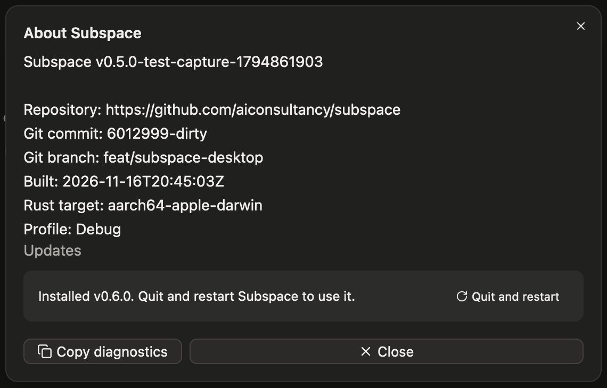
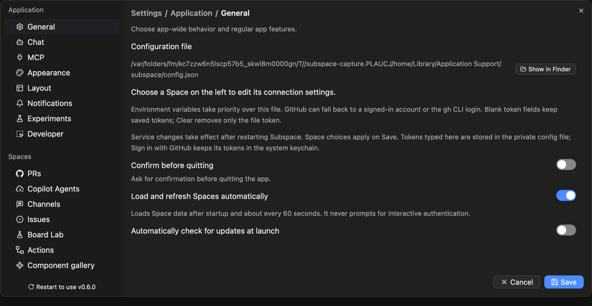

# Quit and restart after an update

Back to the [change records](../README.md).

## Intent

After installing an update, About said "Restart Subspace to use it. Open
windows and running tunnels use v… until then." Tunnels are legacy and no
longer part of Subspace, and the owner had to quit and reopen the app by
hand. The owner asked for no mention of tunnels and a button that quits and
restarts the app.

## Spec

- Installed state text: "Installed v<version>. Quit and restart <app> to use
  it." The `upgrade` CLI reports "<old> → <new> installed. Quit and restart
  the app to use it." Nothing mentions tunnels.
- The update button follows the state (`UpdateAction`): **Check for
  updates**, **Install update**, then **Quit and restart** (RotateCw glyph)
  once installed. In Settings the bottom-left update button reads "Restart to
  use v<version>" and does the same.
- **Quit and restart** dispatches the new `subspace_app::QuitAndRestart`
  action through the shell's quit path. With **Confirm before quitting** on,
  the confirmation lists running programs first, titled and labelled **Quit
  and restart**. It saves preferences and calls GPUI's `restart`, which
  waits for this process to end and opens the app bundle (or executable)
  that the update replaced.
- Settings › General no longer says tokens are "not Keychain": tokens typed
  in Settings are in the private config file; Sign in with GitHub keeps its
  tokens in the system keychain.
- Capture gains an `installed:<version>` step that puts the updater in the
  installed state without installing anything, for evidence.

## Delivery

Unit tests cover the button per state, the status and CLI text, and the
confirmation's title and glyph; the compact Settings view test covers the
installed label. `subspace-shell` and `subspace-update` tests pass.

Before, About showed "Installed v1.2.0. Restart Subspace to use it. Open
windows and running tunnels use v1.0.0 until then." and only **Check for
updates**; there was no capture step for that state, so it has no image.

After (`make capture`, fixture data, `installed:0.6.0`):

## Tasks

- [x] Drop the tunnel wording from About and the CLI.
- [x] Quit and restart button in About and Settings, through the quit path.
- [x] Correct the Settings token sentence.
- [x] Capture step, tests and docs.
