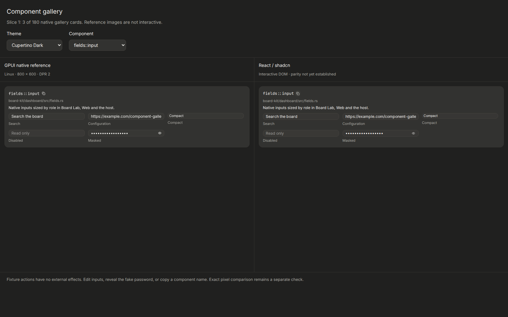

# Slice 1 results

18 November 2026. This is a Linux rendering/comparison proof for
three of 180 cards. It does not establish pixel parity or complete the ticket.

## Native evidence

Six actual GPUI captures cover action buttons, inputs and error boxes in
Subspace One Dark and Cupertino Dark. Each PNG is 1600 × 1200 from an
800 × 600 logical viewport at DPR 2. Independent repeated captures were
byte-identical for all six cases. The fixture uses the real catalogue cards,
the selected native theme documents and the approved installed fonts.

The exact invocation is in the Framework gallery test's
[README](../../../../subspace-framework/spaces/component-gallery/tests/README.md).
References and their source manifest are under [evidence](evidence/).

## Web evidence

The web Space uses React 19, TypeScript, Tailwind and locally owned
shadcn/ui Button, Input and Alert compositions. It bundles fonts and native
reference PNGs, has no WASM or permissions, and serves an installable `dist/`.
The [package README](../../../web-spaces/examples/component-gallery/README.md)
documents the build, capture and comparison commands.

The first Chromium capture produced all six actual DOM screenshots. Strict
comparison failed all six. Non-edge differences ranged from 18,702 to 103,686
pixels. The initial comparison report is retained locally under
`web-spaces/examples/component-gallery/artifacts/comparison-slice1/`.
After source-driven corrections, final capture still fails all six cases.
No tolerance, masks, reference substitution or image resizing was added.

| Case | Non-edge differences | Percentage |
| --- | ---: | ---: |
| One Dark action buttons | 40,923 | 2.1314% |
| One Dark inputs | 93,197 | 4.8540% |
| One Dark error box | 14,694 | 0.7653% |
| Cupertino Dark action buttons | 33,076 | 1.7227% |
| Cupertino Dark inputs | 93,225 | 4.8555% |
| Cupertino Dark error box | 15,095 | 0.7862% |

Residual differences include text and SVG rasterisation, fractional
positions and all translucent fill colours. The complete
[comparison report](evidence/comparison/index.html) links each unchanged
native reference, actual React raster, difference and overlay. Its
[JSON](evidence/comparison/report.json) records exact and non-edge counts.

The [Chromium manifest](evidence/chromium-manifest.json) records browser
159.0.8154.6, viewport, DPR and passed interaction checks. The built package
passed theme/component selection, input editing, disabled-state, password
visibility, clipboard-refusal and card-change reset checks under the
web-Space content security policy. No real credential or clipboard data was
used.

## Checks and remaining work

- Native reference capture and repeat determinism passed.
- Thirteen Node tests passed, including rejection of changed pixels,
  different dimensions, a missing reference and stale comparison output.
- Web production build and installable-package validation passed.
- Framework's first full check failed package verification when the kernel
  killed a `github-copilot-sdk` compiler process for out-of-memory. Its Rust
  tests passed. Desktop's full check was interrupted by a server restart.
  The memory-bounded serial Framework retry passed all normal checks,
  including package verification for all 24 crates. Desktop's serial
  retry also passed all normal checks. Framework and Desktop quality checks pass
  without new touched-code findings or baseline changes.
- Framework and Desktop dependency audits fail `RUSTSEC-2026-0543` for
  existing `chrono 0.4.45`. The baseline lockfile already contains this
  version. No suppression or dependency migration was added.
- A fresh npm audit reported zero vulnerabilities.
- One Opus 5.5 visual review completed in session
  `ses_e0f911f44ffeneEEqkdwsI7qYs`. It inspected all six native and React
  images, selected diff/overlay evidence and the normal two-pane screenshot.
  No second visual review was run.
- Publication follows these checks. The draft PR records its final commit
  and pre-push-hook result. Its title must retain
  `parity incomplete: 0/6 strict`; it is not a ready-to-merge parity claim.

## Visual review corrections and remaining causes

The review found that the selected Ghost button used the border token,
not the secondary-active token. This was a genuine colour bug in Cupertino
Dark, fixed before the final capture. It also found that the styling-only
Selected sample incorrectly had `aria-pressed="true"`. Only Selected and
toggled now has that state. The new colour/accessibility regression and
stale-output regression failed before their fixes, then passed. Comparison
now refuses an existing output folder. Browser prerequisites are explicit
in the normal package task and README.

The three main remaining visible causes are:

1. Translucent fills differ by one RGB step over large areas. This is most
   of the input-card difference. A later slice should verify the native
   blend calculation and use exact opaque composites for these uniform
   fixture backgrounds, then rerun the unchanged comparator.
2. Text and SVG rasterisation differ, including password bullet advances
   and small horizontal drift across the action row. A later slice should
   verify matching glyph/stroke geometry and source font metrics. It must
   keep DOM text and controls, not replace them with reference images.
3. Small positions and line-height snapping differ, usually one device
   pixel vertically and up to four across controls. A later slice should
   measure native layout bounds and adjust only source-backed metrics,
   including the mask-toggle alignment, then recapture all six cases.

These are a closure plan, not a claim that cross-renderer parity is
guaranteed. Hover, active and focus visuals and the mask-toggle keyboard
behaviour remain outside the native comparison. The web toggle is a
keyboard stop; the native fixture's toggle is not.

This proof does not cover the other 177 cards, native window chrome,
macOS, installed web-view integration or a Linux web-view port.

## Bowser input-fill follow-up — local, not published

The committed native references remain the comparison baseline. A fresh AMD
Radeon 780M native capture at source `7dfb862` has matching outer-card bounds
but different decoded pixels in all six cases, not merely different PNG
encoding. RGB channel differences are at most two steps, with unchanged
opaque alpha. This host-reproduction result is not React parity. Neither the
native references nor the earlier comparison evidence was replaced.

Pinned GPUI Component 0.9.1 uses Oklab mixing at 0.3 alpha for normal inputs
and 0.8 followed by 0.5 opacity for disabled inputs. Alpha remains floating
point; the WGPU renderer blends into an 8-bit UNORM target. This does not
establish a single cross-GPU rounding rule. The web fixture now uses opaque
theme tokens measured from the committed references over the uniform muted
panel: One Dark `#1e2026` / `#21242a`, Cupertino Dark `#373734` / `#393836`
for normal / disabled fills. These tokens are not reusable alpha colours.

Same-host Chromium 159 captures before and after this input-only change use
the unchanged committed native baseline and strict comparator:

| Case | Before non-edge differences | After non-edge differences |
| --- | ---: | ---: |
| One Dark action buttons | 35,651 | 35,651 |
| One Dark inputs | 88,628 | 14,577 |
| One Dark error box | 9,648 | 9,648 |
| Cupertino Dark action buttons | 27,332 | 27,332 |
| Cupertino Dark inputs | 88,362 | 14,794 |
| Cupertino Dark error box | 9,806 | 9,806 |

These before counts differ from the earlier host's published table; only
the same-host before/after rows isolate this patch. **Parity remains 0/6
strict.** New captures and reports are retained outside the repository under
task `task_153d16be-a3a6-4257-b9fd-bc9dba204d5a`, not published PR evidence.

The new browser regression failed before the fix and passed after it. All
14 package tests, the TypeScript/production build and package validation
passed. Both captures also passed the existing interaction checks. No npm
install-script approval or bypass was needed. No native rebuild, full
repository gates or second visual review was run for this patch. Text/SVG
rasterisation and subcontrol geometry remain unresolved; no text metrics,
layout, comparator tolerance or reference pixels changed.

## Bowser measured layout and action follow-up — local

19 November 2026. Retained the input-fill patch and measured native raster
control boundaries, DOM frames and text advances before changing geometry.
Source `gpui-pre 0.3.12` ceilings each TextLayout width; its Cosmic Text
renderer disables hinting. Browser form controls had overridden the root's
`geometricPrecision` request. Native labels therefore used ceiled unhinted
widths while web labels used hinted advances. The action row now uses real
text spans with ceiled intrinsic widths and DPR2-snapped frames. Error titles
and messages use those ceiled widths when centred, rather than centring raw
glyph advances. No arbitrary baseline offsets or font-size changes were added.

The remaining action plates now use measured opaque rest-state composites
over the same uniform panel. Pinned GPUI outlined-danger source uses 0.1
alpha, not the earlier web value 0.08; neutral actions use foreground, not
secondary foreground. Input controls request unhinted advances. The native
mask button's padding-free glyph ends at the input content inset; the web
glyph now follows it without shrinking the 17.5 × 17.5 hit target or changing
the real password field's type, accessible name or keyboard interaction.

| Case | Start of this follow-up | Final non-edge differences |
| --- | ---: | ---: |
| One Dark action buttons | 35,651 | 8,882 |
| One Dark inputs | 14,577 | 13,675 |
| One Dark error box | 9,648 | 9,476 |
| Cupertino Dark action buttons | 27,332 | 9,224 |
| Cupertino Dark inputs | 14,794 | 13,886 |
| Cupertino Dark error box | 9,806 | 9,634 |

These are same-host Chromium captures against the unchanged committed native
references. **Parity remains incomplete: 0/6 strict.** The new
[comparison report](evidence/bowser-follow-up/comparison/index.html) and its
[JSON](evidence/bowser-follow-up/comparison/report.json) preserve all six final
reference/React/diff/overlay images in a separate directory. The
[before captures](evidence/bowser-follow-up/before/manifest.json) record the
same-host state before the input-fill correction. Earlier evidence is unchanged.
Each meaningful fix had
a failing browser regression before its correction, then a passing focused
check and one fresh full-frame DOM capture/comparison. Evidence and source
measurements are retained outside the repository under task
`task_19355e01-88a5-4f9e-b083-41d50410b026`; intermediate directories are
`label-rounding`, `action-fills`, `input-advances` and `error-centering`, each
with a separate comparison report. They are not the earlier PR's screenshots.
The final TypeScript/production build, all 18 package tests and installable
package validation passed; capture interactions passed at every cycle. The npm
install-script policy stayed unchanged. Required delivery hooks and independent
focused patch review remain separate gates, not implied by these checks.

Residual strict differences fall almost entirely on non-uniform raster areas:
only 0–7 changed pixels per case have a uniform 3 × 3 reference neighbourhood.
This is a flat-interior heuristic, not a semantic text/edge classifier. The
nine used SVG node geometries match the native assets, and installed native
font hashes match the approved originals. Measured input frame/text ink can
still differ by one device pixel despite matching logical frames; password
bullet advances and rasterisation remain different. Native host reproduction
already differs with the same fonts and source. No universal cross-renderer
exactness, new baseline or tolerance relaxation follows from these findings.
Further changes need a concrete source or measurement explanation, not
speculative CSS offsets. No native rebuild or old visual-review replay was
needed for this follow-up.
