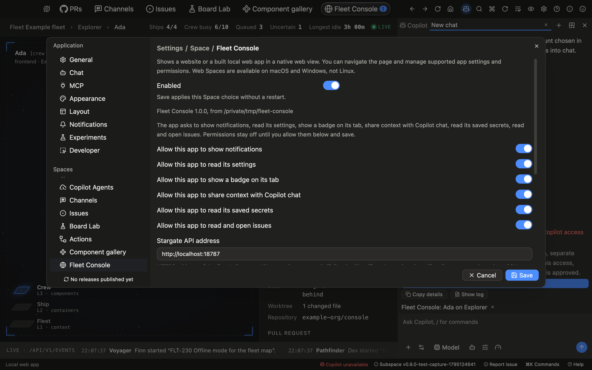
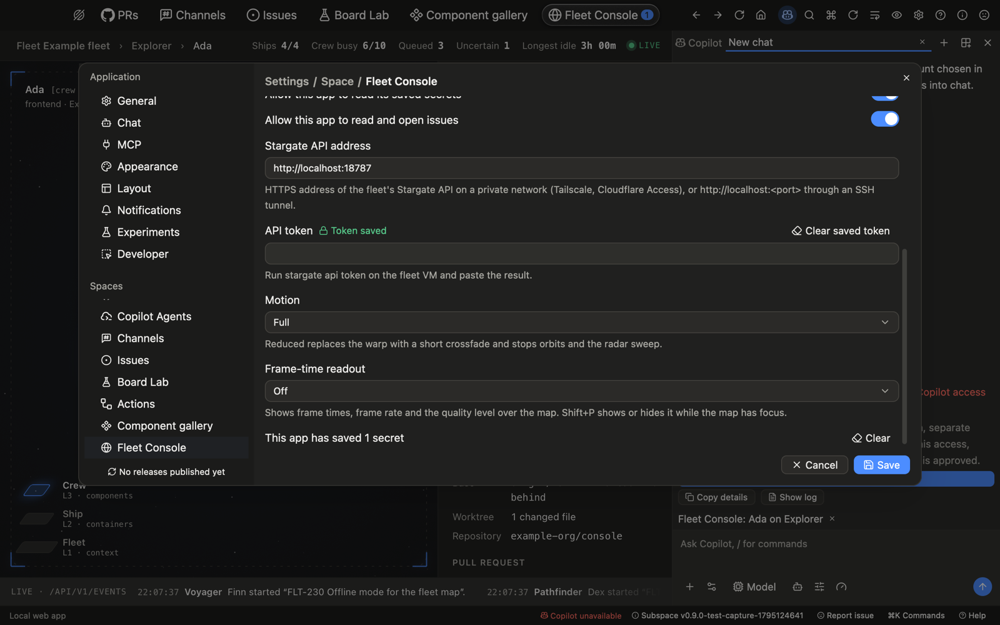

# Web Space bridge: theme, secrets and issues

Back to the [change records](../README.md).

## Intent

A first-party web Space should look like the rest of Subspace, read the
API token its user saved for it, and show live issue tiles the way
Channels (IRC) does. The bridge had none of these: pages could not see the
theme, secrets never reached the page, and only boards compiled into the
app could follow the `issues` contract.

## Spec

- `subspace.theme()` needs no permission. It returns the theme's id (the
  bundled theme file, or `custom`), its variant name, light or dark mode,
  the sixteen dashboard tones as `#rrggbb` (translucent tones flattened onto
  `bg`) and CSS `font-family` values for the interface and monospaced
  fonts. `subspace:theme` (`CustomEvent`, `detail` a `Theme`) fires on
  `window` when any of them changes and differs from the last value sent.
- `subspace.secrets.get()` needs the new `secrets` permission (**Allow this
  app to read its saved secrets**). It returns the saved, non-empty values
  of the settings the manifest declares as `secret`, and nothing else.
- `subspace.issues.scope()`, `issues.resolve(identifiers)` and
  `issues.open(identifier)` need the new `issues` permission (**Allow this
  app to read and open issues**). They forward the Framework's `issues`
  contract: `current-scope`, `resolve` (at most 50 distinct identifiers) and
  the shell's board navigation that an IRC tile click uses.
  `subspace:issues-changed` (a plain `Event`) fires after each contract
  `changed` while `issues` is allowed. Resolution states and state kinds map
  to the lowercase strings in the reference.
- The Issues hub supplies the active Subspace API base and project keys as
  `appOrigin` and `teamKeys`. The bridge keeps `linearWorkspace` in the
  scope payload with a `null` value. Opening a recognised issue uses the
  same API and profile binding as Channels.
- Both permissions start off, bind to the manifest fingerprint like the
  others, and are reported by `info().permissions` when allowed. Request
  limits (16 KiB, 32 pending, 10 s) and exact-origin checks are unchanged.
  Pushed events run only in the document the web Space shows, after a
  native check of its address and a `location.origin` check in the page.
- Framework: `subspace_dashboard::ThemeId` names the active theme's bundled
  file (set by the host with each theme it applies), and
  `BoardRegistration::configured` now captures the type's `contracts()`, so
  every configured web Space declares the `issues` roles under its own ID.

The full API is in the
[reference](../../web-spaces-reference.md#follow-the-apps-theme).

## Delivery

- Unit tests: permission parsing and labels (`manifest.rs`), secrets
  filtering, grant gating and issue validation (`bridge/tests.rs`), theme
  JSON and font families (`bridge/theme.rs`), issue JSON mapping,
  navigation and the broker round trip with a fixture responder
  (`bridge/issues.rs`), protocol parsing and event scripts
  (`bridge/protocol.rs`), and the JavaScript methods and pushed events
  (`tests/bridge.test.mjs`). The Framework's appearance snapshot test covers
  `ThemeId`.
- Settings shows the two new **Allow this app to …** switches only for a
  manifest that requests them; they are drawn by the existing permission
  rows.
- Checked end to end with Fleet Console in the capture build against a live
  Fleet API: `theme()`, `secrets.get()`, `issues.scope` and `issues.resolve`
  through the signed-in Issues Space, `setBadge` and `setContext`. See the
  [Fleet Console record](../fleet-console-web-space/README.md#in-subspace-against-a-live-fleet-api)
  for its screenshots. Capture screenshots of a web Space need the page
  mirror the capture build now draws (`spaces/web/src/mirror.rs`).
- Not checked in a running app: a live theme switch delivering
  `subspace:theme`, and `issues.open` switching to the Issues Space.

## Board checklist: web (changed parts)

- [x] Contracts: subscribes `issues@1/changed`, requests
  `issues@1/current-scope` and `issues@1/resolve`, declared in
  `contracts()`; the board view subscribes when an app that asks for
  `issues` opens; recorded in
  [Declared contracts](../../spaces-audit.md#declared-contracts).
- [x] Framework state it follows: the GPUI Kit `Theme` and `ThemeId`
  globals; no other Space's crate or globals.
- [x] No tools, search or notifications carry issue content; nothing is
  stored.
- [x] `help.md`, the reference, the guide and the `web-space` skill updated.
- [x] Screenshots of the new Settings switches from the capture build.

## Tasks

- [x] `secrets` and `issues` permissions with Settings labels.
- [x] `theme()` and the `subspace:theme` push.
- [x] `secrets.get()`.
- [x] `issues.scope`, `issues.resolve`, `issues.open` and
  `subspace:issues-changed`.
- [x] Framework `ThemeId` and configured-board contracts.
- [x] Docs, help, skill, packaging script and tests.
- [x] Capture screenshots for the pull request.

## Follow-up: page-owned secrets (`secrets.set`)

### Intent

Fleet Console lets the user add several fleets in the page, each with its
own Stargate token. A manifest can only declare a fixed set of secret
fields, so the page needs to save secrets it creates at run time.

### Spec

- `subspace.secrets.set(key, valueOrNull)` needs `secrets`. It saves one
  secret, or deletes it for `null`, and resolves once the config file has
  it. Keys are 1 to 40 letters, digits, `_` or `-`, starting with a letter;
  values 1 to 4096 characters without control characters.
- A key the manifest declares as a secret writes that declared secret; one it
  declares as a non-secret setting is refused. At most 32 secrets of the
  page's own (undeclared keys); replacing or deleting one is always allowed.
- `secrets.get()` returns the declared secrets with saved values and every
  secret the page saved. Declared non-secret keys never appear.
- Storage: the Space's `secrets` in the private config file, the same object
  as the declared secrets, written through the checked immediate edit and
  applied to the running configuration without reloading any Space. Removing
  the Space removes them; replacing it keeps them.
- Only a shown Space with nothing over it saves (`Open this Space to save a
  secret.`). Settings covers the Space while open, so a page never writes the
  file behind an open Settings, whose Save would then refuse a changed file.
- Settings shows **This app has saved N secrets**, never the keys or values,
  with **Clear**, which removes them all on Save. The Framework gains
  `BoardFields::with_app_secrets()` and `SettingsFile::board_secret_keys` for
  this; any configured board can opt in.

### Delivery

- Framework tests: the count and Clear on Save, keeping declared secrets,
  and no line for a board that does not opt in (`board_field_tests/app_secrets.rs`);
  `board_secret_keys` (`services/core`).
- Desktop tests: key, value, setting-key and 32-secret checks; what
  `secrets.get()` returns; the write keeping the rest of the entry; a save
  reaching the file and the running configuration (`bridge/secrets.rs`);
  grant gating (`bridge/tests.rs`); protocol parsing; the JavaScript method's
  shapes and type checks (`tests/bridge.test.mjs`).
- Captured in the capture build with one page-owned secret saved: the
  Settings line and its Clear button.

## Follow-up: review fixes

### Intent

A post-merge review found that the `secrets.set` follow-up widened what an
existing grant allowed and that page-owned secrets could outlive the app
that saved them. It also found smaller gaps in the theme payload, the save
path and the shell's close-Space menu.

### Spec

- **Saving has its own permission.** `secrets.set` needs `save-secrets`
  (**Allow this app to save its own secrets**). `secrets` (**read its saved
  secrets**) stays read-only, so a grant made before saving existed never
  starts to write. `secrets.set` refuses every key the manifest declares,
  secret or not (`This key belongs to one of the app's settings, which only
  Settings changes. Choose another key.`): the declared secrets are the
  user's, set in Settings.
- **Page-owned secrets belong to their app's install source.** They are
  stored as `<owner>:<key>`, the owner being the first 32 hex digits of a
  digest of the source recorded in the entry's `managedSource`: a GitHub
  repository and board folder, a release's repository and asset, a local
  folder's canonical original, or a website's origin. A ZIP install, or an
  entry with no recorded source (or one that does not match its `url` or
  `path`), is strict: the owner is the grant identity (folder and manifest).
  `secrets.get()` returns only the current owner's, so an update from the
  same source keeps them and an app from another source starts with none.
  Settings still counts every undeclared secret in **This app has saved N
  secrets**, and **Clear** removes them all.
- **Earlier keys carry over only to the same source.** A page's secrets
  saved before they had owners (plain keys) are read as the app's own when
  its source is recorded, and hidden otherwise. Keys an earlier build of
  this change stored under the folder-and-manifest identity are read by
  that same folder and manifest. A save replaces the key's older forms.
  Installing into the Space from the manager binds the plain keys (except
  those the new app declares) and the previous app's identity keys to the
  previous source first, so they stay visible only if the new source is the
  same, or stay hidden when no source was recorded.
- **The file decides the write.** Before writing, the save reads the Space's
  entry from the file it is about to change: it must still give the Space
  this app's folder and install source and allow `save-secrets` for this
  identity (otherwise `This Space changed in the config file. Review it in
  Settings, then try again.`), and the 32-secret limit counts that entry's
  secrets.
- **Saving keeps the page open.** The registration's configuration leaves
  out page-owned secrets (`subspace_web_board::configuration`), so the next
  board-set rebuild, such as closing another Space, reuses the web view.
  A declared secret changed in Settings still reloads the page, as before.
- **Saves are limited.** At most 10 `secrets.set` saves in any 10 seconds
  (`Too many secret saves. Wait a few seconds, then try again.`); refused
  writes do not count. The write stays on the UI thread: the config file is
  small, and the limit bounds how often it is rewritten.
- **A custom theme's name stays private.** `theme()` sends `name: "Custom"`
  with `id: "custom"`.
- **Framework: close Space never leaves none.** Closing a Space checks the
  board set the write would produce, from the same file, and refuses when no
  Space would stay on (`Couldn't close <Space>: it is the only Space the
  config file leaves on`), for example after the file turned the others off
  outside the app.
- **Framework: menus over a web Space.** A Space tab's right-click menu, and
  the toolbar's label menu, count as covering the board area while open, so
  a web Space's native view hides under them instead of drawing over them.

### Delivery

- Desktop tests (`bridge/tests.rs`, `bridge/secrets/tests.rs`,
  `bridge/theme.rs`, `manifest.rs`, `source.rs`): a `secrets` grant alone
  cannot save; declared keys are refused with `save-secrets`; another app's
  secrets are hidden; an update from the same GitHub source keeps them,
  another repository or board folder does not, a ZIP reinstall stays
  strict, and folders, releases and websites own theirs by source
  (`bridge/secrets/owner/tests.rs`); plain and folder-and-manifest keys are
  read and replaced on save, and installing binds them to the previous
  source or hides them when none was recorded (`owner/tests.rs`,
  `manager/model.rs`); a write after the file's install source changed is
  refused; the 10-in-10-seconds limit; a write to an
  entry that now names another folder, or whose grant is off, leaves the file
  unchanged; the limit counts the file's secrets; a saved secret leaves
  `configuration` unchanged while a declared one changes it; the custom theme
  name; the new permission's name, label and Settings checkbox.
- Framework tests (`app/space_menu_tests.rs`): closing the last Space the
  file leaves on is refused and writes nothing; an open Space menu covers the
  board and Escape uncovers it.
- `scripts/package-web-space.py` accepts `save-secrets`.
