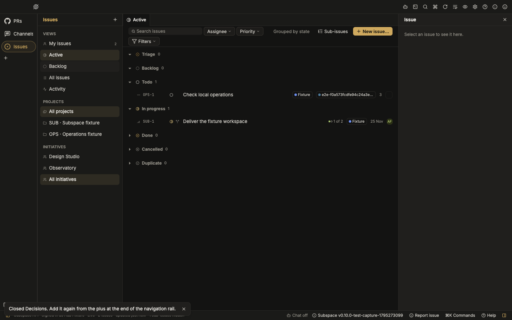
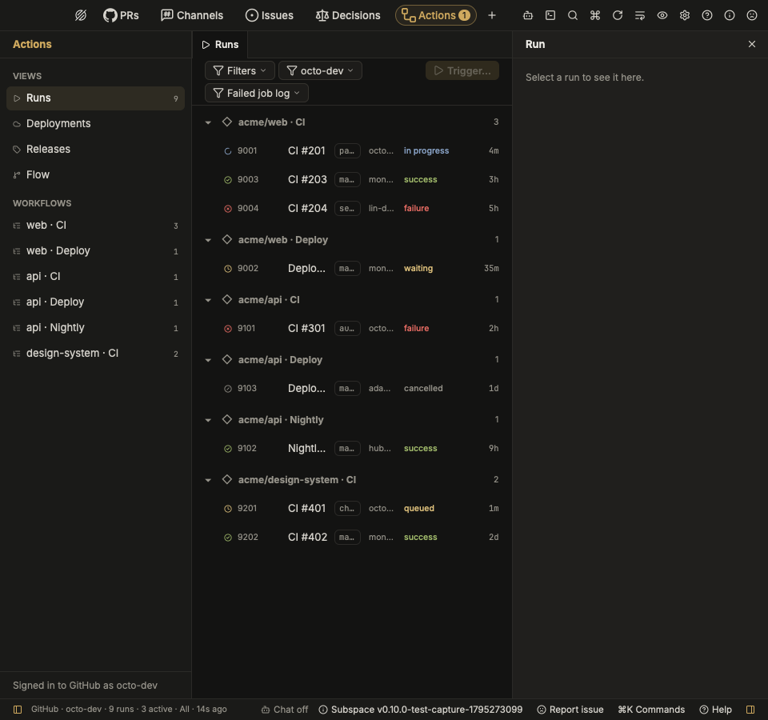

# Workspace shell review findings: verification

Back to the [change record](intent.md).

## Findings

Every finding pull request #29 left open, and one found while fixing them.
IDs: **O** for Claude Opus 5.5, **S** for GPT-6.2 Sol in the order of #29's
list of open findings, **F** for the fleet review, **N** for the one found
here. Locations are as #29's reviewers gave them, against #29's head
`225c4b9`; paths under `spaces/`, `docs/` and `scripts/` are in
`subspace-desktop/`. Tests named without a path are in the crate that owns
the file.

| ID | Reviewer and severity | Location in #29 | Outcome | Covering test or reason |
| --- | --- | --- | --- | --- |
| S12 | GPT-6.2 Sol, high | `spaces/decisions/src/board.rs:128` | Fixed | `tests/account.rs`: `switching_account_drops_everything_read_for_the_previous_one`, `an_answer_read_for_the_previous_account_is_dropped`, `signing_out_drops_everything_read_for_the_account`, `a_hidden_space_drops_the_previous_account_and_reads_when_shown`; `page.rs`: `a_return_key_names_its_account_epoch` |
| F1 | Fleet review, P3 | `spaces/decisions/src/board.rs:80` | Fixed, with S12 | As S12 |
| O1 | Claude Opus 5.5, low | `spaces/decisions/src/board.rs:699` | Fixed, with S12 | `switching_account_drops_everything_read_for_the_previous_one`: the directory is dropped and read again |
| S16 | GPT-6.2 Sol, low | `spaces/decisions/src/board.rs:89` | Fixed | `load.rs`: `a_stopped_read_asks_for_no_further_page`; `tests/account.rs`: `a_newer_read_stops_the_one_it_supersedes` |
| S14 | GPT-6.2 Sol, medium | `spaces/decisions/src/search.rs:51` | Fixed | `tests/list.rs`: `a_failed_search_shows_no_rows_found_for_the_previous_text` |
| S15 | GPT-6.2 Sol, medium | `spaces/decisions/src/page.rs:44` | Fixed | `tests/issues.rs`: `back_from_an_issue_chosen_in_the_list_returns_to_its_decision` |
| S36 | GPT-6.2 Sol, medium | `docs/changes/decisions-space/spec.md:67` | Left | Paging past 1,000 matches (a "Load more" or a documented cap) needs the owner's design decision; the guide, the spec and the developer page now state the limit, the **+** count and that narrowing reaches the rest |
| S13 | GPT-6.2 Sol, medium | `spaces/issues/src/view/shell.rs:88` | Fixed | `view/shell.rs`: `tests::a_screen_keeps_the_organisation_menu_while_the_navigator_is_hidden`, a test of the toolbar rule; a full render needs a NETT backend |
| N1 | Found while fixing S15 | `spaces/issues/src/seam.rs` (`attach`) | Fixed | `tests/detail/back.rs`: `a_new_hub_forgets_the_origin_from_the_last_account`. The stale origin was latent: opening an issue after the page was dropped already reset it, but the Back state no longer outlives the page |
| S1 | GPT-6.2 Sol, medium | `subspace-framework/board-kit/dashboard/src/list/menu.rs:27` | Fixed | `list::menu::tests`: `a_menu_selects_its_line_and_offers_the_boards_commands_for_it`, `a_blocked_board_keeps_its_selection_and_the_menu_never_acts_on_it`, `a_blocked_header_menu_shows_fold_disabled` |
| S2 | GPT-6.2 Sol, medium | `subspace-framework/board-kit/dashboard/src/workspace.rs:101` | Fixed | `workspace::layout_tests`: `the_docks_keep_their_widths_while_there_is_room`, `the_docks_yield_so_the_pane_keeps_its_least_width`, `a_workspace_narrower_than_the_pane_gives_the_pane_all_of_it` |
| S3 | GPT-6.2 Sol, medium | `subspace-framework/board-kit/dashboard/src/workspace/navigator.rs:287` | Fixed | `workspace::interaction_tests`: `rows_are_tree_items_that_say_which_is_selected`, `the_list_keys_move_between_rows_and_enter_or_space_chooses_one`, `a_click_chooses_a_row_without_taking_the_keyboard_focus` |
| S4 | GPT-6.2 Sol, low | `subspace-framework/board-kit/dashboard/src/workspace/row_parts.rs:40` | Fixed, narrowed | Choosing an unselected row first is the documented contract; a right-click on the selected row no longer runs its click again. `workspace::interaction_tests`: `the_menu_of_the_selected_row_does_not_choose_it_again`, `the_menu_of_another_row_chooses_it_first` |
| S5 | GPT-6.2 Sol, low | `subspace-framework/board-kit/dashboard/src/list/menu.rs:62` | Not a defect | GPUI Kit 0.9.1's `PopupMenu` skips a separator when the menu is empty or already ends with one and drops a trailing one, so the drawn menu never doubles them |
| S6 | GPT-6.2 Sol, medium | `subspace-framework/host/app/src/app/add_space/menu.rs:101` | Fixed | `space_menu_tests/add_space.rs`: `each_space_in_the_plus_menu_is_named_by_its_title`, and `choosing_a_space_in_the_plus_menu_adds_it` updated |
| S7 | GPT-6.2 Sol, medium | `subspace-framework/host/app/src/app/add_space.rs:192` | Fixed | `space_menu_tests/add_space.rs`: `a_space_added_for_after_a_restart_is_current_after_the_restart` |
| S8 | GPT-6.2 Sol, medium | `subspace-framework/host/app/src/app/shell.rs:193` | Fixed | `toolbar/tests/status.rs`: `zoomed_help_hides_the_dock_switches_and_keeps_the_hidden_spaces_docks` |
| S9 | GPT-6.2 Sol, medium | `subspace-framework/host/app/themes/twilight-two.json:174` | Fixed | `theme.rs`: `twilight_two_syntax_colours_meet_normal_text_contrast` |
| S10 | GPT-6.2 Sol, low | `subspace-framework/docs/design-guide.md:360` | Not a defect | The checklist is the project's own screenshot checklist for people, linked from `AGENTS.md`; it gives no instruction to an automated reviewer |
| S11 | GPT-6.2 Sol, low | `subspace-framework/host/app/src/app/space_menu.rs:83` | Fixed | `space_menu.rs`: `the_closed_toast_says_where_to_reopen_the_space`; `space_menu_tests.rs`: `the_closed_notice_points_to_the_rail_when_navigation_is_vertical` |
| S17 | GPT-6.2 Sol, medium | `spaces/github/src/lib.rs:569` | Fixed | `navigation/tests/drafts.rs`: `an_account_switch_drops_the_open_review_draft`, `the_same_account_keeps_the_open_review_draft` |
| S18 | GPT-6.2 Sol, medium | `spaces/github/src/page.rs:112` | Fixed | `navigation/tests/drafts.rs`: `a_review_action_on_the_same_pull_request_keeps_the_draft`, `a_review_action_on_another_pull_request_keeps_the_draft` |
| S19 | GPT-6.2 Sol, medium | `spaces/irc/src/toolbar.rs:38` | Fixed | `tests/hidden_navigator.rs`: `with_the_navigator_hidden_connection_acts_on_the_named_conversation`, `with_the_navigator_shown_the_toolbar_acts_on_the_selection` |
| S20 | GPT-6.2 Sol, medium | `spaces/irc/src/view/frame.rs:25` | Fixed | `tests/hidden_navigator.rs`: `with_the_navigator_hidden_the_board_keeps_its_focus_target` |
| S21 | GPT-6.2 Sol, low | `spaces/github/src/inspector/status_rows.rs:85` | Fixed | `inspector::status_rows::tests::a_check_link_names_the_site_it_opens` |
| S22 | GPT-6.2 Sol, low | `spaces/github/src/lib.rs:1866` | Fixed | `repo_filter::tests::the_status_counts_stay_the_views_while_a_repository_is_filtered` |
| S23 | GPT-6.2 Sol, medium | `spaces/actions/src/open.rs:92` | Fixed | `panel/fetch/runtime_tests.rs`: `the_writes_act_on_the_run_the_opened_tab_shows` |
| S24 | GPT-6.2 Sol, medium | `spaces/actions/src/panel/fetch.rs:23` | Fixed | `panel/fetch/runtime_tests.rs`: `the_failed_job_log_picker_offers_and_reads_only_the_selected_runs_jobs` |
| S25 | GPT-6.2 Sol, medium | `spaces/actions/src/panel/fetch.rs:87` | Fixed | `panel/fetch/runtime_tests.rs`: `a_new_attempt_starts_the_opened_tab_afresh_and_drops_the_old_attempts_answer`, `a_rerun_seen_while_another_run_is_selected_reads_the_opened_run_again`; `open.rs`: `a_run_page_shows_jobs_only_from_the_attempt_it_names` |
| S26 | GPT-6.2 Sol, medium | `spaces/actions/src/panel/fetch.rs:50` | Fixed | `panel/fetch/runtime_tests.rs`: `only_the_newest_log_read_lands_and_a_failed_log_keeps_the_jobs` |
| S27 | GPT-6.2 Sol, medium | `spaces/actions/src/lanes.rs:67` | Fixed | `view.rs`: `a_narrow_list_keeps_room_for_the_run_title` |
| S28 | GPT-6.2 Sol, medium | `spaces/actions/src/panel.rs:130` | Fixed | `panel/fetch/runtime_tests.rs`: `quick_selection_reads_one_run_at_a_time_and_skips_the_runs_passed` |
| S29 | GPT-6.2 Sol, low | `spaces/actions/src/panel/fetch.rs:55` | Fixed | `panel/fetch/runtime_tests.rs`: `only_the_newest_log_read_lands_and_a_failed_log_keeps_the_jobs` |
| O2 | Claude Opus 5.5, low | `spaces/actions/src/panel/fetch.rs` (line given as 10761, beyond the file) | Fixed, with S29 | As S29 |
| S30 | GPT-6.2 Sol, low | `spaces/github-copilot-agents/src/shell.rs:82` | Fixed | `shell/tests/opened.rs`: `an_opened_task_that_leaves_the_list_keeps_a_tab_that_closes` |
| S31 | GPT-6.2 Sol, low | `spaces/github-copilot-agents/src/shell.rs:56` | Fixed | `shell/tests/opened.rs`: `a_filter_key_on_an_opened_task_shows_the_list_and_opens_the_menu_there` |
| O3 | Claude Opus 5.5, low | `spaces/github-copilot-agents/src/load.rs` (line given as 17220, beyond the file) | Fixed | `load/detail_tests.rs`: `each_loaded_list_renames_the_account_and_a_failed_one_keeps_it` |
| S32 | GPT-6.2 Sol, low | `spaces/board-lab/help.md:523` | Left | Board Lab is being renamed to Space Lab on a parallel branch that rewrites this guide; fixing it there avoids a conflict |
| S33 | GPT-6.2 Sol, medium | `AGENTS.md:78` (repository root) | Fixed | Checked by hand with prek 0.5.10 in a scratch repository: a ranged run, and a per-commit `--from-ref c^ --to-ref c` run, both miss a key added and later removed, because prek checks the files in the checkout; `git rebase --exec 'prek run --last-commit'` finds it |
| S34 | GPT-6.2 Sol, medium | `docs/changes/unreleased-spaces/spec.md:69` | Fixed | A new block in `scripts/test-package-products.sh` |
| S35 | GPT-6.2 Sol, medium | `docs/github-copilot-agents.md:159` | Fixed, in code and docs | `logs/load.rs`: `tests::a_prefetch_reads_no_log_the_search_index_would_not_keep` |
| S37 | GPT-6.2 Sol, low | `subspace-desktop/AGENTS.md:291` | Not a defect | The project's own guidance to compare screenshots with the design guide's anatomy image, which reviewers are given |
| S38 | GPT-6.2 Sol, low | `subspace-desktop/AGENTS.md:335` | Fixed | Guidance only: before and after in the same theme, with the fallback stated |
| S39 | GPT-6.2 Sol, low | `docs/subspace/boards.md:12` | Fixed | `scripts/check-board-docs.py` and `scripts/check-docs-index.py` |
| F2 | Fleet review, nit | `scripts/test-product-interfaces.sh:89` | Fixed | No automated test: nothing drives the script with a stub binary |

Of #29's 44 findings, 39 are fixed (three of them with another finding),
3 are not a defect and 2 are left. N1, found here, is fixed too.

## Checks

All on the final working tree, one build at a time, on macOS (aarch64).

| Check | Result |
| --- | --- |
| Framework `make check` (architecture, board docs, docs index, format, clippy with `-D warnings`, tests, packaging, publish script) | Passed. Tests: 3,460 passed, 0 failed, 6 ignored |
| Framework `mise run quality` | Passed: 0 findings against the baseline |
| Desktop `make check` (architecture, board docs, docs index, format, licences, clippy with `-D warnings`, tests, script fixtures, web bridge and web Space tests) | Passed. Tests: 2,394 passed, 0 failed, 13 ignored |
| Desktop `mise run quality` | Passed: 0 findings. `main` itself had one, a stale suppression in `products/subspace/build.rs`, removed here |
| Desktop `make interfaces` | Passed |
| `scripts/test-package-products.sh`, with the new refusal block | Passed (also part of `make check`) |
| `bash -n` and `shellcheck -x` on the changed scripts | Clean |

The build needed three fixes the editing pass could not see, none of which
changes an outcome above: a type in the navigator row's handler helper, a
missing trait import in the S22 test, and a redundant closure in the S19 test.

## Screenshots

Captured with `make capture` in Twilight Two from fixture data: before from
a build of `main` (`40b9ebd`), after from this branch, with the same steps.
The window is 1440 x 900, except the narrow Actions pair at 960 x 900.

**S3: a navigator row reached from the keyboard.** The same eleven
Shift+Tab presses from the Space. Before, the rows are not in the tab order
and the focus ends on Report issue in the status bar; after, it lands on a
project row and shows its accent ring.

**S8: zoomed Help.** Before, the status bar still has the navigator and
inspector switches at its two ends, acting on the hidden Space; after, it
has none while Help is zoomed.

**S11: closing a Space from the navigation rail.** Before, the notice
points to a plus in the title bar, which vertical navigation does not have;
after, it points to the plus at the end of the rail.

**S2 and S27: Actions in a narrow window.** Before, the branch, actor and
status columns take the whole row and the run titles disappear; after, they
give way and each title keeps its place.

**S9, Twilight Two syntax colours: no capture.** The four colours changed
(`link_uri`, `link_text`, `title` and `type`) are Markdown-source and type
highlights, and no fixture view draws them: the issue editor is plain text,
and the fictional pull requests' TypeScript diffs use none of them. The
contrast test checks each against every Twilight Two background; the worst
case, the editor's current line, rises from 2.77, 3.36 and 3.34 to 4.55,
4.53 and 4.51. The other visible changes (S13, S14, S18, S22, S29, S30) need
fixture states the capture servers do not provide, such as a failing search
or a NETT organisation choice; their headless tests cover them.
