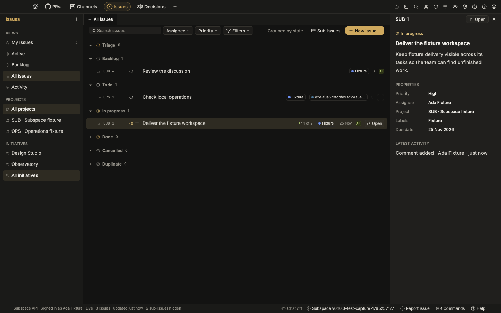
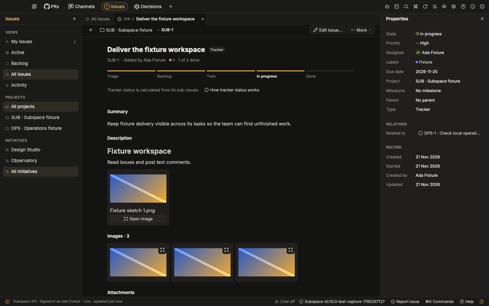
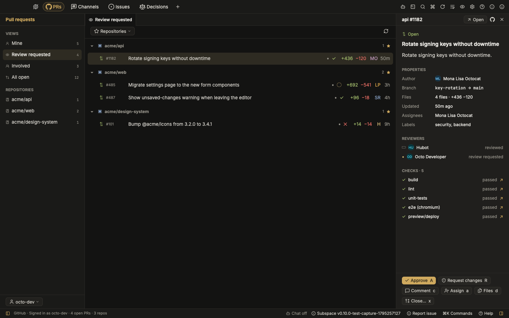
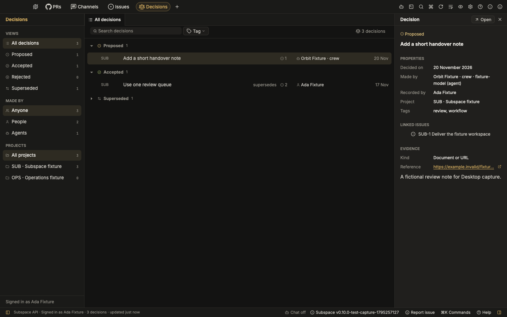
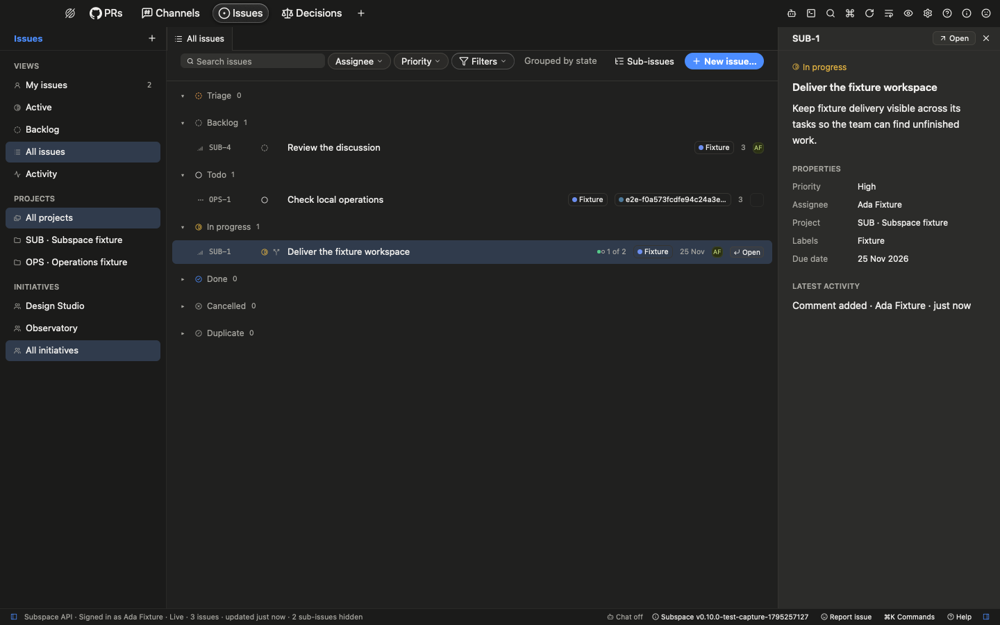

# Delivery: workspace shell

See the [intent](intent.md), [spec](spec.md) and [tasks](tasks.md).

## State on 21 November 2026

Built, and the unit and headless tests pass on the branch's working tree,
which includes the restyle to the mock-ups (spec section 2a), the dock
switches in the status bar (section 3), the Twilight Two theme and the
embedded [Inter and JetBrains Mono](../bundled-fonts/README.md). Five
captures from the final build are under [evidence](#evidence).

On the final working tree, on 21 November 2026, `make check` passed in the
Framework and in the desktop (its lint and test steps ran in both
configurations, see the
[unreleased Spaces record](../unreleased-spaces/delivery.md)),
`mise run quality` passed in both (in the Framework with no new findings
against the baseline) and `make interfaces` passed in the desktop.
`mise run audit` in the desktop fails on advisories against a dependency
that `main` also uses, so it does not pass (see
[Not yet done](#not-yet-done)). Neither model review has run, and the
terminal check, the Board Lab interfaces run and the Windows and Linux font
checks have not been done, so the change is not ready for review. This page
records only what has been checked.

## Tests

The main session ran plain `cargo test --workspace --locked --no-fail-fast`
in each project on the branch's working tree, based on `main` at `1fc8996`.
Both runs exited 0:

| Project | Test binaries | Passed | Ignored |
| --- | --- | --- | --- |
| Framework | 69 | 2,396 | 4 |
| Desktop | 45 | 2,243 | 11 |

The suites this change touches, from those runs:

| Project | Suite | Tests |
| --- | --- | --- |
| Framework | Dashboard (`board-kit/dashboard`) | 424, plus 4 boundary tests |
| Framework | Component gallery | 41 |
| Framework | Host app (`subspace-shell`) | 591 |
| Desktop | Web Spaces | 102 |
| Desktop | Channels | 444, 4 ignored |
| Desktop | Actions | 87 |
| Desktop | Copilot Agents | 105 |
| Desktop | Board Lab | 202, 4 ignored |
| Desktop | Pull requests | 168 |
| Desktop | Issues | 273 |
| Desktop | Decisions | 55 |
| Desktop | Product descriptor | 14 |

The counts above are from that earlier `cargo test` run, before the last
fixes added a few tests. The final `make check` passed with a few more tests.

One real failure was found and fixed on the way: Twilight Two's switch knob
failed the bundled-theme switch contrast rule against the theme's accent
track. The knob now uses the theme's dark ink, `#17150f`, and the rule's test
(`theme::switch_tests`, in the host app suite) passes in the runs above.

The Decisions suite belongs to the
[Decisions Space record](../decisions-space/delivery.md), and the host app's
add-a-Space tests to
[add a Space from the title bar](../add-space-from-title-bar/delivery.md);
they are listed here because they ran in the same build.

## Found and fixed on the way to the gates

- A lint error in the font test helper.
- Thirteen quality findings from the day's additions: three files over the
  300-line module limit, one function over 60 lines, stale suppression
  markers, a constructor used only outside the Framework that is now marked
  as API, two tests restructured to call a real function, and one function
  split into logic and integration.
- The Decisions evidence link overflowed the inspector. Marked external links
  now shorten to an ellipsis and keep their glyph, with a regression test,
  `a_long_marked_address_shortens_to_fit_a_narrow_panel`, in the Framework's
  dashboard crate.

## Evidence

Taken only with `make capture`, from the final build of this branch, with
fixture data, at 1440 x 900, the mock-ups' size. They were retaken on
21 November 2026 and replace the earlier ones. The first four are in
Twilight Two (`CAPTURE_THEME="Twilight Two"`) and are also the repository
README's screenshots. The title bar in them shows only Pull requests,
Channels, Issues and Decisions: neither unreleased Space appears.

The Twilight Two captures were compared with the owner's mock-ups and the
design guide's
[Reviewing a UI change](../../../../subspace-framework/docs/design-guide.md#reviewing-a-ui-change)
checklist: the zones are in the same places, text starts on one edge, the
strips line up, the views are in the navigator and state is in the status
bar. Where they still differ is under [Known gaps](#known-gaps). The Cupertino
Dark capture shows that another theme keeps its own look and fonts on the
same shell.

Not captured:

- No before captures from a build of `main`.
- Channels: in the default fixture state it has no network, so a capture
  shows only its empty state. A real capture needs `CAPTURE_IRC_CONFIG` and
  the local IRC test server.
- Actions: switched off in the capture configuration.
- Copilot Agents: not enabled in the capture configuration, so its capture
  showed Pull requests instead.
- Board Lab: its earlier capture showed an error in the pane (see
  [Known gaps](#known-gaps)), so it is not evidence. Board Lab is now left
  out of default captures.
- A web Space.
- The right-click menus and the Add a Space menu.
- A hidden navigator or inspector.

## Not yet done

Passed on the final working tree on 21 November 2026:

- [x] `make check` in the Framework, then in the desktop (exit 0 in both).
- [x] `mise run quality` in both projects (the Framework with no new
      findings against the baseline, the desktop exit 0).
- [x] `make interfaces` in the desktop (exit 0): the default board list,
      without Board Lab or the Component gallery.

Still to do:

- [ ] `mise run audit` in the desktop. It was run and fails on nine
      advisories published against `heapless` 0.9.3 (RUSTSEC-2026-0574 to
      RUSTSEC-2026-0582, all "unsound"). `main` depends on the same
      `heapless` version, and this branch adds no third-party crate (its
      only lock-file change is the new `subspace-decisions-board` workspace
      crate), so `main` fails the audit too. Not caused by this branch.
- [ ] `MISE_ENV=terminal make check-terminal`. Not run.
- [ ] `SUBSPACE_FIXTURE_BOARD_LAB=1 make interfaces`, the interfaces run
      with Board Lab. Not run.
- [ ] Before captures from a build of `main`, and captures of the Spaces and
      states listed as not captured above.
- [ ] The shell anatomy image redrawn, and the captures compared with it.
- [ ] Both model reviews, Claude Opus 5.5 and GPT-6.2 Sol at high effort,
      clear the final head. Not run.

## Known gaps

What the branch does not yet do, against the spec, the design guide or what
the Spaces did before:

- **Remove-group labels.** A Remove command's glyph takes the theme's danger
  colour, but its label keeps the menu's text colour: GPUI Kit's native menu
  cannot colour a label without losing it as the item's accessible name. See
  the [standard right-click menu](../standard-context-menu/delivery.md).
- **Channels.** No **Direct messages** section label in the navigator, no
  rounded single-box composer and no larger reading text size.
- **Actions.** A run's id is not in a monospace font in the shared list.
- **Pull requests.** The old detail panel could be resized and had its own
  right-click menu; the inspector has neither. Linked issues are not shown on
  a pull request.
- **Copilot Agents.** The row menu no longer offers **Copy ID**.
- **Board Lab in the capture build.** Its capture showed the error line
  "File exists (os error 17)" in the pane, with fixture data. Board Lab is
  now left out of default builds and captures (see the
  [unreleased Spaces record](../unreleased-spaces/delivery.md)), and the
  error was not investigated.
- **Look against the mock-ups.** Restyled to the mock-ups (spec section
  2a), but these still differ:
  - The mock-ups' look is the new Twilight Two theme, with their colours
    and sizes, in the embedded Inter and JetBrains Mono; other themes keep
    their own. What it cannot set, because no theme token covers it:
    navigator rows are 32 px like list rows (28 px in the mock-ups), because
    one row-height token covers both lists and the navigator; the toolbar's
    vertical padding is 4 px (5 px); the current Space tab's ring and the
    Open button's ring are drawn from the accent, not the mock-ups' darker
    `#6b5a35`; a latched button's text is the accent mixed with strong text,
    close to but not the mock-ups' `#e6c888`; and the quiet grey (`#6f6c65`)
    for No priority has no token.
  - The shared list draws group headers at the row height, as it draws rows
    (30 px and 32 px in the mock-ups), and row keys are not in the monospace
    family.
  - In Issues and Decisions several navigator rows show as selected at once,
    one in each section, because each section has its own current choice
    (for example a view, a project and an initiative). The mock-ups show one.
  - Section labels are not tracked: GPUI has no letter-spacing.
  - Tabs in a pane's tab strip keep GPUI Kit's 10 px side padding (14 px),
    unselected tabs keep a transparent trailing border (a hairline), and
    their labels are regular weight (medium).
  - Opened-item tabs show a key only in Issues and Pull requests. Actions'
    run, Copilot Agents' task and Decisions' decision tabs have no separate
    key, so they show their title as before.
  - Toolbar labelled actions keep their glyphs (Sub-issues, Edit issue…,
    More), following the rule that action buttons have a glyph; the
    mock-ups draw them without.
  - An active filter menu (such as Assignee in My issues) is still drawn
    primary, so a toolbar can show it beside the main action.
  - The search field keeps GPUI Kit's input height.
  - The title bar's controls on the right and the glyph before the first
    Space tab are existing features the mock-ups do not draw.
  - The title bar's Space tabs keep their 18 px glyph (14 px in the
    mock-ups). Their label size and height are theme values: Twilight Two
    sets 13 px and 26 px; other themes keep 15 px and their own `--nav-h`.
  - The status bar keeps GPUI Kit's `StatusBar` layout and text size: its
    height, padding and the gaps between its items are not the mock-ups'
    26 px, 10 px and 14 px, though its commands take 11.5 px text. Its items
    carry glyphs, which the mock-ups draw without.
- **Shell anatomy image.** The dock switches moved from the toolbar's ends
  to the status bar's (spec section 3), but the design guide's anatomy
  image, `subspace-framework/docs/images/shell-anatomy.png`, still draws
  them at the toolbar's ends. It needs redrawing from the owner's artboard
  before the captures are compared with it.
- **Embedded fonts on Windows and Linux.** Not checked on this branch.
  Windows may list "JetBrains Mono Medium" as a family of its own, and on
  Linux an Inter installed on the system may be chosen over the embedded
  one. See the [bundled fonts record](../bundled-fonts/README.md).
