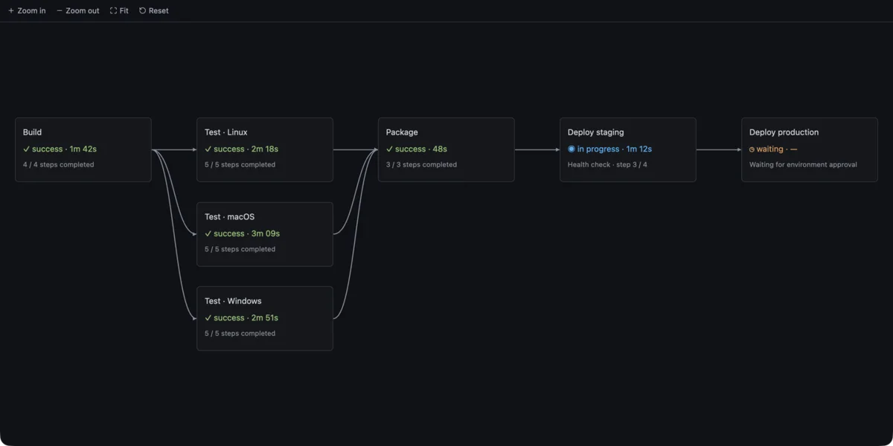

# Actions guide

<!-- Evidence: spaces/actions/src (dashboard, view, navigator, toolbar, docks,
keys, menus, model, rows, lanes, inspector, open, panel, dialogs, writes, poll,
load, graph),
clients/github/src/actions, subspace-framework/host/app/src/settings. Live
GitHub behavior was not tested while this guide was written. -->

## Overview

The Actions Space shows GitHub Actions workflow runs, deployments and releases
for the repositories that you configure. You can inspect jobs and steps, read
the log of a failed job, view the job dependency graph, and trigger, re-run,
cancel, approve or reject after you confirm.

This board is experimental. It can change or be removed. It is off by default in
debug and release builds.

To open this guide, press `?` or choose **Help**. The Help panel shows this
guide and the keyboard shortcuts. Copilot can read the same guide through
`board_help`.

## Before you start

1. Enable the board. Open **Settings > Boards > Actions**, turn on
   **Enabled**, and save. The Settings page states that Save applies the board
   choice without a restart.
2. Choose the repositories to read: star them with **Repositories…** in the
   PRs board, add them under **Favourite repositories** in Settings, or set
   `repos` in the product's `config.json`. The list is shared by PRs, Copilot
   Agents and Actions, and the board follows changes without a restart.
   Restart Subspace after you change credentials.
3. Sign in to GitHub. The board uses the existing GitHub credential order:
   `GH_TOKEN` or `GITHUB_TOKEN`, then `github.token` in `config.json`, then the
   `gh` CLI login of the selected account. The board adds no credential source
   and does not copy a saved token into an input.

Token permissions:

- Reads need **Actions**, **Contents** and **Deployments** read access to each
  configured repository.
- Trigger, Re-run, Re-run failed and Cancel run need Actions write access, or a
  classic token with the `repo` and `workflow` scopes.
- Approve and Reject also need deployment write access and reviewer rights for
  the environment.

If no repository is a favourite, the board shows **No favourite repositories**
and makes no request.

## Main view

The Space has the same layout as every Space:

- The **navigator** on the left is titled **Actions**. **Views** lists the
  four views, and the section under it lists the groups of the list on show.
  The line at the bottom names the GitHub account, such as
  `Signed in to GitHub as <account>`.
- The **pane** in the middle has a tab named after the current view, a second
  tab for the item you open, the toolbar, and then the list, the Flow graph or
  the opened item.
- The **inspector** on the right shows the selected item, with the buttons
  that change it at the bottom.
- The **status bar** at the bottom of the window shows the account, the run
  counts and when Actions last loaded.

The board has four views. Select a view in the navigator or with the keys
`1` to `4`. Subspace remembers the last view. **Runs** shows the number of
loaded runs beside its name.

| View | Key | Content |
| --- | --- | --- |
| **Runs** | `1` | Workflow runs, grouped by repository. |
| **Deployments** | `2` | Each environment with its latest deployment, and runs that wait for review. |
| **Releases** | `3` | Recent releases, and tags that have no release. |
| **Flow** | `4` | The job graph of the selected run. |

### Runs, Deployments and Releases lists

- Each configured repository has a group header, in the configured order. A
  repository stays visible with a count of 0 when it has no matching rows.
- In **Runs**, groups are `owner/name · <workflow>` by default, or
  `owner/name · <status>` when grouping is by status. In **Deployments** and
  **Releases**, there is one group per repository.
- A run row shows, in columns that line up across groups: a status mark, the
  run ID, the title `<workflow> #<number>`, the branch as a chip, the actor
  and event (`<actor> · <event>`), the status in words and in its colour, and
  the age. Each kind of status has its own mark, so it reads without colour:
  a tick for success, a cross for failure, a turning circle for in progress, a
  clock for queued or waiting, a slashed circle for cancelled and a dashed
  circle for skipped.
- Item search also matches a run's branch, actor, workflow, event and status.
- A **Deployments** row is either an environment
  (`<environment> · <ref> · <latest status>`) or a review request
  (`Review <environment> · <workflow> #<number>`, status waiting).
- A **Releases** row shows `<name> · <tag>` and a status of `draft`,
  `prerelease` or `published`. A release without a completed run for its tag in
  the loaded run history carries the text `no matching completed run in loaded
  history`. A tag without a release appears as `<tag> · tag without release`.
- Status colors: green for success, approved and active; red for failure,
  timed out, rejected and error; blue for in progress; yellow for waiting,
  queued, pending and requested; muted for all other states.
- Repositories show **Loading runs…** while their runs arrive. The status line shows
  the same message while Actions is loading.
- The status line shows
  `GitHub · <account> · <n> runs · <n> active · <status filter> · <n>s ago`.
  It adds `run history truncated` before the age when a repository has more
  runs than Subspace loads. Before an account is known it shows
  `GitHub · Checking account…` or `GitHub · Account unavailable` in place of
  the account.
  The board badge shows the number of pending deployment reviews when that
  number is greater than 0.
- Click a group header, or select it and press Enter, to fold or unfold the
  group. The shared list does not bind the Left and Right keys to folding.

### Flow

Flow shows one node per job of the run selected in **Runs**. It shows
**No run selected** until you select a run. See [Flow graph](#flow-graph).

### Screenshots

The isolated desktop capture uses synthetic GitHub data for Runs, Deployments
and Releases.

## Toolbar and filters

The toolbar sits under the pane's tab. **Filters**, the account picker and
**Failed job log** are on the left, and **Trigger…** is on the right. The
switches at the two ends of the status bar, at the bottom of the window,
show or hide the navigator and the inspector, and Subspace remembers both
choices. In a narrow pane the controls on the left
wrap onto a second line.

### Navigator

- Choose a row under **Views** to change view. The current view is
  highlighted.
- The section under **Views** lists the groups of the list: **Workflows** in
  **Runs** (**Statuses** when grouping is by status) and **Repositories** in
  **Deployments** and **Releases**. Each row shows the group's count, and the
  repository owner is left out unless two owners share a name. Choose a row to
  unfold that group, select its heading and scroll the list to it. **Flow**
  has no such section.
- When the navigator is hidden, a menu named after the current view appears
  at the start of the toolbar. Use it, or the keys `1` to `4`, to change
  view.

### Filters

Choose **Filters**, or **Filter Actions…** in Commands, to see the current
values in one place. Each choice updates the runs immediately. The panel
stays open during edits and outside clicks. Use **Close filters** (×),
Escape or the **Filters** button to close it. Reopen the panel to include
choices from newly loaded runs. The Status, Branch and Grouping shortcuts
open the panel and focus that field.

| Picker | Key | Choices | Default |
| --- | --- | --- | --- |
| Status | `s` | **All**, **Active**, **Failed**, **Success** | **All** |
| Branch | `b` | **All** and the branches of loaded runs | **All** |
| Workflow | none | **All** and the workflows of loaded runs | **All** |
| Actor | none | **All** and the actors of loaded runs | **All** |
| Grouping | `g` | **Workflow**, **Status** | **Workflow** |

- **Active** means the run is queued, in progress, waiting, requested or
  pending. **Failed** means the conclusion is failure or timed out.
  **Success** means the conclusion is success.
- Filters combine with AND. They apply to the **Runs** view only, and they run
  in Subspace on the loaded runs. They do not change which runs GitHub returns.
  Each repository explains when it has no matching runs. If none match, the
  **Clear filters** button resets the run filters and keeps your grouping.
- Subspace saves the view, status, branch, workflow, actor, grouping and
  account as preferences, with whether the navigator and the inspector
  show. They are not secrets.

### Account and failed job log

- The account picker (or `u`) is named after the current account, or
  **Account** before one is known. It lists the `gh` logins when the
  credential comes from the `gh` CLI, or the one login of the token
  otherwise. Until you choose an account
  on this board, it uses the shared GitHub account saved in Settings. A board
  choice takes priority on later starts. A change discards in-flight
  results for the previous account, and records stay separate for each account.
  The picker does nothing while a confirmation dialog is open.
- **Failed job log** lists the failed jobs of the selected run as
  `<id> · <name>`. Choosing one opens the run in its tab and shows the log
  there.
  See [Read a failed job log](#read-a-failed-job-log).

### Refresh

- When automatic updates are on, Actions loads shortly after Subspace starts
  and refreshes runs, deployments and releases about every 10 minutes, even
  while another Space is open. Opening Actions also loads it if needed.
- Press `r` or use **Reload** to refresh all configured repositories.
  A refresh already in progress keeps running.
- Select a repository group and choose **Refresh repository** from its
  right-click menu or Commands. This reloads its runs, deployments and
  releases. The request joins a load already reading that repository or
  waits for the current fetch to finish.
- Each repository is loaded independently. If one read fails, the board keeps
  the loaded records and shows **Refresh failed; loaded records retained** with
  one line per failed source, such as `owner/name: Runs: <error>`.
- Automatic polling is described in [Polling](#polling).

### Search

Press `/` to search the loaded records. The placeholder is **Search loaded
Actions records**. The board does not keep a persistent full-text index.

## Details

- One click on a row selects it and shows it in the inspector. A selected run
  starts a background read of its jobs and its workflow file, as opening a run
  did before. One read runs at a time: when you move through runs quickly,
  the run you stop on is read next, and the runs you passed are not read. The
  selection does not open anything.
- A double click, Enter or **Open** in the inspector opens the item in a second
  tab beside the view's tab. Click the view's tab, or choose a view, to go back
  to the list; the opened tab stays until you close it with its ×. Opening
  another item replaces it.
- Clicking the opened tab selects its item again, in its own view, so the
  inspector, the keys and Commands act on the item the tab shows. Selecting
  another item, for example from the navigator or a search, shows the list
  again.
- In a narrow list a row's columns after the title take at most 60% of the
  row. The branch and actor columns give way first, then the status word is
  cut; the age keeps its width.
- Click a group header, or select it and press Enter, to fold or unfold it.

### Inspector

The inspector's header names the run (`Run <id>`), or the kind of item, and
has **Open**, **Open on GitHub** and **Close inspector**. With nothing
selected it says `Select a run to see it here.`

For a run it shows:

- The status with its mark, in words and colour, then the title. A waiting run
  adds one line saying what it waits on, such as `Waiting for a reviewer to
  approve the production environment.`, `Waiting for a runner.` or `Waiting to
  start.`
- **Details**: **Repository**, **Branch**, **Actor**, **Event** and
  **Started**.
- **Jobs**: one line per job with its status mark, name and result and
  duration (`success · 134s`), or `Running` or `Not started`. It shows
  **Loading jobs…** while the jobs load, `No jobs yet. A queued run may not
  have started.` when there are none, and the error when the read fails.
- **Environment**, when the run waits for a review: the environment's name and
  its reviewers, from the pending deployments loaded in **Deployments**.
- At the bottom: **Approve**, **Reject**, **Re-run**, **Re-run failed** and
  **Cancel run**. **Approve** is the main action when a review is what the run
  waits for. See
  [Change a run or review a deployment](#change-a-run-or-review-a-deployment).

An environment or a release shows its status, title and properties: an
environment's **Environment**, **Ref**, **Protected branches** (or `No branch
policy`) and **Updated**; a release's **Tag**, **Published** and **Author**.

The switch at the right end of the status bar hides the inspector and
shows it again. The selection stays, so **Flow**, the keys and Commands keep working.

### An opened run

A run's tab shows everything opening a run showed before, at reading width:
the status and title, **Details** (repository, workflow, branch, actor,
attempt, event, SHA, started and updated), **Commit** with the commit message,
**Jobs** with each job's result, duration, runner, labels and steps
(`<number>. <name> · <result> · <duration>`), and **Job log** once you load a
log. After a re-run, the tab shows **Loading jobs…** until it has read the new
attempt, so the jobs and log never come from an earlier attempt than the
facts. A review request's tab adds **Environment**, **Allowed reviewer**,
**Requester**, **Wait timer** and **Wait timer started**; a release's adds its
**Release notes**.

### Flow graph

This image uses the board's offline development fixture. It shows invented
jobs and dependencies, not a run from GitHub.

The graph has one node for each job of the API response, including matrix
variants. Each node shows the job name, a status mark with its state and
duration, and the runner, labels and steps.

- Click a node, or move with the arrow keys, to select a job. Enter selects the
  focused job again. The inspector then shows the job: its name, result and
  duration, and its runner, labels and steps. **Close job** returns it to the
  run. It ends with the buttons that change the run, when that run is still
  the one selected in **Runs**.
- Drag the background to pan. Drag a node to move it. Use the mouse wheel or a
  pinch gesture to zoom. Zoom ranges from 0.01 to 2.5.
- The toolbar above the graph has **Zoom in**, **Zoom out**, **Fit** and
  **Reset**. Press `0` in the graph to fit. **Reset** clears node moves, then
  fits the graph.
- Edges come from the `needs` entries of the workflow file at the run's commit.
  If the file cannot be read, is larger than 1 MB, has ambiguous job names or
  an invalid graph, the board shows a **Dependencies unavailable** banner with
  the reason and draws no edges. The board also shows this banner when the job
  list is truncated, or when the graph has more than 128 jobs
  (`Graph too large; use the Runs text view`).
- A status refresh does not move nodes.

## Actions

### Open or copy a link

Press `o` to open the selected record in GitHub. Press `y` to copy its link.
Right-click a row for **Open**, **Open in GitHub**, **Copy link**, **Copy
title**, **Copy id** and **Add to chat**. Release and review rows without a
link omit the link entries.

### Read a failed job log

1. Select a run in **Runs**.
2. Open the **Failed job log** picker and choose a job.

Subspace opens the run in its tab, reads the log on request only, and shows it
in the **Job log** section: **Loading the job log…** first, then the log. The
log is limited to 1 MB. A longer log ends with
`[Subspace truncated this log at 1 MB.]`. If you choose another job before a
log arrives, only the last one you chose shows. A log that cannot be read shows
`The job log did not load: <error>` in that section, and the jobs stay as they
were. The picker lists only the jobs of the run that is selected now. Closing
the run's tab, or a re-run of that run, discards the log.

### Change a run or review a deployment

Select a run or a review request, then choose one of these buttons, keys or
commands. A button is disabled, with a reason in its tooltip, when the action
does not apply.

- **Trigger…** is in the toolbar, because it starts a new run.
- The other buttons act on the selected item, so they are at the bottom of the
  inspector. Select the run or the review request to see them. An
  environment, a release or a notice has no run, so it has none.
- Commands lists each action that applies to the selected item, with its
  key. Use Commands or a key when the inspector is hidden.

| Button | Key | Command | Applies when |
| --- | --- | --- | --- |
| **Trigger…** | `d` | **Trigger…** | A run is selected. The run's workflow is dispatched. |
| **Re-run** | `R` (`Shift+R`) | **Re-run…** | The run has an attempt. |
| **Re-run failed** | none | **Re-run failed…** | The run has an attempt. |
| **Cancel run** | `x` | **Cancel run…** | The run is active. |
| **Approve** | `A` (`Shift+A`) | **Approve…** | The selected item is a review request, and your account can review it. |
| **Reject** | none | **Reject…** | The same conditions as **Approve**. |

Disabled reasons: **Select a run or pending deployment first**, **This item has
no workflow run**, **A completed run cannot be cancelled**, **The run has no
attempt to re-run** and **This account cannot review this environment**.

Every action opens a `Confirm <action>` dialog that shows the repository and
the target. No request is sent before you choose **Confirm**.

1. Choose the button or the command, or press the key.
2. Complete the fields of the dialog, if any.
3. Choose **Confirm**. The button changes to **Applying…**. Choose **Back**, or
   press Escape, to close the dialog without a request. Back and Escape do
   nothing while a request is running.

Dialog fields:

- **Trigger**: **Branch or tag**, filled with the branch of the selected run, is
  required. Subspace reads the workflow file at the run's commit
  (**Reading workflow inputs…**) and shows one field for each declared input.
  Boolean inputs and choice inputs use a selector. Required inputs must have a
  value. If the workflow has no `workflow_dispatch` trigger, the dialog shows
  `This workflow has no workflow_dispatch trigger` and **Confirm** does nothing.
  If the definition cannot be read, the dialog shows **Workflow inputs JSON**
  with `{}`. Enter a flat JSON object of string values. Subspace does not
  validate it, and rejects arrays, numbers and nested objects.
- **Approve**: **Review comment** is optional.
- **Reject**: **Review comment** is required.
- **Re-run**, **Re-run failed**, **Cancel run**: no fields.

Subspace sends a review comment exactly as you enter it. A failed write keeps the
dialog open and shows the error. After GitHub accepts a request, the board shows
the toast **GitHub accepted the request** with an **Open run** link, closes the
dialog and reads the run again. List navigation keys are disabled while a dialog
is open.

The board cannot merge, delete, edit workflow files or create releases.

### Agent tools

The Actions board registers no agent tools. Copilot chat and the MCP server
cannot read or change Actions data through this board. You can add a selected
row to chat with **Add to chat**.

## Keyboard shortcuts

Board keys act only while no text field, menu or dialog has focus. The same
letters are ordinary text in an input.

| Key | Action |
| --- | --- |
| `j` or Down, `k` or Up | Next or previous row. |
| Home, End | First or last row. |
| Enter | Open the selected item in a tab, or fold or unfold a group. |
| Escape | Close a menu or a dialog. |
| `1` `2` `3` `4` | Runs, Deployments, Releases, Flow. |
| `s` `b` `g` `u` | Open the Status, Branch, Grouping or Account picker. |
| `d` `R` `x` `A` | Trigger, Re-run, Cancel run, Approve, each with confirmation. |
| `o` `y` | Open the record in GitHub, copy its link. |
| `/` | Search loaded records. |
| `r` | Reload. |
| `w` | Wrap long titles. |
| `?` | Show or hide Help. |

In a menu: Up and Down, `Ctrl+N` and `Ctrl+P` move, Enter picks, `1` to `9` pick
the numbered option, and Tab or Escape closes. In the Flow graph: arrow keys
select a neighbor job, Enter selects the focused job and `0` fits the graph.

## Settings

Open **Settings > Boards > Actions**.

| Setting | Default | Notes |
| --- | --- | --- |
| **Enabled** | Off | Save applies the board choice without a restart. |
| **Background updates** | On | Save applies without a restart. Off pauses automatic loads and polling. Manual refresh and opening the board still load data. |
| **Update interval** | **Default** | **Default**, 30 seconds, 1, 2, 5, 10, 15 and 30 minutes, or 1 hour. **Default** uses 10 minutes for full refreshes and 30 seconds for active-run polling. |
| **GitHub accounts** | None | Shared GitHub setting. Lists accounts signed in through Subspace and `gh` accounts. **Sign in with GitHub** and **Sign out** apply at once, without Save. |
| **Account** | Not set | Shared GitHub setting. Choose an account (**Choose an account**). It shows **No GitHub accounts yet** when none exist; choose **Sign in with GitHub**, or run `gh auth login` and reopen Settings. Restart Subspace to apply the account to other GitHub Spaces and Copilot chat. |
| **GitHub token** | Not set | The input never shows a saved token. **Clear saved token** removes it on Save. `GH_TOKEN` and `GITHUB_TOKEN` take priority. |
| **Favourite repositories** | Empty | Shared with PRs, Copilot Agents and the agent tools. **Remove** and **Add repository…**; Save applies without a restart. |

Background updates also require the global **Load and refresh boards
automatically** switch in **Settings > General**. Token and account changes
need Save and a restart; repository changes apply on Save. Tokens are stored in the private config file,
not in the Keychain. The board has no other setting. Flow needs no second
switch.

### Polling

- Polling runs only while the Actions board is visible, and reads only the runs
  that are still active, the jobs of the selected run and the pending reviews.
  It does not re-read completed runs, environments, releases or tags.
- The delay is the longer of the **Update interval** (30 seconds for
  **Default**) and the error back-off. After an error the back-off doubles from
  30 to 60 to at most 120 seconds. A success returns it to 30 seconds.
- When another board is shown, active-run polling stops. Automatic full
  refreshes continue on their own schedule.

## Troubleshooting

| Symptom | Check |
| --- | --- |
| The board tab is missing. | Turn on **Enabled** in **Settings > Boards > Actions** and save. The board is off by default. |
| **No favourite repositories** | Star repositories with **Repositories…** in the PRs board, or add them in Settings and save. |
| **Refresh failed; loaded records retained** | Read the source line (`owner/name: Runs`, `Deployments` or `Releases`). Check the token permissions in [Before you start](#before-you-start) and the repository name. Other repositories still load. |
| No accounts, or the wrong account. | Choose **Sign in with GitHub** in Settings, or run `gh auth login` and reopen Settings. `GH_TOKEN` or `GITHUB_TOKEN` override both. |
| **Dependencies unavailable** in Flow | Read the reason in the banner. The workflow file may be unreadable, over 1 MB, ambiguous or too large. |
| **Definition unreadable** or **Definition unavailable** in Trigger | Enter flat JSON string values. Subspace cannot check them. |
| A write button is disabled. | Read its tooltip. Select a run or review request, or use an account that can review the environment. |
| The write buttons are missing. | Select a run or a review request: the buttons are at the bottom of the inspector. If the inspector is hidden, choose the switch at the right end of the status bar, or use Commands. |
| The navigator or the inspector is missing. | Choose the switch at the left or the right end of the status bar. |
| A write fails. | The dialog stays open with the GitHub error. Check Actions write, deployment write and reviewer permissions. |
| Data does not change. | Press `r` to refresh all repositories now. Check **Background updates** and the global automatic refresh switch. |

Subspace does not prove that a token has a permission. GitHub decides when it
accepts a request.

## Limits

- Live GitHub behavior, reads, writes, polling, logs and Settings saves were not
  tested while this guide was written. The statements above come from the board
  source and its tests.
- The board reads at most 3 pages of 100 runs, jobs and environments for each
  list. It reads one page of 100 releases and one page of 100 tags. A truncated
  list adds a notice row, such as
  **Run history is truncated to the client page limit**. Jobs also show
  `Jobs are truncated; dependencies may be incomplete`.
- A job log is limited to 1 MB. A workflow file is limited to 1 MB.
- The graph shows up to 128 jobs.
- Records stay in memory for the session. Subspace does not write a record
  cache and does not index Actions content for full-text search.
- Filters apply to loaded runs in the **Runs** view only.
- Matrix jobs appear as separate nodes. Dependencies come from workflow text
  and can be unavailable.
- The board has no agent tools and no notifications.
