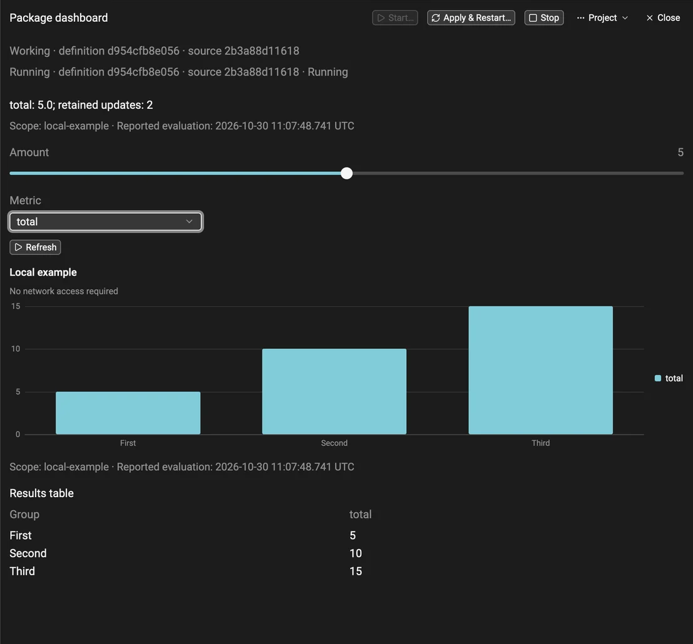
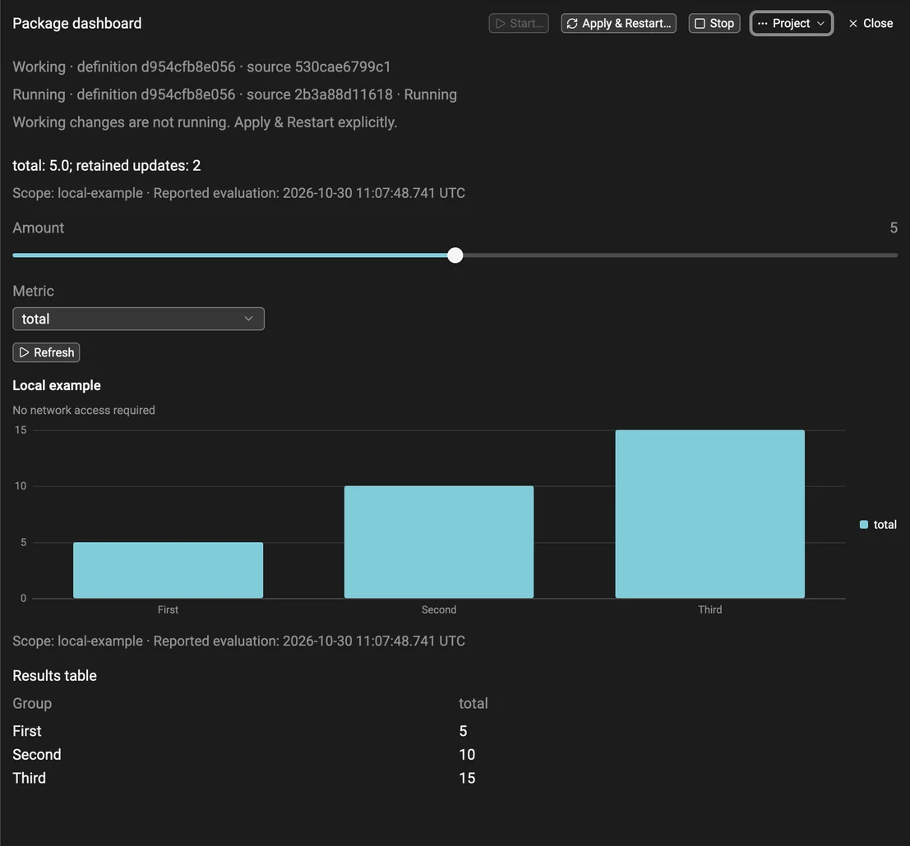
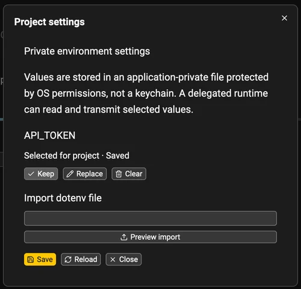

# Space Lab guide

<!--
Evidence: spaces/space-lab/src/{lib,help_images,shell}.rs, workbench/{mod,state,view/*}.rs,
project_browser/{facts,view,view/*,commands,creation,sync}.rs, project_view/*.rs,
project_settings/{view,import}.rs, project_tools/*.rs, lab_tools/*.rs,
project/{validation,store}.rs, environments/*.rs, editors.rs;
subspace-framework/board-kit/dashboard/src/native_grid/view/controls.rs;
products/descriptor/src/lib.rs (default enablement);
subspace-framework/services/agent-tools/src/{help,help_image}.rs;
docs/space-lab.md.
Not checked in this pass: any real provisioning, MXC worker start, network
destination, or Copilot/MCP call. The three help-assets images are retained;
they were captured from an isolated native build with synthetic data.
-->

## Overview

Build a native dashboard from a JSON definition and ordinary Python, Node or
Bun source. Space Lab is an opt-in alpha for macOS ARM64. It is disabled by
default.

This guide is bundled with the app and available offline. Open Space Lab and
press `?` while board navigation has focus, or choose the **Help (?)** toolbar button, to show the Help panel,
which renders this guide. You can also open the command palette (`Cmd+K` on
macOS, `Ctrl+K` on Windows, `Ctrl+Shift+K` on Linux) and choose **Help**. The
older **Board help** name is retired. Copilot can read
the same guide through `board_help`, including its example code and the
screenshot catalog. Screenshots show synthetic data.

The retained **Canvas** and **Dashboard** prototypes are hidden by default.
To show them, enable **Show prototype views** in **Settings > Spaces > Space Lab**,
under **Experiments**, then save and restart Subspace. This changes view
visibility only; it does not remove saved prototypes or their tools.

Space Lab has two parts:

- **Native projects** are the main feature. A project is `dashboard.json` plus
  declared source files. A worker runs the source in a managed environment and
  the board shows its controls and results as native GPUI interfaces. They are
  not embedded web applications or a complete notebook engine.
- **Legacy fixture recipes** are the retained Canvas and Dashboard prototypes.
  They use synthetic data and are described under
  [Existing canvases and snapshots](#existing-canvases-and-snapshots).

## Before you start

- **Platform.** Space Lab needs macOS ARM64. On any other platform the product
  does not include the board, and a configuration entry cannot add it. If the
  platform check fails at run time, the board shows `Space Lab unavailable` with
  `Space Lab requires macOS ARM64; no worker fallback is available.` There is no
  unsandboxed fallback.
- **Availability.** Space Lab is not ready to ship, so released builds of
  Subspace do not include it. Developer builds made with its `space-lab`
  feature include it, off by default. A saved `boards."space-lab"` choice in
  `config.json` always wins. Open **Settings > General > Boards**, enable
  **Space Lab** and save, or choose it from **Add a Space**. The board appears
  without a restart. Disabling it hides it, but open project
  workers keep running until you quit Subspace.
- **No automatic installs.** Enabling or opening the board does not download
  tools, install packages or provision an environment, and it never starts a
  worker.
- **Environments.** You need a ready Python, Node or Bun environment. Provision
  it explicitly in **Environments**. Provisioning is a trusted,
  network-enabled host operation. It is not contained by the worker sandbox and
  is not safe for arbitrary hostile dependencies.
- **Tools.** Released macOS Subspace bundles mise `2026.10.17` at
  `Contents/Resources/bin/mise`. Provisioning copies that verified CLI into the
  board's private tool root. Developer builds may use an installed mise when the
  app has no bundled copy. Python uses uv, Node uses pnpm and TypeScript uses
  Bun and its package manager.
- **Editors.** To edit source from the board, install VS Code or Zed. The board
  detects them and never installs or substitutes one.
- **Credentials.** The starter needs none. Add private values only through
  [Project settings](#store-credentials-outside-source), never in source.
- **Data location.** Board data is stored beside Subspace's state file under
  `spaces/space-lab/`. On macOS this is normally
  `~/Library/Application Support/subspace/boards/space-lab/`. Projects are in
  `projects/`, shareable exports in `project-exports/`, and environments in
  `environments/`. The development override `SUBSPACE_WORKBENCH_ROOT` selects a
  separate absolute data directory. A relative path is rejected, and Space Lab
  never falls back to the current or a temporary directory.
- **Alpha.** This is an alpha, not a production security guarantee or a
  whole-chat sandbox.

## Main view

Space Lab has the same layout in every view: a navigator on the left, and a
pane with a tab strip, a toolbar and the content.

- **Navigator.** Its header shows `Space Lab`, an `Alpha` label and a **New
  project** button. Below it, a switch selects the view. The default views are
  **Projects** and **Environments**. With prototype views on, the order is
  **Projects**, **Canvas**, **Dashboard**, **Environments**. The first view is
  **Projects**. A saved Canvas or Dashboard selection falls back to
  **Projects** when prototype views are off. Under the switch, the navigator
  lists the projects or the environments. Drag its right edge to resize it.
- **Tab strip.** One tab names what is open in the pane: the open project,
  `Welcome` when no project is open, `New project` while you create one, or
  the view's name in the other views.
- **Toolbar.** The button at its left end hides or shows the navigator, and
  Space Lab remembers the choice. While the navigator is hidden, a menu named
  after the current view takes its place. It lists the views and **New
  project**, and in **Projects** also the projects and **Refresh projects**.
- **Status bar.** Subspace's status bar at the bottom of the window shows
  Space Lab's status line.

### Projects view

- The navigator lists the project titles. Choose one to open it. An empty list
  shows `No projects yet`. **Refresh projects** is at the foot of the
  navigator.
- With nothing open, the tab reads `Welcome` and the toolbar shows **Projects**
  and a **New project** button. The content says `Your native dashboards`, that
  source stays in ordinary files and that no worker starts until you choose
  Start, and that environment installation is separate. Below that are **New
  project** and **Open Environments**, which shows the **Environments** view.
- With a project open, the tab and the toolbar show its title. The toolbar has
  the buttons **Start…** (**Restart…** after a failure), **Apply & Restart…**,
  **Stop**, a **Project** menu and **Close**. **Apply & Restart…** appears only
  while the worker is starting or running, or when working changes exist.
- Two revision lines sit at the top of the content:
  `Working · definition <12 characters> · source <12 characters>` and
  `Running · definition … · source … · <status>`, or `Running · none (not
  started)`. When they differ, the board adds `Working changes are not running.
  Apply & Restart explicitly.` A failed worker adds `Worker failed. Last valid
  results remain visible; choose Restart to run again.` A difference between the
  lines does not mean that the changed code has executed.
- The project's own dashboard fills the rest of the area. Each component with a
  result shows a metadata line, `Scope: <scope> · Reported evaluation: <UTC
  time>`. The reported time comes from project code.
- The status bar shows the status line, such as `Running · <project title>` for the
  open project's worker, or `Working…` while an operation is pending. Errors
  appear in a red band at the bottom of the content.
- Components are rows, columns, grids, text, sliders, selects, buttons, charts
  and tables. A slider whose range cannot be represented shows the value and the
  note `Readonly: this range cannot be represented by the slider`.

### Environments view

The navigator lists the configured environments, each with `ready` or
`not provisioned`. In the content, a card for each environment shows its title,
`ready` or `not provisioned`, its tools, its runtime, version, package count
and package manager. Select a card or its navigator row to select that
environment. The built-in catalog has
**Python data** (`python-data`), **Node services** (`node-services`),
**Bun notebook** (`bun-notebook`), **Python alternate** (`python-alt`) and
**CLI lab** (`cli-lab`, a shell profile that native projects do not use). A
`catalog.json` file in the environments directory can replace this list. It is
limited to 64 KiB and 16 environments. A warning in this view states that tool
and package installation is a trusted, network-enabled host step, that worker
execution uses MXC, and that Python's historical releases lack the mise
attestation receipt that newer releases have. Historical Python pins currently
disable mise's Python attestation check. This is an experimental compatibility
workaround, not production policy.

### Existing canvases and snapshots

The **Canvas** and **Dashboard** views retain the earlier fixture recipes and
saved visualizations. Fixture financial data is synthetic, not live service
data. Imported canvases without a refresh recipe remain labelled snapshots.
Native projects do not replace those formats or historical saved presets.

- **Canvas** has a profile selector (**Market (Python)**, **Services (Node)**,
  **TypeScript (Bun)**), a layout selector (**Composer**, **Compact**), a
  **Controls** panel with **Title**, buttons **Add Start date**, **Add End
  date**, **Add Currency**, **Add Service** and **Add Group by**, a chart type
  (**Bar**, **Line**, **Area**), and **Run**, **Save / Update** and **Delete**.
  The result area has **Chart**, **Data** and **Recipe / receipt** tabs. Before
  a run it says `No run yet. Press Run to execute the bound recipe through the
  managed environment.` The environment line shows `ready` or `needs
  provisioning` and a **Provision profile** button.
- **Dashboard** has a layout selector (**Grid**, **Wide**, **Rows**) and a card
  for each saved preset with **Earlier**, **Later**, **Open** and **Delete**.
  Saved presets survive a restart, and each tile replays its last saved
  snapshot, not a live re-run. **Export → import copy** round-trips a canvas.
- The fixture controls bind `start`, `end`, `currency`, `service` and
  `group_by`. Their dates are ISO text fields, not calendar pickers. Examples
  use synthetic data and fixed fixture exchange rates. They do not call live
  services or obtain live financial data.

<!-- The starter dashboard, apply and private-settings screenshots below are
retained synthetic images. Canvas, Dashboard and Environments have no
screenshot. -->

## Toolbar and filters

Space Lab has no board-level filter. Its controls are in the navigator, in the
pane's toolbar and in each view's content. The Canvas, Dashboard and
Environments views keep their controls in the content.

| Control | Where | Purpose |
| --- | --- | --- |
| **Projects**, **Canvas**, **Dashboard**, **Environments** | Navigator switch, or the view menu while the navigator is hidden | Switch view. Canvas and Dashboard need prototype views. |
| **New project** | Navigator header, the toolbar and the content while nothing is open, and the view menu | Open the New project form. |
| **Refresh projects** | Foot of the navigator in Projects, and the view menu | Reread the project list, the environments and the detected editors. |
| **Open Environments** | Content while nothing is open | Show the Environments view. |
| **Start…**, **Restart…**, **Apply & Restart…**, **Stop**, **Close** | Toolbar of an open project | Control the worker. Each running or starting project disables Start. |
| **Project** menu | Toolbar of an open project | **Settings…**, **Open in VS Code**, **Open in Zed**, **Refresh working files**, **Export…**. With no editor found it shows a disabled `VS Code and Zed not detected`. |
| **Hide navigator**, **Show navigator** | Left end of the status bar | Hide or show the navigator. The choice is remembered. |

Subspace's status bar shows the board status. For Projects it shows the
status line, such as `Open a project or create one. Starting a worker is always
explicit.`, `Running · <project title>` or `Project closed; its worker is stopped.` A
pending project operation shows `Working…`. The global reload command rereads
the Canvas catalog and presets.

Tables in a project have their own toolbar, described in
[Explore table results](#explore-table-results). Table filters are per column
and do not run project code.

## Details

### Explore table results

Click a column header to cycle through ascending, descending and source order.
Type in its **Contains…** field to filter that column. Column filters combine
with AND. **Clear sort** and **Clear filters** restore the corresponding view.
These operations do not run project code or change its source result. With no
match the grid says `No matching rows. Clear filters to show all results.`

Click a cell to select it. Shift-click another cell, or hold Shift while using
the arrow keys, to select a rectangle. Arrow keys move the active cell and
scroll it into view. Command-C on macOS, or Control-C, copies the selected cells
as tab-separated text. Drag selection is not supported.

**Copy selected** copies selected records, including selected records hidden by
filters. **Copy view** includes headers and the filtered rows in displayed
order. **Copy all** includes headers and the complete result in source order.
Sorting and filtering keep selected records attached to the current result.
A new runtime result clears the old selection. Pause the example to explore a
stable result without further timer updates. A copy reports `Copied`.

Choose **Export…**, then the selected, view or all scope and CSV or JSON format.
The menu items read **Export selected as CSV…**, **Export selected as JSON…**
and the same for **view** and **all**. The command captures a result snapshot
before opening the save dialog. Later updates cannot change that export. Choose
a new filename; an existing file is not overwritten. The suggested name is
`table-<component id>.csv` or `.json`. The grid reports `Export saved` or
`Cannot save export: <reason>`. CSV and clipboard text protect formula-like
strings for spreadsheet use. JSON preserves the original string and number
values.

**Grid options** has individual switches for **Shaded header**, **Alternating
rows**, **Cell boundaries**, **Row hover**, **Sorting**, **Column filters**,
**Cell selection** and **Clipboard copy**. All are enabled initially. Tables
scroll without pagination within the existing 500-row and 8,000-cell limits.

### Results and metadata

Native results are keyed by component ID. A text result replaces a text
component's content. A table with no
data yet shows its label and `No data`. Results retain their scope and
evaluation time when a later operation fails. Result limits are 500 table rows,
8,000 table cells, 32 chart series, 500 chart points and 16 KiB of text.

## Actions

### Create your first dashboard

1. Enable **Space Lab** in Subspace's board settings and save.
2. Open **Environments**. Choose a Python, Node or Bun profile and explicitly
   provision it if it is not ready. Provisioning installs private tools and
   dependencies. It is a trusted host operation, not sandboxed project code.
   Choose **Provision** on the profile card.
3. Open **Projects** and choose **New project**. Enter an ID and choose the
   ready environment. Creation writes a working example without running it.
   Choose **Create**, or press Enter in the **Project ID** field.
4. Choose **Start…**. Review the source revision, environment, selected variable
   names and destination grants before confirming. The dialog is titled
   `Start project “<id>”?` and has **Cancel** and **Start**.
5. Watch the SIMULATED results change. Choose **Paused** under **Updates** to
   stop timer updates, or change **Update interval (seconds)**. Choose **Reset
   history** to start the sample history again.

A project ID is 1 to 64 ASCII characters: a letter first, then letters, digits,
`_` or `-`. The create form says that it creates a readable native dashboard
example and source files, and that it does not provision packages, contact
services or start code. With no configured environment it says to open
Environments to configure one.

The starter needs no credentials or network access. Python, Node and Bun use
the same native definition and result contract. Imported packages come from
the selected managed environment, not your shell's global packages.

The values are simulated, not CPU, RAM or disk measurements from your computer.
The starter stores at most 60 samples in memory. Restarting starts a new
history. Updating the starter template never overwrites an existing project.

#### How the starter fits together

`dashboard.json` declares `rate` (0.1 to 5 seconds) and `mode` (`Running` or
`Paused`). Its slider and select bind to those input keys; the button binds to
the declared `reset` action. The entrypoint returns results by component ID:
`summary` is text, `utilization` is a doughnut, `history` is a line chart,
`memory` is an area chart, `comparison` is a bar chart, and `rows` is a native
table. The summary includes numeric values next to the doughnut. The table is
newest first and can be explored with the grid controls.

The code creates an initial sample in `on_init`, returns patches for input and
action callbacks, and uses `context.publish` for timer updates. Changing the
interval replaces the pending timer; pausing cancels it. Reset is an explicit
action and can create a sample while paused. Output chart labels and series
must agree; a doughnut uses one single-value series per slice. The history is
well below the 500-row, 8,000-cell and 500-chart-point limits.



### Edit without rebuilding Subspace

Open the **Project** menu and choose **Open in VS Code** or **Open in Zed**.
Only detected editors are offered. No editor is installed or substituted.
The board reports `Opened project in <editor>. Saved edits do not restart its
worker.`

A project contains `dashboard.json` and its declared source files. The
definition selects an environment and entrypoint, declares inputs and actions,
and composes rows, columns, grids, text, sliders, selects, buttons, charts and
tables. Keep source paths in the definition's `files` list.

Definition rules: at most 32 source files and 2 MiB of source in total, 256 KiB
per file and per definition, 64 components at depth 16, 64 inputs and 64
actions. Source paths are relative, may not name hidden files or the folders
`node_modules`, `__pycache__`, `venv`, `logs`, `results`, `snapshots`,
`private`, `settings`, `target` or `dist`, and need a shareable extension.
`dashboard.json` is reserved for the definition. The entrypoint must be a
declared file.

After saving an edit:

1. Choose **Project > Refresh working files**.
2. Check the working and running revisions. A difference does not mean that
   the changed code has executed.
3. Choose **Apply & Restart…** and approve the exact working revision. The
   dialog is titled `Apply & Restart project “<id>”?`.

Invalid definitions preserve the last valid view. A replacement launch failure
leaves the project stopped with an error. A successful restart starts a new
process and retains accepted input values, not the old process's memory.



### Write runtime callbacks

The runtime helper owns the transport. Do not add a stdin loop or write your
own protocol messages. Define `on_init`, `on_input` and `on_action`; return a
typed patch. `context.values` contains accepted inputs. Background work can
call `context.publish(patch)` for timer or stream updates.

The following complete entrypoints update the starter's `summary` text. They
do not populate its chart or table. Keep the generated starter when you want
the complete chart/table example, or inspect the published result schema.

#### Python

```python
import time


def on_init(context, event):
    return {"results": {"summary": {
        "scope": "local-example",
        "evaluated_at_ms": int(time.time() * 1000),
        "value": {"type": "text", "text": f"Updates: {context.values['mode']}"},
    }}}


on_input = on_init
on_action = on_init
```

Async Python callbacks are also supported. Use the environment's ordinary
`pyproject.toml` and `uv.lock` for dependencies. Installing or changing packages
requires explicit environment preparation; saving a source import does not
install the package.

#### Node and Bun

```javascript
export function on_init(context, event) {
  return { results: { summary: {
    scope: "local-example",
    evaluated_at_ms: Date.now(),
    value: { type: "text", text: `Updates: ${context.values.mode}` },
  } } };
}

export const on_input = on_init;
export const on_action = on_init;
```

Use `main.mjs` for this module example and declare it as the entrypoint and a
source file. Node uses `package.json` and its package-manager lockfile; Bun
uses `package.json` and `bun.lock`. Keep exact runtime selections in the
managed environment rather than replacing them with host commands.

### Manage environments

In **Environments**, select a card, then:

- Choose **Provision** on a card to install that profile's private runtime and
  packages. On the Canvas, **Provision profile** does the same for the active
  environment. The status line reads `Working on <id>...` and then the result.
- Enter an exact version in **Pin version** and choose **Set version**.
- Enter a package in **Add package** and choose **Add package**.
- Enter a tool as `name@version`, for example `rg@14.1.1`, in the same field and
  choose **Add mise tool (name@version)**. Otherwise the status line asks for a
  tool and an exact version.

Environment installation changes files outside the sandbox and needs network
access. Provisioning is a separate step from creating or starting a project.

### Share a project

Choose **Project > Export…** and review the disclosure. The dialog is titled
`Export “<id>”?` and has **Cancel** and **Export**. The archive contains
only declared shareable source and a definition without destination grants.
Private settings, dotenv files, dependencies, logs and runtime results are
excluded. An existing archive is never overwritten.

The archive is written to the board's fixed `project-exports/` directory as
`<id>-<source revision>.zip`. The status line reports `Exported <path>`.

Review source for hardcoded credentials before sharing. Known saved values
are rejected, but transformed or unknown secrets cannot be detected reliably.
The recipient must provision an environment, supply private values and review
execution authority independently.

### Stop and close a project

Choose **Stop** to stop the worker. Choose **Close** to stop and close the
project. The status line then reads `Project closed; its worker is stopped.`
Switching boards or views only pauses UI observation. See
[Network and lifecycle](#network-and-lifecycle).

### Ask Copilot to help

Start with a request such as:

> Read the Space Lab guide and schemas. Inspect my selected project's source
> and live state. Add a text result showing the current update mode. Explain the
> change before applying it. Do not read or write credential values.

Copilot can use:

| Tool | Purpose |
| --- | --- |
| `board_help` | Read this guide and request a bundled screenshot by ID. |
| `space_lab_project_inspect` | Discover schemas; inspect definitions, declared source, live state and setting names. |
| `space_lab_project_edit` | Create or edit source, save definitions, start/apply, set values, invoke actions and export under the tool's approval rules. |

Source writes require the current definition/source revision. Input and action
writes require the visible session ID and input revision. After a conflict,
inspect again instead of retrying with stale identifiers. Space Lab tools do
not sandbox every other built-in Copilot tool.

Details of the tools:

- `board_help` has the actions `list`, `get` and `image`. `get` returns this
  guide and an image catalog without bytes. `image` needs an `image_id` from
  `get`. The ids are `dashboard`, `apply` and `settings`. The same tool answers
  in chat and in the MCP server.
- `space_lab_project_inspect` needs no approval. Its actions are `schemas`
  (definition schema, protocol schema and an example), `list`, `project`,
  `source`, `state` and `settings_names`. It returns setting names and a
  revision only, never private values.
- `space_lab_project_edit` needs approval for each call. Its actions are
  `create`, `save`, `edit_file`, `apply`, `start`, `stop`, `close`, `set_value`,
  `invoke` and `export`. `save` and `edit_file` do not execute code. Start, apply,
  set a value and invoke show the exact revisions, environment, selected
  variable names and requested HTTPS destinations, and state that project code
  will execute. Export writes only to the fixed export directory. There is no
  shell and no arbitrary export path.
- Action outcomes keep the request and session IDs in a bounded shared history
  of 64 entries. The UI and the tools cannot silently consume each other's
  completion messages.
- The older fixture tools remain: `space_lab_inspect` (no approval) with
  `environments`, `presets`, `draft`, `canvas`, `network_policies`, `recipes`,
  `source` and `dashboard`; `space_lab_edit` with `add_control`, `parameters`,
  `save`, `delete`, `import_canvas` and `arrange`; `space_lab_run` with `recipe`,
  `execute` and `network_probe`; and `space_lab_environment` with
  `register_environment`, `provision`, `set_version`, `add_package`, `add_tool`,
  `configure_network` and `register_recipe`. Edit, run and environment calls
  need approval, except `add_control`, `parameters` and `import_canvas`. Network
  is denied unless `execute` asks for `network` and the destinations are
  configured. Requests and results are limited to 256 KiB.
- Mutating and executing tools follow the calling client's approval policy.
  Enabling the board does not approve later provisioning or execution. When MCP
  serves the board, the MCP client owns approval.

## Keyboard shortcuts

Space Lab defines no board-specific bindings. Press `?` while board navigation has focus to show or hide the Help
panel with this guide and the key list. `Cmd+Shift+/` (`Ctrl+Shift+/` elsewhere)
opens the Keyboard Shortcuts filter. The **Help (?)** toolbar button and the
**Help** item in the macOS app menu open the same Help panel.

| Key | Where | Action |
| --- | --- | --- |
| `Enter` | **Project ID** field | Create the project. |
| `Cmd+C` (`Ctrl+C`) | A table with a selected cell | Copy the selected cells as tab-separated text. |
| `Shift+Click`, `Shift+Arrow` | A table | Extend the cell selection to a rectangle. |
| `Arrow` keys | A table | Move the active cell. |
| `r` / `Cmd+R` (`Ctrl+R`) | Board | Reload, as the shell defines it. |

Copy keys act only in a table, not while a table filter or another text field
has focus. Typing in the **Project ID**, **Pin version**, **Add package**,
**Contains…**, **Dotenv file path** or replacement fields is ordinary text input.
The framework default key list (`j`, `k`, `Enter`, `Esc`) can appear in the Help
panel for this board. Space Lab views are not row lists, so those keys do not
select anything. This was read from source, not confirmed in a running app.

## Settings

### Board settings

Open **Settings > Spaces > Space Lab**. The page describes Space Lab as an
experimental, opt-in feature to use at your own risk, available on macOS ARM64
only and off by default.

| Setting | Default | Notes |
| --- | --- | --- |
| **Enabled** | Off | Save applies it without a restart. Only a build with the app's `space-lab` feature has Space Lab; release builds leave it out. |
| **Show prototype views** (Experiments) | Off | Shows the Canvas and Dashboard views. Save and restart to apply. Hidden prototypes keep their saved data and tools. |

Space Lab has no connection settings, no notifications and no background-update
controls. Project values are in the Project settings dialog below.

### Store credentials outside source

Choose **Project > Settings…**. The dialog is titled `Project settings` and
opens `Private environment settings`. Saved values never prefill the replacement
input. Each variable row shows `Selected for project` or `Not selected for
project`, and `Saved` or `Not saved`, with **Keep**, **Replace** and **Clear**
choices. **Replace** shows a field labelled `Replacement value for <name>`. The
dialog also has **Save**, **Reload** and **Close**. With nothing declared it says
`No environment names declared or saved.`

To import a dotenv file, enter its absolute path in **Dotenv file path**, choose
**Preview import**, review the names and approve each replacement conflict with
**Approve replacing all listed values**, then choose **Import values**. Save or
discard pending row edits first. Import reads a regular file of at most 128 KiB,
with at most 64 variables of at most 16 KiB each. A failure says `Could not
preview the file. Check the path and dotenv format.` or `Could not import.
Reload settings and preview the file again.`

Dotenv import reads literal assignments. It does not run a shell, expand
variables or execute substitutions. Only names declared in `environment_keys`
are delegated on Start or Apply & Restart. Saving settings does not change an
already running process. After a save, the status line says `Private settings
saved. Apply & Restart to use changes.`



Storage is an owner-private file outside the shareable project, not encrypted
Keychain storage. The file is at most 1 MiB with owner-only permissions.
Project code and its children can read and transmit delegated
values. Do not give untrusted code credentials. Never paste credential values
into Copilot, dashboard definitions, source or tool arguments.

## Troubleshooting

| Condition | Next action |
| --- | --- |
| Environment not ready | Provision the selected profile explicitly in Environments. |
| Missing package | Add it to that environment's dependencies and prepare a new revision. |
| Working changes are not running | Refresh working files, then explicitly Apply & Restart. |
| Revision or session conflict | Inspect the current state and review the competing change. |
| Worker failed | Review the diagnostic, correct the source and explicitly Restart. |
| API destination denied | Review the required HTTPS destination. Do not bypass the proxy. |
| No installed editor | Install an editor yourself or edit the ordinary project files with your preferred tool. |

More checks:

| Condition | Next action |
| --- | --- |
| `Space Lab unavailable` | The platform is not macOS ARM64, or the application data directory is unavailable or relative. There is no fallback. |
| `No configured Python, Node or Bun environments` | Open **Environments** and configure or provision one. **Create** is disabled until one exists. |
| `A project operation is pending. Wait, then try the control or action again.` | A project operation is still running. Wait for `Working…` to end. |
| Board missing from the switcher | It starts off. Turn on **Enabled** in **Settings > Spaces > Space Lab**, or add it from **Add a Space**, and save. Release builds do not include it; use a build with the app's `space-lab` feature, such as `make run-unreleased`. |
| Canvas or Dashboard view missing | Turn on **Show prototype views** under **Settings > Spaces > Space Lab**, save and restart. |
| Table export did not save | The chosen file already exists, or the save failed. Choose a new filename. |
| Project export fails | Known configured credentials in source are rejected. Remove them and export again. |

A successful local check does not prove that a project's destinations, packages
or tokens work against a real service.

## Limits

- macOS ARM64 only, alpha. No Linux or Windows containment. Worker execution uses the MXC
  Seatbelt adapter with no unsandboxed fallback. It receives the selected
  project and runtime roots and only explicitly delegated local environment
  values, not the whole host environment.
- Provisioning is trusted, network-enabled host execution, not MXC-contained.
- Service-specific credential brokering, service SDK or private-feed integration,
  arbitrary host UI callbacks and Linux or Windows containment are not provided.
- Other Copilot built-in tools keep their existing SDK policy. Space Lab is not a
  sandbox around the whole conversation.
- Definition, source, result and table limits are listed under
  [Edit without rebuilding Subspace](#edit-without-rebuilding-subspace) and
  [Results and metadata](#results-and-metadata). The environment catalog is
  limited to 16 environments.
- Fixture presets: at most 64, 256 KiB each. Canvas imports are bounded to 5,000
  rows and 20,000 cells, and fixture controls to five.
- The legacy fixture controls bind `start`, `end`, `currency`, `service` and
  `group_by`. Native project definitions are a separate contract, not a change
  to saved presets.
- Destinations: at most 32 per project, each an HTTPS origin with no path, query,
  credentials or fragment.
- Storage is a private file, not Keychain or Credential Manager.
- **Not checked in this pass:** real provisioning, worker start, outbound
  connections, MXC enforcement, VS Code or Zed launch, and Copilot or MCP tool
  calls. These statements come from source and tests.
- **Screenshots.** The three images in this guide show synthetic data only.
  The Canvas, Dashboard and Environments views have no screenshot, because they
  need a provisioned environment and a running worker.

### Network and lifecycle

Worker networking is denied by default. Declare HTTPS destinations explicitly;
the host-owned CONNECT proxy enforces destination scope, not API paths or
service operations. An allowed destination can receive any secret delegated
to that code. Arbitrary Kafka or TCP access is not provided.

Workers keep running when you switch views. **Stop**, explicit project
**Close** and Subspace exit stop them. A crashed worker remains stopped until
you choose **Restart…**. Saving, opening or enabling a project never starts it.
Results retain their scope and evaluation time when a later operation fails.
