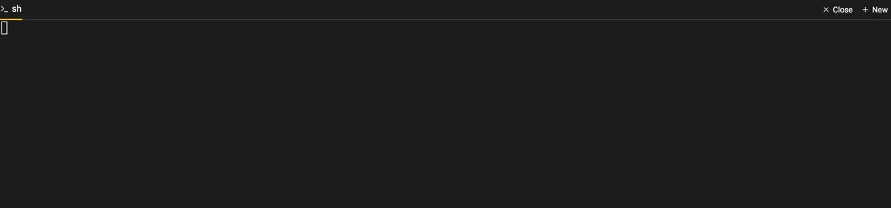

# Terminal guide

<!--
Evidence: terminal/panel/src/{lib,panel,header,keys,view}.rs;
subspace-framework/host/app/src/app/{terminal_dock,shell/dock}.rs and src/terminal.rs;
terminal/runtime/src/{clipboard,close_policy,exit,command,program,
view/clipboard,view/keys,pointer}.rs; terminal/ghostty-config/src/paths.rs;
docs/terminal.md.
Not checked in this pass: any running shell, Zig build, ConPTY session or input
method. The terminal crates need Zig and are excluded from the normal workspace.
-->

## Overview

The terminal runs local shell sessions in tabs inside Subspace. It is a panel
that the window docks beside every Space, the way the chat is, rather than a
Space of its own. It uses libghostty for terminal emulation and reads your
Ghostty configuration and themes.

The terminal is built only when the Cargo feature `terminal` is on. For now
only debug builds turn it on (`make run` and `make install-macos`); release
builds do not include it. Platforms are macOS arm64, Linux x64 and Windows
x64. Windows support is experimental.

Press ``Ctrl+` `` (Ctrl and the backtick key, on every platform) to show or
hide the terminal, or select **Terminal** in the toolbar, **View > Terminal**
in the menu bar, or **Show terminal** in the command palette. To show this
guide, choose **Terminal help** in the command palette, or choose **Help**
while the terminal has focus.

## Before you start

- The terminal needs a build with the `terminal` feature. Without it there is
  no terminal button, menu item, palette command, Settings page or key.
- The terminal runs your own shell with your own permissions. It does not
  sandbox the shell. Anything you type has the access that your account has.
- No sign-in or credentials are used. Subspace does not read or save the
  contents of your sessions.
- The shell is the Ghostty `command` value when set, otherwise `$SHELL` as a
  login shell. When `$SHELL` is empty or unset, Subspace uses `/bin/sh`. On
  Windows it is `SHELL` when set, otherwise `pwsh.exe` from `PATH`, then
  `powershell.exe`, then `ComSpec`, then `cmd.exe`. Windows needs version 1809
  or later (ConPTY).
- If `$SHELL` names a missing or non-executable file, Subspace reports that
  shell instead of switching silently to `/bin/sh`.
- The start directory is the Ghostty `working-directory` value (`home`, an
  absolute path or `~/…`), otherwise your home directory. On Windows the home
  directory is `HOME`, or `USERPROFILE` when `HOME` is unset.
- The session sets `COLORTERM=truecolor`. `TERM` is the Ghostty `term` value, or
  `xterm-ghostty` when its terminfo is found, or `xterm-256color`.
- Building the feature needs Zig 0.16.0 through the Terminal mise environment.
  See [Limits](#limits). Machines behind a TLS-intercepting proxy can prefetch
  the Zig packages with the `terminal-deps` task in the same environment.

## Main view

The terminal is a header above one session. The header holds the tabs, the
tab buttons and the layout buttons.

- Each tab shows an icon and a title. The title is what the program last set
  with the terminal title sequence. Otherwise it is the shell's file name, for
  example `zsh`. A title longer than 28 characters is truncated. A tab whose
  session could not start is titled `Failed`.
- At the right of the tabs are **Close** and **New**. Their tooltips are
  `Close terminal tab (Cmd+W)` and `New terminal tab (Cmd+T)` on macOS, and
  `Close terminal tab (Ctrl+Shift+W)` and `New terminal tab (Ctrl+Shift+T)`
  elsewhere. The layout buttons follow; see
  [Toolbar and filters](#toolbar-and-filters).
- The first time you show the terminal, it loads your Ghostty configuration and
  opens one session. Hiding it and showing it again does not start another
  one. Sessions keep running and keep receiving output while the terminal is
  hidden and while you switch Spaces. Subspace remembers whether the terminal
  was shown and shows it again at the next start, with a new session.
- The session draws a character grid using the font from **Settings > Terminal**.
  Automatic uses Ghostty first, then the default Terminal.app profile on macOS,
  then the code font in Subspace Appearance. Ghostty also sets colors and
  padding; unset colors follow the Subspace theme. Bold, faint, italic,
  underline, inverse, strike-through, hidden and blinking text, 256 colors and
  24-bit color are drawn. A double-width character uses two cells. The cursor
  follows the program's requested shape and blink and is hollow when the
  session is not focused.
- Resizing the window, dragging the terminal's edge, moving the terminal or
  changing the font recomputes the rows and columns and tells the program its
  new size.
- The mouse wheel, the scrollbar and `Shift+Page Up` and `Shift+Page Down` move
  through scrollback. New output follows the bottom only while the view is at
  the bottom.
- When a program ends, the tab keeps its final screen and scrollback and adds a
  last line `[process exited with code N]`, or `[process exited with signal
  NAME]` for a signalled program. A **Restart** button appears below the
  session.
- With no tab, the view says `No terminal session` and `Open a new tab to start
  a terminal session.` with a **New tab** button.
- When a session cannot start, the tab shows `Terminal failed to start`, the
  failing program or operation with the system message, and a **Retry** button.
  Other tabs keep working.

<!-- Screenshot omitted: no screenshot is registered for this guide yet. The
dev binary must be built with the terminal feature (Zig). If the owner builds it
with an empty HOME and XDG directories, three states need no account data:
the first session, `No terminal session`, and `Terminal failed to start` with
SHELL set to a missing path. A shell prompt shows the empty directory name only.
Use `/bin/sh` as the shell and a synthetic prompt. -->

## Toolbar and filters

The header's layout buttons are glyphs. Each says what it does in its tooltip.
To show their text as well, right-click the header and choose **Show button
labels**, or turn on **Show text on terminal layout buttons** in **Settings >
Layout**. The text is off by default.

- **Move left**, **Move to bottom** and **Move right** dock the terminal at
  that edge. The button for the current edge stays pressed. The terminal pushes
  the Space aside rather than covering it. On the left or the right, the chat
  stays at the window's right edge.
- **Full window width** shows only while the terminal is at the bottom. By
  default a bottom terminal sits below the Space, beside the chat, and the chat
  keeps the full window height. With **Full window width** pressed, the
  terminal spans the whole window below the Space and the chat.
- **Maximize** fills the whole window body with the terminal, covering the
  Space and the chat. The title bar, Space navigation and status bar stay.
  **Restore**, hiding the terminal or switching Space returns to the docked
  layout. Subspace does not remember the maximized state.
- **Hide terminal** (``Ctrl+` ``) hides the terminal and returns focus to the
  Space. Its sessions keep running.
- Drag the edge between the terminal and the Space to resize it. The bottom
  height and the side width are kept separately and remembered. The terminal
  never takes more than 60% of the space it shares.

Layout button changes apply and are saved at once. **Settings > Layout** offers
the same placement, bottom width and button text choices, applied on Save.

- **Reload** (`Cmd+R` on macOS, `Ctrl+Shift+R` on Linux, `Ctrl+R` on Windows)
  while the terminal has focus rereads Ghostty configuration and themes.
  It applies colors, fonts, padding, cursor defaults, clipboard and close
  rules to every open session at once, without restarting Subspace. The settings
  `command`, `working-directory` and `term` affect only tabs that you open
  after the reload. Subspace does not watch the files, so editing a file changes
  nothing until you reload. A changed Subspace appearance also recomputes
  token-derived colors and fonts, including the half of a `light:` / `dark:`
  theme pair that matches the new appearance.
- The status area shows configuration warnings as `⚠ <warning>`, joined with
  ` · `. A warning names the file and line of an invalid value, a missing theme
  or a missing include.

## Details

The terminal has no detail panel. The selected tab is the whole detail.
Session text stays in the program's scrollback and is not written to a file.

- A tab title and the program name come from the program. Treat them as
  untrusted text from whatever runs in the session.
- A selection can be copied. See [Copy and paste](#copy-and-paste).
- The terminal shows no list of past sessions. Subspace does not save or
  replay sessions. See [Limits](#limits).

## Actions

### Open and switch tabs

1. Select **New** or press the new-tab key while a session has focus.
2. Select a tab, or use the next-tab and previous-tab keys, to switch.
3. Select **Close** or press the close-tab key to close the selected tab.

Subspace sets no limit on the number of tabs. Opening a tab starts a new
session. Closing a tab ends its session.

### Close a tab that is busy

When the selected tab runs a program other than its own shell, **Close** and
the close-tab key first show the dialog `Close terminal tab` with
`A foreground program is still running.` Choose **Cancel** to keep the tab or
**Close** to end it. A tab at its shell prompt, or whose program has exited,
closes at once. The Ghostty `confirm-close-surface` value changes this rule:
`false` never asks, `true` keeps the busy-program rule, and `always` always
asks. On Windows a session never reports a busy program, so closing does not
ask unless `confirm-close-surface = always`.

Closing the pseudo console ends the attached programs. On Windows a shell that
stays is stopped after a short wait.

### Restart or retry a session

Select **Restart** below an ended session to start a new session in that tab.
Select **Retry** on a failed start. Fix the cause first, for example the
`SHELL` path or the missing program the message names.

### Copy and paste

- **Copy** puts the selection on the system clipboard. It keeps line breaks and
  removes the padding that wrapped lines add. It does nothing without a
  selection.
- **Paste** sends the clipboard text to the program. It wraps the text in
  bracketed-paste markers when the program has turned that mode on.
- Right-click the session for **Copy** and **Paste**. The menu does not appear
  while the program uses mouse reporting.
- With `clipboard-paste-protection = true` (the default), a paste that holds a
  line break and is not sent in bracketed mode asks first. The dialog is
  `Paste into the session?`, says that the text holds a line break so the
  program would run it as soon as it arrives, shows the first 400 characters
  and offers **Cancel** and **Paste**. `clipboard-paste-bracketed-safe = true`
  (the default) treats bracketed pastes as safe. The rule applies to clipboard
  paste, not to text you type.
- Without mouse reporting, dragging selects text, a double click selects a word
  and a triple click selects a line. A finished selection is also copied as
  `copy-on-select` says. When the program enables mouse reporting, the terminal
  reports clicks, drags and wheel events to it and starts no selection.
- A program can set the clipboard with an OSC 52 write unless `clipboard-write`
  is `deny` or `ask`. A clipboard read from a program is refused unless
  `clipboard-read = allow`. The terminal has no prompt, so `ask` acts as `deny`.

### Input

Subspace sends printable keys, Enter, Tab, Backspace, Delete, arrow, Home, End,
Page and keypad keys, and every Ctrl and Alt combination that Subspace does not
use, to the program, encoded for its current mode. Input method and dead-key
input are supported. Pre-edit text is shown in place and clipped to the cells
left on the cursor's row. Only committed text is sent. A `keybind` line with a
`text:`, `esc:` or `csi:` action sends those bytes for its trigger key. Other
`keybind` actions, and `global:`, `all:` or `unconsumed:` prefixes and key
sequences, are ignored. Subspace and terminal keys take precedence over a `keybind`
for the same key.

### Agent tools

The terminal adds no Copilot or MCP tool and runs no shell command for an
agent.

## Keyboard shortcuts

``Ctrl+` `` shows and hides the terminal on every platform, also while a
session has focus. Tab keys act while a session has focus.

| Action | macOS | Linux and Windows |
| --- | --- | --- |
| Show or hide the terminal | ``Ctrl+` `` | ``Ctrl+` `` |
| New tab | `Cmd+T` | `Ctrl+Shift+T` |
| Close tab | `Cmd+W` | `Ctrl+Shift+W` |
| Next tab | `Cmd+>` | `Ctrl+Page Down` |
| Previous tab | `Cmd+<` | `Ctrl+Page Up` |
| Copy | `Cmd+C` | `Ctrl+Shift+C` |
| Paste | `Cmd+V` | `Ctrl+Shift+V` |

`Cmd+<` and `Cmd+>` mean `Cmd` with the key that types `<` or `>` on your
keyboard layout. For example, they are `Cmd+Shift+,` and `Cmd+Shift+.` on a US
layout.

While a session has focus, plain keys go to the program. On macOS, `Cmd` keys
keep their Subspace meaning and `Ctrl` keys go to the program. On Linux, plain
`Ctrl` keys go to the program and Subspace keys use `Ctrl+Shift`.

| Shell key | macOS | Linux | Windows |
| --- | --- | --- | --- |
| Command palette | `Cmd+K` | `Ctrl+Shift+K` | `Ctrl+K` |
| Reload | `Cmd+R` | `Ctrl+Shift+R` | `Ctrl+R` |
| Settings | `Cmd+,` | `Ctrl+Shift+,` | `Ctrl+,` |
| Quit | `Cmd+Q` | `Ctrl+Shift+Q` | `Ctrl+Q` |
| Toggle Chat | `Cmd+Shift+C` | `Super+Shift+C` | `Ctrl+Shift+C` |
| Add to Chat | `Cmd+Shift+A` | `Ctrl+Shift+A` | `Ctrl+Shift+A` |

The Windows column follows the key bindings in source. On Windows, Toggle Chat
and Copy both use `Ctrl+Shift+C`. Which one acts while a session has focus, and
how `Ctrl+K`, `Ctrl+R` and `Ctrl+Q` behave there, was not checked.

`Cmd+1` to `Cmd+9` (`Ctrl+1` to `Ctrl+9` on Linux and Windows) switch to the
Space at that position, also from a focused session. `F1` to `F12` switch
Spaces only when no session has focus. With a session focused they go to the
program, so `htop` keeps `F9` and `F10`. `Ctrl+Tab` does not switch Spaces.

Typing in a session, the paste dialog or the close dialog is ordinary input,
not a shortcut.

The Help panel lists the toggle key and the four tab keys with `Cmd/Ctrl` shown as one key.

## Settings

Open **Settings** and choose **Terminal** under **Application**.

Under **Font**, choose an installed fixed-width **Font family** and enter a
**Font size** from 8 to 48 points. Select **Automatic** for the family or clear
the size to inherit that value independently. **Save** updates open and new
sessions without restarting them. **Cancel** discards the changes. The
choices are saved as `fontFamily` and `fontSize` in the config file's
`terminal` object.

**Settings > Layout** has **Terminal placement** (Left, Bottom or Right),
**Bottom terminal width** (Beside the chat or Full window width) and **Show
text on terminal layout buttons**. They apply on Save.

Automatic uses Ghostty first. On macOS, if the configured family is
unavailable, Subspace uses the family, weight and size from the default
Terminal.app profile. A Ghostty size on its own still applies. When the
Terminal.app font is unavailable, Subspace falls back to its code font. Use
**Reload** after changing the Ghostty files or the Terminal.app profile.

**Settings > General > Confirm before quitting** (off by default) is an
application setting. When it is on, quitting shows a dialog that lists any
programs that still run in a session other than the shell.

### Ghostty configuration

Subspace reads these files in this order. Later values override earlier values:

1. `$XDG_CONFIG_HOME/ghostty/config`, then `config.ghostty` (`~/.config` when
   `XDG_CONFIG_HOME` is unset).
2. On macOS, `~/Library/Application Support/com.mitchellh.ghostty/config`, then
   `config.ghostty`.
3. The Subspace layer `~/.config/subspace/ghostty/config`, then `config.ghostty`.

On Windows the Ghostty configuration is read from `%USERPROFILE%\.config\ghostty`,
or from `XDG_CONFIG_HOME` when it is set.

`config-file` includes are followed relative to the including file. A `?` marks
an optional file. A cycle stops with a warning. Subspace never writes a Ghostty
file. For a named `theme`, Subspace searches the Subspace layer `themes`
directory, then `$XDG_CONFIG_HOME/ghostty/themes`, then the Ghostty resources
`themes` directory. An absolute theme path is used directly. `light:A,dark:B`
selects by the current Subspace appearance. Configuration colors override theme
colors.

Supported keys: `background`, `foreground`, `cursor-color`, `cursor-text`,
`palette`, `selection-background`, `selection-foreground`, `cursor-style`
(`block`, `bar`, `underline`, `block_hollow`; default `block`),
`cursor-style-blink` (default `true`), `font-family` and its bold, italic and
bold-italic forms, `font-size`, `adjust-cell-height`, `scrollback-limit`
(bytes; default 10,000,000), `term`, `command`, `working-directory`,
`clipboard-read` (default `ask`), `clipboard-write` (default `allow`),
`clipboard-paste-protection` (default `true`),
`clipboard-paste-bracketed-safe` (default `true`), `copy-on-select`,
`confirm-close-surface`, `mouse-scroll-multiplier` (default `1`),
`window-padding-x` and `window-padding-y` (default `2` points), `keybind`,
`theme` and `config-file`. Subspace ignores other keys without a warning.
A supported key with an invalid value keeps its default, keeps the other
settings and adds a warning with the file and line. An empty value clears an
optional value or restores the default.

`copy-on-select` accepts `none`, `primary`, `clipboard`, `both` and `true`. The
primary selection exists only on Linux. `true` means primary on Linux and
clipboard on macOS. On Windows, `true` copies to the clipboard and the default
copies nothing.

Subspace reads no secret from these files. Do not put credentials in `command`.

## Troubleshooting

| Symptom | Check or action |
| --- | --- |
| There is no terminal | The build has no `terminal` feature. Release builds do not include it yet; use a debug build (`make run`). |
| `Terminal failed to start` | Read the program or operation and the system message. Fix the `SHELL` path or the Ghostty `command`, then select **Retry**. |
| `Terminal configuration is not loaded` | The terminal has not loaded its configuration yet. Hide and show it again, or reload. |
| A `⚠` warning in the status area | Open the named file at the named line, correct the value and reload. |
| Config edits do nothing | Reload. Subspace does not watch the files. `command`, `working-directory` and `term` apply only to new tabs. |
| The program ended but the tab stays | This is intended. Read the final screen, then select **Restart** or **Close**. |
| The Space is gone | The terminal is maximized. Select **Restore** in its header, or switch Space. |
| Function keys do not switch Spaces | A session has focus, so `F1` to `F12` go to the program. Use `Cmd+1` to `Cmd+9` (`Ctrl+1` to `Ctrl+9`), or click outside the session. |
| `Ctrl+C` does not copy on Linux or Windows | Copy is `Ctrl+Shift+C`. Plain `Ctrl+C` interrupts the program. |
| Pasting asks for confirmation | The text holds a line break and the program is not in bracketed-paste mode. Read the preview, then choose **Paste** or **Cancel**. |
| A paste is refused or a program cannot read the clipboard | `clipboard-read` defaults to `ask`, which acts as `deny`. Set `clipboard-read = allow` only when you trust the program. |
| Windows closes a tab without asking | A Windows session never reports a busy program. Set `confirm-close-surface = always`. |

A successful start of a shell does not prove that the programs inside it are
safe or that a network service is reachable.

## Limits

- Platforms: macOS arm64, Linux x64 and Windows x64. Windows is experimental
  and has had little desktop use. Report the Windows version, the shell and the
  steps that caused a problem. On Windows, copy and paste are `Ctrl+Shift+C` and
  `Ctrl+Shift+V`, and the Ghostty `copy-on-select` primary selection does not
  exist.
- Build: the terminal crates are separate Zig workspaces and are excluded from
  `make check`. Their gate is `make check-terminal`. Release builds do not
  include the terminal yet.
- One terminal per window. Dragging the terminal to an edge is not supported
  yet; use the layout buttons.
- Sessions, tab sets and scrollback do not survive a restart. Subspace writes
  no session content, command text or scrollback to `state.json` or a cache
  file. A restart starts with one fresh session.
- Scrollback is capped at `scrollback-limit` bytes per session (default
  10,000,000).
- No Kitty graphics and no session restore. The terminal does not use the
  desktop-notification API of programs.
- Only the Ghostty keys listed under [Settings](#settings) apply. Window,
  shader and title-bar keys are ignored.
- Quitting ends every session. Hiding the terminal keeps shells running until
  Subspace quits.
- **Not checked in this pass:** a running shell, input methods, ConPTY, Linux
  primary selection, theme discovery on a real Ghostty install, clipboard
  behavior on each platform. These statements come from
  source, tests and change records.
- The screenshot shows the first tab of the former Terminal Space in a
  directly launched macOS development build with an isolated HOME. It predates
  the docked terminal's header buttons. It does not show command
  execution or verify clipboard or remote connectivity.
