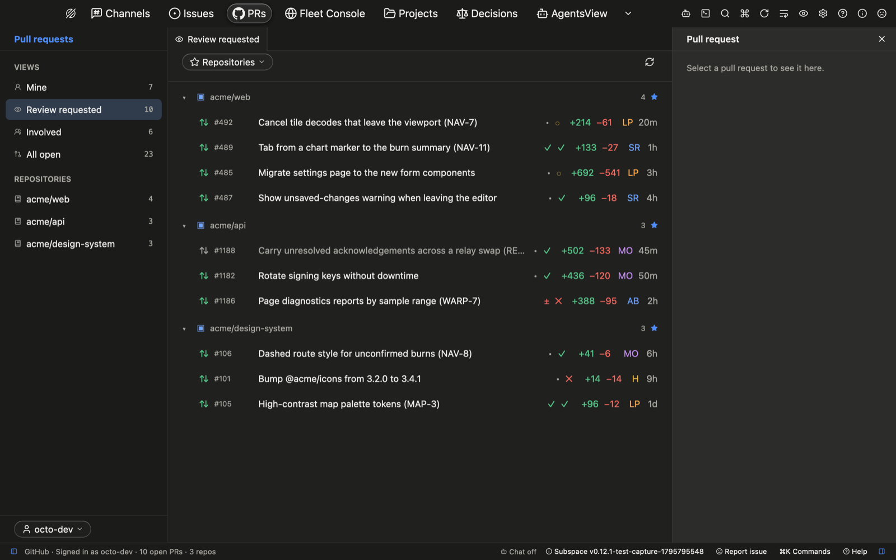
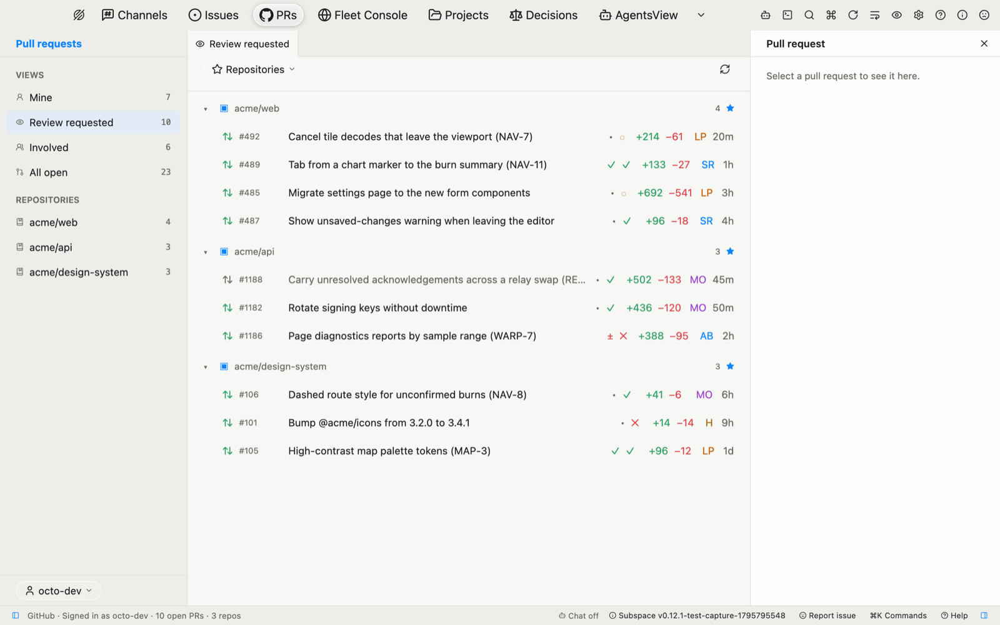
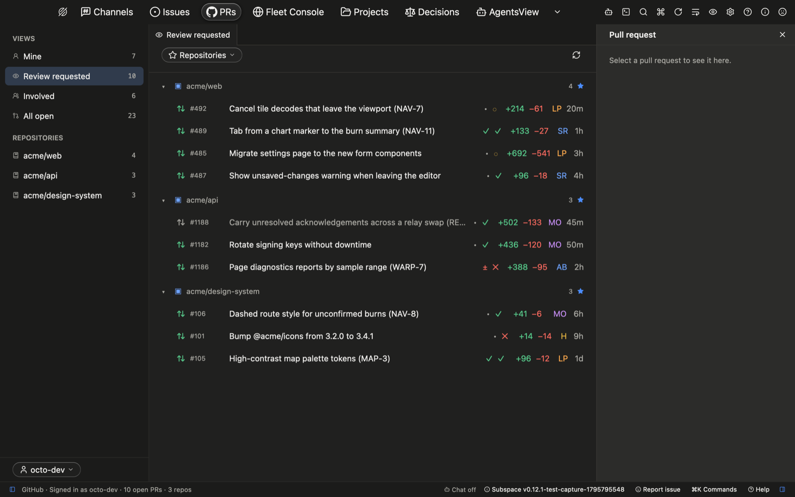
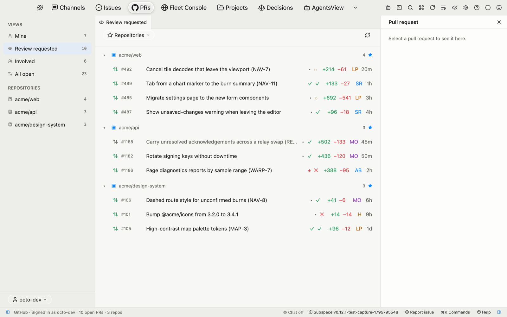
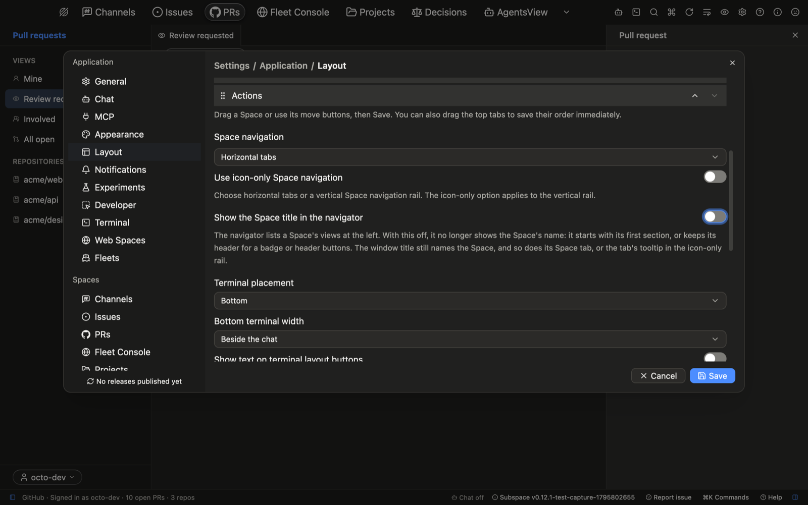
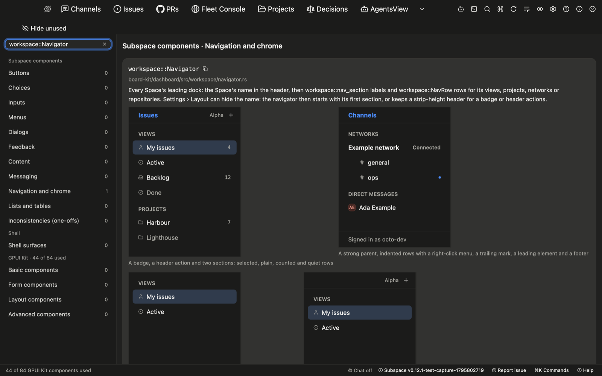

# Hide the Space title in the navigator

## Intent

The navigator starts with the Space's name in the accent colour. The window
title and the Space tab, or the tab's tooltip in the icon-only rail, already
name the Space, so some people and some
apps want the navigator to start with its first section instead. A product
built on the Framework asked for a way to hide the title by default, and
for people to choose for themselves.

## Change

- **Setting.** Settings › Layout has **Show the Space title in the
  navigator**, saved as `layout.navigator-title` (`"1"` or `"0"`) in the
  state file. Like the other Layout settings it is a draft until Save. The
  other Layout settings have no palette command, so this one has none.
- **App default.** `ProductBuild::navigator_title` sets the default for
  people who have not chosen. `ProductBuild::new` sets `true`, and the
  Subspace App sets `true` in its struct literal, so neither changes. A
  saved choice always wins over the app default.
- **Navigator.** `workspace::navigator_title` holds the default and the
  saved choice and answers `shown(cx)`. With the title hidden:
  - a navigator with no badge and no header actions has no header and
    starts with its first section, and it draws no line at the strip
    height;
  - a navigator with a badge or header actions keeps its header at the
    strip height without the title, so its hairline still lines up with
    the pane's tab strip.
  - the badge and header actions stay on the trailing edge.
  The navigator always passes the title on as its tree's accessible name.
- **Saving.** Settings stages the choice inside the state file write, which
  restores the preferences if the write fails, and accepts the draft only
  after the write succeeds.
- **Who sets it.** The default global and the saved key are private. The
  setters are public for the host app only and hidden from the docs, so a
  Space cannot override the person's choice. The Component gallery uses a
  hidden `navigator_title::preview` to show both hidden-title states.
- **Breaking.** `ProductBuild` gains a public field, so an app that builds it
  field by field must set `navigator_title`; `true` keeps the old
  behaviour. The Framework README has an upgrade note.
- **Design guide.** The navigator zone, the strip rule, rule 7 and the
  review checklist say what the setting does.

## Tests

- `navigator_title_tests`: the title shows by default; a hidden default
  removes the header and the body starts at the navigator's top; a saved
  `"1"` shows the title over a hidden app default.
- `navigator_title_tests`: with a badge and an action, a hidden title keeps
  `workspace-navigator-header` at the strip height, lined up with the
  pane's strip; the action stays trailing; the tree keeps the Space's name.
- `toolbar_tests`: a failed state file write keeps the live title and the
  draft.
- Component gallery: the Navigator card draws both hidden-title states.
- `pre_startup`: `ProductBuild::new` shows the title.
- `toolbar_tests`: the Layout switch is a draft until Save, then saves
  `layout.navigator-title` as `"0"` and reopens with the switch off.

## Evidence

Fixture captures from `make capture` (PRs Space, fictional data), scaled to
1600 px. `before` is `main` before this change; `title-shown` is this
branch's default, the same view; `title-hidden` comes from turning the
switch off in Settings › Layout and choosing Save in the same run.

| View | Dark (Cupertino Dark) | Light (Cupertino Light) |
| --- | --- | --- |
| Before |  |  |
| Title shown, the default |  |  |
| Title hidden after Save |  |  |

The switch turned off before Save: the navigator behind the dialog still
shows the title, as the choice is a draft until Save.

The Component gallery's Navigator card, with both hidden-title samples
under the two existing ones:

