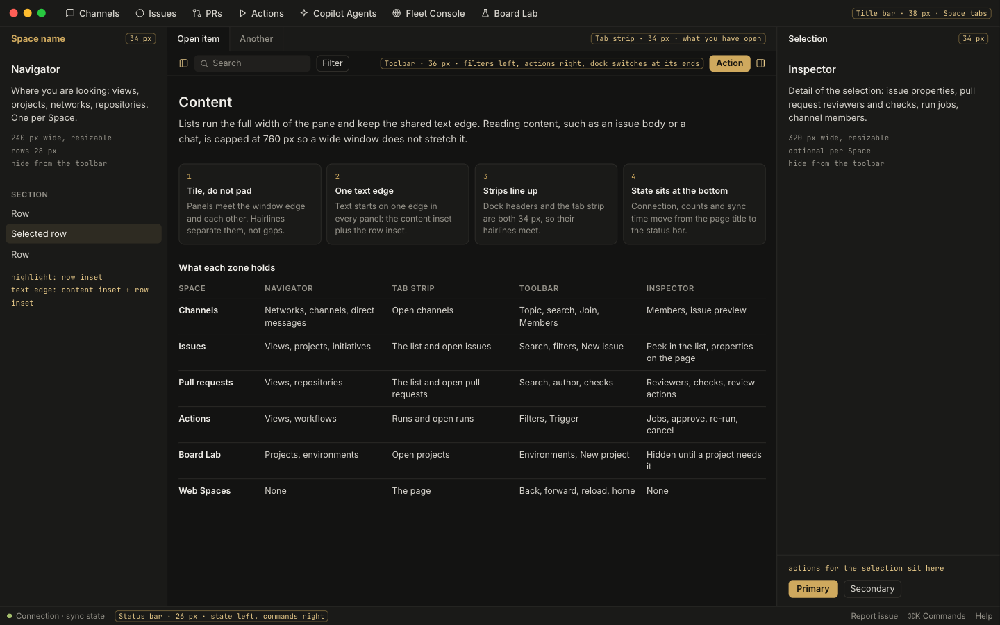

# Design guide

This page says how a Space must look and be laid out. Every Space uses the
same workspace shell, so the app feels like one app. What a Space shows
differs; where it shows it, and how it behaves, does not.

It builds on three other pages:

- The GPUI Kit [Design Guides](https://gpui-kit.com/docs/design-guides.md),
  also in the `gpui-kit-design-guides` skill in
  [.agents/skills](../.agents/skills/gpui-kit-design-guides/SKILL.md), are
  the base: task hierarchy, desktop conventions, spacing and language. This
  page adds what is particular to Subspace.
- The [UI component catalogue](ui-components.md) says which component to use
  and who owns it. The rules there still apply.
- [What the Framework gives a board](board-integration.md) lists the hooks a
  Space implements, including the
  [workspace layout](board-integration.md#workspace-layout) in short.



*The workspace shell's zones: navigator, tab strip, toolbar, content,
inspector and status bar.* The image lives in [images/](images/README.md).

## The zones

The shell is `dashboard::workspace` in `board-kit/dashboard`. A Space in an
app imports it as `subspace_framework::dashboard::workspace`.

| Zone | Holds | Never holds | Size |
| --- | --- | --- | --- |
| Navigator, the leading dock | The Space's name in its header, then where you are looking: views, projects, networks, repositories, groups. The signed-in account may sit in its footer. | Filters, actions on the selection, the detail of an item. | `--nav-w` wide; header `--strip-h` high; rows `--row-h` high |
| Tab strip, the top of the pane | What is open: the list or view on show, and an opened item beside it. | The Space's views; those are navigator rows. | `--strip-h` high |
| Toolbar, under the tab strip | Search and filters on the leading side, actions for what is open on the trailing side. | A Space title, a line of context, actions that need a selection to make sense, the dock switches. | at least `--toolbar-h` high |
| Content | The list, the page, the conversation or the graph. | A heading for the Space, its own outer padding. | the rest of the pane |
| Inspector or detail panel, the trailing dock | The detail of the selection, with the actions that act on it in its footer. | Views, filters, the Space's own state. | `--inspector-w` wide, or the detail panel's own width; header `--strip-h` high |
| Status bar, the shell's | Account, connection, counts and sync time, from `Dashboard::status`; the navigator's switch at its leading end and the inspector's at its trailing end, from `Dashboard::docks`. | Any other control of the Space's. Besides the dock switches, it holds only the shell's own commands, such as About and Help. | the shell's |

Inside every panel, text starts at `--pad-x` plus `--row-inset`. The defaults
are a 240 px navigator, a 320 px inspector and a 34 px strip; the theme sets
the rest. The [appearance](appearance.md) page and the theme designer's
Window group hold the values.

Above the Space, the title bar's Space tabs end with a plus, **Add a Space**
(at the end of the navigation rail when that layout is on). Its menu lists
the Spaces that are switched off, each with its glyph, title and one-line
description, and ends with **Manage Spaces…**. Choosing a Space turns it on
as its Settings switch and Save do, and opens it; when the change waits for
a restart, the app opens on that Space when it starts again. A Space adds
nothing to this control.

## The rules

1. **Panels tile to the window's edges.** The docks and the pane meet the
   window and each other, separated by hairlines. A Space has no outer
   padding and no margin around the workspace. The room is inside each
   panel. In a narrow window the docks give up width first, so the pane
   keeps at least `workspace::PANE_MIN_WIDTH_PX` (320 px) and nothing runs
   past the workspace's edge. A `Workspace::detail` panel yields the same
   way.
2. **One text edge.** Text starts at `workspace::text_edge(&tokens)`, the
   content inset plus the row inset, in every panel: dock headers, navigator
   rows, the toolbar, list rows and the content. A Space has no side inset
   of its own. A shared list Space returns the text edge from
   `ListDashboard::list_side_inset`.
3. **Strips line up.** Dock headers and the tab strip share `--strip-h`, so
   the hairlines under them run across the window as one line.
4. **Lists run full width; reading is capped.** A list uses the pane's whole
   width. Reading content, such as an issue's body or a conversation, is no
   wider than `workspace::READING_WIDTH_PX` (760 px).
5. **Views live in the navigator.** A Space's views are `NavRow`s. The tab
   strip is for what is open, never for switching views.
6. **State goes to the status bar.** Account, connection, counts and sync
   time go through `Dashboard::status`. There is no large Space heading and
   no line of context above the content; the Space's name is the
   navigator's title.
7. **Selection shows through the row's own fill.** No leading bars, no
   coloured edges.
8. **One primary action per toolbar.** A pane toolbar has at most one
   primary action: the Space's main one, at the trailing end, such as
   **New issue…**, **Trigger…** or **New project**, built with
   `action::main_action`. Every other toolbar action is neutral or quiet. In
   a dialog or a footer, `Intent::Primary` marks the action that completes a
   decision, such as Save.
9. **Shared components and tokens only.** No literal colours or sizes, no
   one-off styled controls. Read sizes from `Tokens::current(cx)`.

## Interaction in list Spaces

- One click on a row selects it and loads it in the inspector or detail
  panel. It does not open the item.
- A double click, Enter or an Open control opens the item.
- Actions that act on the selection sit with it, in the inspector's footer
  or the detail panel's footer (`ListDashboard::panel_footer`). Do not add a
  row of buttons to the toolbar that stay disabled until something is
  selected.
- Each Space remembers whether its navigator and its inspector show, both
  shown by default, and reports both through `Dashboard::docks`. The shell
  puts their switches at the two ends of the status bar.
- With the navigator hidden, its views stay reachable from a view menu at
  the start of the toolbar, a `menu_button` that names the current view.
- Navigator rows are tree items (`Role::TreeItem`) in a tree
  (`Role::Tree`) named after the Space. Tab reaches them, the list keys
  (down or j, up or k) move between them, and Enter or Space chooses one.
  A click chooses a row without taking the keyboard focus, so j and k keep
  driving the list. A row reached from the keyboard shows its focus as an
  accent border on its fill.

## Context menus

Every right-click menu is built from the same seven groups in the same
order, with a separator between groups that have commands. A Space fills
groups in; it never orders them. A group with nothing in it is left out.

| Group | Holds | Examples |
| --- | --- | --- |
| 1. Open | The default action first, showing its key, then the item's page elsewhere. | **Open** (Enter), **Open in GitHub**, **Open to the right** |
| 2. Act | The item's own verbs, with submenus for choices. | **Join**, **Refresh repository**, **Add `owner/name` to favourites** |
| 3. Copy | The selected text, then the item's facts. | **Copy**, **Copy link**, **Copy title**, **Copy id** |
| 4. Chat | Sending the item or the selection to the chat. | **Add to chat**, **Add selection to chat** |
| 5. View | The container's commands. | **Fold group**, **Unfold group** |
| 6. Remove | Commands that remove or leave something, last but one. | **Leave channel**, **Close Space** |
| 7. Place | Settings for the place. | **Space settings…** |

The rules:

- **Every command has a Lucide glyph** in the menu's icon slot.
- **Right-click selects first.** The highlighted row is always the one the
  menu acts on. Shared list rows, group headers and `workspace::NavRow`
  select the line before the menu opens. Right-clicking the navigator row
  that is already selected only opens its menu.
- **A blocked list keeps what still works.** While a dialog of the Space's
  blocks navigation, a list row's menu cannot select its row. It keeps
  Open in and the copies, shows Open, Add to chat and Fold or Unfold
  disabled with the reason "Finish the open dialog first.", and leaves out
  the Space's own commands.
- **Say why not.** A command that exists but cannot run now stays in its
  place, disabled, with one line under it saying why, such as "The last
  open Space can't be closed."
- **Removal comes late and is marked.** The Remove group's glyphs take the
  theme's danger colour. An ellipsis in a label means the command asks
  first. The label itself keeps the menu's text colour, so that it stays
  the item's accessible name in GPUI Kit's native menu.
- **Never the only way.** Each command is also on the toolbar, in the
  inspector or in the command palette, with the same words, glyph and key.

Build a menu with `row_menu::GroupedMenu` and `row_menu::MenuCommand`, and
show it with `row_menu::build` inside `anchored_context_menu`. A shared list
Space describes its rows with `ListDashboard::row_menu` (Open, Open in, the
copies and the chat) and adds its own commands, each in its group, with
`ListDashboard::row_commands`. A navigator row takes a menu through
`NavRow::menu`.

## Build a new Space on the shell

The sketch below is for an imaginary Notes Space. Copy the patterns, not the
names. Working examples in the app's repository: the Actions Space
(`spaces/actions/src/view.rs`, `navigator.rs`, `docks.rs`, `toolbar.rs`,
`panel.rs`), the Copilot Agents Space (`spaces/github-copilot-agents/src/shell.rs`)
and the web Space's toolbar (`spaces/web/src/toolbar.rs`).

1. **The root.** Give the Space's root its key context and focus, then put a
   `Workspace` in it. Leave a dock out to hide it.

   ```rust
   use gpui_kit::component::v_flex;
   use gpui_kit::{
       Context, InteractiveElement as _, IntoElement, KeyContext, ParentElement as _, Render,
       Styled as _, Window, div,
   };
   use subspace_framework::dashboard::{DASHBOARD_CONTEXT, Dashboard as _, Tokens, workspace};

   impl Render for Notes {
       fn render(&mut self, _: &mut Window, cx: &mut Context<Self>) -> impl IntoElement {
           let tokens = Tokens::current(cx);
           // An element declares context names; `view_keys` is a binding
           // predicate and must not be parsed as one.
           let mut context = KeyContext::new_with_defaults(cx.platform_info().os);
           context.add(DASHBOARD_CONTEXT);
           context.add(Self::ID);
           let shell = workspace::Workspace::new("notes-workspace").pane(self.pane(cx));
           let shell = if self.docks.navigator {
               shell.navigator(self.navigator(cx))
           } else {
               shell
           };
           let shell = match self.inspector(cx) {
               Some(inspector) if self.docks.inspector => shell.inspector(inspector),
               _ => shell,
           };
           v_flex()
               .size_full()
               .key_context(context)
               .track_focus(&self.focus)
               .bg(tokens.bg)
               .text_color(tokens.fg)
               .child(div().flex_1().min_h_0().child(shell))
       }
   }
   ```

2. **The navigator.** Name it after the Space, then add sections and rows.

   ```rust
   fn navigator(&self, cx: &Context<Self>) -> workspace::Navigator {
       workspace::Navigator::new(Self::TITLE)
           .child(workspace::nav_section("Views", cx))
           .children(View::ALL.map(|view| {
               workspace::NavRow::new(format!("notes-view-{}", view.title()), view.title())
                   .icon(view.icon())
                   .selected(self.view == view)
                   .on_click(cx.listener(move |this, _: &ClickEvent, _, cx| {
                       this.set_view(view, cx)
                   }))
           }))
           .footer(self.account_line())
   }
   ```

   `NavRow` also takes `count`, `leading`, `trailing`, `quiet`, `strong` and
   `indent`.

3. **The pane.** A tab strip naming what is open, the toolbar, then the
   content.

   ```rust
   fn pane(&self, cx: &mut Context<Self>) -> workspace::Pane {
       let tabs = tabs::pane_tab_bar("notes-open-tabs")
           .selected_index(0)
           .child(tabs::tab(TabSpec::new(self.view.title(), self.view.icon())));
       workspace::Pane::new("notes-pane")
           .tabs(tabs)
           .toolbar(self.toolbar(cx))
           .child(self.content(cx))
   }

   fn toolbar(&self, cx: &mut Context<Self>) -> workspace::Toolbar {
       let bar = workspace::Toolbar::new("notes-toolbar");
       // Hidden, the navigator's views stay one menu away.
       let bar = if self.docks.navigator {
           bar
       } else {
           bar.leading(self.view_menu(cx))
       };
       // The Space's one main action is the toolbar's only primary button.
       bar.leading(self.search_field(cx)).trailing(
           action::main_action("notes-new", IconName::Plus, "New note…")
               .on_click(cx.listener(|this, _: &ClickEvent, window, cx| this.new_note(window, cx))),
       )
   }

   fn search_field(&self, cx: &Context<Self>) -> impl IntoElement {
       div()
           .w(px(SEARCH_WIDTH_PX))
           .child(fields::toolbar_search(&self.search, "Search notes", cx).id("notes-search"))
   }
   ```

   The tab strip names what is open with `tabs::pane_tab_bar`: each tab is
   as tall as the strip, and the open one takes the content's surface. An
   opened item's tab shows its key with `TabSpec::key`, such as `SUB-12`,
   before its title. Name a filter by its label alone with
   `action::filter_button`; quiet text that states a fact, such as how the
   list is grouped, is a `toolbar_label::label` without a glyph.

   A shared-list Space keeps the list's own detail panel instead. Draw the
   tab strip and toolbar with `workspace::pane_head`, and the list under them
   with `list::render_under`, which puts the detail panel beside both at full
   height:

   ```rust
   let head = workspace::pane_head(
       Some(tabs.into_any_element()),
       Some(self.toolbar(cx).into_any_element()),
       cx,
   );
   shell.pane(list::render_under(self, head, window, cx))
   ```

   That Space returns `workspace::text_edge` from `list_side_inset` and puts
   the actions on the selection in `ListDashboard::panel_footer`.

4. **The inspector.** A title, sections of facts, and the actions on the
   selection in the footer. `Inspector::footer` draws the footer bar itself,
   so pass it the buttons.

   ```rust
   fn inspector(&self, cx: &mut Context<Self>) -> Option<workspace::Inspector> {
       let note = self.selected()?;
       let properties = workspace::section("Properties", cx)
           .child(workspace::fact("Author", note.author.clone(), cx))
           .child(workspace::fact("Updated", note.updated.clone(), cx));
       Some(
           workspace::Inspector::new("notes-inspector", note.title.clone())
               .on_close(
                   "Close inspector",
                   cx.listener(|this, _: &ClickEvent, _, cx| this.toggle_inspector(cx)),
               )
               .child(properties)
               .footer(self.archive_button(cx)),
       )
   }
   ```

   A panel that owns its width, such as the shared detail panel
   (`panel::frame`), goes in with `Workspace::detail` instead. Use `detail`
   or `inspector`, not both.

5. **Dock preferences.** Keep two stored choices in `prefs`, both shown until
   hidden, as `spaces/actions/src/docks.rs` does.

   ```rust
   pub(crate) fn toggle_navigator(&mut self, cx: &mut Context<Self>) {
       self.docks.navigator = !self.docks.navigator;
       prefs::set(cx, "notes.navigator", if self.docks.navigator { "shown" } else { "hidden" });
       cx.notify();
   }
   ```

   Load them with `prefs::get(cx, "notes.navigator")`, treating anything but
   `hidden` as shown.

6. **The dock switches.** Tell the shell which docks the Space has and
   whether each shows, and take a switch's click back. The status bar draws
   the navigator's switch at its leading end and the inspector's at its
   trailing end. It draws neither while another surface covers the Space,
   such as the log view, a maximised terminal or zoomed Help.

   ```rust
   use subspace_framework::dashboard::workspace::{SpaceDock, SpaceDocks};

   fn docks(&self, _cx: &App) -> SpaceDocks {
       SpaceDocks {
           navigator: Some(self.docks.navigator),
           // No switch while nothing is selected, as there is no inspector.
           inspector: self.selected().map(|_| self.docks.inspector),
       }
   }

   fn toggle_dock(&mut self, dock: SpaceDock, _window: &mut Window, cx: &mut Context<Self>) {
       match dock {
           SpaceDock::Navigator => self.toggle_navigator(cx),
           SpaceDock::Inspector => self.toggle_inspector(cx),
       }
   }
   ```

   Both are `Dashboard` methods; the defaults report no docks. Keep any
   palette command or key the Space has for a dock on the same toggle.

7. **The status bar.** Put the Space's state in `Dashboard::status`.

   ```rust
   fn status(&self, _cx: &App) -> Option<SharedString> {
       Some(format!("Signed in as {} · {} notes · synced {}", self.login, self.count, self.synced).into())
   }
   ```

8. **Test it.** Unit-test the pure logic (which row is selected, what the
   status says). Add render tests that find the shell's elements by id, such
   as `workspace-navigator` and `workspace-inspector-title`, and test the dock
   contract by calling `Dashboard::toggle_dock` and reading
   `Dashboard::docks`. The shell's own tests find the switches in the status
   bar by their ids, `workspace-navigator-toggle` and
   `workspace-inspector-toggle`. Check the Space in a narrow window with
   both docks shown, then complete the [board checklist](board-checklist.md).

**Compile trap.** `.test_support()` changes an element's type in test builds.
Never call it inside a function whose return type is a concrete `Div` or
`Stateful<Div>`. Return `AnyElement` or `impl IntoElement`, or call
`.test_support()` where the element is used.

## Reviewing a UI change

Screenshots in a pull request are compared with the anatomy image above and
with this page. Content differs per Space; the layout and the feel must not.
A reviewer ticks:

- [ ] Each zone holds what it should, in the same place as the anatomy.
- [ ] Nothing is padded off the window's edge; panels meet the window and
      each other.
- [ ] Text starts on one edge in every panel.
- [ ] The dock headers and the tab strip line up, and their hairlines meet.
- [ ] Views are in the navigator; the tab strip shows only what is open.
- [ ] Account, connection, counts and sync time are in the status bar.
- [ ] There is no large Space heading or line of context.
- [ ] Only shared components and theme tokens are used.
- [ ] Selection shows through the row's fill, with no leading bar.
- [ ] The Space's name in the navigator takes the accent, and section
      labels show in capitals.
- [ ] The open tab joins the content, with no accent line along its top.
- [ ] Each toolbar has at most one primary action, the Space's main one.
- [ ] The dock switches end the status bar, the navigator's first and the
      inspector's last, quiet glyphs that take the accent while on.

## Not yet in the shell

These are designed but not built:

- Keyboard resizing of the docks. Their edges take only the pointer.
